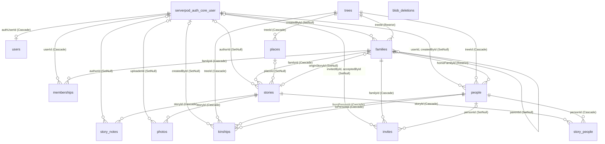

# Schema design — Serverpod 4.1.1 + Postgres 16/17

Target: Serverpod **4.1.1** (verified `SERVERPOD_VERSION` = 4.1.1 in a clone of github.com/serverpod/serverpod at commit `7cfc979`, 2026-11-05). Dev/test DB is Serverpod's embedded Postgres 16; prod is managed PG 16/17. All raw SQL below uses only PG ≥ 15 features. It is **executed and behaviour-tested on Serverpod 4.1.1's embedded Postgres 16** against the real DDL that `serverpod generate` / `create-migration` produce from the §1 YAML, by `apps/server/test/integration/constraints_test.dart` (run with `just server-test`, see §3.4). It has not been run on PG 17. The one feature newer than PG 14 is `ON DELETE SET NULL (column)`, which arrived in PG 15.

Sources: repo migrations `supabase/migrations/*.sql`, `docs/design-doc/data-model.md`, Serverpod docs (latest = 4.x), and Serverpod 4.1.1 source. Doc URLs are cited inline.

---

## 0. Key decisions

### 0.1 Ids are `UuidValue`, generated as UUID v7 in the database

Every table uses `id: UuidValue?, defaultPersist=random_v7`.

- **The auth module already uses this.** `AuthUser` is `id: UuidValue?, defaultPersist=random_v7` (serverpod 4.1.1 `modules/serverpod_auth/serverpod_auth_core/serverpod_auth_core_server/lib/src/auth_user/models/auth_user.spy.yaml`). Using the same id type for everything means one id type in the whole schema.
- **Ids are public-facing.** They appear in router paths, invite flows and blob keys. The docs advise `UuidValue` "when the id is public-facing, needs to exist before the row is stored": https://docs.serverpod.dev/concepts/data-and-the-database/database/tables#choosing-an-id-strategy. Serial ints can be enumerated.
- **Less client churn.** The Flutter client already treats every id as a UUID `String` (for example `apps/tell_me_a_story/lib/data/photos_api.dart:244` `const Uuid().v4()`).
- **v7 over v4.** v7 is time-ordered, which mostly fixes the index-locality cost the docs warn about. `random_v7` maps to a Serverpod-generated `gen_random_uuid_v7()` SQL function, so it does not depend on PG 18's native `uuidv7()`: https://docs.serverpod.dev/concepts/data-and-the-database/models#supported-default-values
- **Why `defaultPersist` and not `defaultModel`.** The server is the only writer. When it needs an id before inserting (to build blob keys for photos, covers or avatars), it sets `id: const Uuid().v7obj()` explicitly. I verified that explicit ids are inserted as given: Serverpod 4.1.1 `packages/serverpod_database/lib/src/adapters/postgres/sql_query_builder.dart:513-524` keeps the `id` column for rows whose `id != null`. Endpoints MUST NOT insert client-built model objects as they are. They build rows on the server; the docs say never treat a client-supplied UUID as proof of ownership.
- **Cost.** 16-byte keys instead of 8. This doesn't matter at family scale.

### 0.2 How the user profile relates to the Serverpod `AuthUser`

- **Identity is `AuthUser.id`** (table `serverpod_auth_core_user`, UUID). Endpoints read it from `session.authenticated?.authUserId` (https://docs.serverpod.dev/concepts/authentication/working-with-users#authenticated-users).
- **Every "user" foreign key points straight at `serverpod_auth_core_user.id`**, using `relation(parent=serverpod_auth_core_user)`. This is the documented id-only form for module tables: https://docs.serverpod.dev/concepts/data-and-the-database/database/relations/modules. Authorization then needs no extra lookup: `memberships.userId == session.authenticated.authUserId`.
- **App-owned profile data lives in a bridge table `users` (class `AppUser`).** It is 1:1 with `AuthUser` through `authUserId` (unique, `onDelete=Cascade`). This is the documented "attaching additional information" pattern: https://docs.serverpod.dev/concepts/authentication/working-with-users#attaching-additional-information. It holds displayName, avatarKey, about, birth fields and birthVisibility.
- **Email is not copied** (the old `profiles.email` and its `sync_profile_email` trigger go away). The verified, lower-cased email already lives in two places:
  - `serverpod_auth_core_profile.email`, which OTP registration sets: `email_idp.dart:386-391`, `UserProfileData(email: result.email)`.
  - `serverpod_auth_idp_email_account.email`, which has a unique index `serverpod_auth_idp_email_account_email`.

  Use the second one for "find account by email" lookups (the old `resolve_person_user`), because it is the indexed one.
- **We don't use the core `UserProfile`'s `fullName` or `image`.** Display name and avatar stay in `AppUser`, for three reasons:
  1. Display name, avatar, about and birth are edited together and are joined with `people` (linked-person name sync and the profile fallback).
  2. The core image pipeline stores images under its own keys, outside our blob scheme.
  3. The core profile's email is populated by the IdP, and we treat it as read-only.
- **When the `AppUser` row is created.** Create it in `AuthUsersConfig.onAfterAuthUserCreated` and pass the provided `transaction` (https://docs.serverpod.dev/concepts/authentication/working-with-users#reacting-to-the-user-created-event). Also add an idempotent `ensureAppUser(session)` on first authenticated call, as a fallback.
- **Account deletion.** Call `AuthServices.instance.authUsers.delete(session, authUserId:)` (same doc page). The cascades are:
  - `users` and `memberships` rows are deleted (Cascade).
  - Authored or uploaded content stays: `stories.authorId`, `photos.uploaderId`, `story_notes.authorId`, `families.createdById`, `people.createdById`, `kinships.createdById` and `invites.invitedById/acceptedById` are set to null (SetNull).
  - The linked person is unlinked: `people.userId` is set to null (SetNull).

  This settles OPEN item 2 in `docs/design-doc/data-model.md` (NO ACTION FKs blocked account deletion). The deletion endpoint must first, in the app layer:
  - delete the user's drafts;
  - refuse, or force an ownership transfer, while the user is the `owner` of a family that has other members.

  Tested: the SetNull path passes every CHECK (§3.4).

### 0.3 Naming and types

- **Column names.** Fields are camelCase, and Serverpod emits them as quoted camelCase columns (`"familyId"`). The docs' generated SQL shows this (`"addressId" bigint NOT NULL`): https://docs.serverpod.dev/concepts/data-and-the-database/database/relations/one-to-one#generated-sql. The raw SQL in §3 quotes them. Table names follow the decided design: plural snake_case.
- **No date-only type.** `DateTime` maps to `timestamp without time zone` and is always UTC (https://docs.serverpod.dev/concepts/data-and-the-database/models/field-types#datetime). Calendar dates (`dateStart`, `dateEnd`, `birthDate`) are stored as **UTC midnight**, and a CHECK enforces midnight. Person life dates (`people.birthDate`, `people.deathDate`) and the account birth (`users.birthDate`) use the same convention, aligned to their precision: a month-precision date is the 1st of the month, a year-precision date is 1 January (CHECKs `people_birth_shape`, `people_death_shape`, `users_birth_shape`).
- **`int` is `bigint`** (same page).
- **Enums.**
  - `serialized: byName` enums are stored as `text`. There is no PG enum type, so value CHECKs are added in §3.
  - `DatePrecision` is deliberately `serialized: byIndex` (`bigint`) so `ORDER BY "datePrecision"` keeps the old enum ordinal order, coarser first. With `byName` it would sort alphabetically (`day < month < year`). Its values are **append-only, never reordered**. The docs warn that `byIndex` breaks on reorder: https://docs.serverpod.dev/concepts/data-and-the-database/models#enum
- **`decade` precision is dropped.** On insert it was already rejected (`VALIDATION: year required`, `20261011210000_fit_and_finish.sql:104-107`, and the same in `20261017000000_story_draft_nullable_date.sql`). Updates could only keep an existing decade, never set a new one, so decade existed only on legacy rows, and the client calls it `legacyDecade` (`apps/tell_me_a_story/lib/features/stories/story_date.dart:18`). Birth precision also forbade it (`people_birth_no_decade`, `profiles_birth_no_decade`). With no data migration it can never occur. Client cleanup needed: `StoryDatePrecision.decade` in `stories_api.dart:10` and the `legacyDecade` paths in `story_date.dart` and `new_story_page.dart:111-113,329-332`.

### 0.4 Where the raw SQL runs

On a **fresh** database, Serverpod applies only the latest migration's `definition.sql`. It does not replay the `migration.sql` chain. Verified in 4.1.1 `packages/serverpod_database/lib/src/migrations/migration_manager.dart:240-249`: `if (fromVersion == null) … latestArtifacts?.definitionSql`. `definition.sql` is regenerated by every `serverpod create-migration`. So custom SQL pasted into one `migration.sql` (https://docs.serverpod.dev/concepts/data-and-the-database/database/migrations#writing-custom-sql) would be **missing on every fresh DB**, including the embedded dev/test DB.

Also, `create-repair-migration` diffs the live DB against the target and drops indexes it doesn't know about (CLI `tools/serverpod_cli/lib/src/database/migration.dart:320-326`). Normal `create-migration` diffs project definitions only, so it leaves raw objects alone.

**Decision:** keep all raw SQL in one idempotent Dart const, `constraintsSql` in `apps/server/lib/src/db/constraints.dart` (§3.3). `applyConstraints(pod)` in the same file runs it right after `await pod.start()`, which is where migrations are applied (`serverpod.dart:831-834`). `apps/server/lib/server.dart`:

```dart
await pod.start();
await applyConstraints(pod);
```

`applyConstraints` opens a session (`pod.createSession()`, `serverpod.dart:1207`), calls `session.db.unsafeSimpleExecute(constraintsSql)` and closes the session. `unsafeSimpleExecute` (https://docs.serverpod.dev/concepts/data-and-the-database/database/raw-access, `serverpod_database/lib/src/database.dart:622`) uses the simple protocol, so the multi-statement `DO` block works. The integration tests run the same const in their setup. A Dart const ships inside the compiled server, so no file path has to resolve at runtime.

**Definitions are immutable by name.** Each index and constraint is created only if no object with its name exists, so editing a definition in place has no effect on a database that already has it. To change one, add it under a **new name** and drop the old name in the same SQL. The "Retired names" step at the top of `constraintsSql` does this with `ALTER TABLE … DROP CONSTRAINT IF EXISTS …` before the create loop. Retired so far: `families_branch_year_range` (replaced by `families_branch_year_1000_9999`) and `users_birth_midnight` (replaced by `users_birth_shape`). `people_family_tree_fk` went away with the dropped `people.familyId` column and needs no drop.

### 0.5 Dimensions

The schema is the source of truth for relationships. Timeline, filters and search are server queries over these dimensions.



Composite FKs in `constraintsSql` (§3.3) keep every cross-entity link inside one tree: `families_parent_same_tree_fk`, `families_origin_tree_fk`, `people_home_family_tree_fk`, `stories_family_tree_fk`, `stories_place_tree_fk`, `story_people_story_tree_fk`, `story_people_person_tree_fk`, `invites_family_tree_fk`, `invites_person_tree_fk`, `kinships_from_tree_fk`, `kinships_to_tree_fk`. `blob_deletions` has no FKs.

| Dimension | Key / scope | Attributes | Join path |
|---|---|---|---|
| Family / branch | `families.id`, grouped by `treeId` | name, parentId, branchYear, effective origin, deletedAt | stories.familyId; tenancy = family, reading = tree |
| Time | derived from the story | `dateStart`, `dateEnd` (stored, server-derived from start + precision, for range overlap), `datePrecision`; decade = `floor(year/10)*10`, computed in queries, never stored; documented time = `publishedAt`; life dates on people; `branchYear` = attach year | stories columns |
| Place | `places.id`, tree-scoped | label, address, lat/lng, mapboxPlaceId | stories.placeId (same tree by FK) |
| People | `people.id`, tree-scoped | name, life dates, passedAway, linked user | story_people (tags), kinships (parentOf/partnerOf; siblings share a parent) |
| Authorship | `serverpod_auth_core_user.id` | AppUser displayName/avatar | the author's person = `people` where `userId = authorId AND treeId = story.treeId` |

The facts are `stories` (one row per story), `photos` and `story_notes`. Named orders:
- `timelineOrder`: dateStart, datePrecision, createdAt, id (ascending);
- `allStoriesOrder`: dateStart desc, publishedAt desc, id;
- `latestOrder`: publishedAt desc, id desc.

---

## 1. Model files (`apps/server/lib/src/models/<name>.spy.yaml`)

Syntax references:
- models, enums and defaults: https://docs.serverpod.dev/concepts/data-and-the-database/models
- tables and id types: https://docs.serverpod.dev/concepts/data-and-the-database/database/tables
- relations: https://docs.serverpod.dev/concepts/data-and-the-database/database/relations/one-to-many and https://docs.serverpod.dev/concepts/data-and-the-database/database/relations/self-relations
- referential actions: https://docs.serverpod.dev/concepts/data-and-the-database/database/relations/referential-actions
- indexes and unique: https://docs.serverpod.dev/concepts/data-and-the-database/database/indexing
- `serverOnly`: https://docs.serverpod.dev/concepts/data-and-the-database/models#limiting-visibility-of-a-generated-class

Relation conventions used here:
- FKs are declared as **id fields with `relation(parent=<table>)`**, so the FK value is a readable, filterable field.
- `onDelete` is always explicit. The default is `NoAction`.
- `SetNull` requires a nullable FK field. The CLI enforces this: `tools/serverpod_cli/lib/src/analyzer/models/validation/restrictions/foreign_key_action.dart:33`.
- Object relations (for `include:` queries) can be added later with `relation(name=…, field=<existingIdField>)`. I expect that to need no DB change [INFERENCE].
- Index `fields` can include `id`. The validator accepts any persisted declared field: `restrictions.dart:2015-2035`.

### Enums

`apps/server/lib/src/models/membership_role.spy.yaml`
```yaml
### Role of a user in one family. Stored by name (text).
enum: MembershipRole
serialized: byName
values:
  - owner
  - coOwner
  - member
```

`apps/server/lib/src/models/story_status.spy.yaml`
```yaml
enum: StoryStatus
serialized: byName
values:
  - draft
  - published
```

`apps/server/lib/src/models/date_precision.spy.yaml`
```yaml
### Precision of a calendar date span. byIndex ON PURPOSE: the stored bigint
### (0 year, 1 month, 2 day) sorts coarse→fine like the old Postgres enum.
### APPEND-ONLY. Never reorder or remove values.
enum: DatePrecision
serialized: byIndex
values:
  - year
  - month
  - day
```

`apps/server/lib/src/models/birth_visibility.spy.yaml`
```yaml
### How much of a user's birth date other tree members see.
enum: BirthVisibility
serialized: byName
values:
  - hidden
  - year
  - yearMonth
  - full
```

`apps/server/lib/src/models/note_kind.spy.yaml`
```yaml
### Replaces the separate comments / perspectives tables.
enum: NoteKind
serialized: byName
values:
  - comment
  - perspective
```

`apps/server/lib/src/models/kinship_kind.spy.yaml`
```yaml
### parentOf: fromPerson is a parent of toPerson. partnerOf: symmetric, stored with fromPersonId < toPersonId.
### Siblings, grandparents and cousins are derived, never stored.
enum: KinshipKind
serialized: byName
values:
  - parentOf
  - partnerOf
```

### AppUser (decided-design "users")

`apps/server/lib/src/models/app_user.spy.yaml`
```yaml
### App-owned profile for one Serverpod AuthUser (1:1 bridge).
### Endpoints return this only for the caller; other users' data goes out via DTOs
### (e.g. PersonProfile with birth date coarsened by birthVisibility).
class: AppUser
table: users
fields:
  id: UuidValue?, defaultPersist=random_v7
  ### serverpod_auth_core_user.id
  authUserId: UuidValue, relation(parent=serverpod_auth_core_user, onDelete=Cascade)
  displayName: String?
  ### Blob key, see §4. users/{authUserId}/avatar/{blobId}.jpg
  avatarKey: String?
  ### ≤ 500 chars (CHECK users_about_len).
  about: String?
  ### UTC midnight. Paired with birthPrecision (CHECK users_birth_pair).
  birthDate: DateTime?
  birthPrecision: DatePrecision?
  birthVisibility: BirthVisibility, default=hidden
  createdAt: DateTime, default=now
  updatedAt: DateTime, default=now
indexes:
  users_auth_user_uidx:
    fields: authUserId
    unique: true
```

### Tree

`apps/server/lib/src/models/tree.spy.yaml`
```yaml
### Groups a root family and all its branches. Every family has exactly one tree;
### "same tree" checks become an equality on treeId (no recursive parent walk).
class: Tree
table: trees
fields:
  id: UuidValue?, defaultPersist=random_v7
  createdAt: DateTime, default=now
```

### Family

`apps/server/lib/src/models/family.spy.yaml`
```yaml
class: Family
table: families
fields:
  id: UuidValue?, defaultPersist=random_v7
  ### Immutable. Tree rows are deleted by the purge job only when empty.
  treeId: UuidValue, relation(parent=trees, onDelete=Restrict)
  ### Branch parent; same tree enforced by raw FK families_parent_same_tree_fk.
  parentId: UuidValue?, relation(parent=families, onDelete=SetNull)
  name: String
  ### Attach year, 1000..9999 (CHECK families_branch_year_1000_9999). Null for roots.
  branchYear: int?
  ### Origin story: published, in the parent family (branch) or this family (root). Set at branch creation, changeable by stewards (setOrigin). Same tree enforced by families_origin_tree_fk; the effective origin is derived (§3.5).
  originStoryId: UuidValue?, relation(parent=stories, onDelete=SetNull)
  ### Blob key, see §4. families/{familyId}/cover/{blobId}.{jpg|png|webp}
  coverKey: String?
  createdById: UuidValue?, relation(parent=serverpod_auth_core_user, onDelete=SetNull)
  createdAt: DateTime, default=now
  ### Soft delete; purged 60 days later by a future call.
  deletedAt: DateTime?
indexes:
  families_tree_idx:
    fields: treeId
  ### Target of the composite FKs (stories, people, invites, parent) in constraintsSql.
  families_id_tree_uidx:
    fields: id, treeId
    unique: true
  families_parent_idx:
    fields: parentId
  families_origin_story_idx:
    fields: originStoryId
  families_deleted_at_idx:
    fields: deletedAt
```

### Membership

`apps/server/lib/src/models/membership.spy.yaml`
```yaml
class: Membership
table: memberships
fields:
  id: UuidValue?, defaultPersist=random_v7
  familyId: UuidValue, relation(parent=families, onDelete=Cascade)
  userId: UuidValue, relation(parent=serverpod_auth_core_user, onDelete=Cascade)
  ### One owner per family: raw partial unique index memberships_one_owner_uidx.
  role: MembershipRole, default=member
  createdAt: DateTime, default=now
indexes:
  memberships_family_user_uidx:
    fields: familyId, userId
    unique: true
  ### "My families" lookup.
  memberships_user_idx:
    fields: userId
```

### Person

`apps/server/lib/src/models/person.spy.yaml`
```yaml
### A human in one tree, shared by every family (timeline) in the tree.
class: Person
table: people
fields:
  id: UuidValue?, defaultPersist=random_v7
  ### Owning tree. Deleted with the tree, or explicitly.
  treeId: UuidValue, relation(parent=trees, onDelete=Cascade)
  ### Family the person was added in; its stewards hold steward-only rights.
  ### Same tree enforced by people_home_family_tree_fk. The purge job reassigns it before deleting the family (§4.3).
  homeFamilyId: UuidValue, relation(parent=families, onDelete=Restrict)
  ### Linked account. Unique per tree; NULLs are distinct.
  userId: UuidValue?, relation(parent=serverpod_auth_core_user, onDelete=SetNull)
  ### For linked people this mirrors AppUser.displayName (app-layer sync, §3.2).
  name: String
  ### Lower-cased, trimmed, non-empty or null (CHECK).
  email: String?
  ### ≤ 500 chars (CHECK).
  about: String?
  ### Blob key, see §4. trees/{treeId}/people/{personId}/avatar/{blobId}.jpg
  avatarKey: String?
  ### UTC midnight aligned to precision (CHECK people_birth_shape). While linked, AppUser birth wins on read.
  birthDate: DateTime?
  birthPrecision: DatePrecision?
  ### UTC midnight aligned to precision (CHECK people_death_shape). Requires passedAway.
  deathDate: DateTime?
  deathPrecision: DatePrecision?
  passedAway: bool, default=false
  createdById: UuidValue?, relation(parent=serverpod_auth_core_user, onDelete=SetNull)
  createdAt: DateTime, default=now
  updatedAt: DateTime, default=now
indexes:
  people_tree_user_uidx:
    fields: treeId, userId
    unique: true
  ### Target of the composite FKs (story_people, invites, kinships).
  people_id_tree_uidx:
    fields: id, treeId
    unique: true
  ### Tree-wide person picker.
  people_tree_name_idx:
    fields: treeId, name
  ### listFamily(familyId) and the Restrict check on family delete.
  people_home_family_name_idx:
    fields: homeFamilyId, name
  people_user_idx:
    fields: userId
```

### Place

`apps/server/lib/src/models/place.spy.yaml`
```yaml
### A real-world place, shared by every family in the tree.
class: Place
table: places
fields:
  id: UuidValue?, defaultPersist=random_v7
  treeId: UuidValue, relation(parent=trees, onDelete=Cascade)
  label: String
  address: String
  lat: double
  lng: double
  mapboxPlaceId: String?
  isFavorite: bool, default=false
  lastUsedAt: DateTime?
  createdAt: DateTime, default=now
indexes:
  ### Target of stories_place_tree_fk.
  places_id_tree_uidx:
    fields: id, treeId
    unique: true
  places_tree_label_idx:
    fields: treeId, label
  ### One row per Mapbox place per tree; create returns the existing row.
  places_tree_mapbox_uidx:
    fields: treeId, mapboxPlaceId
    unique: true
  places_tree_last_used_idx:
    fields: treeId, lastUsedAt
```

### Story

`apps/server/lib/src/models/story.spy.yaml`
```yaml
class: Story
table: stories
fields:
  id: UuidValue?, defaultPersist=random_v7
  familyId: UuidValue, relation(parent=families, onDelete=Cascade)
  ### Copy of families.treeId (immutable), kept equal by stories_family_tree_fk.
  treeId: UuidValue
  ### Null only after the author's account is deleted.
  authorId: UuidValue?, relation(parent=serverpod_auth_core_user, onDelete=SetNull)
  title: String?
  body: String?
  status: StoryStatus, default=draft
  ### UTC midnight. All three null (undated draft) or a valid span (CHECK stories_date_shape).
  dateStart: DateTime?
  dateEnd: DateTime?
  datePrecision: DatePrecision?
  ### Same tree enforced by stories_place_tree_fk (SET NULL placeId only).
  placeId: UuidValue?, relation(parent=places, onDelete=SetNull)
  publishedAt: DateTime?
  createdAt: DateTime, default=now
  updatedAt: DateTime, default=now
indexes:
  ### Timeline order. status sits after familyId because timeline reads always filter
  ### status=published (drafts are author-only), so the remaining columns give an
  ### index-ordered scan: dateStart, datePrecision, createdAt, id
  ### (same tiebreak as client compareStories, stories_api.dart:796 and :663-665).
  stories_family_order_idx:
    fields: familyId, status, dateStart, datePrecision, createdAt, id
  ### Drafts page (author's drafts).
  stories_author_status_idx:
    fields: authorId, status
  ### "Latest" window (latestPublishedCutoff, stories_api.dart:767).
  stories_family_published_at_idx:
    fields: familyId, publishedAt
  stories_place_idx:
    fields: placeId
  ### Target of story_people_story_tree_fk and families_origin_tree_fk.
  stories_id_tree_uidx:
    fields: id, treeId
    unique: true
```

### StoryPerson

`apps/server/lib/src/models/story_person.spy.yaml`
```yaml
### Junction story ↔ person (Serverpod tables always have an id; the old composite PK
### becomes a unique index). https://docs.serverpod.dev/concepts/data-and-the-database/database/relations/many-to-many
class: StoryPerson
table: story_people
fields:
  id: UuidValue?, defaultPersist=random_v7
  storyId: UuidValue, relation(parent=stories, onDelete=Cascade)
  personId: UuidValue, relation(parent=people, onDelete=Cascade)
  ### Copy of the story's treeId; story_people_story_tree_fk and story_people_person_tree_fk make tags same-tree.
  treeId: UuidValue
indexes:
  story_people_story_person_uidx:
    fields: storyId, personId
    unique: true
  story_people_person_idx:
    fields: personId
```

### Photo

`apps/server/lib/src/models/photo.spy.yaml`
```yaml
class: Photo
table: photos
fields:
  id: UuidValue?, defaultPersist=random_v7
  storyId: UuidValue, relation(parent=stories, onDelete=Cascade)
  ### Uploader may delete own photo (story_reader_page.dart:1017).
  uploaderId: UuidValue?, relation(parent=serverpod_auth_core_user, onDelete=SetNull)
  ### families/{familyId}/stories/{storyId}/photos/{photoId}/original.{jpg|png|webp}
  originalKey: String
  ### families/{familyId}/stories/{storyId}/photos/{photoId}/edited-{editVersion}.jpg
  editedKey: String?
  ### Optimistic-concurrency counter; +1 on every save AND reset of an edit.
  editVersion: int, default=0
  sortOrder: int, default=0
  createdAt: DateTime, default=now
indexes:
  photos_story_sort_idx:
    fields: storyId, sortOrder
```

### StoryNote

`apps/server/lib/src/models/story_note.spy.yaml`
```yaml
### Comments and perspectives in one table.
class: StoryNote
table: story_notes
fields:
  id: UuidValue?, defaultPersist=random_v7
  storyId: UuidValue, relation(parent=stories, onDelete=Cascade)
  authorId: UuidValue?, relation(parent=serverpod_auth_core_user, onDelete=SetNull)
  kind: NoteKind
  body: String
  createdAt: DateTime, default=now
  updatedAt: DateTime, default=now
indexes:
  ### Lists per story+kind ordered by createdAt (comments_api.dart:68-69).
  story_notes_story_kind_created_idx:
    fields: storyId, kind, createdAt
```

### Invite

`apps/server/lib/src/models/invite.spy.yaml`
```yaml
### serverOnly: tokenHash must never be serialized to the app; endpoints return a
### PendingInviteDto (id, email, personId, sentAt, expiresAt, createdAt).
### Status is derived: acceptedAt → accepted; revokedAt → revoked;
### expiresAt <= now → expired; else pending.
class: Invite
table: invites
serverOnly: true
fields:
  id: UuidValue?, defaultPersist=random_v7
  familyId: UuidValue, relation(parent=families, onDelete=Cascade)
  ### Copy of families.treeId, kept equal by invites_family_tree_fk; invites_person_tree_fk keeps personId in the tree.
  treeId: UuidValue
  personId: UuidValue?, relation(parent=people, onDelete=SetNull)
  ### Null = open link invite. Lower-cased/trimmed (CHECK).
  email: String?
  ### lowercase hex SHA-256 of the raw token (CHECK invites_token_hash_shape).
  tokenHash: String
  invitedById: UuidValue?, relation(parent=serverpod_auth_core_user, onDelete=SetNull)
  acceptedById: UuidValue?, relation(parent=serverpod_auth_core_user, onDelete=SetNull)
  acceptedAt: DateTime?
  revokedAt: DateTime?
  ### Set on create and on every resend.
  lastSentAt: DateTime, default=now
  ### Set by the app: now + 7 days (create and resend). No YAML default can express it.
  expiresAt: DateTime
  createdAt: DateTime, default=now
indexes:
  invites_token_hash_uidx:
    fields: tokenHash
    unique: true
  invites_family_created_idx:
    fields: familyId, createdAt
  invites_person_idx:
    fields: personId
```

### Kinship

`apps/server/lib/src/models/kinship.spy.yaml`
```yaml
### Person-to-person edge inside one tree. Replaces the dropped free-text people.relationship.
class: Kinship
table: kinships
fields:
  id: UuidValue?, defaultPersist=random_v7
  treeId: UuidValue, relation(parent=trees, onDelete=Cascade)
  kind: KinshipKind
  fromPersonId: UuidValue, relation(parent=people, onDelete=Cascade)
  toPersonId: UuidValue, relation(parent=people, onDelete=Cascade)
  createdById: UuidValue?, relation(parent=serverpod_auth_core_user, onDelete=SetNull)
  createdAt: DateTime, default=now
indexes:
  kinships_from_to_kind_uidx:
    fields: fromPersonId, toPersonId, kind
    unique: true
  kinships_to_idx:
    fields: toPersonId
  kinships_tree_idx:
    fields: treeId
```

### BlobDeletion (outbox needed by §4)

`apps/server/lib/src/models/blob_deletion.spy.yaml`
```yaml
### Keys whose objects must be deleted from blob storage. Written in the SAME
### transaction that drops/replaces the DB reference; drained by a recurring future
### call. Needed because Serverpod CloudStorage has no list/prefix-delete (§4.3).
class: BlobDeletion
table: blob_deletions
serverOnly: true
fields:
  id: UuidValue?, defaultPersist=random_v7
  key: String
  createdAt: DateTime, default=now
  attempts: int, default=0
indexes:
  blob_deletions_created_idx:
    fields: createdAt
```

### Index coverage notes

- **FK columns.** Postgres doesn't index FK columns by itself. The cascade and restrict parents are covered by a leading index column: memberships.familyId, people.treeId, people.homeFamilyId (`people_home_family_name_idx`), places.treeId, stories.familyId, photos.storyId, story_notes.storyId, story_people.storyId, invites.familyId, kinships.treeId, kinships.fromPersonId (`kinships_from_to_kind_uidx`) and kinships.toPersonId (`kinships_to_idx`).
- **Composite FKs.** The same-tree FKs on stories, story_people and invites lead with the single-column FK (`familyId`, `storyId`, `personId`), so the indexes on those columns cover them.
- **Not indexed on purpose:** the user-FK SetNull columns `photos.uploaderId`, `story_notes.authorId`, `families.createdById`, `people.createdById`, `kinships.createdById`, `invites.invitedById` and `invites.acceptedById`. Account deletion is rare and the tables are family-scale. If account deletion ever gets slow, add an index per column (the old repo did this in `20261022000000_advisors_perf.sql:44-60`).

---

## 2. Column-by-column mapping (old → new)

Old shapes are the final state after every ALTER in `supabase/migrations/`. Legend: **=** kept, **→** renamed or changed, **✗** dropped, **+** new.

### profiles → `users` (AppUser)
| Old (file:line) | New | Note |
|---|---|---|
| id uuid PK FK auth.users (`…0002_ddl.sql:4`) | → `authUserId` FK `serverpod_auth_core_user`, unique, Cascade; **+** own `id` | §0.2 |
| display_name (`ddl:5`) | = `displayName` | |
| email (`ddl:6`) | ✗ | Copy of auth email kept up to date by trigger `sync_profile_email` (`20261005000001:60-79`). Read `serverpod_auth_idp_email_account.email` or `serverpod_auth_core_profile.email` instead. |
| created_at / updated_at (`ddl:7-8`) | = `createdAt` / `updatedAt` | |
| avatar_path + CHECK `profiles_avatar_path_own` (`20261005000001:5-13`) | → `avatarKey` | The server generates keys, so the path-shape CHECK is ✗ (§4). |
| birth_date, birth_precision, about + CHECKs (`20261012100000:36-50`) | = `birthDate`, `birthPrecision`, `about` | `profiles_birth_no_decade` is ✗ because the enum has no decade. Pair and length are kept as raw CHECKs. |
| birth_visibility dob_visibility (`20261016130000:9-17`) | = `birthVisibility` | `year_month` → `yearMonth` |
| trigger handle_new_user (`20260923000003`) | ✗ | Replaced by `onAfterAuthUserCreated` (§0.2). |

### families
| Old | New | Note |
|---|---|---|
| id, name (`ddl:11-13`) | = | name non-blank CHECK, as `families_guard_update` did (`20261028180000:65-73`) |
| parent_family_id (`ddl:14`) | → `parentId`, `onDelete=SetNull` | Replaces the manual "null children's parent" step in `purge_expired_families` (`20261007000002:484-506`). Same-tree is enforced by a composite FK. |
| created_by NOT NULL (`ddl:15`) | → `createdById` nullable, SetNull | Lets accounts be deleted. |
| created_at (`ddl:16`) | = | |
| updated_at (`ddl:17`) | ✗ | No reader. The client selects created_at and deleted_at only (`families_api.dart:391-394`). |
| deleted_at (`20261007000002:4-5`) | = `deletedAt` | The partial index becomes a plain btree. |
| branch_year + CHECK (`20261010230000:6-7`) | = `branchYear` + raw CHECK | |
| origin_story_id SetNull (`20261011150000:5-7`) | = `originStoryId` | |
| CHECK families_parent_not_self (`20261011200000:4-6`) | = raw CHECK | |
| cover_photo_path + format CHECK (`20261028180000:4-13`) | → `coverKey` | Format CHECK ✗ because keys are server-generated. |
| — | **+** `treeId` | Replaces the recursive `family_tree_root()` / `family_tree_ids()` (`20261010230000:9`, `20261007000002:223`). |

### memberships
| Old | New | Note |
|---|---|---|
| id, family_id, user_id (`ddl:22-28`) | = (user FK → AuthUser) | |
| role membership_role (`ddl:27`, `20261007000001`) | = `role` MembershipRole | `co_owner` → `coOwner` |
| unique(family_id,user_id); idx user_id, family_id (`ddl:28-31`) | = unique + user idx | The family idx is covered by the unique index. |
| memberships_one_owner_uidx partial (`20261007000002:18-20`) | = raw SQL (§3) | |
| trigger memberships_co_owner_cap (`20261007000002:108-135`) | app layer (§3.2) | |
| — | **+** `createdAt` | |

### people
| Old | New | Note |
|---|---|---|
| id, name, email | = | email normalized (CHECK). Blank email becomes null, which was the purpose of the `merge_blank_email` fixer. |
| family_id | → `homeFamilyId`, `onDelete=Restrict` | The family the person was added in. Same tree enforced by `people_home_family_tree_fk`. The purge job reassigns it to a sibling family before deleting the family (§4.3), so a person tagged across branches survives. |
| relationship (nullable since `20261012100000:13-14`) | ✗ | Dead: never written, and read only on a path that never selects it. Replaced by `kinships`. |
| created_by NOT NULL (`ddl:39`) | → `createdById` nullable SetNull | |
| user_id NO ACTION (`20261007000002:11-12`) | → `userId` SetNull | Fixes OPEN item 2 in data-model.md. |
| people_family_user_uidx per family (`20261007000002:14-16`, `20261016120000:153-155`) | → `people_tree_user_uidx (treeId, userId)` | Now **per tree**, which fixes OPEN item 3 ("enforced only inside functions"). |
| about, avatar_path, updated_at (`20261012100000:4-11`) | = `about`, → `avatarKey`, = `updatedAt` | `people_about_len` kept. `people_avatar_path_own` ✗. |
| birth_date/precision, passing_date/precision (dropped in `20261016130000:45-49`) | **+** `birthDate`, `birthPrecision`, `deathDate`, `deathPrecision` | Re-added for unlinked people, with pair and shape CHECKs (`people_birth_*`, `people_death_*`); decade is not allowed. While a person is linked, the account's `AppUser.birthDate`, coarsened by `birthVisibility`, wins on read (old `person_profile`, `20261016130000:104-216`). |
| passed_away (`20261016130000:19-20`) | = | Guard is app-layer (§3.2). |
| — | **+** `treeId` (owning FK, Cascade), `createdAt` | Person is tree-scoped: one row per human per tree, shared by every family. |

### places
| Old | New | Note |
|---|---|---|
| label, address, lat, lng, mapboxPlaceId, isFavorite, lastUsedAt (`ddl:42-52`) | = | |
| family_id | → `treeId` (Cascade) | Places are shared by every family in the tree, so the same real place isn't duplicated per branch. |
| index (family_id,label) (`20261004000002:10`) | → `places_tree_label_idx (treeId, label)` | **+** unique `places_tree_mapbox_uidx (treeId, mapboxPlaceId)`. |
| — | **+** `createdAt` | |

### stories
| Old | New | Note |
|---|---|---|
| family_id, title, body, status, published_at (`ddl:54-64`) | = | |
| author_id NOT NULL (`ddl:57`) | → `authorId` nullable SetNull | |
| timeframe_start / timeframe_end (nullable since `20261017000000:1-2`) | → `dateStart` / `dateEnd` (DateTime at UTC midnight) | |
| date_precision story_date_precision (`20261011210000:4-7`) | → `datePrecision` DatePrecision byIndex, without decade | §0.3 |
| place_id NO ACTION (`ddl:62`) | → `placeId` SetNull | Deleting a place no longer fails. |
| created_at (`20261011210000:8-16`) | = | |
| CHECKs stories_date_shape, stories_published_needs_date (`20261011210000:60-86`, `20261017000000:5-12`) | = raw CHECKs, tightened | Dates are now all-null or all-set. Previously, partial nulls passed because a NULL CHECK evaluates as true. |
| trigger stories_date_guard (fills end=start; forbids new decade) | ✗ | Its legacy-shape fixing isn't needed. The server always writes all three fields. |
| trigger stories_edit_guard (`20261011210000:178-204`) | app layer | |
| idx (family_id,status), order idx (`ddl:70`, `20261011210000:133-134`), place idx, author idx | → `stories_family_order_idx` (status added), author+status, family+publishedAt, place | |
| replica identity full (`20261004000001:5`) | ✗ | Realtime moves to Serverpod streams. |
| — | **+** `updatedAt` | |
| — | **+** `treeId` | Copy of the family's tree. `stories_family_tree_fk` keeps it equal; `stories_place_tree_fk` keeps the place in the same tree. |

### story_people
Composite PK (`ddl:74-78`) → `id` + unique (storyId, personId). The person_id index is kept (`20261004000002:4`). **+** `treeId` (copy of the story's tree). The same-tree policy (`20261018000000`) becomes the DB FKs `story_people_story_tree_fk` and `story_people_person_tree_fk`.

### photos
| Old | New | Note |
|---|---|---|
| story_id (`ddl:82`) | = | |
| family_id (`ddl:83`) | ✗ | Denormalized only so RLS and storage policies could test membership without a join (`20261010233000:191-221`). App-layer auth derives family via story. |
| uploader_id NOT NULL (`ddl:84`) | → `uploaderId` nullable SetNull | |
| storage_path `{family}/{story}/{photo}.ext` (`ddl:85`, `20260923000005:2`) | → `originalKey` | New scheme in §4. |
| sort_order (`ddl:86`) | = | |
| edited_storage_path, edit_version + 3 CHECKs (`20261106150000:2-17`) | → `editedKey`, = `editVersion` | Nonnegative and "edited ⇒ version>0" are raw CHECKs. The path-shape CHECK is ✗. |
| trigger photos_cap_insert 20/story (`20261011190823:221-248`) | app layer | |
| triggers photos_guard_update, RPCs save_photo_edit / reset_photo_edit (`20261106150000:52-…`) | app layer: `UPDATE … SET editVersion = editVersion+1 … WHERE id=$1 AND "editVersion"=$expected` | |
| — | **+** `createdAt` | The comment at `20261106150000:42` claims a DB default, but no migration ever added the column. |

### comments + perspectives → `story_notes`
| Old | New |
|---|---|
| comments.*, perspectives.* (`ddl:89-107`) | one table plus `kind` (comment or perspective) |
| family_id on both | ✗ (same reason as photos) |
| author_id NOT NULL | → `authorId` nullable SetNull |
| story_id, body, created_at, updated_at | = |
| triggers comments/perspectives_guard_update (only body editable, `20261011190823:5-60`) | app layer |

### invites
| Old | New | Note |
|---|---|---|
| family_id, email, expires_at, accepted_by, accepted_at (`ddl:109-119`) | = (`acceptedBy` → `acceptedById`) | expires default `now()+7d` moves to the app. |
| invited_by NOT NULL | → `invitedById` nullable SetNull | |
| token text unique (`ddl:115`) | → `tokenHash` (hex SHA-256), unique | A raw token is no longer stored, so a DB read can't hand out working invite links. Generate 32 random bytes (`Random.secure`) and base64url-encode them; old tokens were 2× uuidv4 hex (`supabase/functions/create-invite/index.ts:133-134`). |
| status invite_status (`ddl:116`, enum `20260923000001:3`) | ✗ | Derived from acceptedAt/revokedAt/expiresAt. `expired` was never written by any code path; it was always computed from expires_at (`20261013140000:37-38`). A stored status could disagree with the timestamps. `revokedAt` replaces `status='revoked'` (`20261010184643:84-86`). |
| person_id SetNull (`20261012100000:279-280`) | = `personId` | |
| — | **+** `revokedAt`, `createdAt` | createdAt fills the gap noted at `20261010184643:2`. |
| — | **+** `lastSentAt` | Set on create and on every resend. Replaces the back-computed `expiresAt − 7d`. |
| — | **+** `treeId` | Copy of the family's tree, kept equal by `invites_family_tree_fk`. `invites_person_tree_fk` keeps `personId` in the tree. |

### kinships (new)
| Old | New | Note |
|---|---|---|
| — (no table; free-text `people.relationship` was dead) | **+** `kinships`: `treeId` (Cascade), `kind` KinshipKind, `fromPersonId`/`toPersonId` (Cascade), `createdById` (SetNull), `createdAt` | Person-to-person edges `parentOf` and `partnerOf`. Siblings, grandparents and cousins are derived. Same tree enforced by `kinships_from_tree_fk` / `kinships_to_tree_fk`; `kinships_not_self`, `kinships_kind_valid`, `kinships_partner_canonical` (partner edges stored with `fromPersonId < toPersonId`); unique `kinships_from_to_kind_uidx`. Cycle check is app-layer (§3.2). |

### Dropped wholesale
- **One-shot data fixers.** No data is migrated, so none of these apply:
  - `merge_copied_people` (`20261012100100`, `20261013150100`)
  - `backfill_member_person_rows` (`20261016120000:83`)
  - `backfill_linked_person_names` (`20261016233908:70`, `20261016235900:65`)
  - the date-precision and created_at backfills (`20261011210000:10-52`)
  - the passed_away carry-over (`20261016130000:22-37`)
- **All RLS policies and helpers** (`is_family_member`, `is_live_family_member`, `is_tree_member`, `is_family_tree_readable`, `can_edit_story`, `can_contribute_to_story`, `same_family_tree`, …). These move to endpoint authorization keyed on familyId and treeId.
- **Storage buckets and policies.** Replaced by §4.
- **Realtime publication** (`20261004000001`).
- **grants** (`ddl:121-127`).
- **The `invite_status` enum.**

---

## 3. Constraints the YAML can't express

### 3.1 Raw SQL (in the DB)
| Invariant | Why in DB | Name |
|---|---|---|
| One owner per family | A broken invariant breaks authorization; concurrent role changes could race | `memberships_one_owner_uidx` (partial unique) |
| Branch parent in same tree | Integrity | `families_parent_same_tree_fk` (composite FK → `families_id_tree_uidx`) |
| Origin story in the family's tree | Integrity | `families_origin_tree_fk` (composite FK → `stories_id_tree_uidx`, SET NULL `originStoryId` only) |
| Person's home family in the person's tree | The per-tree unique index depends on it | `people_home_family_tree_fk` (Restrict). Replaces the removed `people_family_tree_fk`. |
| Story in its family's tree; story place in the same tree | Tree-scoped places and the tree copy on stories | `stories_family_tree_fk`, `stories_place_tree_fk` (SET NULL `placeId` only) |
| Tagged person in the story's tree | Was the same-tree policy `20261018000000` | `story_people_story_tree_fk`, `story_people_person_tree_fk` |
| Invite in its family's tree; invited person in the same tree | Integrity | `invites_family_tree_fk`, `invites_person_tree_fk` (SET NULL `personId` only) |
| Kinship ends in the same tree, not self, valid kind, partner edge canonical | Integrity; one row per partner pair | `kinships_from_tree_fk`, `kinships_to_tree_fk`, `kinships_not_self`, `kinships_kind_valid`, `kinships_partner_canonical` |
| Parent ≠ self, branchYear 1000..9999, names non-blank, about ≤ 500 | Carried over from old CHECKs; branch year range tightened | `families_parent_not_self`, `families_branch_year_1000_9999`, `*_name_not_blank`, `*_about_len` |
| Story date shape, published ⇒ dated and publishedAt set | Timeline ordering correctness | `stories_date_shape`, `stories_published_needs_date` |
| Account birth date/precision pair, precision-aligned UTC midnight | Carried over, shape tightened | `users_birth_pair`, `users_birth_shape` |
| Person life dates: pairs, precision-aligned shape, death needs passedAway, death year ≥ birth year | Timeline and profile correctness | `people_birth_pair`, `people_birth_shape`, `people_death_pair`, `people_death_shape`, `people_death_needs_passed_away`, `people_death_after_birth` |
| Photo editVersion ≥ 0, edited ⇒ version > 0 | Carried over | `photos_edit_*` |
| text-enum values valid | `byName` enums are plain `text`, and the partial index depends on the exact `'owner'` value | `*_valid`, including `users_birth_visibility_valid` |
| Invite: hash shape, email normalized, acceptedBy ⇒ acceptedAt, not accepted and revoked, expiry after creation | Integrity. The acceptedBy pair is one-directional so SetNull on account deletion still passes. | `invites_*` |

### 3.2 App layer (endpoint code, inside `session.db.transaction`)
These need cross-row or cross-table logic, and the old repo already did them in triggers or RPCs. Each must run in one transaction (https://docs.serverpod.dev/concepts/data-and-the-database/database/transactions) and take a row lock on the parent. Serverpod 4.1.1 find methods accept `lockMode` (`LockMode.forUpdate`, `forNoKeyUpdate`, … in `serverpod_database/lib/src/concepts/row_lock.dart`, parameter at `database.dart:80,128,169`).

| Rule | Old location | Implementation |
|---|---|---|
| ≤ 2 co-owners per family | `memberships_co_owner_cap` | Lock the family row `forUpdate`, count `role=coOwner` excluding the target, reject at ≥ 2 |
| ≤ 20 photos per story | `photos_cap_insert` | Lock the story row `forNoKeyUpdate`, count photos, reject at ≥ 20 |
| Origin (setOrigin, steward of the family): the family is live, and the parent (if any) is live; the story is published and `story.familyId == coalesce(family.parentId, family.id)` | `families_guard_update`, `20261011190823:72-151` | Parent deleted ⇒ `VALIDATION: parent family is deleted`; story check fails ⇒ `NOT_FOUND`. Same tree is the DB FK `families_origin_tree_fk`. |
| `parentId`, `treeId` and `createdById` are immutable; `originStoryId` changes only through setOrigin or branch creation | `families_guard_update` | Endpoints never expose those updates. A branch is created with an existing parent, so cycles are impossible. |
| Soft delete owner-only; recover owner or co-owner; rename and cover owner or co-owner | `families_guard_update` | Role check |
| Story: author/family/createdAt locked; only the author changes status/publishedAt; editors are the author (live member) or owner/co-owner on published | `stories_edit_guard`, `can_edit_story` | Role check plus field whitelist |
| Notes: only body editable | `*_guard_update` | Field whitelist |
| Notes delete (D4): the author with `canContribute`, or an owner/co-owner of the story's live family on a published story; a child-family steward cannot delete notes on the parent's origin story | `dwp:4-8` (author only) | Role check; `NoteDto.canDelete` is computed with the same rule for the caller |
| Live family (D6b): every write and every member read requires the family to be live; owner/co-owner may still read a soft-deleted family's row and memberships (recovery) | `isMember` gates (BR §6 #4) | `Authz` live-member check on every endpoint; the only exception is the recovery read |
| Photos: clients change sortOrder only; edits use optimistic `editVersion` | `photos_guard_update`, `save_photo_edit` | `updateWhere … editVersion = expected`; 0 rows updated ⇒ conflict |
| passedAway: a linked person can't set their own flag; changing it on a linked person needs owner or co-owner | `people_guard_passed_away` (`20261016140000:10-31`) | Role check |
| Life dates: input normalized to precision-aligned UTC midnight; birth fields on a linked person refused; unlinked death fields via `people.update`; `passedAway = false` clears the death fields | new | Birth write on a linked person ⇒ `VALIDATION: birth date comes from the account`. Death date on a linked person: `people.setDeathDate`, owner of the live home family only, never self (D10); co-owners may toggle the flag but not the date. |
| Linked person name = AppUser.displayName (blank keeps the existing name); linked name locked | `profiles_sync_linked_person_name`, `people_guard_linked_name` (`20261016235900`) | In the displayName update transaction: `UPDATE people SET name=… WHERE userId=…` |
| Tagging a person has **no** membership side effect | BR §2 (M14 Lock 1); the old `ensure_story_person_membership` trigger is not carried over | Same tree is enforced by the DB (§3.1). |
| Person delete (D5): owner or co-owner of the live home family; refused when `userId` is set | BR §6 #5 | Role check on `homeFamilyId`; linked ⇒ `VALIDATION: person is linked to an account`; the old avatar key goes to `blob_deletions` |
| Kinship add (`people.addKinship`): caller is a live member of a live family in the tree | new | Lock the `trees` row `forUpdate`. For `partnerOf`, store the smaller id as `fromPersonId`. For `parentOf`, reject with `VALIDATION: kinship would create a cycle` when `toPersonId` is `fromPersonId` or an ancestor of it (recursive walk over `parentOf` edges in the tree). A duplicate returns the existing edge. |
| Kinship remove: same caller rule | new | No cycle check needed |
| Places: read = any live member of a live family in the tree; create/markUsed/setFavorite = live member of a live family in the tree | new (places were per family) | Create with an existing `(treeId, mapboxPlaceId)` returns that row. No delete endpoint exists, which matches the client. |
| createRoot | — | One transaction: insert the tree, the family, the owner membership, and a linked person (`homeFamilyId` = new family, name = display name, else email local-part, else `Member`). |
| createBranch: caller and new owner are live members of the parent; depth ≤ 63; `branchYear` 1000–9999; each picked person has `homeFamilyId == parentId` | BR (branch creation) | Walk `parentId` and refuse at depth ≥ 63. The year range is the DB CHECK. Picked linked people's accounts become members; no person rows are copied. The new owner and each picked member get a linked person in the tree (D6d): reuse their existing linked person, else insert one with `homeFamilyId` = the branch and name = display name. |
| removeMember applies to every family with the same `treeId` | BR (member removal) | Delete those memberships and unlink the user's person in the tree. Refused if the target owns any family in the tree. |
| Invite create: if `personId` is set, the person is in the tree (DB), unlinked and not passedAway | `create-invite` | Else `VALIDATION`. Create and resend set `lastSentAt = now` and `expiresAt = now + 7 days`. |
| Unlinked picker (`people.listUnlinked`): people in the tree with `userId` null and `passedAway` false, excluding any person with a pending invite | — | Pending = `acceptedAt IS NULL AND revokedAt IS NULL AND expiresAt > now()` |
| Invite accept: family live (D6a) and, when `invite.email` is set, it equals the caller's account email after trim + lowercase (D2), both checked before the accepted/re-entry check; then insert member if absent (keep existing role), link person if still unlinked and caller has no linked person in the tree, otherwise ensure a member person row | `accept-invite`, `link_accepted_person`, `ensure_member_person` | Deleted family ⇒ `inviteInvalid` "Invite is not valid"; email mismatch ⇒ `inviteInvalid` "Invite was sent to a different email". The tree uniqueness is now also a DB index. |
| Resend only while pending; revoke not after accept | `20261010184643` | Derived status |
| Purge after 60 days | `purge_expired_families` | Recurring future call (§4.3). Children's parentId is cleared by the FK. |

### 3.3 `apps/server/lib/src/db/constraints.dart` (`constraintsSql`; idempotent, PG 15+; tested on embedded PG 16)

```sql
-- Invariants Serverpod model YAML cannot express. Idempotent: safe to run on
-- every server start after Serverpod has applied its migrations.
-- Definitions are immutable by name: each is created only if absent by name,
-- so editing one in place never reaches existing databases. To change one,
-- add it under a new name and drop the old name in this same SQL.
-- Column names are Serverpod's quoted camelCase field names.
-- DatePrecision is serialized byIndex: 0 = year, 1 = month, 2 = day.

-- One owner per family (partial unique index).
CREATE UNIQUE INDEX IF NOT EXISTS memberships_one_owner_uidx
  ON memberships ("familyId")
  WHERE "role" = 'owner';

-- Retired names. A changed definition gets a new name below; its old name is
-- dropped here so databases created before the change converge.
ALTER TABLE families DROP CONSTRAINT IF EXISTS families_branch_year_range;
ALTER TABLE users DROP CONSTRAINT IF EXISTS users_birth_midnight;

DO $constraints$
DECLARE
  c record;
BEGIN
  FOR c IN
    SELECT * FROM (VALUES
      -- families -----------------------------------------------------------
      ('families', 'families_parent_not_self',
        $$CHECK ("parentId" IS NULL OR "parentId" <> "id")$$),
      ('families', 'families_name_not_blank',
        $$CHECK (btrim("name") <> '')$$),
      ('families', 'families_branch_year_1000_9999',
        $$CHECK ("branchYear" IS NULL OR "branchYear" BETWEEN 1000 AND 9999)$$),
      -- A branch's parent must be in the same tree (needs families_id_tree_uidx).
      ('families', 'families_parent_same_tree_fk',
        $$FOREIGN KEY ("parentId", "treeId") REFERENCES families ("id", "treeId")
          ON DELETE SET NULL ("parentId")$$),
      -- The origin story must be in the same tree (needs stories_id_tree_uidx).
      ('families', 'families_origin_tree_fk',
        $$FOREIGN KEY ("originStoryId", "treeId") REFERENCES stories ("id", "treeId")
          ON DELETE SET NULL ("originStoryId")$$),
      -- memberships --------------------------------------------------------
      ('memberships', 'memberships_role_valid',
        $$CHECK ("role" IN ('owner', 'coOwner', 'member'))$$),
      -- people -------------------------------------------------------------
      -- The home family must be in the person's tree (needs families_id_tree_uidx).
      ('people', 'people_home_family_tree_fk',
        $$FOREIGN KEY ("homeFamilyId", "treeId") REFERENCES families ("id", "treeId")
          ON DELETE RESTRICT$$),
      ('people', 'people_name_not_blank',
        $$CHECK (btrim("name") <> '')$$),
      ('people', 'people_about_len',
        $$CHECK ("about" IS NULL OR char_length("about") <= 500)$$),
      ('people', 'people_email_normalized',
        $$CHECK ("email" IS NULL OR ("email" <> '' AND "email" = lower(btrim("email"))))$$),
      -- Life dates: UTC midnight aligned to precision, years 1000..9999.
      ('people', 'people_birth_pair',
        $$CHECK (("birthDate" IS NULL) = ("birthPrecision" IS NULL))$$),
      ('people', 'people_birth_shape',
        $$CHECK ("birthDate" IS NULL OR (
          "birthDate" = date_trunc('day', "birthDate")
          AND extract(year FROM "birthDate") BETWEEN 1000 AND 9999
          AND ("birthPrecision" = 2
            OR ("birthPrecision" = 1 AND "birthDate" = date_trunc('month', "birthDate"))
            OR ("birthPrecision" = 0 AND "birthDate" = date_trunc('year', "birthDate")))))$$),
      ('people', 'people_death_pair',
        $$CHECK (("deathDate" IS NULL) = ("deathPrecision" IS NULL))$$),
      ('people', 'people_death_shape',
        $$CHECK ("deathDate" IS NULL OR (
          "deathDate" = date_trunc('day', "deathDate")
          AND extract(year FROM "deathDate") BETWEEN 1000 AND 9999
          AND ("deathPrecision" = 2
            OR ("deathPrecision" = 1 AND "deathDate" = date_trunc('month', "deathDate"))
            OR ("deathPrecision" = 0 AND "deathDate" = date_trunc('year', "deathDate")))))$$),
      ('people', 'people_death_needs_passed_away',
        $$CHECK ("deathDate" IS NULL OR "passedAway")$$),
      -- Years only, so a coarse birth can't reject a finer death in the same year.
      ('people', 'people_death_after_birth',
        $$CHECK ("deathDate" IS NULL OR "birthDate" IS NULL
          OR extract(year FROM "deathDate") >= extract(year FROM "birthDate"))$$),
      -- users --------------------------------------------------------------
      ('users', 'users_about_len',
        $$CHECK ("about" IS NULL OR char_length("about") <= 500)$$),
      ('users', 'users_birth_pair',
        $$CHECK (("birthDate" IS NULL) = ("birthPrecision" IS NULL))$$),
      ('users', 'users_birth_shape',
        $$CHECK ("birthDate" IS NULL OR (
          "birthDate" = date_trunc('day', "birthDate")
          AND extract(year FROM "birthDate") BETWEEN 1000 AND 9999
          AND ("birthPrecision" = 2
            OR ("birthPrecision" = 1 AND "birthDate" = date_trunc('month', "birthDate"))
            OR ("birthPrecision" = 0 AND "birthDate" = date_trunc('year', "birthDate")))))$$),
      ('users', 'users_birth_visibility_valid',
        $$CHECK ("birthVisibility" IN ('hidden', 'year', 'yearMonth', 'full'))$$),
      -- stories ------------------------------------------------------------
      -- treeId copies the family's tree; the place must be in that tree.
      ('stories', 'stories_family_tree_fk',
        $$FOREIGN KEY ("familyId", "treeId") REFERENCES families ("id", "treeId")
          ON DELETE CASCADE$$),
      ('stories', 'stories_place_tree_fk',
        $$FOREIGN KEY ("placeId", "treeId") REFERENCES places ("id", "treeId")
          ON DELETE SET NULL ("placeId")$$),
      -- Dates are all-null (undated draft) or a well-formed year/month/day span.
      ('stories', 'stories_date_shape',
        $$CHECK (
          ("dateStart" IS NULL AND "dateEnd" IS NULL AND "datePrecision" IS NULL)
          OR (
            "dateStart" IS NOT NULL AND "dateEnd" IS NOT NULL AND "datePrecision" IS NOT NULL
            AND "dateStart" = date_trunc('day', "dateStart")
            AND extract(year FROM "dateStart") BETWEEN 1000 AND 9999
            AND (
              ("datePrecision" = 2 AND "dateEnd" = "dateStart")
              OR ("datePrecision" = 1
                  AND "dateStart" = date_trunc('month', "dateStart")
                  AND "dateEnd" = date_trunc('month', "dateStart") + interval '1 month' - interval '1 day')
              OR ("datePrecision" = 0
                  AND "dateStart" = date_trunc('year', "dateStart")
                  AND "dateEnd" = date_trunc('year', "dateStart") + interval '1 year' - interval '1 day')
            )
          )
        )$$),
      ('stories', 'stories_published_needs_date',
        $$CHECK ("status" <> 'published' OR ("dateStart" IS NOT NULL AND "publishedAt" IS NOT NULL))$$),
      ('stories', 'stories_status_valid',
        $$CHECK ("status" IN ('draft', 'published'))$$),
      -- story_people ---------------------------------------------------------
      -- A tag's story and person share the tag's treeId.
      ('story_people', 'story_people_story_tree_fk',
        $$FOREIGN KEY ("storyId", "treeId") REFERENCES stories ("id", "treeId")
          ON DELETE CASCADE$$),
      ('story_people', 'story_people_person_tree_fk',
        $$FOREIGN KEY ("personId", "treeId") REFERENCES people ("id", "treeId")
          ON DELETE CASCADE$$),
      -- photos -------------------------------------------------------------
      ('photos', 'photos_edit_version_nonnegative',
        $$CHECK ("editVersion" >= 0)$$),
      ('photos', 'photos_edited_needs_version',
        $$CHECK ("editedKey" IS NULL OR "editVersion" > 0)$$),
      -- story_notes --------------------------------------------------------
      ('story_notes', 'story_notes_body_not_blank',
        $$CHECK (btrim("body") <> '')$$),
      ('story_notes', 'story_notes_kind_valid',
        $$CHECK ("kind" IN ('comment', 'perspective'))$$),
      -- invites ------------------------------------------------------------
      -- treeId copies the family's tree; the invited person must be in it.
      ('invites', 'invites_family_tree_fk',
        $$FOREIGN KEY ("familyId", "treeId") REFERENCES families ("id", "treeId")
          ON DELETE CASCADE$$),
      ('invites', 'invites_person_tree_fk',
        $$FOREIGN KEY ("personId", "treeId") REFERENCES people ("id", "treeId")
          ON DELETE SET NULL ("personId")$$),
      ('invites', 'invites_token_hash_shape',
        $$CHECK ("tokenHash" ~ '^[0-9a-f]{64}$')$$),
      ('invites', 'invites_email_normalized',
        $$CHECK ("email" IS NULL OR ("email" <> '' AND "email" = lower(btrim("email"))))$$),
      -- acceptedById may be nulled later by account deletion, so one direction only.
      ('invites', 'invites_accepted_by_needs_at',
        $$CHECK ("acceptedById" IS NULL OR "acceptedAt" IS NOT NULL)$$),
      ('invites', 'invites_not_accepted_and_revoked',
        $$CHECK ("acceptedAt" IS NULL OR "revokedAt" IS NULL)$$),
      ('invites', 'invites_expiry_after_create',
        $$CHECK ("expiresAt" > "createdAt")$$),
      -- kinships ---------------------------------------------------------------
      -- Both ends in the edge's tree; no self edges; partnerOf stored once.
      ('kinships', 'kinships_from_tree_fk',
        $$FOREIGN KEY ("fromPersonId", "treeId") REFERENCES people ("id", "treeId")
          ON DELETE CASCADE$$),
      ('kinships', 'kinships_to_tree_fk',
        $$FOREIGN KEY ("toPersonId", "treeId") REFERENCES people ("id", "treeId")
          ON DELETE CASCADE$$),
      ('kinships', 'kinships_not_self',
        $$CHECK ("fromPersonId" <> "toPersonId")$$),
      ('kinships', 'kinships_kind_valid',
        $$CHECK ("kind" IN ('parentOf', 'partnerOf'))$$),
      ('kinships', 'kinships_partner_canonical',
        $$CHECK ("kind" <> 'partnerOf' OR "fromPersonId" < "toPersonId")$$)
    ) AS t(tbl, name, def)
  LOOP
    IF NOT EXISTS (
      SELECT 1 FROM pg_constraint
      WHERE conname = c.name AND conrelid = c.tbl::regclass
    ) THEN
      EXECUTE format('ALTER TABLE %I ADD CONSTRAINT %I %s', c.tbl, c.name, c.def);
    END IF;
  END LOOP;
END
$constraints$;
```

Caveats:
- **Changing a constrained definition.** Definitions are immutable by name: the idempotency check is by **name**, so an in-place edit never reaches a database that already has the old one. To change a definition, give it a new name, and in the same SQL add the old name to the "Retired names" step (`ALTER TABLE … DROP CONSTRAINT IF EXISTS <old>`).
- **Destructive Serverpod migrations.** If a migration drops and recreates a column or table (it warns `destructive`, `migration.dart:294-305`), the CHECKs on it are dropped with it. They come back on the next start.
- **Repair migrations.** Don't apply `create-repair-migration` output without first removing its `DROP INDEX memberships_one_owner_uidx` and its drops of the composite FKs listed below.
- **Expected boot warning.** From the second boot on, Serverpod's integrity check prints `WARNING: The database does not match the target database`. It lists `memberships_one_owner_uidx` and the composite FKs (`families_parent_same_tree_fk`, `families_origin_tree_fk`, `people_home_family_tree_fk`, `stories_family_tree_fk`, `stories_place_tree_fk`, `story_people_*_tree_fk`, `invites_*_tree_fk`, `kinships_*_tree_fk`). These are the `constraintsSql` objects Serverpod's model doesn't know about. The warning is harmless and is not a reason to run a repair migration. Seen on a dev boot on 2026-11-07.

### 3.4 What was verified
- **Environment.** `apps/server/test/integration/constraints_test.dart`, run by `just server-test` on Serverpod 4.1.1's embedded Postgres 16, against the real DDL from `serverpod generate` and the init migration. The test setup runs `constraintsSql` before each test. All 58 server tests pass, on a fresh database and again on a reused one (idempotency).
- **Idempotency and retired names.** Running `constraintsSql` a second time succeeds. A database that still has `users_birth_midnight` / `families_branch_year_range` loses them on the next run.
- **Rejected as expected** (SQLSTATE `23503` foreign key, `23514` check, `23505` unique; Postgres reports `ON DELETE RESTRICT` as `23503`):
  - Same-tree composite FKs (23503): a story whose place is in another tree; a story whose treeId isn't its family's tree; tagging a person from another tree; an invite for a person in another tree; an origin story from another tree; a kinship across trees; a person whose home family is in another tree; a branch whose parent is in another tree; an invite whose treeId isn't its family's tree.
  - Kinships: a kinship to oneself (23514); `partnerOf` stored with the larger id first (23514); a duplicate kinship (23505); an unknown kind (23514).
  - Life dates (23514): a death date without passedAway; a death year before the birth year; a month-precision birth on the 15th; a birth date with a time of day; a birth date without a precision; a death precision without a date; a year-precision death not on 1 January; an account birth on the 15th at month precision (`users_birth_shape`); an unknown `birthVisibility`.
  - Families: `branchYear` 999 (23514); a blank family name (23514); deleting a family that is a person's home (23503, Restrict).
  - Places: a duplicate Mapbox place in one tree (23505).
  - Carried over: a second owner (`memberships_one_owner_uidx`, 23505); a blank person name; the same account linked twice in one tree (`people_tree_user_uidx`); an unnormalized person email; story date shapes (month span with the wrong end, partial-null dates, year 999, time-of-day date, undated published story); a raw invite token instead of a hash (`invites_token_hash_shape`).
- **Accepted as expected:**
  - carried over: a co-owner next to the owner, two unlinked people in one tree, an undated draft, and valid day, month (including 1984-02-29) and year spans; deleting the accepting account nulls `acceptedById` and the CHECKs still pass;
  - one place serves stories in two families of one tree, and a person from a sibling family can be tagged;
  - `parentOf` plus canonical `partnerOf` on one pair;
  - a day-precision death in a year-precision birth year;
  - the same Mapbox place in two trees;
  - deleting a place nulls the story's `placeId` and keeps `familyId` and `treeId`;
  - deleting a person removes their tags and kinships and nulls `invites.personId`;
  - purging a non-last family: reassign `homeFamilyId` to a sibling, delete the family; the person remains, its stories are gone, and the sibling's `originStoryId` and `parentId` become NULL;
  - purging the last family: delete the tree's people, the family and the tree; the places and stories are gone;
  - deleting an account nulls `people.userId`, `stories.authorId` and `kinships.createdById`, and every CHECK still passes.
- **Generator.** `serverpod generate` and `create-migration` accept every YAML file in §1, including the two relations from `kinships` to `people` and `relation(parent=serverpod_auth_core_user)` through `serverpod_auth_idp`.

### 3.5 Effective origin
`effectiveOrigin(f)` = `f.originStoryId` when all of these hold, else null:
- `f` is live;
- the story is published;
- the story's family is live;
- `story.familyId == coalesce(f.parentId, f.id)`.

`TreeFamilyDto.effectiveOriginStoryId` carries it. A child of a soft-deleted parent stays in the tree (`treeId`), and its effective origin is null while the parent is deleted (D8, roadmap "Product decisions").

---

## 4. Blob keys and limits

### 4.1 Old buckets (all private)
| Bucket | Path | Size limit | MIME | Client output | Source |
|---|---|---|---|---|---|
| story-photos | `{family_id}/{story_id}/{photo_id}.{jpg\|jpeg\|png\|webp}`; edited `{family}/{story}/{photo}.edited.{v}.jpg` | 52428800 (50 MiB) | image/jpeg, image/png, image/webp | JPEG, ≤1920px long edge, q80 | `20260923000005:2-12`, `20261106150000:11-16`, `photos_api.dart:140-158,245` |
| avatars (user) | `{uid}/avatar.jpg` (overwritten) | 2097152 (2 MiB) | image/jpeg | JPEG 512px q80 | `20261005000001:15-22`, `profile_api.dart:195` |
| person-avatars | `{person_id}/avatar.jpg` (overwritten) | 2097152 (2 MiB) | image/jpeg | JPEG 512px q80 | `20261012100000:206-213`, `people_api.dart:448-451` |
| family-covers | `{family_id}/cover.{jpg\|jpeg\|png\|webp}` (overwritten) | 5242880 (5 MiB) | image/jpeg, image/png, image/webp | JPEG 1920px q80, client cap `familyCoverMaxBytes = 5242880` | `20261028180000:94-101`, `family_covers.dart:9,69` |

### 4.2 New key scheme (one private storage, `storageId: 'private'`)
Keys have no leading slash and use only `[a-z0-9-/.]`, as https://docs.serverpod.dev/concepts/endpoints-and-apis/file-uploads requires for S3 compatibility. `{blobId}` is a fresh UUID v7 per upload.

| Object | Key | Allowed MIME (ext) | Max bytes |
|---|---|---|---|
| Story photo original | `families/{familyId}/stories/{storyId}/photos/{photoId}/original.{ext}` | image/jpeg (jpg), image/png (png), image/webp (webp) | 52428800 |
| Story photo edited | `families/{familyId}/stories/{storyId}/photos/{photoId}/edited-{editVersion}.jpg` | image/jpeg | 52428800 |
| Family cover | `families/{familyId}/cover/{blobId}.{ext}` | jpeg/png/webp | 5242880 |
| Person avatar | `trees/{treeId}/people/{personId}/avatar/{blobId}.jpg` | image/jpeg | 2097152 |
| User avatar | `users/{authUserId}/avatar/{blobId}.jpg` | image/jpeg | 2097152 |

Rules:
- **Keys are server-generated and stored in full** in `photos.originalKey/editedKey`, `families.coverKey`, `people.avatarKey` and `users.avatarKey`. The extension comes from the MIME type the server verified. Nobody parses keys for authorization: reads go through `MediaEndpoint`, which finds the row holding the key, checks access, and returns bytes from `retrieveFile`.
- **Immutable objects.** Every replacement (avatar, cover, edit save) writes a **new key**, with `preventOverwrite: true` per the file-uploads doc. Old fixed keys like `avatar.jpg` were overwritten in place (`upsert: true` in `profile_api.dart:207`), which left caches stale and let concurrent uploads race. Edited photos are versioned by `editVersion`, as before.
- **Prefixes follow ownership** (tree → person, family → story → photo). The key itself shows what a purge or story delete must remove. People never change tree and stories never change family (field locks, §3.2), so prefixes stay valid.
- **Upload flow.**
  1. The endpoint authorizes and creates the key.
  2. It calls `createDirectFileUploadDescription` with `UploadOptions(maxFileSize: <limit above>, contentLength: <client-declared size>, preventOverwrite: true)` (file-uploads doc).
  3. The client uploads.
  4. The endpoint calls `verifyDirectFileUpload`, sniffs the magic bytes (JPEG `FF D8 FF`, PNG `89 50 4E 47`, WebP `RIFF….WEBP`), and only then writes the DB row.

  The default `maxFileSize` is 10 MiB, so the 50 MiB photo limit must be passed explicitly. With dev's default database-backed storage, the upload also goes through the API server, so `maxRequestSize` in the run-mode config must be ≥ 50 MiB (same doc, "two size limits apply").
- **Keeping parity with the old buckets.** The table above keeps the old limits and MIME lists. Every current client write path emits JPEG only (`photos_api.dart:155-158`), so in practice photos and covers are JPEG.

### 4.3 Deletion
Serverpod's `CloudStorage` has `storeFile`, `retrieveFile`, `statFile`, `fileExists`, `deleteFile`, `publicDownloadUrl`, `temporaryDownloadUrl`, `createUploadDescription` and `verifyUpload`. It has **no list and no prefix delete** (`cloud_storage.dart:36-119`). So:
- **Writing deletions.** Every transaction that removes or replaces a key reference inserts the old key(s) into `blob_deletions`. That covers: photo delete, story delete, edit save or reset (previous `editedKey`), avatar or cover replacement, person delete, and family purge. For a purge, collect the keys as listed below **before** deleting any row.
- **Draining.** A recurring future call (https://docs.serverpod.dev/concepts/scheduling/recurring-tasks) drains `blob_deletions`: `deleteFile`, then delete the row, with `attempts` incremented on failure.
- **Family purge.** The 60-day purge runs as a recurring future call. For each family with `deletedAt < now() - 60 days`, in one transaction:
  1. If it is the **last family in its tree**:
     - write every photo key (original and edited) for its stories, its `coverKey`, and every `people.avatarKey` in the tree to `blob_deletions`;
     - delete the tree's `people` (this cascades kinships, story_people and the invite personId);
     - delete the family (this cascades stories, photos, notes, memberships and invites);
     - delete the `trees` row (this cascades places).
  2. Otherwise:
     - pick the successor family: the same tree, not this family, ordered by (`deletedAt IS NOT NULL`, `createdAt`, `id`);
     - set `homeFamilyId = successor` on people whose home is this family;
     - write the photo keys and `coverKey` to `blob_deletions`;
     - delete the family. The FKs null children's `parentId` and other families' `originStoryId`. The reassigned people keep their avatars.

  Fail closed (D6c): the keys are written to `blob_deletions` in the same transaction as the deletes, so if any step fails the transaction rolls back and the family row stays. Failed `deleteFile` calls are retried by the drain, which leaves no orphaned blob.

  This replaces `purge_expired_families` (`20261007000002:484-506`) and the Storage-API purge mentioned in `20261028180000:2`.
