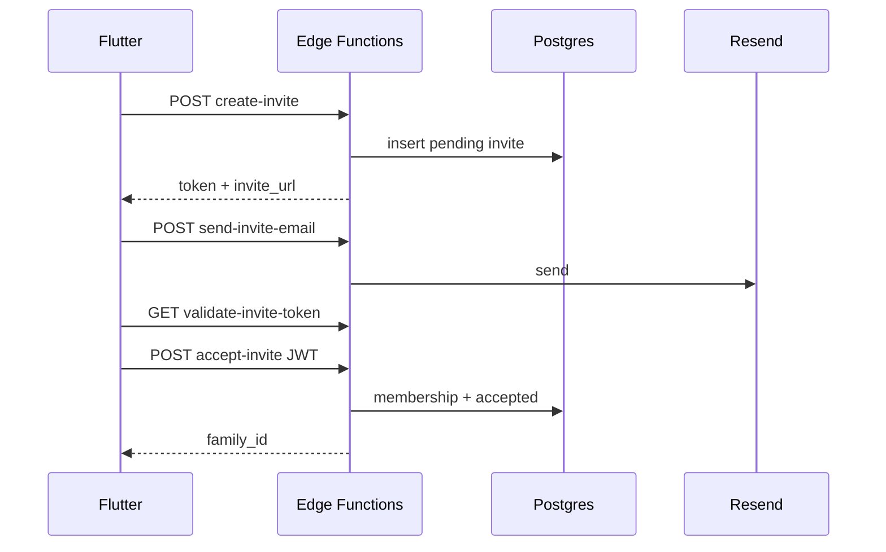

# 📐 Tell Me a Story — Design Doc

## Context
Companion Design Doc to the Accepted System Overview. Locks schema, RLS, and Edge contracts for coding agents (no invention).
- SAD: [🏗️ Tell Me a Story — System Architecture (v1)](https://app.notion.com/p/3e0c4bcef238810d8898e79e881f5ac8)
- Impl Spec: [📐 Tell Me a Story — Impl Spec (Accepted)](https://app.notion.com/p/3e0c4bcef238814f9686d1d956b1f3f8)
- Bill locked all proposed OPENs 2026-09-19; Impl Spec Accepted
- Bill locked **co-member profiles SELECT** 2026-09-27 (M5 names on comments/perspectives)
## Decision
Lock DDL, RLS patterns, Storage, timeframe shape, invite lifecycle, Edge HTTP contracts, Resend, Realtime filters, Mapbox client token, and error codes as specified below. SAD table/component names win.
## Alternatives considered
- Leave OPENs for agents — rejected
- Admin role in v1 — rejected (`member` only)
- Decade enum column — rejected (UX chips → date range)
- Email only inside create-invite — rejected (separate send for retry)
- Mapbox secret server-side — rejected for v1
- Custom Realtime channel names — rejected (table filters)
## Consequences
Unblocks Big Head / coding agents. Migrations must match this doc. Requires Resend + Mapbox accounts before invite/place features.
---
## 1. Enums + DDL
```sql
create type story_status as enum ('draft', 'published');
create type invite_status as enum ('pending', 'accepted', 'revoked', 'expired');
create type membership_role as enum ('member');
```
**profiles** — `id uuid PK → auth.users`, `display_name`, `email`, timestamps.
**families** — `id`, `name`, `parent_family_id` nullable (branch), `created_by`, timestamps. Index `parent_family_id`.
**memberships** — `family_id`, `user_id`, `role membership_role default 'member'`, unique `(family_id, user_id)`. Indexes on `user_id`, `family_id`.
**people** — `family_id`, `name`, `relationship` (required), `email` optional, `created_by`.
**places** — `family_id`, `label`, `address`, `lat`, `lng`, `mapbox_place_id` optional, `is_favorite`, `last_used_at`.
**stories** — `family_id`, `author_id`, `title`, `body`, **`timeframe_start date not null`**, **`timeframe_end date`**** nullable** (null end = single day; check end ≥ start), `place_id` nullable, `status story_status default 'draft'`, `published_at`. Indexes `(family_id, status)`, `(family_id, timeframe_start, timeframe_end)`.
**Timeframe (locked):** Decade chips are UI only; they write calendar ranges (1980s → 1980-01-01..1989-12-31).
**story_people** — PK `(story_id, person_id)`.
**photos** — `story_id`, `family_id`, `uploader_id`, `storage_path`, `sort_order`. App enforces max **20**/story.
**comments** / **perspectives** — `story_id`, `family_id`, `author_id`, `body`, timestamps.
**invites** — `family_id`, `invited_by`, `email` nullable, `token` unique, `status invite_status default 'pending'`, `expires_at` (= created + **7 days**), `accepted_by`, `accepted_at`. Token **single-use**.
## 2. RLS
```sql
create or replace function public.is_family_member(fid uuid)
returns boolean language sql stable security definer set search_path = public as $$
  select exists (
    select 1 from public.memberships m
    where m.family_id = fid and m.user_id = auth.uid()
  );
$$;
```
Enable RLS on all public tables.
<table header-row="true">
<tr>
<td>Table</td>
<td>SELECT</td>
<td>INSERT</td>
<td>UPDATE/DELETE</td>
</tr>
<tr>
<td>profiles</td>
<td>own id **OR co-member** (shares ≥1 family via `memberships`)</td>
<td>trigger only</td>
<td>own id</td>
</tr>
<tr>
<td>families</td>
<td>member</td>
<td>authenticated + membership in same flow</td>
<td>member</td>
</tr>
<tr>
<td>memberships</td>
<td>member</td>
<td>Edge/security definer only</td>
<td>Edge only</td>
</tr>
<tr>
<td>people, places</td>
<td>member</td>
<td>member</td>
<td>member</td>
</tr>
<tr>
<td>stories</td>
<td>member</td>
<td>member + author_id = uid</td>
<td>author only</td>
</tr>
<tr>
<td>story_people</td>
<td>member</td>
<td>story author</td>
<td>story author</td>
</tr>
<tr>
<td>photos</td>
<td>member</td>
<td>member + uploader_id = uid</td>
<td>uploader or story author</td>
</tr>
<tr>
<td>comments, perspectives</td>
<td>member</td>
<td>member + author_id = uid</td>
<td>author only</td>
</tr>
<tr>
<td>invites</td>
<td>member</td>
<td>member + invited_by = uid</td>
<td>Edge for status transitions</td>
</tr>
</table>
Expand to explicit `create policy` in migrations; never weaken membership checks. Mandatory test: two families, zero cross-read.
**Amendment (Bill 2026-09-27):** `profiles` SELECT is own row **or** any profile whose `id` shares at least one `memberships.family_id` with `auth.uid()`. Enables nested `display_name` on comments/perspectives for family members. UPDATE/DELETE stay own-id only. INSERT remains trigger-only.
```sql
-- profiles SELECT (replace own-only policy)
create policy profiles_select_own_or_comember on public.profiles
for select using (
  id = auth.uid()
  or exists (
    select 1
    from public.memberships mine
    join public.memberships theirs
      on theirs.family_id = mine.family_id
    where mine.user_id = auth.uid()
      and theirs.user_id = profiles.id
  )
);
```
> 🚫 FORBIDDEN: Denormalize `display_name` / author name onto `comments` or `perspectives`. Read names via `profiles` join. Non-co-members must not read profiles (two-family leak test must cover this).
## 3. Storage
- Bucket: **`story-photos`** (private)
- Path: **`{family_id}/{story_id}/{photo_id}.jpg`** (also `.jpeg` `.png` `.webp`)
- Storage policies: path prefix family_id must pass `is_family_member`
## 4. Profile bootstrap
Trigger `after insert on auth.users` → `handle_new_user()` inserts `profiles` (id, email, display_name). No client upsert for bootstrap.
## 5. Edge HTTP contracts
Auth: `Authorization: Bearer <user JWT>` except validate may be public.
**POST ****`/create-invite`** body `{ "family_id", "email?" }` → `201` `{ invite_id, token, expires_at, invite_url }`. Does **not** send email.
**GET ****`/validate-invite-token?token=`** → `{ valid, family_id?, family_name?, status?, expires_at? }` or valid false + code.
**POST ****`/send-invite-email`** body `{ "invite_id" }` → Resend send; `{ sent: true }`.
**POST ****`/accept-invite`** (JWT required) body `{ "token" }` sequence:
1. Validate pending + not expired
2. Require auth.uid()
3. Upsert membership role=member
4. Mark invite accepted
5. Return `{ family_id, membership_id }`
## 6. Email
**Resend.** Invite HTML template with family name + invite_url. `RESEND_API_KEY` on Edge only. Magic link: Supabase Auth email OK for v1.
## 7. Realtime
`postgres_changes` on `stories` (optional comments/perspectives/photos) with filter `family_id=eq.<uuid>`. No custom channel names. Timeline may add `status=eq.published`.
## 8. Mapbox
Client public token only (Maps + Search). Restrict iOS bundle + web URL. Store address, lat, lng, optional mapbox_place_id. No server secret in v1.
## 9. Error codes
`AUTH_REQUIRED` \| `FORBIDDEN` \| `NOT_FOUND` \| `VALIDATION` \| `INVITE_INVALID` \| `INVITE_EXPIRED` \| `INVITE_ACCEPTED` \| `RATE_LIMITED` \| `STORAGE_FAILED`
Shape: `{ "code": "INVITE_EXPIRED", "message": "..." }`
## Diagram

## Follow-ups
- [x] Big Head closed OPENs in Impl Spec from this doc (Accepted)
- [x] Co-member profiles SELECT (Bill 2026-09-27) — Big Head folds into Spec §7; migration replaces own-only policy
- [ ] Migrations + two-family RLS leak test (include profiles co-member vs stranger)
- [ ] Resend + Mapbox accounts
- [ ] SMS Edge — fast follow (not v1)
- [ ] Offline — v2 backlog
