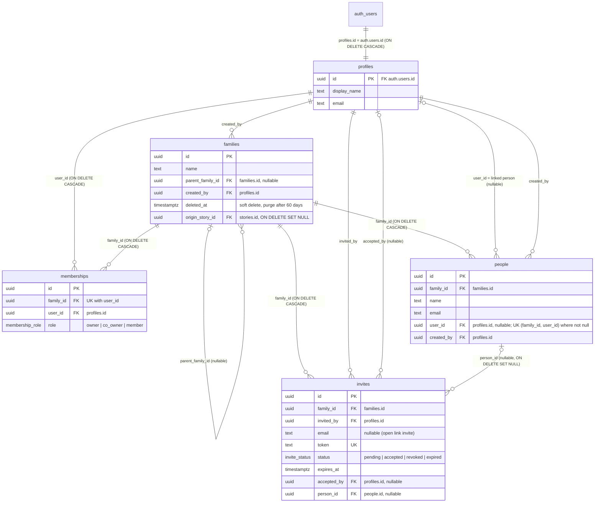

## Family data model — ER diagram (2026-10-16)
Source: `main` migrations through `20261016140000_passed_away_guard_steward.sql`, checked against prod `lchytafmnuefrgkguynt` (information_schema + pg_constraint, read-only) on 2026-10-16. Key columns only. PR #37 is not included.

### Relationships (plain English)
- Each `profiles` row is one auth account: `profiles.id` is both the PK and an FK to `auth.users.id` (ON DELETE CASCADE). The `handle_new_user` trigger creates it on sign-up, and `sync_profile_email` keeps `profiles.email` in sync.
- `memberships` joins a profile to a family: `family_id` → `families.id` and `user_id` → `profiles.id`, both ON DELETE CASCADE. UNIQUE (`family_id`, `user_id`).
- `memberships.role` is the enum `membership_role` with values `owner`, `co_owner`, `member`. `memberships_one_owner_uidx` (unique on `family_id` where role = `owner`) allows only one owner per family. The `memberships_co_owner_cap` trigger allows at most 2 `co_owner` rows per family.
- `people` are the people in a family's tree: `people.family_id` → `families.id` (ON DELETE CASCADE). `people.created_by` → `profiles.id`.
- Profile to linked person: `people.user_id` → `profiles.id` (nullable). `people_family_user_uidx` (unique on `family_id`, `user_id` where `user_id` is not null) allows one linked person per family. M14.1a functions (`ensure_member_person`, `link_accepted_person`) also enforce one linked person per tree (`family_tree_root`), but no constraint does that.
- `families.parent_family_id` → `families.id` (nullable, self-FK) makes branch families. `purge_expired_families` hard-deletes families where `deleted_at` is more than 60 days ago, and first sets the children's `parent_family_id` to null.
- `families.created_by` → `profiles.id`. `families.origin_story_id` → `stories.id` (ON DELETE SET NULL).
- `invites.family_id` → `families.id` (ON DELETE CASCADE). `invites.invited_by` and `invites.accepted_by` → `profiles.id`. `invites.person_id` → `people.id` (nullable, ON DELETE SET NULL) names the tree person the invite is for. `invites.token` is UNIQUE. `invites.status` is the enum `invite_status`: `pending`, `accepted`, `revoked`, `expired`.
- Email-match auto-membership: when a person is tagged on a story (trigger `ensure_story_person_membership`), `resolve_person_user` looks up the account by `people.user_id`, or by an email that matches exactly one `profiles.email` (case-insensitive). `upsert_story_member` then inserts a `memberships` row with role `member` (ON CONFLICT DO NOTHING).
### Invite to membership
- An invite is created by Edge `create-invite`, and its email is sent by `send-invite-email`. The new `invites` row has `status = pending`, a unique `token`, `expires_at`, and optionally `email` and `person_id`. `validate-invite-token` is the public (no-JWT) check.
- The invitee signs in and calls Edge `accept-invite` with the token. It runs with the service role: it loads the invite by `token`, rejects it unless `status = pending` and it has not expired, and lets the same `accepted_by` user re-enter if they accepted it before.
- If the user has no `memberships` row for `invites.family_id`, it inserts one with `role = 'member'`. An existing role (for example `owner`) is kept.
- If `invites.person_id` is set, it calls RPC `link_accepted_person(person_id)`. That sets `people.user_id = auth.uid()` only if the person is still unlinked and the caller has no linked person anywhere in the same live tree.
- It sets the invite to `status = 'accepted'`, `accepted_by`, `accepted_at` (only while it is still `pending`).
- If `person_id` is null, the trigger `invites_ensure_member_person` (`ensure_accepted_invite_person`) runs on that status change and calls `ensure_member_person(family_id, accepted_by, false)`. If the user has no linked person in the tree, it inserts a new `people` row (name from `display_name`, else email, else 'Member') with `user_id` and `created_by` set to the user.
- `resend-invite` and `revoke-invite` (RPCs `resend_invite` and `revoke_invite`) are for the owner and co_owners only.
### OPEN
- **OPEN (PR #37, not merged):** `20261016233908_linked_person_name_sync.sql` would add `profiles_sync_linked_person_name` (copies `profiles.display_name` to every linked `people.name`) and `people_guard_linked_name` (`FORBIDDEN: linked_person_name_locked`), plus a backfill. None of this is in prod or on `main`.
- **OPEN:** `people.user_id` → `profiles.id` has no ON DELETE action (NO ACTION). Deleting an account that has a linked person (auth.users → profiles cascade) would fail until those people rows are unlinked. The doc does not lock how account deletion works. `families.created_by`, `people.created_by`, `invites.invited_by` and `invites.accepted_by` have the same NO ACTION FKs.
- **OPEN:** One linked person per tree is enforced only inside `ensure_member_person` and `link_accepted_person`. The DB constraint is per family (`people_family_user_uidx`).
- **Note:** `memberships` rows are also written outside Edge functions, by the story-tag trigger path (`upsert_story_member`) and by RPC `create_family`, which `create-root-family` calls. These are security-definer database paths, not direct client writes.
