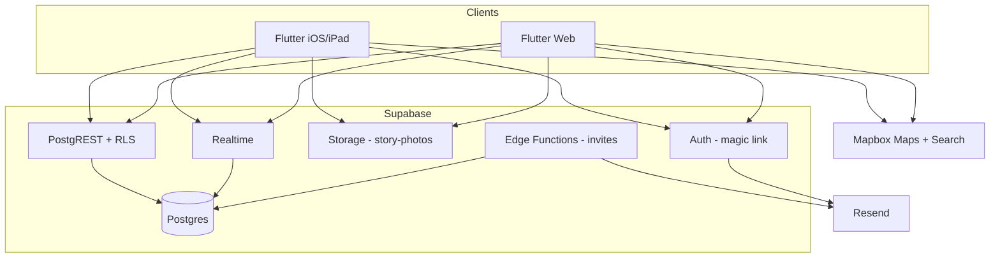
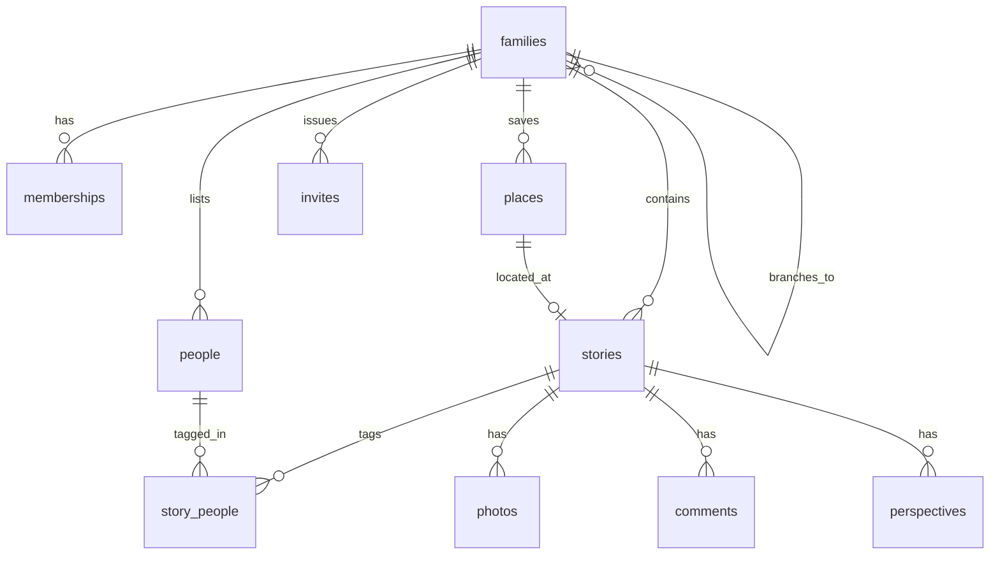

# 📐 Tell Me a Story — Impl Spec (Accepted)

> **Three-source SoT (plus PRD pack + Design Doc locks):** (1) PRD [📋 PRD](https://app.notion.com/p/3e0c4bcef238813e843af14d12c9a4b2) + User Stories [📝 User Stories](https://app.notion.com/p/3e0c4bcef238810ab885df1d973d35bd) + Decisions [✅ Decisions](https://app.notion.com/p/3e0c4bcef238818d8f00c50e88a46166) for product must/must-not; (2) Mugatu UX [🎨 UXD — v1 Handoff (locked)](https://app.notion.com/p/3e0c4bcef238818dba09d617a2127cd4) (Stitch `12192342757314667328`, Memory Album `assets/18104844965535020843`) for screens/flows; (3) SAD System Overview (Accepted) [🏗️ Tell Me a Story — System Architecture (v1)](https://app.notion.com/p/3e0c4bcef238810d8898e79e881f5ac8) for stack/data/API/security **names**; (4) Design Doc (Accepted) [📐 Tell Me a Story — Design Doc](https://app.notion.com/p/3e0c4bcef23881c0ba43db61e6195ec7) for DDL / RLS / Storage / Edge JSON / Resend / Realtime / Mapbox / error codes. Pack: [📖 Tell Me a Story — Product Pack](https://app.notion.com/p/3e0c4bcef238810b9c26ff3e9653debc).
> **Status:** **Accepted** Implementation Spec for coding agents. Architecture OPENs closed from Design Doc (2026-09-19) [📐 Tell Me a Story — Design Doc](https://app.notion.com/p/3e0c4bcef23881c0ba43db61e6195ec7). Mugatu UX leftovers folded in from [🧵 UXD — Client copy & chrome locks (v1)](https://app.notion.com/p/3e0c4bcef23881e59430d4f904bc59a3). Plumbing locked (Bill green-lit Gilfoyle defaults 2026-09-19): Flutter monorepo `apps/tell_me_a_story` + `supabase/`; `--dart-define` (local or deploy-time; CI injects none) `SUPABASE_URL`, `SUPABASE_ANON_KEY`, `MAPBOX_ACCESS_TOKEN`; `RESEND_API_KEY` Edge-only; tests `flutter test` + Supabase RLS SQL tests. Do not invent past PRD + SAD + Design Doc; do not invent screens/copy past Mugatu. **v1 invites = email + shareable link only; server SMS = fast follow (do not redefine).**
---
## 0 Agent operating rules
### Three-source precedence (enforce)
1. **PRD (Jared)** → section 1 Scope lock, domain language, acceptance intent, out-of-scope. **PRD wins** for product must / must-not.
2. **Mugatu UX / Stitch** → section 10 Client behavior lock (routes/screens, loading/empty/error/success, redirects, local storage). **Mugatu wins** for screen/flow when SAD is silent on UI. Do **not** invent screens Mugatu did not lock.
3. **SAD (Gilfoyle System Overview)** → stack, repo map, data/auth planes, API, security, milestones. **SAD names win** for components / tables / routes / tech.
4. **Design Doc (Gilfoyle OPEN locks + plumbing)** → exact DDL, enums, RLS patterns, Storage paths, Edge HTTP contracts, Resend, Realtime filters, Mapbox client token, error codes, plus repo layout / env injection / test commands. **Design Doc wins** for those implementation details; SAD names still win if anything clashes on naming.
Cross-source clash → `> ⚠️ CONFLICT:` pick narrower option, one-line pick. Missing → `> ❓ OPEN:` never invent. Hard cap: no features absent from PRD + SAD; no screens Mugatu did not lock; no schema/API beyond Design Doc. Extras only in §17 OPEN.
### Operating rules
1. Implement **only** what this spec lists. Features absent from PRD + SAD are out of scope unless listed under section 17 as OPEN.
2. If an `> ❓ OPEN:` blocks a file, **stop that file** and do unblocked work elsewhere.
3. Match **names, paths, and schemas exactly** as written here, in SAD, and in the Design Doc. Never rename components, tables, or routes. Screen names match Mugatu.
4. After each milestone, run the listed checks and report **pass/fail with command output**.
5. Do **not** “improve” auth, schema, or API shape beyond this spec / SAD / Design Doc.
6. If code and this spec disagree, **stop and report the diff** — do not silently reconcile.
---
## 1 Scope lock
> **Source owner:** Jared PRD (product must / must-not). SAD confirms stack constraints. Mugatu does not expand product scope.
### In v1 (must build) — PRD must-haves
- Private family tenancy (one family’s shared record; not a public multi-family marketplace)
- Flutter client: **iOS/iPad + web**, full feature parity (capture, timeline, drafts, invites)
- Supabase backend: Postgres + Auth + Storage + RLS + Realtime
- Auth: email **magic link** (passwordless)
- **Online-only**; drafts stored in Supabase
- Story capture: timeframe, people (shared list), place (address → map pin; favorites + recents), text, story title, photos; drafts. **LOCKED 2026-10-03, pack restamp the same evening:** New Story saves `stories.title`. A title is required to publish, not to save a draft. The reader shows that saved title as the headline, with the body under it, and keeps the Documented month/year. Drafts and the timeline show the saved title instead of the body excerpt. No title means "Untitled", and do not use the first line of the body. No perspective title. Add photo stays blocked until a decade is picked.
- Pictures: client-side compress; **\~20 images/story**; images only
- Comments (short) vs perspectives (full alternate tellings) — separate
- Timeline: chronological per family unit; branching family units
- Invites: **email + shareable link**; any member may invite
- Search by person / place / timeframe
- Mapbox Maps + Search/Geocoding; persist address + lat/lng (+ optional Mapbox id)
- Supabase Realtime on timeline / story feeds
### Explicitly out of v1 — PRD out-of-scope + SAD deferrals
- Android as a required ship target (Flutter may build later; not a v1 deliverable)
- Offline mode / offline drafts
- Video
- Server SMS invites (fast follow — do not block v1)
- Public multi-family / marketplace
- AI-written stories
- Genealogy-tree primary UX
- Live chat / messaging
- DNA / Ancestry-style imports
- Push notifications when a story is added (v2 per PRD)
- Export / backup (v2)
- Voice / audio capture (v2)
- Public SEO pages
### Permissions (from SAD / PRD)
- Story author edits core story + pictures
- Comment / perspective authors edit only their own
- Any member may attach pictures to any story
- Any member may invite (email/link in v1)
> ⚠️ CONFLICT: Mugatu Stitch still had an Invite **Text (SMS)** tab; PRD + User Stories US-2 + Decisions + SAD defer server SMS to fast follow. **Pick (locked):** Email + Link only in v1; SMS UI/API superseded — do not ship.
### Acceptance intent (User Stories → implement)
<table header-row="true">
<tr>
<td>US</td>
<td>Intent (product-level)</td>
<td>Spec home</td>
</tr>
<tr>
<td>US-1 Start a family</td>
<td>Create private family; starter owns family record; not publicly discoverable</td>
<td>§8 / M2</td>
</tr>
<tr>
<td>US-2 Invite</td>
<td>Email + shareable link; any member; join after accept; **SMS not required v1**</td>
<td>§9 / §10 / §11</td>
</tr>
<tr>
<td>US-3 Capture</td>
<td>Timeframe, people, place (address→pin), text, story title; own/dictated/deceased; any subject</td>
<td>§10 New Story</td>
</tr>
<tr>
<td>US-3a Places reuse</td>
<td>Shared favorites + recents during capture; new address still allowed</td>
<td>§10 Place picker</td>
</tr>
<tr>
<td>US-4 Pictures</td>
<td>Any member attach to any story; visible on reader; author edits pictures</td>
<td>§7 / §10</td>
</tr>
<tr>
<td>US-5 Author edit</td>
<td>Only author edits core (timeframe/people/place/text) + pictures</td>
<td>§7 RLS / §1 Permissions</td>
</tr>
<tr>
<td>US-6 Comment</td>
<td>Short reaction; attributable; author-only edit</td>
<td>§10 Reader</td>
</tr>
<tr>
<td>US-6a Perspective</td>
<td>Full alternate telling; separate from comments; author-only edit</td>
<td>§10 Add Perspective</td>
</tr>
<tr>
<td>US-7 Timeline</td>
<td>Chronological per family unit; iPad/mobile/web</td>
<td>§10 Timeline</td>
</tr>
<tr>
<td>US-8 Branch</td>
<td>New family unit branches off existing; own timeline; not genealogy-tree UX</td>
<td>§6 / §10 Mid zoom peek</td>
</tr>
<tr>
<td>US-9 Search</td>
<td>By person, place, timeframe</td>
<td>§10 Search</td>
</tr>
<tr>
<td>US-10 People list</td>
<td>Shared list; select on story; add when needed</td>
<td>§10 Add Person</td>
</tr>
<tr>
<td>US-11 Drafts</td>
<td>Save/resume draft; not on timeline until published</td>
<td>§10 Drafts</td>
</tr>
</table>
> 🚫 FORBIDDEN: Inventing tables, routes, Edge Function payloads, or RLS policies beyond what SAD + Design Doc state. Put remaining gaps under section 17.
> 🚫 FORBIDDEN: Shipping server-sent SMS invite UI or API in v1 (US-2 / Decisions / SAD — fast follow only).
---
## 2 Stack lock
<table header-row="true">
<tr>
<td>Layer</td>
<td>Locked choice</td>
</tr>
<tr>
<td>Client</td>
<td>Flutter 3.x — iOS/iPad + web, full parity</td>
</tr>
<tr>
<td>Backend</td>
<td>Supabase — Postgres + Auth + Storage + RLS + Realtime</td>
</tr>
<tr>
<td>Auth</td>
<td>Email magic link</td>
</tr>
<tr>
<td>Offline</td>
<td>Online-only; drafts in Supabase</td>
</tr>
<tr>
<td>Invites</td>
<td>Email + shareable link; SMS → fast follow</td>
</tr>
<tr>
<td>Media</td>
<td>Client compress; \~20 images/story; no video</td>
</tr>
<tr>
<td>Maps</td>
<td>Mapbox Maps + Search/Geocoding (client public token only)</td>
</tr>
<tr>
<td>Live updates</td>
<td>Supabase Realtime `postgres_changes` filtered by `family_id`</td>
</tr>
<tr>
<td>Client SDK</td>
<td>`supabase_flutter` (SAD: flutter_supabase / supabase_flutter)</td>
</tr>
<tr>
<td>Email</td>
<td>**Resend** for invite emails (`RESEND_API_KEY` on Edge); magic link via Supabase Auth email OK for v1</td>
</tr>
<tr>
<td>Edge</td>
<td>Edge Functions: create invite, accept invite, send invite email, validate invite token</td>
</tr>
<tr>
<td>Fast follow</td>
<td>Twilio (or similar) for SMS — hook only; do not block v1</td>
</tr>
</table>
> 🔍 INFER: Prefer package name `supabase_flutter` as the maintained Flutter client; SAD lists both `flutter_supabase` / `supabase_flutter`.
---
## 3 Repo map
> **Locked (Bill green-lit Gilfoyle plumbing 2026-09-19; Design Doc):** Flutter monorepo — `apps/tell_me_a_story` (Flutter client iOS/iPad + web) + `supabase/` (migrations, Edge Functions, seed/RLS tests). Root README + analysis_options as needed.
> 🚫 FORBIDDEN: Separate per-platform repos for v1; inventing extra packages not required by SAD/Design Doc; a second app target.
```javascript
tell-me-a-story/
  apps/
    tell_me_a_story/
      lib/
        main.dart
        app.dart
        core/
        features/
          auth/
          family/
          invites/
          people/
          places/
          stories/
          comments/
          perspectives/
          timeline/
          search/
          drafts/
        data/
      web/
      ios/
  supabase/
    migrations/
    functions/
      create-invite/
      accept-invite/
      send-invite-email/
      validate-invite-token/
    config.toml
```
### Screen → feature folder (Mugatu names)
<table header-row="true">
<tr>
<td>Screen / flow</td>
<td>Feature folder</td>
</tr>
<tr>
<td>New Story</td>
<td>`features/stories/`</td>
</tr>
<tr>
<td>Add Person (pick / create)</td>
<td>`features/people/`</td>
</tr>
<tr>
<td>Place picker</td>
<td>`features/places/`</td>
</tr>
<tr>
<td>Story reader</td>
<td>`features/stories/`</td>
</tr>
<tr>
<td>Add Perspective</td>
<td>`features/perspectives/`</td>
</tr>
<tr>
<td>Timeline (far/mid/near)</td>
<td>`features/timeline/`</td>
</tr>
<tr>
<td>Full-screen search</td>
<td>`features/search/`</td>
</tr>
<tr>
<td>Invite (Email / Link)</td>
<td>`features/invites/`</td>
</tr>
<tr>
<td>Drafts list</td>
<td>`features/drafts/`</td>
</tr>
<tr>
<td>Manage families (hub / detail)</td>
<td>`features/family/`</td>
</tr>
</table>
> 🚫 FORBIDDEN: Building a separate React/SwiftUI web or iOS shell. One Flutter codebase for both surfaces.
---
## 4 Environment and secrets
### Client (Flutter — safe to ship)
<table header-row="true">
<tr>
<td>Secret / config</td>
<td>Where</td>
<td>Notes</td>
</tr>
<tr>
<td>`SUPABASE_URL`</td>
<td>`--dart-define`, local or deploy-time; CI injects none</td>
<td>Public project URL</td>
</tr>
<tr>
<td>`SUPABASE_ANON_KEY`</td>
<td>`--dart-define`, local or deploy-time; CI injects none</td>
<td>Anon key only</td>
</tr>
<tr>
<td>`MAPBOX_ACCESS_TOKEN`</td>
<td>`--dart-define`, local or deploy-time; CI injects none</td>
<td>Public token; restrict by iOS bundle + web URL (Design Doc); no server secret in v1</td>
</tr>
</table>
### Server only (Edge Functions)
<table header-row="true">
<tr>
<td>Secret</td>
<td>Notes</td>
</tr>
<tr>
<td>`SUPABASE_SERVICE_ROLE_KEY`</td>
<td>**Never** in Flutter app</td>
</tr>
<tr>
<td>`RESEND_API_KEY`</td>
<td>Resend — invite emails only on Edge</td>
</tr>
</table>
### Local / staging
- Separate Supabase **staging** project (SAD risk mitigation)
- Mapbox account + restricted public tokens (iOS bundle + web URL)
- Resend account + SPF/DKIM for invite deliverability; Supabase Auth email for magic links
> 🚫 FORBIDDEN: Service-role keys in the Flutter app.
> 🚫 FORBIDDEN: Mapbox secret token / server-side geocode in v1 (Design Doc).
> **Locked (Bill / Design Doc plumbing):** Inject via `--dart-define` locally or at deploy time only: `SUPABASE_URL`, `SUPABASE_ANON_KEY`, `MAPBOX_ACCESS_TOKEN` (public, restricted by iOS bundle ID / web URL). CI injects no dart-defines and no secrets. Edge-only (never in Flutter): `RESEND_API_KEY`, Supabase service role key.
---
## 5 Architecture for implementers
### System components (from SAD; Mail = Resend per Design Doc)

**Same relationships (bullets):**
- Flutter iOS/iPad and Flutter Web both talk to Supabase Auth, PostgREST+RLS, Storage, and Realtime
- Both clients talk to Mapbox Maps + Search
- PostgREST and Realtime read/write Postgres
- Edge Functions (invites) write Postgres and send invite email via **Resend**
- Auth sends magic-link email via Supabase Auth email (v1 OK)
### Actors
Family creator, member, story author, perspective author, commenter, inviter.
### Security boundary
**RLS is the security boundary.** Test with multiple families before any real data.
---
## 6 Domain objects
> **Locked by Design Doc** [📐 Tell Me a Story — Design Doc](https://app.notion.com/p/3e0c4bcef23881c0ba43db61e6195ec7). SAD table names win.
### Enums
```sql
create type story_status as enum ('draft', 'published');
create type invite_status as enum ('pending', 'accepted', 'revoked', 'expired');
create type membership_role as enum ('member');
```
### Tables (columns locked)
<table header-row="true">
<tr>
<td>Object</td>
<td>Columns / meaning</td>
</tr>
<tr>
<td>`profiles`</td>
<td>`id uuid PK → auth.users`, `display_name`, `email`, timestamps</td>
</tr>
<tr>
<td>`families`</td>
<td>`id`, `name`, `parent_family_id` nullable (branch), `created_by`, timestamps; index `parent_family_id`</td>
</tr>
<tr>
<td>`memberships`</td>
<td>`family_id`, `user_id`, `role membership_role default 'member'`, unique `(family_id, user_id)`; indexes on `user_id`, `family_id`</td>
</tr>
<tr>
<td>`people`</td>
<td>`family_id`, `name`, `relationship` (required), `email` optional, `created_by`</td>
</tr>
<tr>
<td>`places`</td>
<td>`family_id`, `label`, `address`, `lat`, `lng`, `mapbox_place_id` optional, `is_favorite`, `last_used_at`</td>
</tr>
<tr>
<td>`stories`</td>
<td>`family_id`, `author_id`, `title`, `body`, `timeframe_start date not null`, `timeframe_end date` nullable (null end = single day; check end ≥ start), `place_id` nullable, `status story_status default 'draft'`, `published_at`; indexes `(family_id, status)`, `(family_id, timeframe_start, timeframe_end)`</td>
</tr>
<tr>
<td>`story_people`</td>
<td>PK `(story_id, person_id)`</td>
</tr>
<tr>
<td>`photos`</td>
<td>`story_id`, `family_id`, `uploader_id`, `storage_path`, `sort_order`; app enforces max **20**/story</td>
</tr>
<tr>
<td>`comments`</td>
<td>`story_id`, `family_id`, `author_id`, `body`, timestamps</td>
</tr>
<tr>
<td>`perspectives`</td>
<td>`story_id`, `family_id`, `author_id`, `body`, timestamps</td>
</tr>
<tr>
<td>`invites`</td>
<td>`family_id`, `invited_by`, `email` nullable, `token` unique, `status invite_status default 'pending'`, `expires_at` (= created + **7 days**), `accepted_by`, `accepted_at`; token **single-use**</td>
</tr>
</table>
### Story status
- `draft` — private until published (UX)
- `published` — appears on timeline
### Timeframe (locked)
~~Decade chips are **UI only**; they write calendar date ranges (e.g. 1980s → ~~~~`1980-01-01`~~~~..~~~~`1989-12-31`~~~~). Persist ~~~~`timeframe_start`~~~~ + optional ~~~~`timeframe_end`~~~~ (null end = single day).~~ **Amended by M13 (Bill 2026-10-11, §15 M13 OPEN 8):** the Year / Month / Day picker replaces decade chips. `timeframe_start` and `timeframe_end` stay the canonical storage, `timeframe_end` is `not null` (day: start = end; month and year store the full period), and `date_precision` records what was entered. Legacy decade stories keep their stored range. See §15 M13 item 3.
### Membership role (locked)
`member` only in v1. Admin role rejected for v1 (Design Doc).
### Branching
Branching = new `families` row with `parent_family_id` when a child unit splits off.
> ⚠️ CONFLICT (resolved): SAD said membership role “(member/admin if needed later)”; Design Doc locks **`member`**** only**. **Pick:** Design Doc — no admin in v1.
---
## 7 Data plane
### Tenant scope
All tenant data scoped by `family_id`.
### ER (from SAD)

**Same relationships (bullets):**
- `families` has many `memberships`, `people`, `places`, `stories`, `invites`
- `families` branches to child `families` via `parent_family_id`
- `stories` tags many `people` through `story_people`
- `stories` has many `photos`, `comments`, `perspectives`
- `places` optionally locates a story
### Helper + RLS (Design Doc)
```sql
create or replace function public.is_family_member(fid uuid)
returns boolean language sql stable security definer set search_path = public as $$
  select exists (
    select 1 from public.memberships m
    where m.family_id = fid and m.user_id = auth.uid()
  );
$$;
```
Enable RLS on all public tables. Expand to explicit `create policy` in migrations; never weaken membership checks. Mandatory test: two families, zero cross-read (**include profiles**: co-member can read `display_name`; stranger cannot).
<table header-row="true">
<tr>
<td>Table</td>
<td>SELECT</td>
<td>INSERT</td>
<td>UPDATE/DELETE</td>
</tr>
<tr>
<td>profiles</td>
<td>own id **OR co-member** (shares ≥1 family via `memberships`)</td>
<td>trigger only</td>
<td>own id</td>
</tr>
<tr>
<td>families</td>
<td>member</td>
<td>authenticated + membership in same flow</td>
<td>member</td>
</tr>
<tr>
<td>memberships</td>
<td>member</td>
<td>Edge/security definer only</td>
<td>Edge only</td>
</tr>
<tr>
<td>people, places</td>
<td>member</td>
<td>member</td>
<td>member</td>
</tr>
<tr>
<td>stories</td>
<td>member</td>
<td>member + author_id = uid</td>
<td>author only</td>
</tr>
<tr>
<td>story_people</td>
<td>member</td>
<td>story author</td>
<td>story author</td>
</tr>
<tr>
<td>photos</td>
<td>member</td>
<td>member + uploader_id = uid</td>
<td>uploader or story author</td>
</tr>
<tr>
<td>comments, perspectives</td>
<td>member</td>
<td>member + author_id = uid</td>
<td>author only</td>
</tr>
<tr>
<td>invites</td>
<td>member</td>
<td>member + invited_by = uid</td>
<td>Edge for status transitions</td>
</tr>
</table>
**Amendment (Bill 2026-09-27):** `profiles` SELECT is own row **or** any profile whose `id` shares at least one `memberships.family_id` with `auth.uid()`. Enables nested `display_name` on comments/perspectives for family members. UPDATE/DELETE stay own-id only. INSERT remains trigger-only. Migration **replaces** the own-only SELECT policy.
```sql
-- profiles SELECT (replace own-only policy)
create policy profiles_select_own_or_comember on public.profiles
for select using (
  id = auth.uid()
  or exists (
    select 1
    from public.memberships mine
    join public.memberships theirs
      on theirs.family_id = mine.family_id
    where mine.user_id = auth.uid()
      and theirs.user_id = profiles.id
  )
);
```
> 🚫 FORBIDDEN: Denormalize `display_name` / author name onto `comments` or `perspectives`. Read names via `profiles` join. Non-co-members must not read profiles.
### Storage (Design Doc)
- Bucket: **`story-photos`** (private)
- Path: **`{family_id}/{story_id}/{photo_id}.jpg`** (also `.jpeg` `.png` `.webp`)
- Storage policies: path prefix `family_id` must pass `is_family_member`
- Signed URLs or authenticated downloads only
- Client-side compress before upload; enforce \~20 images/story (app-level)
> 🚫 FORBIDDEN: Public buckets or unauthenticated photo URLs in v1.
---
## 8 Auth plane
<table header-row="true">
<tr>
<td>Concern</td>
<td>Lock</td>
</tr>
<tr>
<td>Sign-in</td>
<td>Email magic link only</td>
</tr>
<tr>
<td>Session</td>
<td>Supabase Auth session in Flutter</td>
</tr>
<tr>
<td>Profile</td>
<td>`profiles` row linked to `auth.users` — **trigger bootstrap** (Design Doc)</td>
</tr>
<tr>
<td>Family join</td>
<td>Opaque invite token, expiry **7 days**, **single-use**; authenticated `POST /accept-invite` upserts membership + marks invite accepted</td>
</tr>
<tr>
<td>Keys</td>
<td>Anon in client; service role only on Edge Functions</td>
</tr>
</table>
### Profile bootstrap (locked)
Trigger `after insert on auth.users` → `handle_new_user()` inserts `profiles` (`id`, `email`, `display_name`). **No client upsert for bootstrap.**
### Accept-invite sequence (locked — Design Doc)
1. Validate pending + not expired
2. Require `auth.uid()`
3. Upsert membership `role=member`
4. Mark invite `accepted`
5. Return `{ family_id, membership_id }`
Join = authenticated accept of a valid single-use token (no separate admin-approval step in Design Doc).
### Acceptance checks (auth)
1. User can request magic link and complete sign-in on iOS and web
2. Unauthenticated client cannot read any `families` / `stories` rows
3. Service role key is absent from Flutter build artifacts
4. New auth user gets a `profiles` row via trigger (no client bootstrap upsert)
---
## 9 API / interface contracts
### Patterns (SAD + Design Doc)
- **CRUD:** Supabase PostgREST against tables above (RLS-enforced)
- **Storage:** Authenticated upload to `story-photos` at `{family_id}/{story_id}/{photo_id}.ext`
- **Realtime:** `postgres_changes` on `stories` (optional comments/perspectives/photos) with filter `family_id=eq.<uuid>`; timeline may add `status=eq.published`. **No custom channel names.**
- **Mapbox:** Client public token only (Maps + Search); persist address + lat/lng + optional `mapbox_place_id`
- **Email:** Magic links (Supabase Auth) + invite emails (Edge → **Resend**)
- **Edge Functions (names from SAD; contracts from Design Doc):**
	- `create-invite`
	- `accept-invite`
	- `send-invite-email`
	- `validate-invite-token`
### Edge HTTP contracts (Design Doc)
Auth: `Authorization: Bearer <user JWT>` except validate may be public.
**POST ****`/create-invite`** body `{ "family_id", "email?" }` → `201` `{ invite_id, token, expires_at, invite_url }`. Does **not** send email.
**GET ****`/validate-invite-token?token=`** → `{ valid, family_id?, family_name?, status?, expires_at? }` or `valid: false` + code.
**POST ****`/send-invite-email`** body `{ "invite_id" }` → Resend send; `{ sent: true }`.
**POST ****`/accept-invite`** (JWT required) body `{ "token" }` → sequence in §8; return `{ family_id, membership_id }`.
### Invite rules (locked)
- Opaque token
- Expiry: 7 days (`expires_at` = created + 7 days)
- Email + shareable link in v1
- **Single-use** token; rate limits (SAD risk mitigation)
- Any member may invite
- Create and send are **separate** Edge Functions (retry-friendly)
> 🚫 FORBIDDEN: Custom REST API outside Supabase PostgREST + Edge Functions for v1 CRUD.
> 🚫 FORBIDDEN: Wiring SMS provider in v1 (fast follow only).
> 🚫 FORBIDDEN: Custom Realtime channel names (use table filters only).
---
## 10 Client behavior lock
> **Source owner:** Mugatu UX handoff (locked) [🎨 UXD — v1 Handoff (locked)](https://app.notion.com/p/3e0c4bcef238818dba09d617a2127cd4) + UX leftovers lock [🧵 UXD — Client copy & chrome locks (v1)](https://app.notion.com/p/3e0c4bcef23881e59430d4f904bc59a3). Stitch project `12192342757314667328`. Design system: Tell Me a Story — Memory Album (`assets/18104844965535020843`). Mugatu wins for screen/flow/copy when SAD is silent on UI. Do **not** invent screens or strings Mugatu did not lock.
> **Final v1 screens ONLY:** New Story; Add Person (pick + create); Place picker; Story reader; Add Perspective; Timeline far/mid/near (M12 branch marks); full-screen Search; Invite Email + Link only; Drafts list; Manage families (M10); R2 family dropdown carries **+ Start a family** and **Manage families** (M10 navigation, Bill 2026-10-10); avatar menu is **Settings · Logout** only.
> 🚫 FORBIDDEN: SMS invite UI or API in v1 — Stitch SMS tab superseded. Ignore superseded early timeline drafts.
### Locked screens (final Stitch set only)
<table header-row="true">
<tr>
<td>Flow</td>
<td>Screen</td>
<td>Behavior lock</td>
</tr>
<tr>
<td>Capture</td>
<td>New Story</td>
<td>Title above the story, saved on `stories.title` (required to publish; a draft may still be saved without one); timeframe, people chips, place+map, text, photos; Add photo is enabled only once the date has a year (amended by M13, Bill 2026-10-11; replaces "blocked until a decade is picked"); Save draft (secondary) / Publish (primary) → Supabase.</td>
</tr>
<tr>
<td>Capture</td>
<td>Add Person — pick existing</td>
<td>Family people list</td>
</tr>
<tr>
<td>Capture</td>
<td>Add Person — create new</td>
<td>Relationship **required**; email optional (future invite)</td>
</tr>
<tr>
<td>Capture</td>
<td>Place picker</td>
<td>Basemap + pin; favorites/recents from `places` (SAD: Mapbox)</td>
</tr>
<tr>
<td>Reader</td>
<td>Published story reader</td>
<td>**M9 (2026-10-05):** opens as parchment modal Stitch `221229a5b4844e7a9b3a2d1b3ef034e5` over the blurred timeline; X closes to the same spot. Saved `stories.title` is the headline. Null title paints blank (R3). Meta: `Recorded event · Documented {month year} by {author} {avatar} · {n} min read` per Design Doc data map. Author avatar uses M8 circle rule; family co-members can see the picture (M9 visibility). Hero is first photo by `sort_order`; no caption. Comments vs Perspectives stay separate. Deep-link route stays. Print/Share OPEN — do not build.</td>
</tr>
<tr>
<td>Reader</td>
<td>Add Perspective</td>
<td>Full alternate telling overlay (not a comment)</td>
</tr>
<tr>
<td>Timeline</td>
<td>Far zoom</td>
<td>Bill 2026-10-04 dots/layout on `02972cf4e7ca4facaececdcb9e16991f`, plus **FA (2026-10-05)** chrome matching main after PR #21: shared “Continuous Family Dial” sub-header + one year chip (`1980 · IN FOCUS` on Macro, not a range); Macro / Mid / Full Cards switch with terracotta pill (240ms slide). One solid dot per published story. Title only in the tooltip. Drafts stay off the rail. Newest decade at the top. Decade dims in the top/bottom 45% of the rail. Parchment overlays stay off far. Macro decade label / decade node / story dot → Mid (M9, Bill 2026-10-06; not the reader). The dashed rail, hollow rings included, is a mark, and those rings are not stories. **M12:** branch chrome SoT `a6259996a3b1408486c6074a4fa75f5d` (supersedes this id for branch marks only).</td>
</tr>
<tr>
<td>Timeline</td>
<td>Mid zoom</td>
<td>Years + title stubs; branch fork peek. Macro taps (M9) open Mid centered on that year/story with chip `{year} · IN FOCUS`. Mid stub → reader modal; Mid rail node → Near (not reader). **M12:** branch chrome SoT `5a0fa5949a9647daa363c3daf34bd49e` (supersedes Mid `0cd5bfaa63c64008b81a836c48e8abd3` for branch marks only).</td>
</tr>
<tr>
<td>Timeline</td>
<td>Near zoom</td>
<td>Full cards; tap-to-zoom focus. **M12:** branch chrome SoT `974665ebd3a44254a61da7f1cf45a3f2` (supersedes Full Cards `c2c1a5e91d4a449490b92ef53b0cf72c` for branch marks only). Hollow-ring markers between cards at fork years are marks, not story cards.</td>
</tr>
<tr>
<td>Search</td>
<td>Full-screen search</td>
<td>From header; Person / Place / Timeframe chips; story results</td>
</tr>
<tr>
<td>Invite</td>
<td>Email tab</td>
<td>Address + optional note</td>
</tr>
<tr>
<td>Invite</td>
<td>Link tab</td>
<td>Copyable URL; expires 7 days; join via authenticated accept-invite</td>
</tr>
<tr>
<td>Drafts</td>
<td>Drafts list</td>
<td>Filter by missing fields; Continue writing / Discard; status chips. Show the saved `stories.title` instead of the body excerpt.</td>
</tr>
<tr>
<td>Manage</td>
<td>Avatar menu (M10)</td>
<td>Stitch `6b07fcdcaa204d028e79ab4494ca975a`. ~~Rows: Settings · Manage families · Logout~~ **Superseded by M10 navigation (Bill 2026-10-10):** avatar menu Stitch `76b65f5e53684fd7a487148717af53a2`, rows **Settings · Logout** only (M8 shape). Manage families moves to the R2 family dropdown Stitch `9dd2079031004573be8c92226a9c707f`: live families (check on current) · divider · **  • Start a family** · **Manage families** (owner/co_owner gate).</td>
</tr>
<tr>
<td>Manage</td>
<td>Manage families hub</td>
<td>Stitch `622ceebb3b434b6c88143f888cca8ef9` (supersedes `b429823c1f6a44aea297aaeef195bedd`, M10 navigation Bill 2026-10-10). R2 header with the family dropdown trigger active; Timeline and Drafts plain. Lists **only** families the caller owns or co-owns, then Recoverable (60 days) with Recover. Monogram circles. Route `/manage-families`.</td>
</tr>
<tr>
<td>Manage</td>
<td>Start a family</td>
<td>Stitch `78ba55e6adf1449685fe9dadcc1ccdfc`. Root create only (branching is M11). Name required. Create → empty timeline for that family.</td>
</tr>
<tr>
<td>Manage</td>
<td>Family detail</td>
<td>Stitch `1c097b0e40cd4703a76fb8b1baf1ebc7`. Route `/manage-families/:familyId`. Rename; co-owners (max 2); remove member (whole tree); Transfer; soft-delete (owner). Modals: Transfer `5a400d28acc24b9eb8f17da6ac3074e9`, Delete confirm `505fa619379b4ca797208e8087ccf630`.</td>
</tr>
</table>
### Superseded (ignore for build)
- Early Family Timeline screens without locked zoom chrome (two older “Jenkins Family Archive” passes)
- Timeline mid year-stubs screen `b09b90c0a3714344b9ecb0474f184bda`. Replaced 2026-10-03 by Continuous Dial mid `0cd5bfaa63c64008b81a836c48e8abd3`. Do not build the old mid.
- Timeline far screen `97d391c7e9bd46dba1efe302995fde51`. Replaced 2026-10-04 by Continuous Dial Far-Zoom, Flat `02972cf4e7ca4facaececdcb9e16991f`. Do not build the old far. FA (2026-10-05) amends that screen’s chrome to match main after PR #21; dots/layout stay.
- Full-page Story Reader `3ca683beb0144a658fd5074b665fe6af` and M9 candidate `e3692b8710ea4fe395d9e03ebdf1a934`. Replaced for the modal look by `221229a5b4844e7a9b3a2d1b3ef034e5`. Deep-link route may still use the full-page shell; do not match those superseded Stitch ids for the modal.
### Stitch screen inventory (project `12192342757314667328`)
Mugatu stamp 2026-10-02. **Visual SoT** is the Stitch screen id plus its screenshot and HTML resource names. Do not stamp signed download URLs (they expire). Implement-to-match the look, not just structure. “Jenkins” in timeline titles is Stitch demo copy, not a product rename.
<table header-row="true">
<tr>
<td>Spec screen</td>
<td>Stitch screen id</td>
<td>v1</td>
</tr>
<tr>
<td>Timeline far</td>
<td>`02972cf4e7ca4facaececdcb9e16991f`</td>
<td>**Build**</td>
</tr>
<tr>
<td>Timeline mid</td>
<td>`0cd5bfaa63c64008b81a836c48e8abd3`</td>
<td>**Build**</td>
</tr>
<tr>
<td>Timeline near</td>
<td>`b50f9265a875446abc4025d1cf84b8a3`</td>
<td>**Build**</td>
</tr>
<tr>
<td>New Story</td>
<td>`30237cf012c74948b863c02cb860223a`</td>
<td>**Build**</td>
</tr>
<tr>
<td>Drafts</td>
<td>`2ef8fbb308b24783a9b7d385f7d8d7a2`</td>
<td>**Build**</td>
</tr>
<tr>
<td>Add Person (choose)</td>
<td>`c2cde0060dec47e0b5cf9b2afbfdf788`</td>
<td>**Build**</td>
</tr>
<tr>
<td>Add Person (create)</td>
<td>`a634b51aa7524889969ba984b5496a16`</td>
<td>**Build**</td>
</tr>
<tr>
<td>Choose Place</td>
<td>`149c60693c4a447e8a475d36ccf5868d`</td>
<td>**Build** (Mapbox per SAD, not Google chrome)</td>
</tr>
<tr>
<td>Story Reader (modal, M9)</td>
<td>`221229a5b4844e7a9b3a2d1b3ef034e5`</td>
<td>**Build** — M9. Full-page `3ca683beb0144a658fd5074b665fe6af` and candidate `e3692b8710ea4fe395d9e03ebdf1a934` are superseded for the modal look.</td>
</tr>
<tr>
<td>Add Perspective</td>
<td>`8964211b6cd145dd99e4ddaa3e694728`</td>
<td>**Build**</td>
</tr>
<tr>
<td>Search</td>
<td>`8ddd24bb44d1485696c058d04c848108`</td>
<td>**Build**</td>
</tr>
<tr>
<td>Invite (email)</td>
<td>`89b27d387f644be899da138977ea009c`</td>
<td>**Build**</td>
</tr>
<tr>
<td>Invite (link)</td>
<td>`f71a7e7008324b5ba45ebd5df799bc4a`</td>
<td>**Build**</td>
</tr>
<tr>
<td>Invite (SMS)</td>
<td>`3d92c66cebb442a8abc68c46bed7f2ba`</td>
<td>**Inventory only — do not build** (v1 is email + link; server SMS is fast follow)</td>
</tr>
<tr>
<td>Avatar menu (M10)</td>
<td>`76b65f5e53684fd7a487148717af53a2`</td>
<td>**Build** — M10 navigation (Bill 2026-10-10): Settings · Logout only. Supersedes `6b07fcdcaa204d028e79ab4494ca975a`.</td>
</tr>
<tr>
<td>Family dropdown (M10)</td>
<td>`9dd2079031004573be8c92226a9c707f`</td>
<td>**Build** — M10 navigation (Bill 2026-10-10): families · Start a family · Manage families.</td>
</tr>
<tr>
<td>Manage families hub</td>
<td>`622ceebb3b434b6c88143f888cca8ef9`</td>
<td>**Build** — M10. Supersedes `b429823c1f6a44aea297aaeef195bedd` and `f1949c8fd1db41b4baf0c5e9fdb387ce`.</td>
</tr>
<tr>
<td>Start a family</td>
<td>`78ba55e6adf1449685fe9dadcc1ccdfc`</td>
<td>**Build** — M10 (root only)</td>
</tr>
<tr>
<td>Family detail (owner)</td>
<td>`1c097b0e40cd4703a76fb8b1baf1ebc7`</td>
<td>**Build** — M10</td>
</tr>
<tr>
<td>Transfer ownership</td>
<td>`5a400d28acc24b9eb8f17da6ac3074e9`</td>
<td>**Build** — M10 modal</td>
</tr>
<tr>
<td>Delete family confirmation</td>
<td>`505fa619379b4ca797208e8087ccf630`</td>
<td>**Build** — M10 modal</td>
</tr>
<tr>
<td>Macro with branch marks (M12)</td>
<td>`a6259996a3b1408486c6074a4fa75f5d`</td>
<td>**Build** — M12. Supersedes `02972cf4e7ca4facaececdcb9e16991f` for branch chrome only.</td>
</tr>
<tr>
<td>Mid with branch marks (M12)</td>
<td>`5a0fa5949a9647daa363c3daf34bd49e`</td>
<td>**Build** — M12. Supersedes `0cd5bfaa63c64008b81a836c48e8abd3` for branch chrome only.</td>
</tr>
<tr>
<td>Full Cards with branch marks (M12)</td>
<td>`974665ebd3a44254a61da7f1cf45a3f2`</td>
<td>**Build** — M12. Supersedes `c2c1a5e91d4a449490b92ef53b0cf72c` for branch chrome only.</td>
</tr>
</table>
> 🚫 NOT A SCREEN: `a2bc93b9ea2343989b0d0bde7644e4b0` is a map-tile scrap with no HTML. Do not implement it and do not treat it as Place picker.
> ⚠️ CONFLICT: Stitch Place picker chrome looks Google Maps–like; SAD locks **Mapbox**. **Pick:** Mapbox Maps + Search; match Mugatu pin/favorites/recents behavior, not Google SDK.
> 🚫 FORBIDDEN: Implementing Stitch SMS invite screen or any SMS invite API in v1.
### UX principles (implement, do not redesign)
- Feel: warm memory album; forms that breathe; iPad-first
- Timeline zoom: continuous pinch like a map; ladder dots → years → title stubs → full cards; also +/−, tap-to-zoom, Fit all
- Search: full-screen from header — not inline dropdown, not dedicated nav tab
- Invites: one modal from + Invite; album feel not SaaS; any member can invite
- Drafts: private until published; status chips for what’s missing
- Primary actions: Save draft (secondary), Publish story (primary)
- Large tap targets for elders; readable body text
- Place always shows a small map with a pin when selected
- Photo strip with add tile
### Loading / empty / error / success (Mugatu + SAD + UX leftovers lock)
Source: [🧵 UXD — Client copy & chrome locks (v1)](https://app.notion.com/p/3e0c4bcef23881e59430d4f904bc59a3). EN strings below are locked; do not invent alternate copy.
<table header-row="true">
<tr>
<td>Surface</td>
<td>Locked behavior</td>
<td>Locked EN copy / chrome</td>
</tr>
<tr>
<td>Drafts list</td>
<td>Status chips for missing fields; Continue / Discard</td>
<td>Empty: `No drafts yet. Stories you’re still writing will show up here.` · Loading: `Loading drafts…`</td>
</tr>
<tr>
<td>Search</td>
<td>Full-screen; chip filters; story results</td>
<td>Idle (no query): keep recent searches + suggested people/places (per Stitch) · No results: `No stories match. Try another person, place, or time.` · Loading: `Searching the album…`</td>
</tr>
<tr>
<td>Place picker</td>
<td>Favorites/recents + basemap pin</td>
<td>Mapbox failure: `Couldn’t load the map. Check your connection and try again.` · Retry button: `Try again`</td>
</tr>
<tr>
<td>Timeline</td>
<td>Far/mid/near zoom surfaces. Far (Bill 2026-10-04) is Continuous Dial Far-Zoom, Flat `02972cf4e7ca4facaececdcb9e16991f`: one solid dot per published story, title only in the tooltip, drafts off the rail, sample decades are data, the newest decade is at the top. A decade dims while its center is in the top or bottom 45% of the rail, and it comes back to full when it scrolls into the middle (Bill, 2026-10-04). This replaces the first-and-last-row fade. The parchment overlays stay off far. Mid keeps its own top and bottom edge fades. The dashed rail, hollow rings included, is a mark, and those rings are not stories. Mid (Bill 2026-10-03) is the whole published timeline for the current family, scrolled like a dial. The center year is in focus. Rows at the top and bottom fade into parchment. Not one decade. Sample years on the screen are data, not a hardcoded range. Drafts stay off the rail. The timeline header, including the family menu, is not part of M6. It is R2. No new table or Edge function. The mid second rail is drawn and dashed beside the spine, with the branch label. A text label alone is not that rail. It does not load the other family's stories.</td>
<td>Empty archive: `No stories yet. Capture the first one for this family.` Mid context title: `Continuous Family Dial`, plus `{year} · IN FOCUS` for the centered year. Do not render `Mid-1980s` or `Mid-1980s to Mid-1990s Era`.</td>
</tr>
<tr>
<td>Photos</td>
<td>Add tile on strip</td>
<td>SAD: upload failures need clear **retry** UX (no Mugatu string beyond place-picker retry pattern)</td>
</tr>
<tr>
<td>Invite (Email + Link)</td>
<td>Modal from + Invite; Email + Link only in v1 (no SMS UI)</td>
<td>Email send success toast: `Invite sent` · Link copy success toast: `Link copied` · Failure toast: `Couldn’t send invite. Try again.` · After send/copy: **close the invite modal**; stay on the screen underneath · Invitee accepts magic link → land on `/timeline`</td>
</tr>
<tr>
<td>Publish</td>
<td>Primary action on New Story; blocked until required fields present</td>
<td>See **Publish validation UX** below</td>
</tr>
</table>
### Publish validation UX (locked — UX leftovers)
Publish is blocked until all required fields are present:
1. Story title (non-empty). Required to publish, not to save a draft.
2. Story text (non-empty body)
3. Timeframe
4. At least one person
5. Place with map pin
Photos are **optional** for publish.
On blocked Publish tap:
- Soft banner at top of form: `Finish the highlighted fields to publish.`
- Highlight missing fields inline (terracotta focus ring)
- Do **not** navigate away; Save draft remains available
Almost-ready drafts (only photos missing) may show chip `Ready to publish` when 1–5 are complete.
### Redirects / navigation
- Search opens full-screen **from header** (not a nav tab)
- Invite opens as **one modal** from + Invite with Email / Link tabs in v1 (no deep invite route required)
- Add Perspective is an **overlay** (not a comment composer)
- Timeline tap-to-zoom / Fit all stay on timeline surface
### Flutter route path strings (Mugatu suggested; package `tell_me_a_story` locked)
- `/timeline` — family timeline (default signed-in home)
- `/drafts` — drafts list
- `/stories/new` — new story capture
- `/stories/:storyId` — published story reader
- `/stories/:storyId/perspective` — add perspective (modal/route overlay)
- `/search` — full-screen search
- Invite: modal from header `+ Invite` (no deep route in v1)
- Auth redirect: signed-out → magic-link entry; post-auth → `/timeline`
### Local storage
- SAD: **online-only**; drafts in Supabase — **no offline draft store**
- Mugatu: drafts private until published (server status), not a device-local vault
> 🚫 FORBIDDEN: Inventing a local SQLite/Hive offline draft cache in v1.
> ⚠️ CONFLICT: Stitch SMS tab vs locked product trim. **Pick (locked):** no SMS invite UI/API in v1; Email + Link only.
> 🚫 FORBIDDEN: Implementing superseded early Family Timeline screens without locked zoom chrome.
> 🚫 FORBIDDEN: Adding screens not in the Mugatu final Stitch set above.
---
## 11 Async / email / jobs
<table header-row="true">
<tr>
<td>Job</td>
<td>Owner</td>
<td>Notes</td>
</tr>
<tr>
<td>Magic link email</td>
<td>Supabase Auth email</td>
<td>OK for v1; SPF/DKIM still recommended</td>
</tr>
<tr>
<td>Invite email</td>
<td>Edge Function `send-invite-email` → **Resend**</td>
<td>Separate from create; HTML template with family name + `invite_url`; `RESEND_API_KEY` on Edge only</td>
</tr>
<tr>
<td>Invite token validation</td>
<td>Edge Function `validate-invite-token`</td>
<td>Expiry + status</td>
</tr>
<tr>
<td>Accept invite</td>
<td>Edge Function `accept-invite`</td>
<td>Membership upsert + mark accepted (§8)</td>
</tr>
<tr>
<td>SMS invite</td>
<td>Fast follow</td>
<td>Twilio (or similar) hook — do not block v1</td>
</tr>
<tr>
<td>Realtime fanout</td>
<td>Supabase Realtime</td>
<td>`postgres_changes`  • `family_id=eq.<uuid>` (optional `status=eq.published`)</td>
</tr>
</table>
> Locked: invite email is **not** inside `create-invite` — call `send-invite-email` separately for retry.
---
## 12 Error catalog
Machine-readable codes (Design Doc). Shape: `{ "code": "INVITE_EXPIRED", "message": "..." }`.
<table header-row="true">
<tr>
<td>Code</td>
<td>User-facing intent</td>
<td>Handling</td>
</tr>
<tr>
<td>`AUTH_REQUIRED`</td>
<td>Sign-in required / magic link failed</td>
<td>Stay on auth; no session; request new link if expired</td>
</tr>
<tr>
<td>`FORBIDDEN`</td>
<td>Not allowed (RLS / permission)</td>
<td>Surface generic permission error; log</td>
</tr>
<tr>
<td>`NOT_FOUND`</td>
<td>Resource missing</td>
<td>Show not-found state</td>
</tr>
<tr>
<td>`VALIDATION`</td>
<td>Missing / invalid fields (e.g. publish)</td>
<td>Mirror drafts status chips</td>
</tr>
<tr>
<td>`INVITE_INVALID`</td>
<td>Cannot join</td>
<td>Show invalid state</td>
</tr>
<tr>
<td>`INVITE_EXPIRED`</td>
<td>Link expired (\>7 days)</td>
<td>Prompt to request new invite</td>
</tr>
<tr>
<td>`INVITE_ACCEPTED`</td>
<td>Invite already used</td>
<td>Show used/invalid state</td>
</tr>
<tr>
<td>`RATE_LIMITED`</td>
<td>Too many attempts</td>
<td>Backoff; retry later</td>
</tr>
<tr>
<td>`STORAGE_FAILED`</td>
<td>Photo upload failure</td>
<td>Clear retry UX; do not orphan DB rows without storage object</td>
</tr>
</table>
Other cases (no separate Design Doc code): network offline → block mutations + clear “you’re offline”; photo over \~20/story → block adds; Mapbox search failure → allow retry (`Couldn’t load the map. Check your connection and try again.` / `Try again`), do not fake pins.
### Localization / EN strings (locked — UX leftovers)
Source: [🧵 UXD — Client copy & chrome locks (v1)](https://app.notion.com/p/3e0c4bcef23881e59430d4f904bc59a3).
- v1 ships **English only** — do not invent additional languages
- Use §10 locked EN chrome strings as the EN source table for user-facing `message` fields where applicable (Drafts/Search/Place/Timeline empty+loading, invite toasts, publish banner, Mapbox failure)
- Machine codes above remain locked from Design Doc; surface the §10 EN strings for matching UX events
---
## 13 Security non-negotiables
1. RLS on all tenant tables; membership-gated access via `is_family_member`
2. No service-role key in Flutter
3. Private bucket `story-photos`; authenticated or signed download only; path `{family_id}/{story_id}/{photo_id}.ext`
4. Restrict Mapbox public token + Supabase keys by platform/referrer (iOS bundle + web URL)
5. Invite: opaque single-use token, 7-day expiry, rate-limit abuse controls
6. No public SEO pages for family content in v1
7. Multi-family isolation tests before real data
8. Staging project separate from prod
9. `RESEND_API_KEY` only on Edge; no Mapbox secret in v1
> 🚫 FORBIDDEN: Disabling RLS “temporarily” in any shared environment.
> 🚫 FORBIDDEN: Cross-family Realtime subscriptions without `family_id` filter.
---
## 14 Test plan
### Automated / scripted (minimum)
1. **RLS isolation:** User A in family 1 cannot SELECT family 2 stories/photos/people/places/invites
2. **Author rules:** Non-author cannot UPDATE story core; can INSERT photo if member
3. **Comment/perspective authorship:** Author-only UPDATE/DELETE of own rows
4. **Magic link session:** Authenticated requests succeed; anon fail on tenant tables
5. **Invite expiry:** Token older than 7 days rejected by validate/accept (`INVITE_EXPIRED`)
6. **Invite single-use:** Second accept returns `INVITE_ACCEPTED` / invalid
7. **Photo path:** Upload under `{family_id}/{story_id}/{photo_id}.ext` in `story-photos` only for member
8. **Profile trigger:** New `auth.users` row creates `profiles` without client upsert
### Manual / device
1. iOS/iPad and web: capture → draft → publish → appears on timeline
2. Timeline far/mid/near zoom interactions
3. Place picker favorites/recents + Mapbox pin
4. Invite email + link: create → send (Resend) → validate → accept-invite
5. Search by person / place / timeframe
6. Realtime: second client sees new published story without refresh
7. Photo compress + \~20 cap + retry on failure
### Commands (report output)
> **Locked (Bill / Design Doc plumbing):** Client: `flutter test` (from `apps/tell_me_a_story`). Data/RLS: Supabase SQL tests against migrations (two-family leak test mandatory). Milestone reports must include command output.
---
## 15 Milestones
Aligned to SAD phased build plan:
<table header-row="true">
<tr>
<td>#</td>
<td>Milestone</td>
<td>Exit criteria</td>
</tr>
<tr>
<td>M1</td>
<td>Foundation</td>
<td>**CLOSED 2026-09-26 (local).** Local Supabase (`supabase start`); schema + RLS per Design Doc; magic link (Mailpit / Flutter web `:3000`); profile trigger; empty Flutter app wired (iOS + web). Cloud staging **waived** as M1 exit — see Staging MS.</td>
</tr>
<tr>
<td>M2</td>
<td>Family + invites</td>
<td>**CLOSED 2026-10-03** — Bill local smoke. Create family (data/API; **no Create Family UI** — Mugatu OOS); memberships; email + link invites (create/send/validate/accept contracts); Resend.</td>
</tr>
<tr>
<td>M3</td>
<td>People + places</td>
<td>**CLOSED 2026-10-03** — Bill local smoke. Shared lists; Mapbox place picker (client token); favorites/recents.</td>
</tr>
<tr>
<td>M4</td>
<td>Stories + drafts + photos</td>
<td>**CLOSED 2026-09-27** — Bill local smoke. Capture; compress/upload to `story-photos`; publish; drafts list; \~20 cap; timeline list reload after publish; capture-strip thumbs.</td>
</tr>
<tr>
<td>M4.5</td>
<td>Memory Album visual skin</td>
<td>**CLOSED 2026-09-27** — Bill local smoke. PR #13 `fdc5231`; Mugatu PASS vs Stitch. Theme/tokens on `/timeline`, `/stories/new`, `/drafts`, People/Places from capture only.</td>
</tr>
<tr>
<td>M5</td>
<td>Reader</td>
<td>**CLOSED 2026-10-03** — Bill local smoke. PR #14 squash-merged to main as `1b61163`. Comments + perspectives separate; nested `profiles.display_name` via co-member SELECT (Bill 2026-09-27). Migration replaces own-only profiles policy. No denormalized author names.</td>
</tr>
<tr>
<td>M6</td>
<td>Timeline + Realtime</td>
<td>**CLOSED 2026-10-04** — Bill local smoke. PR #16 squash-merged to main as `a3cb316`, from head `443d1d69`. Timeline far, mid, and near plus `postgres_changes` by `family_id`. The timeline header is later R2, not this close.</td>
</tr>
<tr>
<td>M7</td>
<td>Search</td>
<td>**CLOSED 2026-10-04** — Bill local smoke. PR #17 squash-merged to main as `cef8f13`, from head `83874016`. Full-screen search from the `Search archive...` chip on far, mid, and near. The shared header is R2, not this close.</td>
</tr>
<tr>
<td>M8</td>
<td>Profile</td>
<td>**CLOSED 2026-10-07** — Bill local smoke. The logged-in user's profile. Bill 2026-10-04: the name is required. Save does not write a blank or null display_name. Do not take initials from the email. A stored name that is already blank paints no letters until a name is saved. A saved picture still fills the circle, including when the stored name is blank. No NOT NULL in this milestone. Do not reopen M6, M7, R2, or R3.</td>
</tr>
<tr>
<td>R1</td>
<td>Stitch chrome reskin</td>
<td>**CLOSED 2026-10-03** — Bill local smoke. Visual, product, and architecture PASS on `27be83f`. PR #15 squash-merged to main as `b30c697`, from head `27be83f`. Paint the screens the Flutter app already has. A title is required to publish, not to save a draft. It stays on New Story, the reader, Drafts, and the timeline, where it replaces the excerpt. Documented stays. Add photo stays blocked until a decade is picked. One PR off main (`feat/r1-stitch-reskin`). No new routes. Search stays M7. Timeline far / mid / near stay M6. SMS and the map-tile scrap stay out.</td>
</tr>
<tr>
<td>R2</td>
<td>Shared header</td>
<td>**CLOSED 2026-10-04** — Bill local smoke. PR #18 squash-merged to main as `0795f22c`, from head `a94a0c34`. Header only. One bar on the timeline, Drafts, and New story. Do not reopen M6 or M7. Playbook below.</td>
</tr>
<tr>
<td>R3</td>
<td>Full-card timeline</td>
<td>**CLOSED 2026-10-04** — Bill local smoke. PR #19 squash-merged to main as `534000c`, from head `d2ec07d`. Full cards only. Do not reopen M6, M7, or R2. Do not change the R2 header. Playbook below.</td>
</tr>
<tr>
<td>M9</td>
<td>Reader modal + Macro year tap</td>
<td>**CLOSED 2026-10-07** — Bill local smoke. PR #22 squash-merged to main as `1dc7976`, from head `00c18dc`. Stitch `221229a5b4844e7a9b3a2d1b3ef034e5`. Reader opens as a parchment modal over the blurred timeline. Meta line + author avatar (family can see each other's pictures). Bill 2026-10-06 zoom taps re-lock: Macro decade label / decade node / story dot → Mid (not reader); Mid stub + Near full card → reader; Mid rail node → Near. One storage migration: `avatars` SELECT own-or-co-member. Invite Stitch chrome (SMS visual placeholder only). Playbook below. Do not reopen M6, M7, M8, R2, or R3.</td>
</tr>
<tr>
<td>M10</td>
<td>Manage families</td>
<td>**CLOSED 2026-10-10** — Bill local smoke. PR #23 merged to main as `bbedef6`, from head `5a3b53c`. Do not reopen M10. Design Doc M10 (Gilfoyle 2026-10-07) + **M10 navigation (LOCKED Bill 2026-10-10)**. Roles `owner` / `co_owner` / `member`; `families.deleted_at`; Edge create-root / rename / co-owner / remove-member (whole tree) / transfer (immediate) / soft-delete / recover. Routes `/manage-families`  • `/:familyId`. Stitch: family dropdown `9dd2079031004573be8c92226a9c707f`, avatar menu `76b65f5e53684fd7a487148717af53a2`, hub `622ceebb3b434b6c88143f888cca8ef9`, Start `78ba55e6adf1449685fe9dadcc1ccdfc`, detail `1c097b0e40cd4703a76fb8b1baf1ebc7`, Transfer `5a400d28acc24b9eb8f17da6ac3074e9`, soft-delete `505fa619379b4ca797208e8087ccf630`. Branch `feat/m10-manage-families`. Tree-wide write + branch create stay M11. Playbook below. Do not reopen M1–M9 or FA.</td>
</tr>
<tr>
<td>M11a</td>
<td>Origin stories</td>
<td>**CLOSED 2026-10-11** — Bill local smoke PASS (incl. narrow-window ring tap opens parent timeline). PR #26 merged to main as `7cd6bc4`, from head `063c058` (all five lanes PASS; pgTAP 201/201, flutter test 350/0, analyze 29 = main). Do not reopen M11a. OPENs answered and Mugatu's four M11a screens locked by Bill 2026-10-11 (UXD "M11a — origin stories"; `cb931352`, `3ed7c63c`, `e6460f52`, `564334d7`). Design Doc "M11a Origin stories" (Gilfoyle, LOCKED Bill 2026-10-11) + PRD/Decisions M11 (Jared 2026-10-11). `families.origin_story_id` set only through `set_family_origin`; `family_origin(fid)` is the one rule for whether an origin counts; origin dot on the child timeline with the parent ring beside it; child-family members add comments, perspectives and photos to the origin story; delete warning via `list_origin_dependents`; TMAS-24-05 ships here. Branch `feat/m11a-origin-stories`. Starting new timelines is M11b. Playbook below. Do not reopen M1–M10, M12, or FA.</td>
</tr>
<tr>
<td>M11a.2</td>
<td>Origin stories hardening</td>
<td>**CLOSED 2026-10-11** — PR #27 merged as `3158f38` (head `96ec0b9`); all six lanes PASS (spec, architecture, security, visual, product, code quality with nits); Bill's smoke PASS (4 steps) and close order 2026-10-11. Carried: Dinesh nits 1–6 (service_role no-bypass test for perspectives and photos, one multi-row cap insert, policy-text pins depend on search_path, stale `origin must be published` fake at story_reader_page_test.dart:1527, PhotoStrip `canRemove == null` should default to hidden, generated columns would trip the allow-list guards); Trinity follow-ups 01/02/03/05/06 and 07 (`family_tree_root` / `is_family_tree_readable` search_path) to the next hardening pass. History: Bill locked Gilfoyle's calls 1–4; Gilfoyle PASS on places_select_member deviation; PR #27 Spec PASS at `96ec0b9` 2026-10-11; plan-review amendments folded 2026-10-11 (whitelist guard, parent-deleted check first, FOR NO KEY UPDATE, own-photo Remove; storage residual risks accepted by Bill); ships next, before M11b; Trinity audit link to be added when filed. Separate milestone from M11a; Design Doc "M11a.2 Origin stories hardening" (Gilfoyle, LOCKED Bill 2026-10-11). Guard triggers on comments/perspectives/photos; uniform `NOT_FOUND` in `set_family_origin`; `story_row_exists` grant kept (accepted risk); definer `search_path = ''`; server photo cap 20; reader fixes M11A-04/-05. Branch `feat/m11a2-hardening`. Playbook below. Do not reopen M11a.</td>
</tr>
<tr>
<td>M11b</td>
<td>Start a new timeline</td>
<td>**CLOSED 2026-10-11** — PR #28 (feat/m11b-start-a-timeline) merged by Bill at head 7c274a7; Bill confirmed local smoke passed (Mortang room, 2026-10-11: "the PR's been merged, smoke is passed" / "close M11b"). Bill locked Gilfoyle's 3 calls as written (starter not auto-added, any 4-digit attach year, nesting cap 63; dial-label ellipsis stays). Design Doc "M11b Start a new timeline" (Gilfoyle) + UXD M11b (Mugatu, LOCKED Bill 2026-10-11 1:58 PM CT). Story-first: start from the reader ⋯ menu or from the family menu with a required story picker; one atomic `create_branch_family` RPC with a required published origin from the parent family; any live member of the parent may start; every bad origin is `NOT_FOUND: story`; policy count stays 44; one migration `20261011200000_start_a_timeline.sql`; starter stays on the parent with a toast. Branch `feat/m11b-start-a-timeline` (suggested). Playbook below. Do not reopen M11a or M12; do not fold M11a.2 in.</td>
</tr>
<tr>
<td>M12</td>
<td>Timeline branch marks</td>
<td>**CLOSED 2026-10-11** — Bill local smoke (steps 1–5 PASS). Rail-centering fix PR #25 merged to main as `f978616`, from head `0231128` (all five lanes PASS). Do not reopen M12. Design Doc M12 (Gilfoyle 2026-10-07). Hollow-ring branch marks on Macro/Mid/Full; `branch_year`; `family_tree_root`  • `is_family_tree_readable` for published tree **read**; write stays membership; no new graph table. Stitch: Macro `a6259996a3b1408486c6074a4fa75f5d`, Mid `5a0fa5949a9647daa363c3daf34bd49e`, Full Cards `974665ebd3a44254a61da7f1cf45a3f2` (supersede prior Macro/Mid/Full for branch chrome only). Branch `feat/m12-branch-marks`. Branch create stays M11. Playbook below. Do not reopen M1–M9 or FA.</td>
</tr>
<tr>
<td>M13</td>
<td>Fit & Finish</td>
<td>**CLOSED 2026-10-12.** PR #29 merged to main 12:34 PM CT (merge commit `0f47be8`, final head `0ecf739`). Bill in the Mortang room: 'the PR has been merged. smoke passed. let's close it'. Lane PASSes at `0ecf739`: Gilfoyle (architecture), Big Head (spec), Mugatu (visual), Dinesh (code quality). Trinity's M13 review deferred to H1. Earlier: **READY 2026-10-11** (Bill, Mortang room: "yes on 1-4", which locks Gilfoyle's M13 section himself; "hold off on trinity until the hardening milestone", so Trinity's M13 review moves to H1). All OPENs resolved. M11b has merged (`59f91a9`), so M13 can branch now. Grok plans it as one PR. Design Doc "M13 Fit & Finish" (Gilfoyle, LOCKED Bill 2026-10-11) + PRD M13 (APPROVED Bill 2026-10-11) + UXD "M13 — Fit & Finish" (Mugatu, LOCKED Bill 2026-10-11; 12 Stitch screens, three-box date picker `a9fd84de` replaces `5b929a4c`) + Decisions M13 (1)–(11). Eight items: blurred modals; plus-circle create buttons; year / year-month / full dates (`story_date_precision`, each date stored as the full period it covers, one sort order, one decade rule); a Macro dot opens the reader; a click on empty space zooms out one level; landing + sign in; `/invite/:token`; Edit a story through `can_edit_story` (author + owners/co-owners of the story's own timeline; Decisions M13 (11): the parent's owners/co-owners can remove a child member's photo on the origin story). One migration that sorts after `20261011200000`; policy count stays 44. Branch `feat/m13-fit-and-finish` (suggested). Playbook below. Do not reopen M11a, M11a.2, M11b or M12.</td>
</tr>
<tr>
<td>M14</td>
<td>People profiles</td>
<td>**CLOSED 2026-10-13.** PR #30 squash-merged to main as `ec83077`, from final head `ef92451`. Bill's local smoke passed (Mortang room: "smoke passed"). Lane PASSes at `ef92451`: Gilfoyle (architecture), Big Head (spec), Mugatu (visual), Dinesh (code quality), Jared (product). Trinity's review is deferred to H1 item (h). Counts reported in the PR body: analyze 27, Flutter 415, pgTAP 530, Deno 41, policies 47. Known limit: blank-email survivors from `20261012100100` stay blank until someone uses Add email. A follow-up PR (copy and colors, no `supabase/` changes) is recorded in the playbook. Earlier: **READY 2026-10-12.** Design Doc "M14 — People profiles" (Gilfoyle, LOCKED by Bill 2026-10-12; Bill answered all three OPENs 2026-10-12: merge M11b people copies into one person each with story tags moved to the survivor; the invite-link picker excludes anyone with a date of passing; once a person signs in, DOB / About / picture live on the account, one profile everywhere, one Save in Settings, and each tree's person row keeps name, story tags and date of passing (with its precision)) + PRD M14 (APPROVED Bill 2026-10-11; 7 items, 13 locks, incl. Lock 11 picker excludes people with a date of passing, Lock 12 one profile per account after sign-in, and Lock 13 (Bill 2026-10-13) a "Not invited yet" section in the Invite modal) + UXD "M14 — People profiles" (Mugatu, LOCKED Bill 2026-10-12; 8 Stitch screens). Person vs member: being named on a story no longer makes anyone a member (drops the two M10 auto-membership triggers). New `is_tree_member()`; profile columns on `people` (DOB / passing with M13 precision, `about`, `avatar_path`) + private `person-avatars` bucket; account-level `profiles.birth_date` / `birth_precision` / `about`; `invites.person_id`; `accept-invite` links, `remove-member` unlinks; `user_id` server-side only; outside-tree readers see name only; `create_branch_family` stops copying people; one data migration merges existing copies. Policy count 44 → 47 (3 new `person-avatars` storage policies; `people` replaced in place; `profiles` unchanged, account fields read through `person_profile()`). No new error prefixes. Migrations sort after `20261011210000`. Branch `feat/m14-people-profiles`. Playbook below. **Amendment 2026-10-13** (status stays READY; PR #30): any family member can invite (`is_family_member`); Lock 13 "Not invited yet"; `list_unlinked_people` excludes open invites (`20261013140000_unlinked_open_invite.sql`); people INSERT requires `user_id is null`; policies stay 47; fix-push gates analyze ≤ 27, Flutter ≥ 414, pgTAP ≥ 527, Deno ≥ 40. Do not reopen M10–M13.</td>
</tr>
<tr>
<td>M14.1</td>
<td>Add person picker (link existing or create new)</td>
<td>**READY 2026-10-15.** Flow, labels, and Stitch screen `f821c61746fe4895b48c94b2e4e13349` locked by Bill (Mortang room, "lock m14.1", 2026-10-15); Gilfoyle architecture lock same day. Branch `feat/m14-1-person-picker`, client only, no `supabase/` changes. Playbook below.</td>
</tr>
<tr>
<td>H1</td>
<td>Hardening</td>
<td>**DRAFT placeholder 2026-10-11** — not READY. Bill 2026-10-11 (Mortang room): "skip trinity this time. we'll do a hardening milestone later." Scope to be specced later (Trinity's PR #28 review, Trinity's M13 review, publishing Trinity's M11a audit, the `validate-invite-token` raw-error finding, grant tests, TMAS-M11B-01 hosted re-check at Staging, carried M11a.2 items). Bill 2026-10-11: "hold off on trinity until the hardening milestone." No branch, migration or playbook yet. Section below.</td>
</tr>
<tr>
<td>FA</td>
<td>Far-zoom amendment</td>
<td>**LOCKED 2026-10-05** — describes main after PR #21. Not a new build PR. Not a stamp. Amends Macro/Far chrome only. Do not reopen M6. Playbook below.</td>
</tr>
<tr>
<td>FF</td>
<td>Fast follow</td>
<td>SMS invites (after v1)</td>
</tr>
<tr>
<td>Staging</td>
<td>Cloud staging (final-ish)</td>
<td>**Bill lock 2026-09-26.** After feature set proven locally: push schema to cloud Supabase; Email magic link + Resend SMTP; Site URL / Redirect URLs; lock **one** Flutter-web host (Vercel **or** Netlify — not both; still unlocked); magic-link smoke on shareable staging URL. Not a per-feature gate.</td>
</tr>
<tr>
<td>V2</td>
<td>Backlog</td>
<td>Offline, notifications, export, audio. Former M8 hardening: RLS audit, key restriction, basic monitoring.</td>
</tr>
</table>
**Env rule (Bill 2026-09-26):** Feature MS exit = local smoke by Bill. Optional mid-stream staging deploys never block. Staging MS is separate and late.
After each milestone: run section 14 checks for that slice; report pass/fail with output.
### R2 Shared header (executable playbook)
**Status:** **CLOSED 2026-10-04** — Bill local smoke. PR #18 squash-merged to main as `0795f22c`, from head `a94a0c34`. Do not reopen this milestone. Header only. Do not reopen M6 or M7.
**Where:** One bar on the timeline, Drafts, and New story. The reader keeps its back control. Search keeps its own bar.
**On the bar, left to right:** wordmark `Tell Me a Story` (the name, not a link); family menu; `Timeline`; `Drafts` immediately after Timeline, same ink text; the existing search chip (`timeline-search`, still pushes `/search`). Do not add a second search control.
**Right side:** `Invite` is ink text. `New story` is the only filled terracotta button. On the New story page those two come off, and Save draft and Publish stay. The reader keeps its back control. Search keeps its own bar.
**Timeline** returns to the timeline for the current family. **Drafts** opens drafts for the current family and stays on the bar when you are already in Drafts.
Stories, Family Members, Places, and Help come off. They are not destinations.
**Screen:** `703158c2c064414883d9d1c1dff8902a` is the bar. The timeline under it is a stand-in. Far, mid, and near stay the locked zoom screens.
**Family menu:** List this member's families with `listMine()`. Remember the chosen id in process memory. Clear it when the signed-in user id changes or the session drops. A signed-out user keeps the existing null return before any membership read. No new table, package, or Edge function. `currentFamilyId()` returns the remembered id when it is one of those memberships. If nothing is remembered, keep today's unordered `limit(1)` read and do not add a lookup. If the remembered id is not a membership, do not return it, and fall through to that same read. Do not order the fallback. Timeline, search, New story, and Drafts keep calling `currentFamilyId()`. No second family-id source. The menu is on the bar at far, mid, and near. An open New story form keeps the family id it loaded. Do not move that draft into the other family. Search has no family menu. Do not change search results, chips, or its header.
**Out:** Search behavior, timeline zoom rules, and the reader chrome. Add perspective keeps its current bar.
### R3 Full-card timeline (executable playbook)
**Status:** **CLOSED 2026-10-04** — Bill local smoke. PR #19 squash-merged to main as `534000c`, from head `d2ec07d`. Do not reopen this milestone. Full cards only. Do not reopen M6, M7, or R2. Do not change the R2 header.
**Screen:** Stitch `c2c1a5e91d4a449490b92ef53b0cf72c`, project `12192342757314667328`. Ignore `015a7a24ebd746bf96f69c4132fc1d9c`, `0ef65157329747aaba45e529d0a33947`, and the old near screen `b50f9265a875446abc4025d1cf84b8a3`.
**Page:** Scroll the whole published timeline for the current family as full cards, newest toward the top. The card in the center of the viewport is sharp and full opacity. Cards fade into parchment as they leave the top and bottom.
**Card:** Year and the saved title. People chips, place chips, and stored photos. No body excerpt. Do not use the first body line. One terracotta dot per card. The spine is a solid line, a mark, not a second timeline. No "in focus" badge, no dial label, no era name, and no Near zoom view.
**Zoom row:** Under the R2 header, one quiet row. Left, a beige pill reading `Zoom Level: 100% (Full Cards)`. Right, one segmented switch reading Macro, Mid, Full Cards, with Full Cards selected. That switch is the zoom control on this page. No plus, no minus, and no Fit all.
**Header:** The R2 bar stays: wordmark, family menu, Timeline, Drafts, search chip, ink Invite, terracotta New story. Stories, Family Members, Places, and Help stay off. Do not edit that bar in this milestone.
**Data:** No new table, column, or Edge function. If the current published read cannot paint the card, stop. Do not invent a sort column or a second family id.
**Out:** The R2 header, search, the reader, Drafts, and New story.
### M9 Reader modal + Macro year tap (executable playbook)
**Status:** **CLOSED 2026-10-07** — Bill local smoke. PR #22 squash-merged to main as `1dc7976`, from head `00c18dc`. Do not reopen this milestone. Do not reopen M6, M7, M8, R2, or R3.
**Sources:** UXD handoff M9 + Far-zoom amendment [🎨 UXD — v1 Handoff (locked)](https://app.notion.com/p/3e0c4bcef238818dba09d617a2127cd4); Design Doc “M9 avatar visibility” + “M9 reader data map” [📐 Tell Me a Story — Design Doc](https://app.notion.com/p/3e0c4bcef23881c0ba43db61e6195ec7); PRD/Decisions M9 items.
**Screen:** Stitch `221229a5b4844e7a9b3a2d1b3ef034e5`, project `12192342757314667328`. Ignore `e3692b8710ea4fe395d9e03ebdf1a934` and full-page reader `3ca683beb0144a658fd5074b665fe6af` for this milestone’s look. The existing reader route stays as the deep-link target.
**Modal:** Mid **stub** and Near **full card** open a large parchment sheet centered over the timeline (Stitch `221229a5`). Bill 2026-10-06: Macro decade label, Macro decade node, and Macro story dot do **not** open the reader — they open Mid (see Zoom taps). Cold `/stories/:id` and Search “Read Story →” still open the reader (full page on cold). The timeline and the R2 header stay visible behind the modal, dimmed and blurred. The sheet scrolls inside itself. Top bar: “Family Keepsake” on the left, round X close on the right. No back link. Closing returns to the same timeline position and zoom.
**Meta line:** One line under the title: `Recorded event: {event date} · Documented {month year} by {author} {avatar} · {n} min read`. No separate “Written by” line. Data map (Design Doc):
- Recorded event date → `stories.timeframe_start` (+ `timeframe_end` when set)
- Documented month/year → `stories.published_at` (do not add `created_at`)
- Author + avatar → `stories.author_id` → `profiles.display_name` + `avatar_path` (M8 circle rule)
- Min read → client: ceil(word count / 200), minimum 1; nothing stored
- People chips → `story_people` → `people`
- Place chip → `places.label`, or `places.address` when label blank
- Decade chip → client from `timeframe_start`
- Wide hero photo → `photos` with lowest `sort_order`, signed URL from `story-photos`; no photo → no image block
**Avatar visibility (Bill 2026-10-05):** Within a family, anyone can see anyone’s name and picture. Outside the family, neither. One new migration after `20261005000001` (do not edit that file): drop `avatars_select_own`; create `avatars_select_own_or_comember` per Design Doc. Bucket stays private; signed URLs only; INSERT/UPDATE/DELETE stay own-only. RLS SQL tests: co-member can select; stranger cannot; co-member cannot write another’s object. If the signed URL fails, paint initials.
**Zoom taps (Bill 2026-10-06 — supersedes 2026-10-05 Macro-dot → reader):**
- Macro **decade label**, Macro **decade node**, and Macro **story dot** open Mid (`0cd5bfaa63c64008b81a836c48e8abd3`), centered on that year or story, chip `{year} · IN FOCUS`. They do **not** open the reader.
- Mid **stub** and Near **full card** still open the reader modal (see Modal).
- Mid **rail node** (circle on the dashed rail) opens Near (full cards), focused on that story. It does **not** open the reader.
- Up/down arrow keys step each zoom rail. Client-only. Non-blocking / allowed. No new route, table, or Edge.
**Invite Stitch chrome (Bill 2026-10-06 — OK on this PR even though outside original M9 playbook):** Invite dialog may restyle to match locked Stitch Email / Text (SMS) / Link screens on PR #22. Email and Link stay the only send paths; `create-invite` / `send-invite-email` / accept contracts unchanged. SMS / Text tab is visual placeholder only — no SMS Edge, no phone send, no Twilio. Do not invent SMS send. Personal note fields are chrome only.
**Branch:** One PR off main, `feat/m9-reader-modal`. No push to main.
**Tests:** `flutter test` from `apps/tell_me_a_story`. Supabase RLS SQL for the avatar policy. Paste output in the PR.
**OPEN (do not build):** Print and Share beside the X. Photo caption (`photos` has no caption column).
**Out:** Reopening closed milestones. New tables/columns/Edge/packages. Public avatar URL. Denormalizing author name or `avatar_path` onto `stories`. Editing merged M8 migration. Inventing SMS send.
> 🚫 FORBIDDEN: Building Print/Share or photo captions. A public `avatars` bucket. Inventing `stories.created_at`. Matching superseded screens `e3692b8` or `3ca683be` as the modal look. Macro story dots opening the reader. Treating Mid rail nodes as reader opens. Inventing an SMS Edge function or client SMS send. Changing create-invite / send-invite-email / accept-invite contracts.
### M10 Manage families (executable playbook)
**Status:** **CLOSED 2026-10-10** — Bill local smoke. PR #23 merged to main as `bbedef6`, from head `5a3b53c` (all five lanes PASS). Do not reopen this milestone. Do not reopen M1–M9, FA, R2, or R3. Tree-wide write and branch create stay **M11** — do not fold them into M10.
**Sources:** Design Doc “M10 Manage families” (Gilfoyle 2026-10-07) [📐 Tell Me a Story — Design Doc](https://app.notion.com/p/3e0c4bcef23881c0ba43db61e6195ec7); UXD M10 (Mugatu, UX locked) [🎨 UXD — v1 Handoff (locked)](https://app.notion.com/p/3e0c4bcef238818dba09d617a2127cd4); PRD/Decisions M10.
**Screens (Stitch project ****`12192342757314667328`****):**
- Family dropdown (R2, open): `9dd2079031004573be8c92226a9c707f` — live families with a check on the current one · divider · **+ Start a family** · **Manage families** (owner/co_owner gate)
- Avatar menu (open): `76b65f5e53684fd7a487148717af53a2` — **Settings · Logout** only (M8 shape). Supersedes `6b07fcdcaa204d028e79ab4494ca975a`
- Manage families hub: `622ceebb3b434b6c88143f888cca8ef9` — R2 shared header with the family dropdown trigger active (Timeline and Drafts plain); lists **only** families the caller owns or co-owns (Owner / Co-owner chips), then **Recoverable (60 days)** with Recover; monogram circles. Supersedes hubs `b429823c1f6a44aea297aaeef195bedd` and `f1949c8fd1db41b4baf0c5e9fdb387ce`
- Start a family: `78ba55e6adf1449685fe9dadcc1ccdfc` — root create only; name required; Create lands on that family’s empty timeline; Cancel → hub
- Family detail (owner): `1c097b0e40cd4703a76fb8b1baf1ebc7` — rename; up to two co-owners; members; remove; Transfer ownership…; Delete family… (soft-delete)
- Transfer ownership modal: `5a400d28acc24b9eb8f17da6ac3074e9` — pick new owner from co-owners; former owner becomes Co-owner or Member (required); immediate (no accept)
- Soft-delete confirm: `505fa619379b4ca797208e8087ccf630` — type-to-confirm; hidden 60 days then permanent; Recover from hub
**Routes:** `/manage-families` (hub); `/manage-families/:familyId` (detail). Start / Transfer / Delete may be overlays on those routes.
**Session family:** R2 family menu stays the **only** control that switches session current family (`FamilySelection` / `currentFamilyId()`). No new session table. Manage does not replace R2 for switch. The R2 menu also carries **+ Start a family** and **Manage families** as actions, not switches.
**Data / migrations (Design Doc):**
- `alter type membership_role add value if not exists 'owner';` and `'co_owner'` (keep `'member'`). New migration after latest on main; do not edit old enum migrations.
- Product chips: Owner=`owner`, Co-owner=`co_owner`, Member=`member`. Exactly one `owner` per family; at most two `co_owner`. Co-owners same powers as owner except: only `owner` soft-deletes, transfers, or removes a `co_owner`. Owners cannot remove each other.
- Backfill: for each family, set `memberships.role = 'owner'` where `user_id = families.created_by` (create membership if missing); others stay `member`.
- `families.deleted_at timestamptz null` + index where not null. Soft-delete sets `deleted_at = now()`; Recover clears it within 60 days. Active lists exclude soft-deleted. After 60 days: security-definer purge (`pg_cron` or scheduled Edge) hard-deletes (cascade per existing FKs). No client hard delete.
- **Soft-delete parent with children — LOCKED (Bill 2026-10-07):** allowed. While the parent has `deleted_at` set, tree walks / M12 marks treat those children as **roots** (skip the soft-deleted ancestor). Keep `parent_family_id` on the children during the 60-day window so **Recover** restores the parent link. On **permanent purge** after 60 days: set each direct child’s `parent_family_id` to null (they become true roots), then hard-delete the parent.
- **Named on a story → membership — LOCKED (Bill 2026-10-07):** `alter table public.people add column user_id uuid null references public.profiles(id);` + unique partial index `(family_id, user_id) where user_id is not null`. Resolve by `people.user_id` when set, else case-insensitive match of non-null `people.email` to `profiles.email`. Security-definer trigger (or Edge on the same write path): on `story_people` INSERT, and when `people.user_id` / `people.email` changes while the person is already on any story in that family — if resolved, **upsert** `memberships` on that story’s `family_id` with `role = member`. Do **not** demote `owner` / `co_owner`. Do **not** create an auth user or invite if no matching profile. Membership is on the **story’s family only** in M10 (tree-wide write remains M11). Client may set `people.user_id` when tagging a known profile; never writes `memberships` directly.
**Edge / security-definer (JWT required; memberships writes stay Edge-only):**
- `POST /create-root-family` `{ "name" }` — authenticated → root family + owner membership; return `{ family_id }`
- `POST /rename-family` `{ "family_id", "name" }` — owner or co_owner → update `families.name`
- `POST /add-co-owner` `{ "family_id", "user_id" }` — owner or co_owner → promote/insert `co_owner` if under cap 2; target already a member
- `POST /remove-co-owner` `{ "family_id", "user_id" }` — **owner only** → demote that co_owner to `member`
- `POST /remove-member` `{ "family_id", "user_id" }` — owner or co_owner → drop membership on **every family in the same branch tree**; do **not** delete `story_people` / name tags; cannot remove `owner`; cannot remove `co_owner` unless caller is `owner`; cannot remove self
- `POST /transfer-ownership` `{ "family_id", "new_owner_user_id", "former_owner_becomes": "co_owner" | "member" }` — **owner only** → target must be current `co_owner`; immediate swap; **no accept handshake** (Stitch “confirm acceptance” copy is non-binding)
- `POST /soft-delete-family` `{ "family_id" }` — **owner only** → set `deleted_at`
- `POST /recover-family` `{ "family_id" }` — owner or co_owner → clear `deleted_at` if within 60 days
Invite from Manage: still `create-invite` + `send-invite-email` / Link for the family on the detail screen; R2 Invite stays. Accept still upserts `member` on that invite’s `family_id`.
**RLS:** `families` SELECT: member and (`deleted_at is null` or caller is owner/co_owner). UPDATE rename/recover: owner or co_owner; set `deleted_at`: owner only. Hard DELETE: service role / purge only. Client never writes `memberships`.
**Client:** Hub lists only families the caller owns or co-owns (active, then recoverable). Start a family → create-root → set session family → empty timeline. Detail: rename, co-owners, remove, transfer, soft-delete per role. Avatar menu stays **Settings · Logout** (Manage families is not on it).
**M10 navigation — LOCKED (Bill 2026-10-10; Design Doc “M10 navigation”):**
- **R2 family dropdown order:** (1) live families you belong to in any role (`deleted_at is null`), with a check on the session family; tap switches session family as today. (2) Divider. (3) **+ Start a family** for every signed-in user; opens the existing Start dialog over the current page; `create-root-family`; on success sets session family and goes to its timeline. (4) **Manage families**, opens `/manage-families`.
- **Manage gate:** show Manage only if the caller is `owner` or `co_owner` on **at least one** family, **including soft-deleted families inside the 60-day window**. Members-only users never see it. The gate is **not** tied to the session family's role.
- **Gate and hub data:** the dropdown list keeps the active read. The gate and hub use a separate read (or an `includeDeleted` flag on the families API) of families where the caller's `memberships.role in ('owner','co_owner')`, deleted or not. Existing M10 `families` SELECT RLS already allows this. No schema, RLS, or Edge change.
- **Hub:** lists only families the caller owns or co-owns, active first, then Recoverable (60 days). After purge, if that was the caller's last owned/co-owned family, Manage disappears.
- **Avatar menu:** Settings · Logout only.
- **Header active state:** add a Manage value to the existing header page enum (e.g. `AlbumHeaderPage.manageFamilies`). On `/manage-families` and `/manage-families/:familyId` the family dropdown trigger carries the same active ink underline Timeline and Drafts use; Timeline and Drafts render plain. No new nav item, breadcrumbs, or route.
- **Monogram:** dropdown and hub rows use a circle showing the first letter of `families.name`, skipping a leading "The " (case-insensitive), uppercased, on parchment. Client-computed; no photo, column, or upload. "Grandma Ruth's Side" → G.
- **App-start landing:** ≥1 live family (any role) → session/default family timeline as today. No live family **and** ≥1 soft-deleted family you own or co-own → `/manage-families`. Neither → existing empty Start state. One client routing check; no backend change.
- **Nav tests (widget):** dropdown order and divider; Start visible for a members-only user; Manage shown for owner, for co_owner, and for a user whose only owned family is soft-deleted; Manage hidden for members-only; Manage stays visible after switching to a family where you are `member`; soft-deleted families absent from the switch list; avatar menu rows exactly Settings · Logout; family trigger active and Timeline plain on both Manage routes; monogram skips "The "; the three landing cases.
**M10 Add co-owner dialog — LOCKED (Bill 2026-10-10; Stitch ****`71ccb38d05c54f75b6c830e480b06bc0`****):**
- Opens from **+ Add co-owner** on the Family detail Co-owners card, as a centered modal over `/manage-families/:familyId`. The whole page behind it, header to footer, is dimmed and blurred, the same modal standard as Transfer and Soft-delete.
- The list shows only people who are already `member` on **this** family. It never shows the owner or current co-owners. Pick exactly one, then tap **Make co-owner**. That calls the existing `POST /add-co-owner` `{ family_id, user_id }`. The client never writes `memberships`.
- No email field and no invite path. The dialog shows "\{n\} of 2 co-owner spots used".
- **+ Add co-owner** is hidden once the family has 2 co-owners. The server still rejects a third co-owner.
- Cancel and X close the dialog with no change. On success, close the dialog and refresh the Co-owners card.
- Shown to whoever can call `add-co-owner` (owner or co_owner), as in the Design Doc table.
- No new table, column, Edge function, package, or route.
- **Dialog tests (widget):** only members of this family are listed (no owner or co-owners); Make co-owner calls `add-co-owner` with that family and user; button hidden at 2 co-owners; spots counter is correct; Cancel and X make no call.
**M10 Co-owner row actions — LOCKED (Bill 2026-10-10; labels by Mugatu):**
- On each co-owner row of Family detail, the **owner only** sees two text buttons: **Make member** (ink, left) and **Remove** (red, right).
- Make member opens a confirm with title "Make \{name\} a member?" and body "They keep their stories and access but lose co-owner powers." Buttons Cancel and Make member. Confirm calls `POST /remove-co-owner {family_id, user_id}`; Cancel calls nothing.
- Remove calls `POST /remove-member {family_id, user_id}` (whole branch tree; `story_people` stays), but only after a confirm (Bill 2026-10-10), on both co-owner and member rows: "Remove \{name\} from \{family\}? They lose access to \{family\} and its branches. Their stories stay." Buttons: Cancel, which calls nothing, and a red Remove.
- The Make member and Remove confirms use the same full-page blur modal as Add co-owner, Transfer and Delete. Not a stock AlertDialog.
- Co-owners never see either button on a co-owner row. Nobody sees any action on the owner's row or their own row. Member-row Remove is unchanged in who sees it (owner and co-owner), and it now goes through the Remove confirm too.
- After success the page reloads: the "n of 2" counter drops and + Add co-owner returns if it was hidden.
- No new table, column, Edge function, package, or route. Client never writes `memberships`.
- Widget tests: owner sees both on co-owner rows; co-owner sees neither; none on owner or own row; confirm shows the name; Cancel calls nothing; Make member calls remove-co-owner; Remove opens its confirm with the name and family, Cancel there calls nothing, and confirming calls remove-member (co-owner and member rows); both confirms render as the blur modal; counter and Add co-owner update.
- SQL tests (`supabase/tests/manage_families.sql`): throws_ok for co-owner removing owner, co-owner removing co-owner, removing self, non-owner calling remove_co_owner, remove_co_owner on a non-co-owner; lives_ok for owner demoting a co-owner.
**M10 Pending Invites — LOCKED (Bill 2026-10-10; Stitch 16384b751bcb46678b2483cb6b856d66; server per Gilfoyle):**
- Family detail, bottom of the Members card. Shown only to the owner and co-owners, and only when the family has pending invites. Reads `invites` (id, email, created_at, expires_at, status).
- Each row: the email, or "Invite link" when there's no email; sent and expiry dates underneath; a Pending or Expired pill on the right (Expired when `expires_at` \< now).
- **Resend** (ink text, email invites only) calls `POST /resend-invite {invite_id}`. It shows a busy state while the call runs. On success it shows "Invite sent again to \{email\}. The old link no longer works." under the row and reloads the list.
- **Cancel invite** (red text, every invite) opens a full-page blur confirm: "Cancel this invite? \{email\} won't be able to join \{Family\} with this link. You can invite them again any time." For a link-only invite the body reads "This invite link won't work for anyone anymore. You can make a new one any time." Buttons: Keep invite, which calls nothing, and a red Cancel invite, which calls `POST /revoke-invite {invite_id}` and then reloads.
- `resend-invite` uses the security-definer RPC `resend_invite(iid)` and only the owner or a co-owner can call it. It works on `pending` invites, expired ones included. It returns `INVITE_INVALID` for accepted or revoked invites and `VALIDATION` for link-only ones. It sets `expires_at = now() + 7 days` and `status = pending`, **rotates ****`token`**, and sends the email through the shared Resend helper (move `send-invite-email`'s send code into `_shared`). It returns `{sent: true, expires_at}`. If the send fails it returns 502, the row stays rotated, and a retry is safe.
- `revoke-invite` uses the security-definer RPC `revoke_invite(iid)` with the same callers. It sets `status = 'revoked'` and never deletes the row. It returns `INVITE_INVALID` for accepted invites. Revoking an already-revoked invite is a no-op that returns 200. `accept-invite` and `validate-invite-token` already reject revoked invites.
- 🚫 One migration for the two functions and their grants only. No new table, column, enum value or package. No deleting invite rows. The client never writes `invites`. Any member can still create invites.
- Widget tests: section hidden for a plain member and when nothing is pending; email vs "Invite link"; Pending vs Expired pill; Resend only on email rows, shows busy, calls resend-invite, then shows the note; link-only confirm text; Keep invite calls nothing; Cancel invite calls revoke-invite.
- SQL tests: throws_ok for a plain member calling either RPC, resend on an accepted, a revoked, or a link-only invite. lives_ok for a co-owner resend (assert `expires_at` moved and `token` changed), and for a revoke followed by accept failing on that token.
**Branch:** Same PR #23, branch `feat/m10-manage-families`. Push the nav change and the pending fixes together; lanes review the new head once. No push to main.
**Tests:** `flutter test` from `apps/tell_me_a_story`. Supabase RLS/SQL: one owner per family; co_owner cap 2; soft-delete hidden from active lists; recover within 60 days; stranger cannot SELECT soft-deleted; soft-delete parent with children keeps `parent_family_id` and purge nulls children then hard-deletes parent; remove-member drops all tree memberships and leaves `story_people`; transfer immediate and rejects non-co_owner; tagging a resolved person upserts `member` membership (no owner/co_owner promote; no auth-user create); client cannot INSERT `memberships`; two-family leak still passes. Paste output in the PR.
**Locks (Bill 2026-10-07 — no remaining M10 OPENs):**
1. **Named on a story → membership — LOCKED.** Build `people.user_id` + trigger/Edge auto-member as in Data / migrations above.
2. **Soft-delete parent with children — LOCKED.** Allowed; children-as-roots while soft-deleted; purge nulls then hard-deletes as above.
3. **M10 navigation — LOCKED (Bill 2026-10-10).** As in the M10 navigation block above. Manage gate is owner or co_owner on any family, deleted included.
4. **Add co-owner dialog — LOCKED (Bill 2026-10-10).** As in the Add co-owner block above. Rides on PR #23.
**Out:** Manage families in the avatar menu. Gating Manage on the session family's role. Showing Manage to members-only users. Hub rows for families the caller does not own or co-own. Soft-deleted families in the switch list. Timeline underlined on Manage pages. A family photo column or upload. Any new table, column, Edge function, or package for the nav change. Tree-wide write RLS (M11). Branch create UX (M11). Dial branch marks / related-families list (M12). Replacing R2 family menu with Manage for session switch. Transfer accept/confirm step. Soft-delete by co_owner or member. Client writes to `memberships`. Auto-creating auth users from name tags. Promoting to owner/co_owner via tags. Inventing SMS. Email invite or non-members in the Add co-owner dialog. Stamping CLOSED.
> 🚫 FORBIDDEN: Client writes to `memberships`. Soft-delete by co_owner or member. Transfer accept handshake. Shipping tree-wide write in M10. Auto-creating auth users from a name tag. Promoting to owner/co_owner via tags. Folding M11 branch create or M12 marks into this PR. Reopening closed milestones. Stamping CLOSED.
### M11a Origin stories (executable playbook)
**Status:** **CLOSED 2026-10-11** — Bill local smoke PASS, including a narrow-window ring tap that opens the parent timeline. PR #26 merged to main as `7cd6bc4`, from head `063c058` (Gilfoyle, Big Head, Mugatu, Dinesh, Jared all PASS). pgTAP 201/201 (main 144 + M11a 57), `flutter test` 350/0, `flutter analyze` 29 (same as main). Do not reopen this milestone. **Closed-with notes:** narrow layouts put the origin ring in the 28px rail column 8px below the dot, unlabeled and tappable, never overlapping the card; narrow layouts skip the focused 1.05 scale, wide keeps it. Carry (Dinesh nits, non-blocking): name the repeated 8 / 16 / `2 * (8 + 16)` constants; give the right-edge check its own test; tighten the lenient if/else in the ring-tap test. Bill answered both OPENs ("agree on both") and locked the four screens below (UXD "M11a — origin stories (LOCKED Bill 2026-10-11)"). Plan and build M11a alone; M11b (start a new timeline from a story or the family menu, plus the M12 carry items) gets its own playbook after M11a merges.
**Sources:** Design Doc "M11a Origin stories" (Gilfoyle, LOCKED Bill 2026-10-11) [📐 Tell Me a Story — Design Doc](https://app.notion.com/p/3e0c4bcef23881c0ba43db61e6195ec7) is the SQL source and wins on data and RLS; PRD M11 + Decisions (Jared 2026-10-11) [📋 PRD](https://app.notion.com/p/3e0c4bcef238813e843af14d12c9a4b2); Mugatu's M11a screens win on look and copy.
**Screens (Stitch project ****`12192342757314667328`****) — LOCKED Bill 2026-10-11:**
- Reader overflow with Set as origin for \{Child\} + blurred confirm (\[Cancel\] / terracotta \[Set origin\]): `cb9313522baa44deb49841c11c99caf6`
- Timeline with the Set origin story banner (child: button "Choose from \{Parent\}" opens the parent timeline): `3ed7c63cac35408e8c00d4720a03461e`
- Child timeline with origin set (tag `Origin · from {Parent}`, parent ring beside it): `e6460f5208024f58be19e5a2fc457261`
- Delete warning ("This story starts the \{Family\} timeline. Delete anyway?", \[Cancel\] / \[Delete story\]): `564334d791e243b395f879c00bae5100`
**Where the mocks and locked rules disagree (Mugatu 2026-10-11), build the rule:**
- Screen 3: the origin story keeps its own dot, and the M12 ring (16px, centered on the rail, parchment disc) sits beside it. The mock draws only the ring.
- Ring labels go on the empty side of the ring (M12), not under it as screen 2 draws them. On Full Cards, the origin ring's label goes on the side of the rail away from the origin card; Macro and Mid stay on the M12 row (Mugatu, plan review 2026-10-11). Narrow Full Cards (not wide): ignore `cardOnLeft`; the ring sits on the rail, centered in the 28px left column, 8px below the dot, with no label (the card's tag names the parent); it stays tappable and opens the parent timeline and never sits over the card or outside the column. Widget tests: wide with the card on the right puts the label left of the ring; narrow ring center x equals the dot's, no label, no overlap with the card (Mugatu, PR #26 review 2026-10-11).
- Don't ship Stitch's extra lines ("Candidate beginning" under the menu item, the note under the delete warning). Only the confirm text above ships. Also drop the confirm dialog's "Only owners and co-owners…" note (Mugatu, plan review 2026-10-11).
- A root's origin story gets a plain sage `Origin` tag with no "from" (no mock).
**Behavior (Bill 2026-10-11):**
1. Every timeline (root, child, existing) has one origin story. Owners and co-owners of that family set or change it with **Set as origin** in the reader overflow. A change takes effect immediately and moves both the origin dot and the parent ring.
2. A child's origin is a published story in its parent family. A root's origin is a published story in its own family. Drafts can't be picked. One story can be the origin of several timelines. The server is the real gate; the client gate only hides the action.
3. **Banner:** shows to owners and co-owners when `list_family_tree` returns a null `origin_story_id` for the open family. On a child its button reads "Choose from \{Parent\}" and opens the parent timeline. On a root it tells them to open one of their own stories and use the menu item. On a root it waits until the family has at least one published story (PRD: "the owner gets the prompt after the first published story"). Members never see it.
4. **Child timeline:** the origin is the same story row, not a copy. Fetch it by id (tree-read RLS already allows it), merge it into the dots at its own `timeframe_start`, and tag it `Origin · from {Parent}` using the parent's `families.name` exactly as Mugatu's screen writes it. The parent ring (M12 `_BranchMark`, unchanged style) sits beside that dot at Macro, Mid and Full. Until an origin counts, the ring stays where M12 put it (`branch_year`, then the M12 no-year rule).
5. **Child-family members** (live members of the child) can add comments, perspectives and photos to their origin story. Only the author edits the story. If the origin changes or goes unset, their existing rows stay readable but they can no longer edit or delete them (intended).
6. **Delete:** before the normal delete, call `list_origin_dependents(story_id)`. Empty means the normal delete dialog. Non-empty means Mugatu's warning naming those families ("This story starts the \{Family\} timeline. Delete anyway?"). Confirm deletes; the FK clears the link, the banner comes back for those families' owners, and `branch_year` stays as the ring fallback.
**Data (one new migration after ****`20261010233000_story_photos_tree_read_guard.sql`****; do not edit earlier files; apply with ****`supabase migration up --local`****, never ****`db reset`****):**
- `families.origin_story_id uuid null references public.stories (id) on delete set null` + index `families_origin_story_id_idx`.
- `families_guard_update()` locks `origin_story_id` unless `current_setting('app.family_origin', true) = 'on'` (same pattern as `app.family_purge`). Direct PATCH raises `FORBIDDEN: field is locked`.
- `public.family_origin(fid uuid) returns uuid` (security definer, stable): returns the stored id only when the family is live, the story exists, is `published`, its family is live, and `s.family_id = coalesce(f.parent_family_id, f.id)`; otherwise null. Use it everywhere an origin is read. Never clear the stored id to express "unset".
- `set_family_origin(p_family_id, p_story_id) returns void` with the Design Doc error order: `FORBIDDEN` (not owner/co-owner, family not live, null uid), `NOT_FOUND`, `VALIDATION: origin must be published`, `VALIDATION: origin must be in parent family` / `in this family`, `VALIDATION: parent family is deleted`. No clear-origin call.
- `list_origin_dependents(p_story_id) returns table (family_id uuid, name text)`: live families whose `family_origin(id) = p_story_id`; zero rows unless the caller is a live member of the story's family.
- `list_family_tree(fid)` gains `origin_story_id uuid = family_origin(id)`. Drop and recreate in the new migration with the same body, guards and grants as M12 amendment 5.
- `can_contribute_to_story(fid, sid)` (security definer) = `is_live_family_member(fid)` OR caller is a live member of a live family `c` with `c.parent_family_id = fid` and `family_origin(c.id) = sid`. Delete rules keep today's rights exactly (plan review 2026-10-11): keep the current `is_family_member` check and add the child case with OR; comments/perspectives `author_id = (select auth.uid()) and (is_family_member(x.family_id) or can_contribute_to_story(x.family_id, x.story_id))`, photos keep uploader-or-author then the same OR, storage `bucket_id = 'story-photos' and (is_family_member(seg1) or (owner_id = (select auth.uid())::text and can_contribute_to_story(seg1, seg2)))` starting from the `20261010233000` body. Swap it in for `is_live_family_member(<tbl>.family_id)` in every INSERT and UPDATE policy on `comments`, `perspectives`, `photos`, and in storage `story-photos` INSERT/UPDATE/DELETE (`can_contribute_to_story(seg1, seg2)` with the existing guarded uuid casts). Keep the author/uploader checks and the M12 same-family check (`s.family_id = <tbl>.family_id`, outer table named). Rows keep `family_id` = the story's family. SELECT policies don't change. Recreate under the same names; **policy count stays exactly 44**.
- **TMAS-24-05 (Trinity, carried from M12):** `places` tree-read and the `people_tree_read` tree branch return only rows tied to a published story in the tree. Member reads are unchanged.
- Grants: revoke the new functions from `public, anon`; grant execute on `set_family_origin`, `list_origin_dependents` and `list_family_tree` to `authenticated`. `can_contribute_to_story` is called by RLS as the signed-in user, so it gets the same grant as `is_live_family_member` (execute to `authenticated`, not `anon`). `family_origin` is only called inside other security-definer functions: no client grant. `set_family_origin` turns `app.family_origin` back off right after its update. Storage delete for child members is limited to files they uploaded (see the delete rule above), with a pgTAP test that a child member can't delete a parent member's file. PR #26 review (Dinesh + Gilfoyle, 2026-10-11): `story_photos_update_member` uses `is_live_family_member(seg1) or (owner_id = (select auth.uid())::text and can_contribute_to_story(seg1, seg2))` in both USING and WITH CHECK, with a pgTAP check that a child member's update to a parent member's file changes 0 rows. The guard's "old story row is gone" check uses a new `story_row_exists(sid)` helper (SECURITY DEFINER, `search_path = public`, granted to `authenticated`); the guard itself stays invoker. pgTAP: after the author drafts the origin, and after the parent is soft-deleted, the child owner's direct `origin_story_id = null` write throws `FORBIDDEN: field is locked`. Still one migration file; locally re-run only the changed statements, never `migration down` or `db reset`. (Amended 2026-10-11 from Gilfoyle's plan review.)
**Client:**
- Read `origin_story_id` from the existing `list_family_tree` result (no second call). Cache rule stays M12's.
- **Set as origin (LOCKED Bill 2026-10-11):** on a story in the open family, owners/co-owners of the open family see **Set as origin for \{Family\}** (root only, since a root's origin is its own story). There is no bare "Set as origin"; the root banner reads "Open one of your stories and choose Set as origin for \{Family\}." (Mugatu, plan review 2026-10-11). On a parent story, the menu lists **Set as origin for \{Child\}** once per child family the caller owns or co-owns whose parent is that story's family, built from `list_family_tree` plus the caller's memberships. Each item opens the blurred confirm, then calls `set_family_origin(child_id, story_id)`; the server checks the role on the child, not the open family. Only published stories show the items. Call `set_family_origin`, then invalidate the tree cache so the banner, dot and ring update without a restart. Map `VALIDATION` and `FORBIDDEN` to the §12 error catalog copy.
- The reader on an origin story shows the add-comment, add-perspective and add-photo actions to child members. Realtime for that story's comments, perspectives and photos filters on `story_id`, not the open family. Timeline Realtime stays `family_id` for the session family.
- Photo uploads by child members use the path `{story_family_id}/{story_id}/file`, never the child's family id.
**Branch:** one PR off main, `feat/m11a-origin-stories`. No push to main.
**Tests (paste output in the PR):**
- pgTAP, every item in Design Doc "M11a Tests": `set_family_origin` success for owner and co-owner; `FORBIDDEN` for member, non-member, no uid; `VALIDATION` for draft, wrong family, soft-deleted parent; root takes its own story, child takes its parent's; one story origins two children; direct `update families set origin_story_id` raises `FORBIDDEN`; `family_origin` null after parent soft-delete and back after restore, null after unpublish, null after story delete; child member can insert comment, perspective, photo row and storage object on the origin and is denied on another parent story; outsider denied; after the origin changes the child member is denied new rows; `list_origin_dependents` rows for a story-family member, zero for an outsider; TMAS-24-05: a tree reader sees no place or person tied only to drafts; anon has no execute on any new function; policy count exactly 44.
- `flutter test`: banner gate (owner/co-owner yes, member no, root with no published story no); overflow gate; origin dot merged at its decade with the tag and the parent ring beside it, and the ring falls back to the M12 spot when the origin is null; delete with dependents shows the warning, without shows the normal dialog.
- Smoke (Bill, local, second account): set an origin on Test Family (root) and on a child; change it and see the dot and ring move; child member comments, adds a perspective and a photo on the origin; delete the origin and see the warning, then the banner return.
**OPENs:** none. Both answered by Bill 2026-10-11: Set as origin for \{Child\} on parent stories, and a plain `Origin` tag on a root's origin.
**Out:** Starting a new timeline (either way in), the full-tree Related families menu, long-label width cap, dated Macro mark with no story band, cycle refusal, the soft-deleted-family photo-delete pgTAP, Trinity's low findings (all M11b). Copying the origin story into the child family. Clearing the stored id to mean unset. A clear-origin RPC. Search changes. Reopening M12 ring styling.
> 🚫 FORBIDDEN: Writing `origin_story_id` outside `set_family_origin`. Reading the raw column instead of `family_origin`. Letting drafts or another family's story become an origin. Child-member write on any parent story other than their origin. Changing SELECT policies. \[Corrected in M11a.2: places_select_member was narrowed for TMAS-24-05 (accepted deviation, Gilfoyle PASS 2026-10-11); the M11A-02 error order and M11A-03 grant are corrected in M11a.2.\] A policy count other than 44. Editing earlier migrations or running `db reset`. Folding M11b into this PR. Stamping CLOSED.
### M11a.2 Origin stories hardening (executable playbook)
**Status:** **CLOSED 2026-10-11** — PR #27 merged as `3158f38` (head `96ec0b9`); spec, architecture, security, visual, product and code-quality lanes all PASS; Bill's 4-step smoke PASS and close order 2026-10-11. Carried to the next hardening pass: Dinesh nits 1–6 and Trinity 01/02/03/05/06/07 (see status row). History: Bill locked Gilfoyle's calls 1–4; Gilfoyle PASS on places_select_member deviation; PR #27 Spec PASS at `96ec0b9` 2026-10-11; amended 2026-10-11 after the plan review (Gilfoyle's four changes; Bill accepted Trinity 02/03 as residual risks and chose to fix own-photo Remove); ships next, before M11b; Trinity audit link to be added when filed. Separate milestone from M11a, which stays CLOSED; this does not reopen it.
**Sources:** Design Doc "M11a.2 Origin stories hardening" (Gilfoyle, LOCKED Bill 2026-10-11, relayed by Erlich) [📐 Tell Me a Story — Design Doc](https://app.notion.com/p/3e0c4bcef23881c0ba43db61e6195ec7) is the SQL source and wins on data. Trinity's M11a audit of `7cd6bc4` (0 Critical, 0 High, 1 Medium, 3 Low); the audit link will be added when Trinity files it. Code read on main at `7cd6bc4`.
**Locked rules (restated for reviewers, unchanged):** only the author edits the core story (`stories_update_author`; owner/co-owner edit is M13 and not built). Contributors are the members of the story's own family plus the members of a child family whose current origin is that story, and only while it stays their origin.
**In:**
1. **Accepted deviation: ****`places_select_member`**** (Gilfoyle PASS 2026-10-11).** It shipped narrowed in M11a's PR #26 migration, although the M11a playbook says SELECT policies don't change. Members of the family see all its places; anyone else who can read the tree sees only places attached to a published story in the same family. The M11a note points here. M11a's `set_family_origin` error order (M11A-02) and its `story_row_exists` grant text (M11A-03) are corrected by items 3 and 4.
2. **M11A-01: lock row identity on contributor updates (LOCKED Bill 2026-10-11).** Add a BEFORE UPDATE guard trigger on `public.comments`, `public.perspectives` and `public.photos`: security invoker, `set search_path = ''`, written as a whitelist (amended 2026-10-11, Gilfoyle). Comments and perspectives raise `FORBIDDEN: field is locked` when `(to_jsonb(new) - 'body' - 'updated_at') is distinct from (to_jsonb(old) - 'body' - 'updated_at')`. Photos use the same check minus `'sort_order'` (and `'updated_at'` only if the table has it). Any column added later is locked by default. No bypass for any role, service_role included; that is intended. No column-limited grants (fragile next to the DDL's `grant all` plus default privileges, and they silently break upserts). FK cascades are deletes, so the guard needs no exemption.
3. **M11A-02: one error for an origin story you can't use (LOCKED Bill 2026-10-11).** In `set_family_origin` the order is (amended 2026-10-11, Gilfoyle): 1) the `FORBIDDEN` gate (signed in, live family, owner or co-owner); 2) load the family, and if it's a child whose parent is deleted, raise `VALIDATION: parent family is deleted`; 3) one story lookup, where a missing story, a story that isn't published, and a story outside `coalesce(parent_family_id, id)` all raise one error, `NOT_FOUND`. No parent-deleted check after the lookup. The client error mapping in `families_api.dart` already handles `NOT_FOUND`.
4. **M11A-03: ****`story_row_exists`**** keeps its grant (LOCKED Bill 2026-10-11, accepted residual risk).** `families_guard_update` runs as security invoker so its `current_user` check sees the real caller, so `authenticated` needs execute on `story_row_exists`. It reveals only whether a random UUID exists, with no row content. `anon` stays revoked, pinned by pgTAP. No SQL change.
5. **Definer ****`search_path`**** (LOCKED Bill 2026-10-11).** Every security definer function in `20261011150000_origin_stories.sql` moves to `set search_path = ''`: `story_row_exists`, `family_origin`, `set_family_origin`, `list_origin_dependents`, `can_contribute_to_story`, and `list_family_tree` (recreated in that file). Their bodies already name `public.*` explicitly. Sweeping older functions is out of scope.
6. **Server photo cap (LOCKED Bill 2026-10-11).** A security definer BEFORE INSERT trigger on `public.photos` locks the parent `stories` row (`for no key update`) and raises `VALIDATION: photo limit reached` once the story already has 20 photos, matching `maxPhotosPerStory`. The client cap stays as UX.
7. **M11A-04 (Low) — tagged people hidden from child-family contributors.** `story_reader_page.dart` L316–324 sets `canWrite` true for a child-family member on their origin story, then L332–334 picks `listPeople(story.familyId)` (members-only `people`) whenever `canWrite` is true, so the contributor gets no tagged people. Fix: choose the people source by membership of the story's family, not by `canWrite`. Members use `listPeople`; everyone else, contributors included, uses `listTreePeople` (`people_tree_read`, which after TMAS-24-05 returns people tagged on a published story in the tree). No data-plane change: if a pgTAP check shows `people_tree_read` doesn't return the origin's tagged people to a child member, stop and raise it with Gilfoyle.
8. **M11A-05 (Info) — stale delete affordance.** `story_reader_page.dart` L907–912 passes `canDelete: row.authorId == _currentUserId` to `CommentTile` with no contribute check, so a child-family member still sees Delete on their own comment after their family's origin changes (the server already denies it). Fix: show Delete only when the caller can still contribute (author AND the caller is still a contributor, i.e. `_canWrite`). Apply the same rule to the caller's own perspectives and photos (`PhotoStrip onRemove`, L850). Photo Remove shows only when `_canWrite && (photo.uploaderId == uid || story.authorId == uid)`, matching `photos_delete_uploader_or_author` (Bill 2026-10-11: fix, not a deviation).
9. **Accepted residual risks (Bill 2026-10-11, Trinity plan review 02/03; no policy change in this PR):** storage uploads aren't counted toward the 20-photo cap (the cap counts `photos` rows only), and a family member can update or overwrite storage objects in their family's story paths. M11A-03 (item 4) is also an accepted residual risk. The PR body states all three, and that the guards have no service-role bypass by intent.
**Data:** one new migration after `20261011150000_origin_stories.sql` for items 2, 3, 5 and 6 (PR #27 shipped it as `20261011190823_origin_stories_hardening.sql`) (item 4 has no SQL change). Policy count is unchanged. Do not edit earlier files. Apply with `supabase migration up --local`, never `db reset` or `migration down`.
**Branch:** one PR off main, `feat/m11a2-hardening` (suggested). One milestone per PR. No push to main.
**Tests (paste output in the PR):**
- pgTAP: different-parent-story denial (today only on comments) for perspectives, photo rows and storage uploads; a tree member who isn't in the child family is denied; a soft-deleted child-family member is denied; writes are denied after the origin story is unpublished; edits and deletes are denied after the origin changes; an UPDATE that changes `story_id` or `family_id` is denied; `story_row_exists` isn't executable by `anon`.
- pgTAP: keep the 44 count, and replace substring checks with exact `pg_policies.qual` / `with_check` equality (text or md5, captured from main) for the 13 policies `20261011150000` recreated: `comments_insert_member_author`, `comments_update_author`, `comments_delete_author`, `perspectives_insert_member_author`, `perspectives_update_author`, `perspectives_delete_author`, `photos_insert_member_uploader`, `photos_update_uploader_or_author`, `photos_delete_uploader_or_author`, `story_photos_insert_member`, `story_photos_update_member`, `story_photos_delete_member`, `places_select_member`.
- pgTAP (M11A-01): for each of `comments`, `perspectives` and `photos`, every non-allowed column rejects a change with `FORBIDDEN: field is locked` (today, comments/perspectives: `id`, `story_id`, `family_id`, `author_id`, `created_at`; photos: `id`, `story_id`, `family_id`, `uploader_id`, `storage_path`), and the allowed columns still update (`body` + `updated_at`; `sort_order`). A row can't be moved to another story the author could also contribute to. A `lives_ok` for an update that changes only `updated_at`.
- pgTAP (M11A-02): `set_family_origin` returns `NOT_FOUND` for a missing story, a draft, and a story in the wrong family; a caller who isn't owner or co-owner still gets `FORBIDDEN` first, even for a missing, draft or wrong-family story; `VALIDATION: parent family is deleted` is still raised, before any story lookup: a child of a deleted parent gets VALIDATION even when the story id is missing.
- pgTAP (photo cap, search_path, FK): on a fresh published story, first assert it has 0 photos; insert 19 and then the 20th with `lives_ok`, and the 21st `throws_ok` with `VALIDATION: photo limit reached`; a child-family contributor's insert at the cap on the origin story fails the same way; each of the six definer functions in item 5 has `search_path=""` in `pg_proc.proconfig` AND is called once in pgTAP and runs with no "does not exist" errors (every name in its body must be `public.`-qualified); deleting the origin story still lets the FK set `origin_story_id` to null.
- `flutter test`: M11A-04, a child-family contributor sees the origin's tagged people. M11A-05, after the origin changes, the contributor's own comment, perspective and photo show no Delete; while contributing, Remove doesn't show on another member's photo unless the caller is the story's author.
- Recommended, not required (Trinity plan review): outsider and post-move denial on perspectives, photos and storage; child-contributor storage path abuse; exact `people_tree_read` column set; a child contributor can't UPDATE the origin `stories` row.
**Resolved (Bill 2026-10-11):** no parent-side revoke; contributions stop only when the child owner changes origin; parent-side flag possible later.
**Out:** Owner/co-owner story edit (M13 item 8). Moving older definer functions to an empty `search_path`. Any change to who can contribute. Column-limited grants. Starting new timelines and the M12 carry items (M11b, which ships after this). Reopening M11a or M12. Changing who counts as a contributor.
> 🚫 FORBIDDEN: Column-limited grants. Letting a locked column change. A blacklist guard or a role bypass in the guard. Changing storage policies in this PR. Distinct errors for missing, draft or wrong-family origins. Revoking `story_row_exists` from `authenticated` or granting it to `anon`. Widening any SELECT policy or `people` SELECT. Letting anyone but the author edit the core story. Editing earlier migrations or running `db reset` or `migration down`. Folding M11b into this PR. Stamping CLOSED.
### M11b Start a new timeline (executable playbook)
**Status:** **CLOSED 2026-10-11** (Bill). PR #28 merged at 7c274a7; local smoke passed. Lane results on 7c274a7: Spec PASS (Big Head; INVITE_INVALID 4th prefix, `_isInternal` two strings, draft id kept after newTimelineFrom clears, second Save draft updates same draft), Architecture PASS (Gilfoyle), Code quality PASS (Dinesh: flutter analyze 29, flutter test 374 pass), Visual PASS (Mugatu, no on-screen change; no follow-up PR). Trinity review deferred to H1 Hardening (Bill). OPEN 4 (indented full-tree Related families view): not built in M11b; carry item, Bill's explicit yes still pending. History: Bill locked Gilfoyle's three calls as written ("Yes to all three M11b calls as written"); the dial-label ellipsis stays in. Builds only after the M11a.2 PR merges (Design Doc: built on main `7cd6bc4` plus M11a.2). Separate milestone; does not reopen M11a, M11a.2 or M12. **Plan review 2026-10-11:** Grok's M11b plan passed architecture (Gilfoyle), spec (Big Head, 3 required changes), visual (Mugatu) and product (Jared). The plan's OPENs are folded in below. Security (Trinity, relayed by Erlich 2026-10-11): PASS with required changes, all in scope. T1: RPC body as the plan describes, with `search_path = ''` and every name schema-qualified. T2: same as the missing `parent_family_id` Deno test. T3: pgTAP check-order tests (a non-member with a bad origin gets FORBIDDEN; a null `parent_family_id` gets FORBIDDEN; a bad origin plus a blank name gets NOT_FOUND). T4: Edge validates every UUID and `person_ids` entry before the RPC; `mapRpcError` stops passing raw DB messages through. Pass-through is decided by prefix, not by a list of exact strings (Gilfoyle 2026-10-11, replacing Dinesh's list): a message starting with one of four prefixes, `VALIDATION:`, `NOT_FOUND:`, `FORBIDDEN:` or `INVITE_INVALID:` (`["INVITE_INVALID:", "INVITE_INVALID", 400]`), is one we raised and goes through as it does today; anything else (constraint violations, raw Postgres errors) becomes the generic message. Bill 2026-10-11 (Mortang room): yes — INVITE_INVALID restored as the 4th prefix so M10 resend/revoke on a non-pending invite shows the real reason (raised by migration 20261010184643). No migration, policy count stays 44. The Edge keeps splitting code from the bare message as today, and the client shows only the message field, never a code prefix (Mugatu/Gilfoyle). Deno tests: a year of 0999 returns the RPC's sentence with no `VALIDATION:` prefix, and an unprefixed DB error returns generic. Flutter test: the form shows the bare sentence. The generic message using the app's existing generic error string in the same inline spot with the modal open, and no new sentence; if no such string exists, list it as an open question for Mugatu (Mugatu 2026-10-11). The `NOT_FOUND:` prefix-with-colon match stays, and every existing Edge test must still pass unchanged. T5: **RESOLVED (Gilfoyle 2026-10-11)**: no FOR SHARE on the parent or origin rows. The foreign key locks are enough. Add no locking.
**Sources:** Design Doc "M11b Start a new timeline" (Gilfoyle, LOCKED Bill 2026-10-11) [📐 Tell Me a Story — Design Doc](https://app.notion.com/p/3e0c4bcef23881c0ba43db61e6195ec7) is the SQL source and wins on data; UXD "M11b — Start a new timeline" (Mugatu, LOCKED Bill 2026-10-11 1:58 PM CT) [🎨 UXD — v1 Handoff (locked)](https://app.notion.com/p/3e0c4bcef238818dba09d617a2127cd4) wins on look and copy, and where a mock differs from the UXD written rules, the rules win; PRD M11 + Decisions (Jared; "M11b story-first RE-CONFIRMED 2026-10-11") [📋 PRD](https://app.notion.com/p/3e0c4bcef238813e843af14d12c9a4b2).
**Screens (Stitch project ****`12192342757314667328`****) — LOCKED Bill 2026-10-11:**
- Family menu with the Start a new timeline row (v3): `7f173351c091430f900f1a61793cb941`
- Pick the origin story (v3): `7d6fcf3bf70a48cb8aee5923b187457c`
- Create modal "Start a new timeline" (v3): `faaa5d4c913d470a8634e6796f3fc8fd`
- Reader entry: no mock. Build from the locked M11a reader `cb9313522baa44deb49841c11c99caf6` plus the ⋯ menu item. Post-create: no mock; the parent timeline with the toast.
- Superseded v2 "Start a branch" screens, do not build: `f8643416184b4c5a90dac4983bf7acd4`, `4222b8b6af134a63b63b87f42cc46aa1`, `2db4c46528e74aaabb0e58f53858925d`, `21bba77a4e5041c7b9a6dfbcde23ee1d` (and their v1s).
**Where the mocks and the written rules disagree (UXD), build the rule:** in the menu the current family keeps a parchment monogram with the check only (no filled terracotta circle, no row highlight); the picker's search field and footer are white/parchment, not pink, and its backdrop is the full-card timeline, not the mock's card grid; Owner reads exactly "You", not "You (Bill Morgan)"; delete the helper text beside the year box; Timeline name and Owner fields are white. No demo names from the mocks.
**Locked rules (Bill 2026-10-11, restated for reviewers):** M11b is story-first: start from the reader, or from the family menu with a required story picker. No empty start, no dial-mark entry, no "Start a branch" wording anywhere. A new timeline is a child family created in one transaction with its origin, a published story in the parent family; nothing is written before Create and there is no pending or waiting state. Any live member of the parent, in any role, may start one. The starter sets the origin at create; only owners/co-owners change it later, through `set_family_origin` (M11a.2, unchanged). No parent-side revoke.
**Locked calls (Bill 2026-10-11, Gilfoyle's calls as written; formerly OPENs 1–3):**
- LOCKED 1: **Starter membership.** The starter is not auto-added to the new timeline. They are in it only if they make themselves owner or pick themselves as a member, and they always stay in the parent (Design Doc decision 7).
- LOCKED 2: **Attach year.** The year only needs to be four digits (1000–9999, `VALIDATION: attach year must be four digits`); there is no future-year rule (Design Doc decision 8). Future years allowed.
- LOCKED 3: **Nesting depth.** A new timeline may sit at most 63 levels below its root; deeper raises `VALIDATION: too many levels`. This is the M12 tree-walk safety limit (walks stop at depth 64), not a product rule (Design Doc decision 4). Unlimited in practice; nobody sees the limit on screen (Mugatu).
**CONFLICTs and gaps (all resolved 2026-10-11):**
- CONFLICT (nesting): UXD says "Nesting is unlimited"; the Design Doc refuses depth 63+ with `VALIDATION: too many levels`. RESOLVED (Bill 2026-10-11, locked call 3): cap at 63 levels; the M12 walk cap of 64 is unchanged.
- CONFLICT (year prefill): UXD prefills the YEAR box "from the origin story's year (or decade)"; the Design Doc prefills Entry A from `story.timeframeStart.year` and says nothing about a decade-only origin. RESOLVED (Gilfoyle): `timeframe_start` always stores a date, the decade's first year for a decade-only story, so "the 70s" prefills 1970; the box stays editable. Nothing extra to build.
- GAP (origin tag): the Design Doc and UXD M11b both write the child's tag as "Origin · from \{Parent\} Family"; M11a shipped `Origin · from {Parent}` using `families.name` exactly. M11b changes no tag. RESOLVED (Gilfoyle): the tag stays exactly `Origin · from {Parent}` as M11a shipped; "Family" was a typo, now fixed in the Design Doc.
- GAP (dial labels): the Design Doc carries the menu's ellipsis rule to dial ring labels; the UXD "Decided" ellipsis line covers only family-menu and Related families rows. RESOLVED (Gilfoyle): the dial-label ellipsis is carried from §15 M11a Out, not the M11b UXD; it rides along in item 13 unless Bill drops it.
**In:**
1. **One atomic RPC (Design Doc decision 1).** `public.create_branch_family(p_parent_family_id uuid, p_origin_story_id uuid, p_name text, p_branch_year int, p_owner_user_id uuid, p_person_ids uuid[] default '{}') returns public.families`. Security definer, `set search_path = ''`, every name schema-qualified, `(select auth.uid())`; a null uid fails closed. Checks in this order: 1) `FORBIDDEN: member only` (no uid, or `public.is_live_family_member(p_parent_family_id)` false: strangers, non-member tree readers, soft-deleted parent); 2) `NOT_FOUND: story` unless the story exists, is `published` and has `family_id = p_parent_family_id` — a missing story, a draft, another family's, a sibling's, the grandparent's and null all give the same error; 3) `VALIDATION: name is required`; 4) `VALIDATION: attach year must be four digits` (null or outside 1000–9999); 5) `VALIDATION: owner must be a member of the parent family`; 6) `VALIDATION: members must come from the parent family`; 7) `VALIDATION: too many levels` (parent 63+ levels below its root by the M12 upward walk, path guard, cap 64; hitting the cap also counts).
2. **Same transaction, in order:** insert the `families` row (trimmed name, `p_parent_family_id`, `created_by` = caller, `p_branch_year`); set `app.family_origin` on, update `origin_story_id`, set it off (the M11a flag path; `families_guard_update()` is not changed); backstop `public.family_origin(new.id) = p_origin_story_id` or raise `NOT_FOUND: story` and roll back; insert the `owner` membership for `p_owner_user_id` (defaults to the caller in the client; must be a live parent member with an account); for each distinct picked person, copy `name`, `relationship`, `email`, `user_id` into the new family (`created_by` = caller) and `perform public.upsert_story_member(new.id, public.resolve_person_user(user_id, email))` (on conflict nothing, so the owner keeps owner). The starter's parent role doesn't change. Any raised error rolls everything back. Grants: revoke all from `public, anon`; execute to `authenticated, service_role`.
3. **Cycle refusal (decision 9):** `families_parent_not_self` CHECK. `parent_family_id` updates stay locked by the guard; the RPC only inserts.
4. **Edge ****`POST /create-branch-family`** (thin wrapper, M10 `create-root-family` pattern): body `{ parent_family_id, origin_story_id, name, branch_year, owner_user_id, person_ids? }`, response `201 { family_id }`; `handleManage` (JWT, `AUTH_REQUIRED`), one `userSb.rpc` call, `mapRpcError` (it matches the prefix `NOT_FOUND:` with the colon, so the RPC must raise `NOT_FOUND: story` exactly; a bare `NOT_FOUND` like M11a's direct-RPC `set_family_origin` would come back as VALIDATION 400 through Edge; Big Head 2026-10-11, answering Gilfoyle's PR #27 note); pre-checks return `VALIDATION` for a missing `parent_family_id` or `origin_story_id`, a blank name, or a non-integer year, with the messages `parent_family_id is required`, `origin_story_id is required`, `name is required` and `attach year must be four digits`, code and message in separate fields as in `create-root-family` (Gilfoyle, plan OPEN 1). The year pre-check rejects anything that isn't a JSON integer (decimal, string, null, missing); the 1000–9999 range check lives only in the RPC (Gilfoyle, plan OPEN 2). No service role, no new error codes.
5. **RLS and reads:** no policy changes; count stays exactly 44. The RPC is the only way to insert a family or membership. Reads need nothing new (`is_family_tree_readable`, `list_family_tree` with a non-null `origin_story_id`); child members contribute through M11a's `can_contribute_to_story`.
6. **Entry A, reader ⋯ menu:** add "Start a new timeline from this story" to the existing M11a overflow. Show it only on a `published` story and only when the caller has a membership on `story.family_id` (`listMine`, live families only); hidden in tree-read views and on a parent's origin story viewed from a child. Opens the create modal with the origin fixed (no "Change"). The server is the real gate.
7. **Entry B, family menu:** the frozen M10 block exactly as it shipped on main, with no new "Your families" label (the UXD label described the mock; plan OPEN 3, Gilfoyle/Mugatu/Big Head), unchanged except one row: families (monogram, check on current), divider, "+ Start a family", **"Start a new timeline"** (no "+"), "Manage families" (owner/co-owner gate unchanged). Then the M12 related block. "Start a new timeline" shows when the caller is a live member of the open family, and only in the timeline page's header menu (plan OPEN 5, Gilfoyle). The M12 Related families block stays exactly as shipped (plan OPEN 4, Bill 2026-10-11).
8. **Pick the origin story modal:** `showFamilyBlurDialog`, title "Pick the origin story", subtitle "Published stories from \{Parent\}"; client-side search, a case-insensitive substring match on the title, and an empty search lists every published story (plan OPEN 8); rows are the parent family's published stories (title + year) from the timeline's loaded `_published` — no drafts, no borrowed origin from a grandparent; a "Write a new story" row; Cancel is an ink outline button. The picker is required on this path.
9. **Write a new story path (no new route path):** "Write a new story" goes to `/stories/new?newTimelineFrom=<parentFamilyId>`; NewStoryPage keeps the parent as session family; on Publish it goes to `/timeline?newTimelineOrigin=<storyId>`, and TimelinePage opens the create modal once with that origin and "Change" shown, then clears the parameter. Save draft or Cancel ends the flow with no call; Cancel means leaving New Story without publishing (back or close), with no new control (plan OPEN 6).
10. **Create modal "Start a new timeline":** `showFamilyBlurDialog`; origin card (title + year) at top, "Change" back to the picker only on the menu path (Menu path includes the write path: picker → 'Write a new story' → publish → `/timeline?newTimelineOrigin=<id>`. That form keeps Change (`allowChange: true`). Only the reader ⋯ path fixes the origin (`allowChange: false`). (Mugatu UXD lock, confirmed 2026-10-11; Jared: PRD silent, screen-flow call.)); Timeline name (placeholder "e.g. The Morgan-Reyes"); Owner single-select of parent members with accounts from `FamiliesApi.listMembers(parentId)` (factored out of the `loadDetail` roster query), default label exactly "You"; Members chips from `PeopleGateway.listPeople(parentId)`, sage selected / outline unselected, no add-member input; "Attaches in \*" one YEAR box, prefilled from the chosen origin story's `timeframeStart.year` on every path (reader entry, a picker pick or "Change", and the write-and-publish reopen) and editable (see CONFLICT; Big Head required change 1); an Owner or Members entry with a blank name shows `Member` (plan OPEN 7); one line "You'll stay in \{Parent\}."; Cancel (ink outline) and Create timeline (terracotta); no other helper copy. Create timeline is disabled until name, owner and a four-digit year are set. `VALIDATION`, `NOT_FOUND` and `FORBIDDEN` show inline under the form in the existing error style and the modal stays open. Copy (Mugatu 2026-10-11; Big Head required change 2, never show the bare Edge words "story" or "member only"): `VALIDATION` shows the Edge message as returned; `NOT_FOUND` on the menu path "That story isn't available anymore. Pick another one."; `NOT_FOUND` on the reader path "That story isn't available anymore."; `FORBIDDEN` "You're not a member of \{Parent\} anymore." Pull the shared blur shell (sigma 4, scrim `0x662C2416`) into a private helper; the `showFamilyBlurDialog` signature doesn't change (plan OPEN 9, Gilfoyle).
11. **Gateway:** `ManageFamiliesGateway.createBranchFamily({parentFamilyId, originStoryId, name, branchYear, ownerUserId, personIds})` calls `_invoke('create-branch-family', …)` and returns the new id; errors map to the §12 catalog.
12. **After Create:** close the modal, invalidate the `list_family_tree` cache, reload the parent timeline, show the toast "\{Name\} timeline created". Don't change `FamilySelection`; don't navigate. The new ring appears beside the origin story through the M11a placement.
13. **Carried items — in M11b because the Design Doc includes them** (M12 closed notes + M11a Out): ~~the Related families block shows the whole tree as indented rows~~ **not built in M11b (plan OPEN 4). DECIDED Bill 2026-10-11 (Mortang room, "yes on 1-4"): it officially comes out of M11b and stays on the carry list for a later milestone; the M12 Related families block ships unchanged.** Long names truncate with an ellipsis at the menu's max width (menu and Related rows), and dial ring labels get the same ellipsis rule, inside the label's existing slot with no new width limit (plan OPEN 11); a dated Macro mark in a decade with no stories draws as a lone mark; Dinesh's M11a nits (name the 8 / 16 / `2 * (8 + 16)` constants, give the right-edge check its own test, tighten the ring-tap if/else (plan OPEN 10, Dinesh 2026-10-11): in `timeline_page_test.dart` "a narrow origin ring opens the parent timeline", delete the `parentDot` lookup and the whole if/else; after `expect(FamilySelection.id, parent);` assert `find.text('Child tale')` findsNothing, `find.byKey(const Key('timeline-dot-child-story'))` findsNothing, and `find.text('The beginning')` findsOneWidget (full card on the parent). If zoom resetting on a family change is the intended behavior, tap `timeline-zoom-full` again before the last assert and say so in a comment; a reset that isn't intended is a bug, so don't patch the test around it. Not a blocker); the soft-deleted-family photo-delete pgTAP.
**Data:** exactly one new migration, `supabase/migrations/20261011200000_start_a_timeline.sql`, which sorts after M11a.2's actual file `20261011190823_origin_stories_hardening.sql` (PR #27; the Design Doc's planned `20261011180000` was a placeholder, corrected 2026-10-11 per Trinity TMAS-27-04). It holds only `alter table public.families add constraint families_parent_not_self check (parent_family_id is null or parent_family_id <> id);`, the `create_branch_family` function and its grants. No new table, column, enum value, policy or route path; `families` still has no INSERT policy; `families_guard_update()` unchanged. Do not edit earlier migrations. Apply with `supabase migration up --local`, never `db reset`, `db pull` or `migration down`.
**Branch:** one PR off main, `feat/m11b-start-a-timeline` (suggested), opened only after the M11a.2 PR merges. One milestone per PR. No push to main. Don't merge.
**Tests (paste output in the PR):**
- pgTAP, new file `supabase/tests/start_timeline.sql`, every item in Design Doc "M11b Tests": success for a member, a co-owner and an owner (row fields right, `family_origin` returns the origin, `list_family_tree` and `list_origin_dependents` include the new family, exactly one owner); non-owner starter picks user B as owner (create succeeds with origin set, starter has no membership in the new timeline, starter's `set_family_origin` raises `FORBIDDEN`, B's succeeds, direct `origin_story_id` update still raises `FORBIDDEN: field is locked`); people (one with `user_id`, one with matching email, one with no account; owner role preserved; row count equals distinct picks).
- pgTAP, uniform `NOT_FOUND: story` for a random uuid, a draft, another family's story, a sibling's, the grandparent's, and null, each leaving no family row behind; nesting: a grandchild's origin must come from its own parent, so a root story gives `NOT_FOUND: story`.
- pgTAP, `FORBIDDEN: member only` for a tree reader who isn't a member, a stranger, no uid, and a member of a soft-deleted parent.
- pgTAP, `VALIDATION` for a blank name; year null, 987 and 10000; an owner who isn't a parent member; a foreign person; depth guard (depth 63 succeeds, the next level is refused).
- pgTAP, atomicity: after a person error, no family, membership or origin was written. Cycles and inserts: a direct authenticated INSERT gives 42501; a self-parent insert as service role gives 23514; a `parent_family_id` update raises `FORBIDDEN: field is locked`.
- pgTAP, grants and search_path: anon has no execute on `create_branch_family`, authenticated does; `search_path=""` in `pg_proc.proconfig` AND the function is called once in pgTAP with no "does not exist" errors. Policy count exactly 44; M11b changes no policy, so the M11a.2 exact `qual` / `with_check` pins still pass unchanged. Carried: a member of a soft-deleted family gets 0 rows when deleting a photo row or a `story-photos` object.
- Edge (Deno): 401 with no JWT; 400 for a missing `parent_family_id`, a missing origin, a blank name, or a non-integer year (decimal, string, null, missing) (Big Head required change 3); 404 and 403 passed through from the RPC; 201 on success.
- `flutter test`: reader item shows for a member on a published story and is hidden on a draft, for a tree reader, and on a borrowed origin; family menu order exactly as above, no "+" on the new row, ellipsis; picker lists published only, search works, "Write a new story" routing, Publish reopens create with the origin; create modal disabled until name, owner and year are set, the year prefilled from the origin on each of the three paths, owner default reads "You", NOT_FOUND and FORBIDDEN show Mugatu's sentences (never "story" or "member only"), gateway gets the right arguments, errors show inline; after create the toast text is right, the tree cache is invalidated, `FamilySelection` is unchanged and the route stays on the parent; the carried Macro and label items.
- Smoke (Bill, local, second account): 1) start from the reader; 2) start from the menu by picking a story; 3) start from the menu by writing and publishing a story; 4) as a member, make the second account the owner: origin set, only the owner can change it; 5) pick one person with an account and one without; 6) nest one level; 7) the parent ring sits beside the origin and the toast shows on the parent.
**Out:** Dial or timeline-mark entries. "Start a branch". Timelines with no origin or a draft origin. A pending state. Landing on the new timeline after create. A future-year rule. Changing `branch_year` after create. Co-owner assignment in the modal. A clear-origin RPC. Copying the origin story. Parent-side revoke. Re-parenting or merging timelines. Anything in M13. Any new table, column, enum, policy, route path or package. Trinity's M11a low findings (shipped in M11a.2). Reopening M11a, M11a.2 or M12.
> 🚫 FORBIDDEN: An empty start or inserting a family without an origin. Any dial-mark entry. The wording "Start a branch". A "+" on "Start a new timeline". Any change to the M10 menu block other than the added row. Writing `origin_story_id` outside `set_family_origin` or this RPC's flag path. Editing `families_guard_update()`. Origin errors that tell the cases apart. Auto-adding the starter to the new timeline (locked call 1). Client INSERTs into `families` or `memberships`. Widening any SELECT policy. A policy count other than 44. Demo names from the mocks; mock-only chrome. Editing earlier migrations, or running `db reset`, `db pull` or `migration down`. Folding M11a.2 or M13 in, or any M12 carry the Design Doc doesn't list. Branching before M11a.2 merges. Stamping CLOSED.
### M12 Timeline branch marks (executable playbook)
**Status:** **CLOSED 2026-10-11** — Bill local smoke (steps 1–5 PASS). PR #25 (rail-centering fix) merged to main as `f978616`, from head `0231128` (all five lanes PASS). Do not reopen this milestone. **Closed-with notes (Bill 2026-10-11):** a child family's timeline keeps the parent's ring (`relatedMarks` drops only the open family); marks sit centered on the rail at every zoom (narrow ring center 14px), label on the empty side, parchment `albumParchment` disc behind the dashed ring, tap/tooltip/pointer on ring + label only. Carry to M11: long-label width cap (`Flexible` + ellipsis); dated Macro mark when its decade has no story band; full tree in the Related families menu. Mugatu's Full Cards hover screenshot is a post-close visual check. Do not reopen M1–M9, FA, R2, or R3 chrome rules except adding branch marks. Branch **create** stays **M11**. Tree-wide **write** stays **M11**. Do not fold either into M12. **Ship order — LOCKED (Bill 2026-10-07):** do **M12 first**; empty marks until M11 creates branches (no seed/fake branches).
**Sources:** Design Doc “M12 Timeline branch marks” (Gilfoyle 2026-10-07) [📐 Tell Me a Story — Design Doc](https://app.notion.com/p/3e0c4bcef23881c0ba43db61e6195ec7); UXD M12 (Mugatu, UX locked) [🎨 UXD — v1 Handoff (locked)](https://app.notion.com/p/3e0c4bcef238818dba09d617a2127cd4); PRD/Decisions M12.
**Screens (Stitch project ****`12192342757314667328`****) — supersede prior Macro/Mid/Full for branch chrome only:**
- Macro with branch marks: `a6259996a3b1408486c6074a4fa75f5d` — supersedes flat Macro `02972cf4e7ca4facaececdcb9e16991f` for branch chrome
- Mid with branch marks: `5a0fa5949a9647daa363c3daf34bd49e` — supersedes Mid `0cd5bfaa63c64008b81a836c48e8abd3` for branch chrome
- Full Cards with branch marks: `974665ebd3a44254a61da7f1cf45a3f2` — supersedes Full Cards `c2c1a5e91d4a449490b92ef53b0cf72c` for branch chrome
Ignore superseded Stories / Family Members / Places chrome on some Stitch frames; R2/R3 chrome rules stay.
**Behavior:** Dashed sage **hollow-ring** marks = related families in the branch tree (not stories). Solid dots/nodes = published stories. Mark tap → open that related family’s timeline for **read** (set session family via existing `FamilySelection` / R2 selection path). Does **not** merge the other family’s stories into the current dial. Related-families **list** shows every family linked by `parent_family_id` in the whole tree (root + descendants), including families you are not a member of. Entry points: dial mark **and** related-families list. Switching current family for write/session still uses the **R2 family menu** when you are a member. M9 zoom taps stay in force; marks are an additional target type.
**Data / migrations (Design Doc):**
- Graph: existing `families.parent_family_id` only. **No new graph table.**
- `alter table public.families add column branch_year int null check (branch_year is null or (branch_year >= 1 and branch_year <= 9999));` Roots: `branch_year` null. Child families: fork calendar year. **M11** writes `branch_year` on branch create. M12 reads it; if null, show mark/label **without** a year and place Full Cards markers by stable sort among nulls — **do not invent a year from ****`created_at`**.
**Read access (Design Doc helpers):**
- `family_tree_root(fid)` and `is_family_tree_readable(fid)` (security definer) as in Design Doc.
- `stories` / `photos` / `comments` / `perspectives` / `story_people` / `places` **SELECT** (`people` removed 2026-10-10, see M12 amendments): `is_family_member(family_id)` **OR** (`is_family_tree_readable(family_id)` and published content for timeline). **Drafts stay member-only** (`is_family_member` only) — **LOCKED (Bill 2026-10-07):** non-members never see drafts on a related timeline.
- `families` SELECT: member **OR** `is_family_tree_readable(id)` (still respect M10 soft-delete: non-owner/co_owner must not see `deleted_at is not null`).
- INSERT/UPDATE/DELETE unchanged (membership / author). Tree read does **not** grant write.
- Storage `story-photos` SELECT: same tree-readable rule for published paths; do not widen writes.
- Realtime: still `family_id=eq.<uuid>` for the **current** session family. No cross-family Realtime fan-in.
**Client:** Call `list_family_tree(fid)` (security-definer RPC, see M12 amendments). Do not walk `parent_family_id` from the client. Cache in memory for the session family; invalidate on family switch. Paint hollow-ring marks for related families other than current; labels use `families.name` + optional `branch_year`. Full Cards: place marks **between** cards at `branch_year` when set.
**Branch:** One PR off main, `feat/m12-branch-marks`. No push to main.
**Tests:** `flutter test` from `apps/tell_me_a_story`. Supabase RLS/SQL: non-member who shares a tree can SELECT published stories on a related family; stranger outside the tree cannot; non-member cannot SELECT drafts on a related family; non-member cannot INSERT comment/photo on a related family; soft-deleted related family hidden from marks/list for everyone, owner/co_owner included (recover stays in the Manage hub only — amended 2026-10-10); empty marks OK when no `parent_family_id` rows; marks are not story dots; story open paths unchanged. Paste output in the PR.
**M12 amendments — LOCKED (Bill 2026-10-10, from the M12 plan review; Design Doc “M12 amendments” is the SQL source and wins over the original helper SQL):**
1. **Root walk skips soft-deleted ancestors** (M10 delete rule). A soft-deleted family has no root, so nothing tree-reads it. Both walks (up in `family_tree_root`, down in `list_family_tree`) carry a visited-id path and stop when a family id repeats; depth cap 64 stays as the backstop. Copy the Design Doc amendment walk SQL as written. Do not rely on `union` (the depth column makes every row distinct). `parent_family_id` is not cleared.
2. **`list_family_tree(fid)`** is the only client tree read. Returns `id, name, parent_family_id, branch_year` for live families under the visible root. Soft-deleted families are excluded for **everyone**, owner/co_owner included. Returns no rows when the caller cannot read `fid`.
3. **`is_family_tree_readable`** is false when `fid` is soft-deleted and ignores the caller's memberships in soft-deleted families.
4. **`people`**** SELECT stays member-only.** Tree readers read names through the view `people_tree_read` (`id, family_id, name, relationship`; no `email`), granted SELECT to `authenticated` only. The reader uses it only when the viewer is not a member of the session family. Superseded: M14 widened `people` SELECT; view dropped in #72.
5. **Grants.** Revoke `family_tree_root` from `public, anon, authenticated` (helpers only). `is_family_tree_readable` and `list_family_tree`: revoke from `public, anon`, grant execute to `authenticated, service_role`. `family_tree_ids` stays as M10 shipped it; do not grant it.
6. **pgTAP adds:** deleted child absent from `list_family_tree` for a parent member **and** for the child's owner; `is_family_tree_readable` false on a soft-deleted `fid`; a user whose only tree link is a membership in a soft-deleted family cannot read the tree; a tree reader cannot SELECT `people` but can SELECT `people_tree_read`; `has_function_privilege('anon', …, 'execute')` false for all three functions and `has_function_privilege('authenticated', 'public.family_tree_root(uuid)', 'execute')` false; two families that point to each other as parents: the walk ends and returns each family once; a signed-in user outside the tree gets 0 rows from `people_tree_read` (its filter is the only gate, since the view runs with owner rights); `people_tree_read` has no `email` column; `has_table_privilege('anon', 'public.people_tree_read', 'select')` false (revoke the view from `public, anon`, grant select to `authenticated`).
7. **Migration:** one new file after `20261010184643_invite_resend_revoke.sql`. Apply with `supabase migration up --local`; do not reset. The PR #24 fix push adds one follow-up file, `20261010233000_story_photos_tree_read_guard.sql` (see item 9); do not edit `20261010230000`.
8. **Related families menu — LOCKED (Bill 2026-10-10; UXD “M12 Related families menu”).** The M10 family dropdown block stays exactly as locked (families, + Start a family, Manage families). Below it: a divider, a `Related families` label, then one row per related family (same monogram + `families.name`, no year), fed by the same `list_family_tree` result as the marks (no second call). Related rows = every family in that result that is not in `listMine`, **including the open session family** (do not build the rows from `relatedMarks`, which drops the open family). Marks keep using `relatedMarks`. The whole block hides when the related list is empty. When the open session family is a related row, that row shows the checkmark. Selecting a row uses the existing `FamilySelection` path. Widget test: the menu shows Start and Manage in the same order, a related row selects that family, and the open related row has the check.
9. **Security amendments — LOCKED (Bill 2026-10-10; Design Doc “M12 security amendments”, from Trinity's PR #24 review).** All in `20261010233000_story_photos_tree_read_guard.sql`, same push as the ring fix. Apply with `supabase migration up --local`; do not reset.
	- **story_people same family (TMAS-24-01).** `story_people` INSERT and UPDATE WITH CHECK add `exists (select 1 from public.people p join public.stories s on s.id = story_people.story_id where p.id = story_people.person_id and p.family_id = s.family_id)`. `ensure_story_person_membership()` raises `FORBIDDEN` when the person's family is not the story's family.
	- **Child rows tied to the story's family (TMAS-24-02).** `photos`, `comments`, `perspectives` INSERT (and UPDATE where present) WITH CHECK add `exists (select 1 from public.stories s where s.id = <table>.story_id and s.family_id = <table>.family_id)`, with the outer table named each time (`photos.family_id`, `comments.family_id`, `perspectives.family_id`). A bare `family_id` resolves to `stories` and makes the check always true.
	- **Storage.** `story_photos_insert_member` and the update policy: exactly two folders; both segments match the uuid regex before any cast, written as `case when seg ~* '<uuid regex>' then seg::uuid end` for each segment (never `regex and seg::uuid`, which Postgres may evaluate cast-first); segment 2 is a story in the segment-1 family the uploader can write to; extension allowlist unchanged. `story_photos_select_member` is dropped and recreated with the guarded segment-2 cast, so a non-uuid path denies instead of erroring.
	- **Soft-deleted family goes dark.** New security-definer `is_live_family_member(fid)` = member and `families.deleted_at is null`. Every content SELECT/INSERT/UPDATE policy (stories, people, places, photos, comments, perspectives, story_people, storage story-photos, and the `people_tree_read` member branch) uses it instead of `is_family_member`. `families` and `memberships` keep `is_family_member`, so owner and co_owner still see the deleted family row to restore it from Manage families.
	- **auth.uid().** New or rewritten policies and helpers use `(select auth.uid())`. A null uid fails closed.
	- **pgTAP:** cross-family person link rejected; photo, comment, and perspective rows with a mismatched `family_id` each rejected; non-story, 3-folder, and non-uuid storage paths rejected on insert with `42501` (`throws_ok`), not `22P02`; a tree reader selecting `<fid>/not-a-uuid/x.jpg` gets 0 rows and no error; a member of a soft-deleted family reads 0 stories, people, and photos (drafts included) while the owner still reads the `families` row; a no-uid call returns false or 0 rows.
	- **Deferred to M11:** TMAS-24-05 (scope places and `people_tree_read` to published stories). Not in this PR.
**Locks (Bill 2026-10-07 — no remaining M12 OPENs):**
1. **Ship order — LOCKED.** M12 first; empty marks until M11 creates branches. No seed branches.
2. **Drafts on related — LOCKED.** Non-members never see drafts (member-only SELECT for drafts).
**Out:** Branch create (M11). Tree-wide write (M11). Loading another family’s stories into the current dial. New graph tables. Inventing `branch_year` from `created_at`. Widening draft SELECT to tree-readable. Reopening closed milestones. Stamping CLOSED.
> 🚫 FORBIDDEN: Merging another family’s stories into the current dial. Tree-wide write in M12. New graph tables. Using superseded Stitch header chrome as requirements. Inventing `branch_year` from `created_at`. Widening draft SELECT beyond `is_family_member`. Widening `people` SELECT. An `email` column on `people_tree_read`. Granting `family_tree_root` to any client role. Returning soft-deleted rows from `list_family_tree`. Folding M11 branch create into this PR. Stamping CLOSED.
### M13 Fit & Finish (executable playbook)
**Status:** **CLOSED 2026-10-12.** PR #29 merged to main 12:34 PM CT (merge commit `0f47be8`, final head `0ecf739`). Bill in the Mortang room: 'the PR has been merged. smoke passed. let's close it'. Lane PASSes at `0ecf739`: Gilfoyle (architecture), Big Head (spec), Mugatu (visual), Dinesh (code quality). Trinity's M13 review deferred to H1. Earlier: **READY 2026-10-11** (Bill, Mortang room: "yes on 1-4" locks Gilfoyle's M13 Design Doc section and says yes to item 5 and OPEN 4; "hold off on trinity until the hardening milestone" defers Trinity's M13 security review to H1). Written from the Design Doc, PRD, UXD and Decisions M13 sections listed below. Every OPEN is resolved. M11b has merged (`59f91a9` on main), so M13 branches now. Next: Grok plans it as one PR on `feat/m13-fit-and-finish`. Separate milestone. Does not reopen M11a, M11a.2, M11b or M12.
**Sources:** Design Doc "M13 Fit & Finish" (Gilfoyle, LOCKED by Bill 2026-10-11) [📐 Tell Me a Story — Design Doc](https://app.notion.com/p/3e0c4bcef23881c0ba43db61e6195ec7) is the SQL source and wins on data, RLS and contracts. UXD "M13 — Fit & Finish (LOCKED Bill 2026-10-11)" (Mugatu) [🎨 UXD — v1 Handoff (locked)](https://app.notion.com/p/3e0c4bcef238818dba09d617a2127cd4) wins on look and copy; where a mock differs from the UXD build rules, the rules win. PRD "M13 — Fit & Finish" (APPROVED, Bill 2026-10-11; items 1–8, clarifications 1–9) [📋 PRD](https://app.notion.com/p/3e0c4bcef238813e843af14d12c9a4b2). Decisions row "Fit & Finish (M13)" (1)–(11) [✅ Decisions](https://app.notion.com/p/3e0c4bcef238818d8f00c50e88a46166); Decisions M13 (11) is the source for Bill's 2026-10-11 origin-story photo decision.
**Screens (Stitch project ****`12192342757314667328`****, design system ****`assets/18104844965535020843`****) — LOCKED Bill 2026-10-11:**
- Add a story — date picker (three plain boxes Year / Month / Day, "Shows as" preview): `a9fd84de2e094f6e9e234c8fb9387a94`. Replaces `5b929a4c` (superseded, do not build from it).
- Add person — blurred backdrop: `d1f8f94f2e0c45ffb59836f7c2636c22`
- Family detail — create buttons: `4173413ee3894a5c9fe7e8081981235a`
- Landing + sign in: `1939575036dd4c9396d124461df8572f`
- Landing — check your email: `6cdb77ad4e204d29be8cc3dc875e6607`
- Invite sign in: `830d27ceec9c412a8826d8303d56689b`
- Invite sign in — check your email: `5f80ed88432f42a2a9ca78faee4db746`
- Reader — partial date: `d4eb7bc3dc19455b8adb2d3cb312160e`
- Invite link dead: `8855fdcf599348ec8150295218ccd1d0`
- Story reader with Edit: `bdedfd1f423046ed9a1567b739eb2ea2`
- New story — full (M13) top: `125b2d23e0ef4e42a4f4b9a81e07a86b`
- New story — full (M13) bottom: `c91ba67e72bc4cc7b369ae7785e87dfb`
- Items 4 and 5 are behavior only, no screen.
**Where the mocks and the written rules disagree (UXD build rules), build the rule:** keep the built New story layout (two-column `30237cf012c74948b863c02cb860223a`) and swap only the Timeframe card and the create chips; ignore the date-picker mock's word count / "All changes saved" row and the literal "nn"; the preview reads "Shows as: March 14, 1987" on one line; Year/Day values left-aligned per `a9fd84de`; ignore the full-form mocks' icon badges, heading sizes, card gaps, "STORY ENTRY" and "RIVERTOWN"; on Family detail the plus-circle sits inline left of "New story", not stacked; the Add person blur covers the full viewport (no unblurred strip); the reader keeps the M9 hero photo with no caption and no Print/Share. Circle about 20px on chips and small buttons, 32px on the Add photo tile; tokens terracotta #8B5E4B, parchment #FBF7F2, ink #2C2416.
**Locked rules (restated for reviewers):**
- Build order (Gilfoyle lock): M11b ships first, then M13. Branch only after the M11b PR merges.
- Every new function and trigger follows the M11a.2 hardening standard: `set search_path = ''` and every name schema-qualified (`public.*`), `(select auth.uid())`, a null uid fails closed.
- Editing (PRD item 8, Decisions M13 (10)): a published story can be edited by its author and by the owners and co-owners of the timeline the story belongs to. Owners and co-owners of a parent or child timeline in the same tree can't. Comments and perspectives stay editable only by their own authors.
- **Bill 2026-10-11 (Decisions M13 (11)):** YES, the parent timeline's owners and co-owners can remove any photo on the origin story, including one a child-timeline member added. The child timeline's owners still can't edit the origin story.
- Sign-in is magic link only. No password, no Google/Apple/social, no "Forgot password".
- **Supersedes (not edited here):** item 4 replaces the M9 re-lock (Macro dot opened Mid); item 3 replaces the decade-chip capture and the "Add photo blocked until a decade is picked" rule in §6 Timeframe and §10; item 8 replaces "only the author edits the core story" for owners and co-owners of the story's own family; the Remove gate in item 11 below **supersedes M11a.2 item 8's own-photos-only Remove gating** (`_canWrite && (photo.uploaderId == uid || story.authorId == uid)`).
**In:**
1. **Blurred modals (item 1).** Every modal and dialog uses the M10 standard: the whole page behind it, header to bottom, dimmed and blurred; parchment card; Newsreader title. Covers Add person, Choose place, Add perspective, Invite, Start a family, Set as origin, the origin delete warning, and every confirm (Make member, Remove, Cancel invite). The M9 reader modal already does this. No stock AlertDialog anywhere. Dropdown menus get no blur (clarification 9). Client-only.
2. **Create buttons (item 2).** No "+" in any create label. A small filled circle with a plus sits left of the label: terracotta circle with white plus on parchment or outline buttons; parchment circle with terracotta plus on the filled terracotta New story button. Labels: "New story", "Add co-owner", "Start a family", "Add person", "Create new person", "Add photo". Same hide/disable rules as today (Add co-owner still hides at two co-owners). Invite stays a plain button with no plus-circle (clarification 9). Client-only.
3. **Partial dates, data (item 3; Design Doc "Partial dates: data").**
	- New enum `public.story_date_precision as enum ('decade', 'year', 'month', 'day')`. Declaration order is the sort order: less precise sorts first. Clients may never write `decade`; it exists only for legacy rows.
	- `stories.date_precision public.story_date_precision not null`: added nullable, backfilled, then set not null.
	- New `stories.created_at timestamptz not null default now()`, backfilled `coalesce(published_at, now())`. It's the tie-break clarification 5 needs. (Main at `3158f38` has no `stories.created_at`.)
	- `timeframe_start` and `timeframe_end` stay the canonical storage. Each date is stored as the full period it covers, and `timeframe_end` becomes `not null` (backfill sets `timeframe_end = timeframe_start` where null). `day`: start = end. `month`: start is the 1st, end is the last day of that month. `year`: Jan 1 to Dec 31 of that year. `decade` (legacy only): Jan 1 of a year ending in 0 to Dec 31 nine years later.
	- Backfill derives `date_precision` from the shape of the range using those four patterns, after the end-null fix. Any row that matches none makes the migration `raise exception`, listing the ids. No silent guessing.
	- CHECK `stories_date_shape` enforces the shape for each precision plus `extract(year from timeframe_start) between 1000 and 9999`, and replaces `stories_timeframe_end_gte_start`.
	- Trigger `stories_date_guard` (BEFORE INSERT OR UPDATE): an INSERT with `decade` raises `VALIDATION: year required`; an UPDATE that sets `decade` is allowed only when the old row was `decade` and both dates are unchanged.
	- Index: drop `stories_family_id_timeframe_idx`, create `stories_family_id_order_idx on (family_id, timeframe_start, date_precision, created_at, id)`.
	- Realtime already uses replica identity full; the new columns come along with no change.
4. **One sort order, one decade rule (Design Doc, copied exactly).**
	- Canonical order everywhere (server `.order` and client sorts): `timeframe_start asc, date_precision asc, created_at asc, id asc`. That gives 1980s, then 1987, then January 1987, then January 1, 1987, then ties by created. A partial date sits at the start of its period because it is stored there.
	- Newest-first views (decade bands and rows) use the exact reverse of that full key. Never sort on `timeframe_start` alone again. `listPublished`, `listMyDrafts`, `decadeBands`, the decade sorts, rows and the search result sort all use it.
	- Decade of a story = `decadeStartYear(timeframe_start)` for every precision. This one rule feeds the Macro and Mid decade bands, decade dimming (`farFadeBand` logic unchanged, it just gets the bands), branch-ring decade placement, and the Search Timeframe filter (clarification 4). Search changes from range overlap to `decadeStartYear(timeframe_start) in selectedDecades`.
	- M11a origin placement: no change. The origin dot is drawn at its own `timeframe_start` and takes the canonical order; the parent ring sits beside it as locked; `branch_year` is untouched.
	- **M11b year prefill: no change needed.** The create modal reads only the year of the origin's `timeframe_start`, which is correct for all three precisions (and gives the decade's first year for a legacy decade story).
5. **Partial dates, client (Design Doc "client contract" + UXD Behavior 3).**
	- One Dart value type `StoryDate { int year; int? month; int? day; }` plus a legacy `decade` case read from rows only; methods `precision`, `toRange()`, `fromRow(start, end, precision)`.
	- One formatter `storyDateLabel(start, precision)`: "1980s" / "1987" / "March 1987" / "March 14, 1987". Used by the reader meta line ("Recorded event: …"), drafts list, Macro tooltip, timeline year labels and the picker's "Shows as" preview. Delete `decadeChipLabel`, the reader decade pill, `TimeframeChips` and `DecadeRange` capture. Search keeps its own decade chip list for the filter.
	- The Timeframe card replaces the decade chips: three plain boxes side by side, "Year", "Month", "Day"; no precision selector. Year required, four digits. Month optional: a January–December dropdown (RESOLVED Mugatu 2026-10-11, OPEN 4; matches "March" on `a9fd84de`). Day optional (1–31), disabled until a month is picked; clearing Month clears and disables Day. Precision comes from which boxes are filled. Helper: "Year is required. Add the month or day only if you remember. Day unlocks after Month." Preview: "Shows as: 1987" · "Shows as: March 1987" · "Shows as: March 14, 1987". Inline errors: "Enter a four-digit year." · "That day isn't in that month."
	- Writes send `timeframe_start`, `timeframe_end` and `date_precision` from `StoryDate.toRange()`. The update patch must be able to set `timeframe_end`: remove the skip-when-null branch.
	- The client validates first; the server CHECK and trigger are the backstop. On a server `23514` or `VALIDATION`, show the existing save-failed surface.
	- Legacy `decade` story (clarification 2): the reader shows "1980s"; the picker opens empty, so Save draft, Publish and Save changes stay disabled until a Year is entered.
	- Photo gating (clarification 3): Add photo is enabled only when the form's `StoryDate` has a year. Client-side as today. No new photo policy.
	- Reader (clarification 1; RESOLVED Mugatu 2026-10-11, OPEN 7): build to `d4eb7bc3`. Add a "Recorded event: …" line from `storyDateLabel` at the precision entered ("Recorded event: 1987" / "March 1987" / "March 4, 1987"); it replaces the reader's decade chip. The M9 "Documented … by \{author\}" line and avatar stay unchanged. Do not ship "4 min read".
6. **Macro dot (item 4).** Tapping a story dot on Macro opens that story in the reader modal; closing returns to Macro at the same spot. Year chip and decade label still open Mid (M9); Mid rail circle still opens Full Cards. Client-only.
7. **Zoom out on empty space (item 5).** A click or tap on empty space steps out one level: Full Cards → Mid → Macro; on Macro it does nothing. Dots, stubs, cards, chips, branch rings, labels, the header and the zoom switch keep their own taps. The zoom pill slides as it does today. Client-only.
8. **Edit access: ****`can_edit_story`**** (item 8; Design Doc "Edit a story (item 8): access").**
	- New `public.can_edit_story(sid uuid) returns boolean`: security definer, stable, `set search_path = ''`, schema-qualified names, `(select auth.uid())`; a null uid returns false. True when the story exists, its family is live, and either the caller is `author_id` and `public.is_live_family_member(family_id)` (drafts and published), or the story is `published` and the caller is `owner` or `co_owner` of the story's own `family_id`. Owners and co-owners of a parent or child family in the same tree don't qualify. Grants follow the M11a pattern for RLS helpers called as the signed-in user: revoke from `public, anon`; execute to `authenticated`.
	- `stories_update_author` is dropped and recreated as `stories_update_editor` with `using/with check (public.can_edit_story(stories.id))`.
	- `story_people` insert, update and delete swap their author check for `public.can_edit_story(story_id)`; names change suffix `_author` → `_editor` (`story_people_insert_editor`, `story_people_update_editor`, `story_people_delete_editor`). The insert and update keep the TMAS-24-01 same-family person check.
	- Trigger `stories_edit_guard` (BEFORE UPDATE, security invoker, `set search_path = ''`, schema-qualified) raises `FORBIDDEN: field is locked` on any change to `author_id`, `family_id` or `created_at`. When the caller isn't `author_id`, it also locks `status` and `published_at`, so an owner can edit content but can't unpublish or republish someone else's story.
	- Concurrent edits are last write wins, as draft saves are today. No locking.
	- Comments and perspectives are unchanged: own-author only.
9. **Photo policies: replace ONLY the story-author part.** In `photos_update_uploader_or_author` and `photos_delete_uploader_or_author`, only the story-author branch (`exists (… s.author_id = (select auth.uid()))`) is replaced by `public.can_edit_story(photos.story_id)`. Each policy keeps its M11a family gate exactly (`can_contribute_to_story` on update; `is_family_member(photos.family_id) or can_contribute_to_story(photos.family_id, photos.story_id)` on delete) and the uploader branch. Photo INSERT is unchanged. `photos_guard_update` (M11a.2, only `sort_order` may change) is unchanged, and `photos_cap_insert` is unchanged.
10. **Storage: no policy change (RESOLVED Gilfoyle 2026-10-11, OPEN 1).** Every photo, including a child member's photo on an origin story, is stored under the story's own family folder (`storyPhotoStoragePath(familyId: story.familyId, …)`, path `<story family>/<story>/<photo>.<ext>`), so the parent timeline's owners and co-owners already pass `is_family_member(seg1)` in the existing `story_photos_delete_member`. M13 recreates no storage policy; its M11a.2 pin stays untouched.
11. **Client Remove gate (RESOLVED Gilfoyle 2026-10-11, OPEN 2).** The reader's and the edit form's photo Remove shows when `canEditStory || (_canWrite && photo.uploaderId == uid)`. **This supersedes M11a.2 item 8's own-photos-only Remove gating.** Parent owners/co-owners therefore see Remove on a child member's photo on their origin story; the child timeline's owners don't (Decisions M13 (11)); a child member whose origin changed sees no Remove on their own photo. Client-only; server RLS is the real gate.
12. **Edit a story, client (Design Doc "Edit a story: client" + UXD Behavior 8).**
	- New route `/stories/:storyId/edit`, reusing the New story form in edit mode (including the three-box picker), prefilled. Title "Edit story". Header actions "Cancel" and "Save changes" (terracotta) instead of Save draft / Publish. Save writes through the existing draft-update path (story row patch, `story_people` diff, photos), then returns to the reader. Cancel returns to the reader with no changes. No new RPC.
	- Edit covers title, text, date, people and pictures.
	- Reader entry: an outlined "Edit" button (pencil) at the top right of the story content, next to the title; the reader header is otherwise unchanged. It shows when the caller is the author, or when the story is published and the caller's membership in `story.family_id` is `owner` or `co_owner`. The server is the real gate.
13. **Landing + sign in (items 6 and 7 combined; Design Doc "Landing and sign in").** Route `/` stays the public page, rebuilt to screens `1939575036dd4c9396d124461df8572f` and `6cdb77ad4e204d29be8cc3dc875e6607`. Magic link only: `signInWithOtp(email, emailRedirectTo: origin)`. "Send it again" repeats the same call; a 429 on "Send it again" shows the existing inline request-failed error and keeps the sent card on screen, with no new copy (RESOLVED Mugatu 2026-10-11, OPEN 6); "Use a different email" resets the form; a bad email is caught client-side ("Please enter a full email address."). Copy exactly as UXD Behavior 6 (headline "Your family's stories, kept together.", card "Sign in or get started" with the line "Enter your email to access your family archive." (kept, RESOLVED Mugatu 2026-10-11, OPEN 5), button "Email me a sign-in link", sent state "Check your email", footer "Private to your family. Stories stay inside the family you share them with."). Signed-in visitors redirect per the M10 landing rule (unchanged). No password, social or Forgot-password paths. Supabase Auth config otherwise unchanged.
14. **Invite sign in (item 7, clarifications 6–8; Design Doc "Invite sign in").**
	- New public route `/invite/:token`. `buildInviteUrl` changes to `${INVITE_APP_ORIGIN}/invite/<token>`.
	- Links already sent still work: the router rewrites `/timeline?invite=X` and `/?invite=X` to `/invite/X`. After that, the `?invite=` carry-through in the router and `auth_callback` is removed.
	- On load the page calls `validate-invite-token`, which gains `inviter_name` (`profiles.display_name` of `invited_by`, or null; when null the page omits the "\{Inviter\} invited you to \{Family\}." line rather than inventing a name) and returns `INVITE_INVALID` when the invite's family is soft-deleted. An invalid result is a 200 body with `valid: false`, `code` one of `INVITE_INVALID`, `INVITE_EXPIRED`, `INVITE_ACCEPTED`, and a fixed `message`; it does not go through `mapRpcError` (a soft-deleted family returns `INVITE_INVALID` this way). The response stays limited to `{valid, code, message, family_id, family_name, inviter_name, status, expires_at}`: no emails, no ids beyond `family_id`.
	- Any `valid:false` (invalid, expired, cancelled, accepted) renders the single dead-link state `8855fdcf599348ec8150295218ccd1d0`: "This invite link no longer works. Ask your family for a new one." (Gilfoyle, `validate-invite-token/index.ts` on main): a cancelled invite is stored as status `revoked` and returns `INVITE_INVALID` with `status: "revoked"`; an invite stored with status `expired` also returns `INVITE_INVALID`; `INVITE_EXPIRED` is returned only for a `pending` invite whose `expires_at` has passed; `code` does not map one-to-one to `status`; the client does not branch on `code`, and M13 does not change this.
	- Signed out: `signInWithOtp` with `emailRedirectTo: ${origin}/invite/<token>` so the token survives the email round trip. Auth `additional_redirect_urls` adds `${site}/invite/**` for local and prod.
	- Signed in (already, or on return from the link): the app calls `accept-invite` once. Success opens that family's timeline through the existing family-selection path. Failure shows the dead-link state. Errors are no longer swallowed.
	- Page copy per UXD Behavior 7: family monogram (M10 rule), kicker "YOU'RE INVITED", title "Join \{Family\}", body "\{Family\} keeps its stories on Tell Me a Story. Sign in with your email to read them and add your own.", then "\{Inviter\} invited you to \{Family\}."; sent state "We sent a sign-in link to \{email\}. Tap it to join \{Family\}." No inviter photo. Family confirmation of invites stays as it works today (clarification 8; M14 replaces it).
**Data:** exactly one new migration, `supabase/migrations/<timestamp>_fit_and_finish.sql` (suggested `20261011210000_fit_and_finish.sql`); the timestamp must sort after M11b's `20261011200000_start_a_timeline.sql`. It holds the enum, the `stories` columns, backfill, CHECK, `stories_date_guard`, the index swap, `can_edit_story`, `stories_edit_guard`, and the recreated `stories_update_editor`, three `story_people_*_editor` and two `photos_*_uploader_or_author` policies. No storage policy change. Policies are dropped and recreated in place: **policy count stays exactly 44** (44 after M11b, 44 after M13, no net new policies), pinned in a pgTAP test. It assumes the M11a, M11a.2 and M11b policies and helpers are on main. Do not edit earlier migrations. Apply with `supabase migration up --local` only; never `db reset`, `db pull` or `migration down`. Locally re-run only changed statements if a fix is needed. Edge: `validate-invite-token` change only. Auth config: the `/invite/**` redirect URL.
**Branch:** one PR off main, `feat/m13-fit-and-finish` (suggested), opened only after the M11b PR merges, based on that main. One milestone per PR. No push to main. Don't merge.
**Tests (paste output in the PR):**
- pgTAP, partial dates (Design Doc): backfill gives a decade range `decade` and sets a null end to start; the CHECK rejects a bad shape for each precision and a year outside 1000–9999; INSERT with `decade` is refused (`VALIDATION: year required`); a legacy decade row survives an unrelated update but can't move its dates while staying `decade`; ordering of decade, year, month and day at the same start, then `created_at`.
- pgTAP, `can_edit_story` matrix: author (draft and published) true; owner and co-owner true on a published story, false on someone's draft; member, non-member and no-uid caller false; a parent-family owner and a child-family owner false; nobody in a soft-deleted family.
- pgTAP, edit guard: a non-author editor changing `status` (or `published_at`) raises `FORBIDDEN: field is locked`; anyone changing `author_id`, `family_id` or `created_at` raises `FORBIDDEN: field is locked`; an owner's title/body/date edit on a published story succeeds.
- pgTAP, editor rights: an editor can insert, update and delete `story_people` and delete photos; a cross-family person link is still rejected.
- pgTAP, origin-story photo (Decisions M13 (11)), written on the real path `<story family>/<story>/<photo>.<ext>`: a parent-timeline owner (and co-owner) deletes a child-timeline member's photo on the origin story — **both the ****`photos`**** row and the ****`story-photos`**** storage object** are gone; the child-timeline owner is denied (0 rows) on both, and can't update the origin `stories` row.
- pgTAP, unchanged checks: the M11a `can_contribute_to_story` family gates still deny an outsider; `photos_guard_update` still raises on a locked column; the 20-photo cap still holds.
- pgTAP, hardening: `can_edit_story` has `search_path=""` in `pg_proc.proconfig` and is called once with no "does not exist" errors; anon has no execute on `can_edit_story`; **policy count exactly 44**. Pins (RESOLVED Gilfoyle 2026-10-11, OPEN 3): in the same PR, pin every policy the M13 migration recreates or renames by exact name and exact `qual` / `with_check`, counting from the migration itself; expected `stories_update_editor`, `story_people_insert_editor`, `story_people_update_editor`, `story_people_delete_editor`, `photos_update_uploader_or_author` and `photos_delete_uploader_or_author` (the two photos policies keep their names). `story_photos_delete_member` is not recreated, so its M11a.2 pin stays untouched, as do the M11a.2 pins for every other policy M13 doesn't touch.
- Edge (Deno): `validate-invite-token` returns `inviter_name` (and null when the inviter has no name); returns `valid: false, code: "INVITE_INVALID"` (200 body, no prefix parsing) for a soft-deleted family; an invalid result is a 200 body with `valid: false`, `code` one of `INVITE_INVALID`, `INVITE_EXPIRED`, `INVITE_ACCEPTED`, and a fixed `message`, and does not go through `mapRpcError`; the response has no keys beyond `{valid, code, message, family_id, family_name, inviter_name, status, expires_at}`; every existing Edge test passes unchanged.
- `flutter test`, dates: `StoryDate` round-trip and `storyDateLabel` for all four precisions; picker derives precision from the filled boxes (year / year+month / year+month+day), Year is required (Mugatu UXD M13), Month is a January–December dropdown, Day stays disabled until a month is picked, clearing Month clears and disables Day, both inline errors, the "Shows as" preview; no precision selector and no decade chips in the form; legacy decade story opens with an empty picker and can't be saved; photo gating needs a year; canonical sort (including the reverse for newest-first views); decade mapping `decadeStartYear(timeframe_start)` for every precision feeds bands, branch-ring decade placement and the Search decade filter on partial dates; the reader shows "Recorded event: …" at the entered precision in place of the decade chip, the M9 "Documented … by \{author\}" line and avatar unchanged, and no "4 min read".
- `flutter test`, edit: Edit button gate (author yes; owner/co-owner of `story.family_id` on a published story yes; member, other-family owner and child-timeline owner no); edit mode is titled "Edit story" with Cancel and Save changes, prefilled, and both return to the reader; the update patch sets `timeframe_end`. **Remove visibility:** shows for the uploader, shows for an editor (author, or parent owner/co-owner on a child member's origin-story photo), hidden for neither (including a child-timeline owner on the origin story).
- `flutter test`, chrome and behavior: every listed modal uses the blurred shell (no AlertDialog); create labels have no "+" and show the plus-circle, Invite has none; a Macro dot opens the reader and closing returns to Macro; empty-space taps step Full Cards → Mid → Macro and do nothing on Macro, and taps on dots, cards, chips, rings and labels don't zoom out.
- `flutter test`, sign in: landing form, bad-email error, sent state, "Send it again" and "Use a different email"; the card line "Enter your email to access your family archive."; a 429 on "Send it again" shows the existing request-failed inline error with the sent card still on screen; `/invite/:token` live, dead and signed-in paths, plus the legacy `?invite=` rewrite; `emailRedirectTo` carries the invite path; the inviter line is omitted when `inviter_name` is null.
- Gates: `flutter analyze` issue count does not exceed main's current 29, and the full `flutter test` run passes with a count of at least 374 (Dinesh code-quality gate).
- Gates: any new M13 error path uses one of the four T4 prefixes (`VALIDATION:`, `NOT_FOUND:`, `FORBIDDEN:`, `INVITE_INVALID:`) or falls back to the app's existing generic error string (as T4); no fifth prefix (Dinesh code-quality gate).
- Smoke (Bill, local, second account): 1) write a story with only a year, one with year+month, one with a full date in the same year, and see them sort 1987 → March 1987 → March 14, 1987 on the timeline and show exactly that in the reader; 2) open an old decade story: reader shows "1980s", the picker opens empty and Save stays off until a year is entered; 3) as owner, edit the second account's published story (title, text, date, people, a photo) and see Save changes return to the reader; as a member, see no Edit; 4) on an origin story, as the parent owner remove a photo the child-timeline member added; as the child owner, see no Edit and no Remove on it; 5) tap a Macro dot (reader opens), tap empty space (zooms out one level); 6) sign out, sign in from the landing page; 7) open an old `?invite=` link and a new `/invite/<token>` link signed out and signed in, and a used link shows the dead message; 8) spot-check blurred modals and plus-circle create buttons.
**OPENs (all RESOLVED; Bill locked Gilfoyle's M13 Design Doc section 2026-10-11 and deferred Trinity's review to H1; 8 RESOLVED by Bill 2026-10-11; 1–3 RESOLVED by Gilfoyle 2026-10-11, 4–7 RESOLVED by Mugatu 2026-10-11):**
1. **RESOLVED (Gilfoyle 2026-10-11) — storage-path reason for the new storage case.** Every photo, including a child member's on an origin story, is stored under the story's own family folder (`storyPhotoStoragePath(familyId: story.familyId, …)`), so parent owners already pass `is_family_member(seg1)`. The `can_edit_story` storage case is removed; M13 makes no storage policy change. The parent-owner delete pgTAP stays, written on the real path `<story family>/<story>/<photo>.<ext>`. Design Doc corrected.
2. **RESOLVED (Gilfoyle 2026-10-11) — uploader term of the Remove gate.** Remove shows when `canEditStory || (_canWrite && photo.uploaderId == uid)`. Client-only; server RLS is the real gate.
3. **RESOLVED (Gilfoyle 2026-10-11) — exact policy pins.** Pin every policy the M13 migration recreates or renames, by exact name and exact `qual` / `with_check`, in the same PR; count from the migration itself. Expected: `stories_update_editor`, the three `story_people_*_editor` policies, `photos_update_uploader_or_author` and `photos_delete_uploader_or_author` (names kept). `story_photos_delete_member` is not recreated, so its M11a.2 pin stays untouched. Total policy count stays 44.
4. **RESOLVED (Mugatu 2026-10-11) — Month box.** A January–December dropdown (matches "March" on `a9fd84de`). Day stays disabled until a month is picked; clearing Month clears Day. Flutter test added. Within the locked UXD.
5. **RESOLVED (Mugatu 2026-10-11) — landing card line.** The landing card keeps "Enter your email to access your family archive." Within the locked UXD.
6. **RESOLVED (Mugatu 2026-10-11) — 429 on "Send it again".** Reuse the existing inline request-failed error and keep the sent card on screen; no new copy. Within the locked UXD.
7. **RESOLVED (Mugatu 2026-10-11) — reader "Documented" line.** Build to `d4eb7bc3`: a "Recorded event: …" line from `storyDateLabel` at the precision entered replaces the reader's decade chip; the M9 "Documented … by \{author\}" line and avatar stay unchanged; "4 min read" does not ship. Jared's rewording of the PRD note is pending Bill's yes and doesn't block this spec text. Within the locked UXD.
8. **RESOLVED (Bill 2026-10-11, Mortang room: "yes") — superseded text elsewhere in this spec.** §6 "Timeframe (locked)" says `timeframe_end` is optional and null end = single day, and §10 says "Add photo stays blocked until a decade is picked"; M13 makes `timeframe_end` not null (day: start = end) and gates photos on a year. **Recommendation:** approve amending §6 and §10 when M13 goes READY (this draft doesn't edit them). Jared: product PASS (2026-10-11). Bill approved amending §6 and §10 to match M13 (`timeframe_end` not null, day: start = end; Add photo gated on a year). §6 and §10 are edited when M13 goes READY, not before.
**Out:** Anything beyond the eight items. Owner/co-owner story **delete** (`stories_delete_author` unchanged; the sources only add edit). Edit rights for owners of other timelines in the tree. Owners editing someone else's draft. Comment or perspective edits by anyone but their author. Unpublish/republish by a non-author. Edit locking. A precision selector or decade chips in capture. A server photo-date rule. Password, social or Forgot-password sign-in. Inviter photos. Invite edge-case handling beyond the dead-link state. Automatic invite linking (M14). Blur on dropdown menus. Any new table, Edge function or package. Reopening M11a, M11a.2, M11b or M12.
**Carry (not in M13 unless the Design Doc adds them):** Dinesh's M11a.2 nits 1–6 and Trinity follow-ups 01/02/03/05/06/07 (next hardening pass; note that nit 5, PhotoStrip `canRemove == null` defaulting to hidden, touches the item 11 Remove gate); the indented whole-tree Related families view (Bill 2026-10-11); M14 People profiles (held until M13 is through).
> 🚫 FORBIDDEN: Starting M13 before M11b merges. A migration that sorts at or before `20261011200000`. A policy count other than 44. Replacing anything in the photo policies except the story-author part; dropping the `can_contribute_to_story` / `is_family_member` family gates or changing `photos_guard_update`. Any storage policy change. Letting owners of a parent or child timeline edit a story outside their own family, or a child-timeline owner remove a photo on the origin story. A non-author editor changing `status` or `published_at`. Clients writing `decade`. Sorting on `timeframe_start` alone. A precision selector, decade chips in the add-story flow, or a "+" glyph in a create label. Password, social sign-in or "Forgot password". Inviter names or photos the invite doesn't carry. Definer functions without `search_path = ''` or with unqualified names. Editing earlier migrations, or running `db reset`, `db pull` or `migration down`. Folding M11b or M14 in. Stamping READY or CLOSED.
### M14 People profiles (executable playbook)
**Status:** **CLOSED 2026-10-13.** See the closing record below. Earlier: **READY 2026-10-12.** Design Doc "M14 — People profiles" (Gilfoyle, LOCKED by Bill 2026-10-12; policy count corrected to 47 by Gilfoyle 2026-10-12). PRD M14 (APPROVED Bill 2026-10-11) and UXD M14 (Mugatu, LOCKED Bill 2026-10-12) are locked. The Design Doc lists no OPENs: Bill answered all three on 2026-10-12. M13 has merged (`0f47be8` on main), so M14 branches now. Next: Grok plans it as one PR on `feat/m14-people-profiles`. Separate milestone. Does not reopen M10, M11a, M11a.2, M11b, M12 or M13.
**Closing record (CLOSED 2026-10-13):**
- PR #30 was squash-merged to main as `ec83077`, from final head `ef92451`.
- Bill's local smoke test passed ("smoke passed" in the Mortang room).
- Reviews of `ef92451`: Gilfoyle architecture PASS, Big Head spec PASS, Mugatu visual PASS, Dinesh code-quality PASS, Jared product PASS. Trinity's review is deferred to H1 item (h).
- Counts reported in the PR body: `flutter analyze` 27, `flutter test` 415, pgTAP 530, Deno 41, policies 47.
- Known limit: people merged by the one-time run in `20261012100100` who were saved with a blank email stay blank until someone uses Add email.
- Follow-up PR (not yet written; Erlich writes the prompt):
	- Mugatu's copy changes: keep the name placeholder; shorten the About placeholder to "A short note about them" or remove it; remove "Email is hidden when Date of passing is set."; remove both Settings "(optional)" labels and the hint "Short memory or role in the family".
	- Remove the hardcoded colors in `settings_page.dart`.
	- The invite modal moves onto the shared `mapRpcError` list, which stays at exactly four prefixes. Any new prefix goes back to Gilfoyle.
	- An error with nothing after its prefix uses `mapRpcError`'s existing generic message. If there isn't one, Bill picks the words.
	- No changes under `supabase/`.
**Amendment 2026-10-13 (status stays READY; PR #30 on ****`feat/m14-people-profiles`****):**
1. **`create-invite`**** permission (Gilfoyle, corrected in the room):** any family member can invite, as before M14. The gate is `is_family_member`. `FORBIDDEN:` is only for a caller who isn't a member. Earlier wording that limited inviting to a narrower role is removed.
2. **PRD Lock 13 (Bill 2026-10-13), "Not invited yet" in the Invite modal:** the existing Invite to the family archive modal stays unchanged: Email / Text (SMS) / Link tabs, personal note, Cancel / Send invite. A "Not invited yet" section goes below the tab content and above the buttons. It lists people who are unlinked, have no date of passing, and have no open invite.
	- A row with an email shows an Invite button that calls `create-invite` with that `person_id`.
	- A row with no email shows "No email yet" and an Add email button. That opens an inline field and a "Save and invite" button. Save updates the `people` row, then calls `create-invite`.
	- The section is hidden when empty. No other new copy.
	- `list_unlinked_people` also leaves out anyone with an open invite, in migration `20261013140000_unlinked_open_invite.sql`. No new endpoint or policy; the count stays 47. Lock counts are now 1–13.
3. **Rules:** the `people` INSERT policy requires `user_id is null` (replaced in place; the count stays 47). The merge fills email with `coalesce(nullif(btrim(email),''), copy.email)`. All M14 colors come from `album_theme.dart` tokens. `create-invite` never returns raw Postgres error text: it maps errors to the four prefixes and logs the raw error server-side.
4. **Required tests:**
	- pgTAP: `list_unlinked_people` leaves out people with an open invite and anyone with a date of passing.
	- pgTAP: a `people` insert with a non-null `user_id` is refused.
	- pgTAP: after `merge_copied_people`, an `is_empty` check shows that the unique parent/child matches the merge folds leave no duplicate, matching by `user_id`, or by `lower(btrim(email))` when it's non-empty (scope per point 6).
	- Flutter: the email save works, then `create-invite` fails. The email stays saved, the row shows the `mapRpcError` text, and nothing sends twice.
	- Flutter: for any linked person (`userId != null`), the email is read-only and Edit is hidden.
5. **Gates for the fix push:** `flutter analyze` ≤ 27; `flutter test` ≥ 414 passing, 0 failing; pgTAP ≥ 527; Deno ≥ 40 (run with `--allow-env`); policies exactly 47.
6. **No-duplicates test scope (Gilfoyle 2026-10-13):** the `is_empty` check covers the unique parent/child matches the merge folds. It is not a rule that a tree has no duplicates. These duplicates are allowed: two rows in the same family; copies in sibling branches with no matching row in the parent; ambiguous copies left unmerged on purpose; rows created after `20261012100100` ran.
7. **Known limit (recommended by Gilfoyle, Jared and Erlich; Bill has not objected):** the blank-email fill in `20261013150100_merge_blank_email.sql` doesn't reach rows merged by the one-time run in `20261012100100_people_merge_copies.sql`. A survivor saved with `''` keeps no email; Add email fixes it. This is no exception to the migration-edit or reset rules.
8. **Copy push for PR #30:** **Reversed 2026-10-15** (Bill: picker should not have been removed). See M14.1.
	- The profile button reads "Edit".
	- The linked-person test finds the button by key or by the "Edit" text, and fails if it's visible.
	- When the email save itself fails in `_saveEmailAndInvite`, the row shows the `mapRpcError` message, covered by a Flutter test.
	- Strip the mock copy Mugatu listed.
	- Every color in `add_person_modal.dart` comes from `album_theme.dart` tokens (required in this push, per Mugatu).
	- Remove the Choose existing / Create new person tabs and the picker, so Add person opens straight to the create form.
	- Flutter gate: ≥ 414 passing, 0 failing. A lower count is allowed only for removed picker tests, each listed with its reason in the PR body. The other gates are unchanged.
**Sources:** Design Doc "M14 — People profiles" [📐 Tell Me a Story — Design Doc](https://app.notion.com/p/3e0c4bcef23881c0ba43db61e6195ec7) is the SQL source and wins on data, RLS and contracts. UXD "M14 — People profiles (LOCKED 2026-10-12, Bill)" [🎨 UXD — v1 Handoff (locked)](https://app.notion.com/p/3e0c4bcef238818dba09d617a2127cd4) wins on look and copy. Where a mock differs from the UXD copy rule, the rule wins. PRD "M14 — People profiles" (items 1–7, locks 1–13; Lock 11: people with a date of passing are excluded from the invite picker; Lock 12: one profile per account after sign-in; confirmed by Jared 2026-10-12; Lock 13: the Invite modal gains a "Not invited yet" section, Bill 2026-10-13) [📋 PRD](https://app.notion.com/p/3e0c4bcef238813e843af14d12c9a4b2).
**Bill's three answers (2026-10-12, in the Design Doc):** (1) people copied into child timelines (M11b) merge back into one person each, and their story tags move to the survivor; (2) the invite-link picker excludes anyone with a date of passing; (3) once a person signs in, DOB, About and picture live on the account. That gives one profile everywhere and one Save in Settings. Each tree's person row keeps name, story tags and date of passing (with its precision).
**Screens (Stitch project ****`12192342757314667328`****) — LOCKED Bill 2026-10-12; only these ids are canonical (duplicate M14 drafts in Stitch are ignored):**
- Add person: `b473d44aa3d245a190c0e63e4b3a8d5d` (PRD items 1, 2; Lock 5)
- Send invite confirm: `b1fe8caf283040809781a10bba45c97c` (item 5; Lock 6)
- Add person, passed: `58464879b06c48148d22314e9b57ad3c` (Lock 6: email hidden, no invite)
- Person profile, member view: `ed49266f0c1e49a08588e65e583b36a9` (item 4; Lock 8)
- Person profile, name only: `3e69375b469e4e9ab5878de281428bda` (Lock 8)
- Edit person: `98ba67f7f2c04e1187dbbb40f46d26e2` (Lock 3)
- Settings, your profile: `c285e4a01e444a80b784bbbec167af27` (Lock 4; Bill answer 3)
- Invite link, pick a person: `ef1bb744f41a478091a09d80c3538669` (item 6; Lock 7; Bill answer 2)
- Linking happens on the existing M13 invite sign-in page `830d27ceec9c412a8826d8303d56689b` with no "this is me" step (Lock 7). That page is not a new M14 screen.
**Copy rule (UXD; the written rule wins over the mocks):** Labels only: Name, Date of birth, Date of passing, Picture, About, Email. Dates use the M13 three-box picker with its helper "Year is required. Add the month or day only if you remember. Day unlocks after Month." and its "Shows as" preview. Buttons: "Add person" (with the plus-circle) on Add person. "Send invite to \{name\}?" with "Send invite" and "Not now" on the confirm. "Edit" on the profile. "Save" on Edit person and Settings. The invite link shows the names of people not signed in yet plus "Someone new". **Bill 2026-10-12:** people with a date of passing are left out of the picker. Mugatu is making that one-line copy-rule change in the UXD. Build to the decision either way. Ignore every other line in the mocks: subtitles, helper/footer text, badges, breadcrumbs, tabs, Stories list, account email, Cancel, link area, Copy link, expiry, counts, sample names. Layout, colors, blur and the plus-circle follow the mocks. The profile opens from any name pill (and from Settings) as an M13 blurred modal. There is no deceased mark.
**Locked rules (restated for reviewers):**
- Person vs member (Lock 1): a member is a person who has signed in. Membership comes only from accepting an invite. Tagging a story or adding an email never creates a membership. This retires the M10 auto-membership lock.
- Scope (Lock 2): one profile per person across the tree. `people.family_id` stays the **home family**, where the person was added.
- Edit rights (Lock 3): any tree member can edit until the person signs in. After that, only that person can. A removed member's profile becomes editable by tree members again (UXD default).
- Visibility (Lock 8): tree members see the full profile. Anyone else who can see a pill sees only the name.
- Picker (Lock 11): people with a date of passing are excluded from the invite-link picker.
- One profile per account (Lock 12): after sign-in, DOB, About and picture live on the account, the same profile everywhere.
- Invite modal (Lock 13, Bill 2026-10-13): see the 2026-10-13 amendment below.
- Every new function and trigger follows the M11a.2 hardening standard: `set search_path = ''`, every name schema-qualified (`public.*`), `(select auth.uid())`, and a null uid fails closed.
- UXD defaults (Bill-approved): both dates may stay blank, and Year is required only once a date is started. Email can be added later, with the same confirm. "Not now" still saves the email. The picker lists every not-signed-in person in the tree, except anyone with a date of passing. An uploaded picture stays until the person replaces it.
**In (Design Doc, copied):**
1. **Tree membership helper.** New `public.is_tree_member(fid uuid) returns boolean`: true when the caller has a live membership in any live family that shares `public.family_tree_root(fid)`. SECURITY DEFINER, `search_path = ''`. Grants follow the M11a pattern for RLS helpers: revoke from `public, anon`; execute to `authenticated`.
2. **Profile columns on ****`people`****.** `birth_date date`, `birth_precision public.story_date_precision`, `passing_date date`, `passing_precision public.story_date_precision`. These reuse the M13 enum and helper; no new type. **RESOLVED (Gilfoyle 2026-10-12)**: CHECK constraints refuse `'decade'` on `people.birth_precision` and `people.passing_precision` (PRD Lock 5). Each date/precision pair is null-together by CHECK. `about text` with a ≤ 500-character CHECK. `avatar_path text` with CHECK `avatar_path = id::text || '/avatar.jpg'`. `updated_at`. `relationship` becomes nullable: Add person has no Relationship field, and v2 owns relationships.
3. **Private bucket ****`person-avatars`****.** Path `{person_id}/avatar.jpg`. 3 policies on `storage.objects`: select (tree member of the person's home family), plus insert and update (the same rule as profile edit, item 6).
4. **Account-level profile fields.** Add `profiles.birth_date`, `profiles.birth_precision` and `profiles.about`, with the same checks, including a CHECK that refuses `'decade'` on `profiles.birth_precision` (**RESOLVED (Gilfoyle 2026-10-12)**). `profiles.birth_precision` is `public.story_date_precision`. `profiles.avatar_path` already exists (M8). For a linked person, each field shows the account's value when set, otherwise the person row's value. Date of passing stays on `people`. Display picture: the account picture if set, else `people.avatar_path`, else the empty circle (M8 rule). `profiles` gets no new policy. Settings' one Save writes the caller's own `profiles` row (name, DOB, About, picture) through the existing `profiles_update_own`.
5. **`person_profile(p_person_id uuid)`** (**RESOLVED (Gilfoyle 2026-10-12)**). SECURITY DEFINER, `search_path = ''`. Revoke from `anon` and `public`; grant execute to `authenticated` only. A missing row, or a caller who fails `is_tree_member` for the person's home family, raises `NOT_FOUND:`. Returns one row: `id`, `family_id`, `name`. Then `birth_date`, `birth_precision`, `about` and `avatar_path`, each taken from `profiles` when the person is linked and that field is set, otherwise from `people`. Then `passing_date` and `passing_precision`, always from `people`, and `is_linked` (`user_id is not null`). It never returns `user_id` or email. This is how tree members read account fields; `profiles` select is not widened.
6. **RLS on ****`people`**** (replaced in place, net 0).** SELECT the full row: `is_tree_member(family_id)`. `people_tree_read` was cut to `id, family_id, name`, and its TMAS-24-05 published filter was retired on purpose. #72 then dropped it as vestigial (`20261020120000`). INSERT: `is_live_family_member(family_id)` and `user_id is null` (amended 2026-10-13; replaced in place). UPDATE: `(user_id is null and is_tree_member(family_id)) or user_id = auth.uid()`. DELETE: unchanged.
7. `user_id` is server-side only. Revoke client update on `people.user_id`. Only Edge or RPC code writes it. It must be unique per tree, enforced in the write RPCs; the partial index stays per family.
8. **Drop the two M10 auto-membership triggers.** `story_people_ensure_membership` and `people_ensure_membership`.
9. `invites.person_id`. `uuid null references people(id) on delete set null`.
10. `create-invite` (Edge). Accepts an optional `person_id`. It must be a tree person with `user_id is null` and `passing_date is null`. Email path: the client shows the "Send invite to \{name\}?" confirm. "Not now" still saves the email and creates no invite row. No silent send.
11. `accept-invite` (Edge) links. If `invites.person_id` is set and that person is still unlinked, set `user_id = caller`. If the person is already linked to someone else, accept the membership, skip the link, and return no error to the invitee. If `person_id` is null (Someone new), make no link. No email-match auto-link.
12. `remove-member` (Edge) unlinks. Set `user_id` to null on that user's people rows in the tree. Story tags stay.
13. **Picker RPC.** `list_unlinked_people(p_family_id)` returns tree people with `user_id is null` and `passing_date is null`, and (amended 2026-10-13) no open invite (`20261013140000_unlinked_open_invite.sql`). It also feeds the Invite modal's "Not invited yet" section (Lock 13). The client adds "Someone new".
14. **Stop copying people on a new timeline.** `create_branch_family` no longer copies `people` rows. Picked people are already tree people; the picker only seeds who gets an invite or membership, as M11b locked.
15. **Merge existing copies (data migration).** Find `people` rows in a branch family that match a row in the parent family's people list at branch time. Repoint `story_people` to the parent's row (`on conflict do nothing`), then delete the copy. The survivor's email is filled with `coalesce(nullif(btrim(email),''), copy.email)` (amended 2026-10-13). **Matching rules **RESOLVED (Gilfoyle 2026-10-12)**:** nulls and empty values never match. `user_id` matches only when both are non-null and equal. Email matches only when both are non-empty, compared as `lower(trim())`. A name-only match counts only when the normalized names are equal and neither row has a conflicting non-empty email or `user_id`. A copy that could match more than one person is left unmerged. The pgTAP no-duplicates check covers only the unique parent/child matches the merge folds (2026-10-13 amendment point 6).
16. **Client.** Add person and Add person, passed (email field hidden once Date of passing is set). The Send invite confirm. The profile modal from every name pill: member view or name only. Edit person, shown and enabled per Lock 3. Settings, your profile, with one Save to `profiles`. The invite-link person picker, passing the picked `person_id` to `create-invite`. Avatar upload to `person-avatars` at `{person_id}/avatar.jpg` for unlinked people; a linked person replaces their own picture through Settings. **Edit person email (**RESOLVED (Gilfoyle 2026-10-12)**):** Edit person (`98ba67f7`) reads email straight from the `people` row through the `is_tree_member` select policy, not from `person_profile`. Once the person is linked (signed in), the email field is read-only, because the client can't update that `people` row. That person's own details come from `profiles`.
**Errors:** the allowed prefixes are the four `mapRpcError` passes through: `VALIDATION:`, `NOT_FOUND:`, `FORBIDDEN:`, `INVITE_INVALID:`. No new ones. **`create-invite`**** refusals **RESOLVED (Gilfoyle 2026-10-12)**:** a person who doesn't exist or isn't in the caller's tree returns `NOT_FOUND:` (the same answer for both, so callers can't probe the tree). A person who is already linked returns `VALIDATION:`, and so does a person with a date of passing. `FORBIDDEN:` is only for a caller who isn't a member of the family (**Amendment 2026-10-13**: any family member can invite, as before M14; the gate is `is_family_member`). `person_profile` raises `NOT_FOUND:` as in item 5.
**Data:** migrations in `supabase/migrations/`, each sorting after the latest on main, `20261011210000_fit_and_finish.sql`. Suggested names: `20261012100000_people_profiles.sql` (items 1–9, 13, 14 and `person_profile`) and `20261012100100_people_merge_copies.sql` (item 15, the one merge migration the Design Doc calls for). The final split and order are Grok's call, as long as both sort after `20261011210000` and the merge runs before the per-tree `user_id` uniqueness is relied on. Policies on `people` are dropped and recreated in place. **Policy count: 44 → exactly 47** (`select count(*) from pg_policies`, storage included; +3 `person-avatars`), pinned in pgTAP. Do not edit earlier migrations. Apply with `supabase migration up --local` only. Never run `supabase db reset`, `db pull` or `migration down`. If a fix is needed locally, re-run only the changed statements. Edge: `create-invite`, `accept-invite` and `remove-member` only. `create_branch_family` changes in SQL. If its Edge wrapper `create-branch-family` needs a change, report it rather than invent one.
**Branch:** one PR off main, `feat/m14-people-profiles` (PR #30). One milestone per PR. No push to main. Don't merge.
**Tests (paste output in the PR):**
- pgTAP, tree scope: `is_tree_member` is true for a member of any live family in the tree and false for an outsider, a soft-deleted family and a null uid. It has `search_path=""` in `pg_proc.proconfig`, and anon has no execute.
- pgTAP, people RLS: a tree member reads the full row and edits an unlinked person. The edit locks once `user_id` is set (only that user edits). A removed member's row reopens for tree edits. A signed-in user outside the tree and anon read 0 `people` rows (#72: view dropped). A client update of `user_id` is refused.
- pgTAP, columns: the date/precision null-together checks; `'decade'` refused on `people.birth_precision`, `people.passing_precision` and `profiles.birth_precision`; `about` ≤ 500; the `avatar_path` shape; nullable `relationship`.
- pgTAP, `person_profile`: anon and public have no execute and authenticated does. It has `search_path=""`. A missing id raises `NOT_FOUND:`, and so does an outsider (failing `is_tree_member` on the home family) or a null uid. Coalescing: account values win when linked and set, the person row is the fallback, and passing comes only from `people`. `is_linked` is correct. The result has no `user_id` or email column. The `profiles` select policy is unchanged.
- pgTAP, membership: **replace the M10 tests that asserted tagging makes a member** (`supabase/tests/manage_families.sql`: "tagging a matching email upserts member" and the "Tagging a resolved person upserts member…" block) and the M11b one (`supabase/tests/start_timeline.sql`: "an email match becomes a member"). The new tests assert that tagging a story and adding an email create no membership, and that the two triggers are gone. Update the M11b copy-people assertions to assert that no people are copied.
- pgTAP, linking: accept with an unlinked `person_id` links. Accept on an already-linked person accepts membership with no link and no error. Accept with no `person_id` doesn't link. A double link is refused. `remove-member` nulls `user_id` and keeps the tags.
- pgTAP, picker: `list_unlinked_people` leaves out linked people, people with a `passing_date` and (2026-10-13) people with an open invite, and covers the whole tree.
- pgTAP, merge: after the merge migration, the unique parent/child matches it folds leave no duplicate (scope per 2026-10-13 amendment point 6), and the story tags point at the survivor. Null or empty email and `user_id` never match. Email compares as `lower(trim())`. A name-only match with a conflicting email or `user_id` is not merged. An ambiguous copy (more than one candidate) is left unmerged.
- pgTAP, storage: `person-avatars` read by tree members only; insert and update per the edit rule; denied to an outsider. **Policy count exactly 47**, with each recreated `people` policy and the 3 new storage policies pinned by exact name and `qual` / `with_check`.
- Deno: `create-invite` `person_id` rules. A missing person and an out-of-tree person both return `NOT_FOUND:`, with identical responses. A linked person returns `VALIDATION:`, and so does a person who has passed. Any family member can invite; a caller who isn't a member of the family returns `FORBIDDEN:` (**Amendment 2026-10-13**). A valid person is accepted, and an absent `person_id` works as today. `accept-invite` link paths (link / already linked / null). `remove-member` unlink. Every existing Edge test passes.
- `flutter test`, one or more per screen and lock: Add person with optional DOB / passing (M13 picker), picture and About. Passing set hides Email and offers no invite. Saving with an email shows the confirm, and "Not now" saves the email without an invite. The profile opens as a blurred modal from every name pill. The member view versus name only. Edit shows only when allowed (Lock 3). Settings has one Save that writes `profiles`. The picker lists not-signed-in, non-passed people plus "Someone new" and sends `person_id`. Picture fallback order. Labels and buttons exactly as the copy rule, with no extra mock text. Edit person: email is prefilled from the `people` row and editable while unlinked, read-only once linked, with the linked person's details from `profiles`.
- Gates (fix push, amended 2026-10-13): `flutter analyze` ≤ 27 issues; `flutter test` ≥ 414 passing, 0 failing; pgTAP ≥ 527; Deno ≥ 40 (run with `--allow-env`); **policy count exactly 47**. No fifth error prefix. Plus the 2026-10-13 required tests above.
- Smoke (Bill, local, second account): 1) Add a person with a year-only DOB, About and a picture. Open their pill from a story and see the full profile. 2) Add a person with a date of passing: the Email field is hidden. 3) Add a person with an email: the confirm shows. "Not now" saves the email with no invite. Add the email again later and choose "Send invite". 4) Make an invite link, pick an unlinked person (people who have passed aren't listed), and sign in as the second account on `/invite/<token>`. The account is now that person: no "this is me" step, and the tags are kept. 5) As the second account, edit DOB / About / picture in Settings with one Save. As the first account, see it on their profile and see that Edit is gone. 6) Tag someone on a story: no membership appears. 7) Remove the second account: the profile and tags stay and are editable again. 8) Open a pill from a related family you're not a member of: name only. 9) Start a new timeline: no people are copied. Older parent/child copies are merged (other duplicates are allowed, per the 2026-10-13 amendment point 6).
**OPENs (1–4 RESOLVED by Gilfoyle 2026-10-12; folded in above):**
1. RESOLVED (Gilfoyle 2026-10-12) — `create-invite` refusals: missing or out-of-tree → `NOT_FOUND:`; already linked → `VALIDATION:`; has passed → `VALIDATION:`; `FORBIDDEN:` only for a caller who isn't a family member (amended 2026-10-13: any family member can invite, gate `is_family_member`).
2. RESOLVED (Gilfoyle 2026-10-12) — precision type: reuse `public.story_date_precision`, no new type; CHECKs refuse `'decade'` on `people.birth_precision`, `people.passing_precision` and `profiles.birth_precision`.
3. RESOLVED (Gilfoyle 2026-10-12) — merge matching: nulls and empties never match; `user_id` only when both are non-null and equal; email only when both are non-empty, compared as `lower(trim())`; a name-only match only with equal normalized names and no conflicting email or `user_id`; ambiguous copies stay unmerged.
4. RESOLVED (Gilfoyle 2026-10-12) — `person_profile(p_person_id uuid)`: definer, `search_path=''`, authenticated-only execute, `NOT_FOUND:` on a missing row or a non-tree caller, the fixed return shape in item 5, never `user_id` or email. Also locked: Edit person reads email from the `people` row, read-only once linked.
5. Pending, not blocking: Mugatu's one-line UXD copy-rule edit for the picker. Bill's decision already stands.
**Out:** Relationships (v2). A deceased mark. Family tree view. Family friends. SMS invites. Email-match auto-linking. A "this is me" step. Any new error prefix. Widening `profiles` select. Changes to M13 date rules or the sign-in pages beyond the linking call.
**After PR (lanes):** Gilfoyle (architecture), Big Head (spec), Mugatu (visual vs the 8 Stitch ids), Dinesh (code quality), Jared (product). **Trinity's M14 security review is deferred to H1** (listed as H1 item (h)). Bill merges and smokes locally.
> 🚫 FORBIDDEN: A migration that sorts at or before `20261011210000`. A policy count other than 47. A client-writable `people.user_id`. Keeping either auto-membership trigger. Copying people in `create_branch_family`. Email-match auto-link. Listing people who have passed in the picker. Showing DOB / About / picture to non-tree-members. Widening `profiles` select. A fifth error prefix. Definer functions without `search_path = ''` or with unqualified names. Editing earlier migrations, or running `db reset`, `db pull` or `migration down`. Folding H1 in. Stamping READY or CLOSED.
#### Grok Build handoff
Copy-paste prompt for Grok Build:
```javascript
You are implementing milestone M14 "People profiles" for Tell Me a Story (repo wmfmorgan/mortang-tell-me-a-story; Flutter + Supabase; no CI). Do it in ONE PR on branch feat/m14-people-profiles off main (main has M13 at 0f47be8). Do not push to main and do not merge.

Read first, in this order:
1. Impl Spec §15 "M14 People profiles (executable playbook)": https://app.notion.com/p/3e0c4bcef238814f9686d1d956b1f3f8. This is your task list. Also §0 and §14.
2. Design Doc "M14 — People profiles" (LOCKED Bill 2026-10-12): https://app.notion.com/p/3e0c4bcef23881c0ba43db61e6195ec7. Wins on SQL, RLS and contracts.
3. UXD "M14 — People profiles" (LOCKED Bill 2026-10-12): https://app.notion.com/p/3e0c4bcef238818dba09d617a2127cd4. Wins on look and copy. The written copy rule beats the mocks. Stitch project 12192342757314667328; build only the 8 screen ids listed there.
4. PRD "M14 — People profiles" (7 items, locks 1–13): https://app.notion.com/p/3e0c4bcef238813e843af14d12c9a4b2
5. Grok Build CLI Contract: https://app.notion.com/p/3edc4bcef23881e6bfedf1cb30c0e7dd

Bill's decisions (2026-10-12): (1) merge people copied into child timelines back into one person each, moving story tags to the survivor; (2) the invite-link picker excludes anyone with a date of passing; (3) once a person signs in, DOB/About/picture live on the account (profiles): one profile everywhere, one Save in Settings; the per-tree people row keeps name, story tags and date of passing (with its precision).

Build exactly the playbook: is_tree_member(); people profile columns (DOB/passing with the M13 precision, about ≤500, avatar_path, updated_at; relationship nullable); private person-avatars bucket + 3 storage policies; profiles.birth_date/birth_precision/about; person_profile(p_person_id) definer RPC (no widening of profiles select); people RLS replaced in place; user_id server-side only; outside-tree readers name-only via people_tree_read (id, family_id, name); drop story_people_ensure_membership and people_ensure_membership; invites.person_id; create-invite person_id rules; accept-invite linking; remove-member unlink; list_unlinked_people; create_branch_family stops copying people; one merge migration for existing copies; the client screens.

Locked by Gilfoyle 2026-10-12 (see the playbook): create-invite refusals: missing/out-of-tree person → NOT_FOUND: (identical response), already linked → VALIDATION:, has passed → VALIDATION:, FORBIDDEN: only for a caller who isn't a family member (any family member can invite, gate is_family_member; amended 2026-10-13). Precision columns use public.story_date_precision with CHECKs refusing 'decade' (people.birth_precision, people.passing_precision, profiles.birth_precision). Merge: nulls/empties never match; user_id only when both are non-null and equal; email only when both are non-empty, lower(trim()); a name-only match only with equal normalized names and no conflicting email/user_id; ambiguous copies stay unmerged; the is_empty check covers only the unique parent/child matches the merge folds (same-family pairs, sibling copies with no parent match, ambiguous copies and rows created after 20261012100100 may stay duplicated). Known limit: the blank-email fill in 20261013150100 doesn't reach rows merged by 20261012100100; Add email fixes them; no migration edits or resets. Copy push (PR #30): the profile button reads "Edit"; the linked-person test finds it by key or by "Edit" text and fails if it's visible; an email-save failure in _saveEmailAndInvite shows the mapRpcError message on the row, with a Flutter test; strip the mock copy Mugatu listed; every color in add_person_modal.dart comes from album_theme.dart tokens; remove the Choose existing / Create new person tabs and the picker so Add person opens straight to the create form; flutter test ≥ 414 with 0 failing, lower only for removed picker tests, each listed with its reason in the PR body. person_profile(p_person_id uuid): SECURITY DEFINER, search_path='', execute for authenticated only (revoked from anon and public), NOT_FOUND: on a missing row or a non-tree caller; returns id, family_id, name, birth_date, birth_precision, about, avatar_path (from profiles when linked and set, else from people), passing_date, passing_precision (always from people), is_linked; never user_id or email. Edit person reads email from the people row (is_tree_member select), read-only once linked; the linked person's details come from profiles.

Amendment 2026-10-13 (see the playbook note): any family member can invite (create-invite gate is_family_member; FORBIDDEN: only for non-members). Lock 13: the Invite to the family archive modal stays unchanged (Email/Text (SMS)/Link tabs, personal note, Cancel/Send invite), plus a "Not invited yet" section below the tab content and above the buttons, listing unlinked people with no date of passing and no open invite. A row with an email has Invite (create-invite with person_id). A row without one shows "No email yet" + Add email → inline field + "Save and invite" (save the people row, then create-invite). The section is hidden when empty; no other new copy. list_unlinked_people also excludes open invites (migration 20261013140000_unlinked_open_invite). People INSERT policy requires user_id is null (in place; 47 stays). The merge fills email with coalesce(nullif(btrim(email),''), copy.email). M14 colors come from album_theme.dart tokens. create-invite never returns raw Postgres text: map to the four prefixes, log raw server-side. Required tests are listed in the playbook note.

Constraints:
- New migrations must sort after 20261011210000_fit_and_finish.sql. Never edit earlier migrations.
- Local DB: `supabase migration up --local` only. NEVER db reset, db pull or migration down.
- Policy count exactly 47 (pg_policies, storage included), pinned in pgTAP.
- No new error prefixes: only VALIDATION:, NOT_FOUND:, FORBIDDEN:, INVITE_INVALID: (mapRpcError stays at four).
- Definer functions: search_path = '', schema-qualified names, (select auth.uid()), null uid fails closed.
- TDD: failing test → implement → green. Replace the M10/M11b pgTAP tests that asserted tagging/email makes a member.
- The playbook's M14 OPENs 1–4 are resolved. Don't invent past anything the sources don't say. Skip it, do the unblocked work, and report it. If code and the Spec disagree, stop and report the difference.

Definition of done:
- All playbook items built; screens match the 8 Stitch ids and the UXD copy rule.
- Gates (fix push on PR #30): flutter analyze ≤ 27 issues; flutter test ≥ 414 passing, 0 failing; pgTAP ≥ 527; Deno ≥ 40 (run with --allow-env); policy count 47. Paste every command's output in the PR.
- PR description: commands run, test counts, any OPENs left, a screenshot of each of the 8 screens, and Bill's smoke steps from the playbook.
- Then stop. Lanes review (Gilfoyle, Big Head, Mugatu, Dinesh, Jared; Trinity's M14 review deferred to H1). Bill merges.
```
### M14.1 Add person picker (link existing or create new) (executable playbook) (CLOSED 2026-10-16, Bill smoke passed)
**Status:** **READY 2026-10-15.** Bill locked the flow and labels ("yes") and then the whole milestone including the Stitch screen ("lock m14.1") in the Mortang room, 2026-10-15. Gilfoyle locked the architecture the same day (client only, 47 policies, 4 prefixes, only `migration up --local`). This reverses M14 amendment point 8, which removed the Choose existing / Create new person tabs and the picker. Merge the date-test PR (`manage_families_page_test`) to `main` before branching. Follows the repo `AGENTS.md` rules (Cursor cloud agent).
**Branch:** `feat/m14-1-person-picker`, one PR off `main`. Client only. One milestone per PR. No push to `main`. Don't merge. Stop after opening the PR.
**Locked flow (Mugatu; Bill "yes" 2026-10-15):**
1. The Add person modal opens on a search field labeled exactly "Search people in this family". It lists people already in this family tree, each as a name pill with years. People already linked to this story are left out.
2. Tapping a name links that person to the story through the existing `story_people` insert (policy `story_people_insert_editor`), then closes the modal.
3. A row labeled exactly "Create new person" is always last in the list. It opens the current M14 create form with the typed text prefilled into Name.
4. If the tree is empty or nothing matches, only the "Create new person" row shows.
5. "Create new person" opens the existing M14 form in `add_person_modal.dart` with the typed name prefilled. It saves through the existing `people` insert, then links through the same `story_people` insert as the picker. No second copy of the form (Gilfoyle 2026-10-15).
**Architecture limits (Gilfoyle):**
- ~~Nothing under ~~~~`supabase/`~~~~ changes~~ **Amended 2026-10-16 (M14.1a, below):** exactly one new migration `supabase/migrations/20261016120000_member_person_rows.sql` plus its pgTAP file. No other `supabase/` change: no policy edits, no new RPC, no edit to any earlier migration.
**M14.1a Member person rows (amendment, READY 2026-10-16).** Sources: Bill "yes. I want this fixed in #33" and "yes" to the backfill (Mortang room, 2026-10-16); Jared logged it on Decisions and in the PRD under M14.1; Gilfoyle locked it as "M14.1a Member person rows" in the Design Doc. Ships in PR #33 as a fix push. This replaces the client-only limit for this push only.
1. **Owner:** `create_family` also inserts a `people` row for the owner in the new family, with `user_id` = the owner and name from their `profiles` row.
2. **Invitee:** on invite accept, if no `people` row in that family has the invitee's `user_id`: when the invite points at a person, link that person (current behavior); otherwise insert a new linked row. Never two linked rows for one user in one family. Implement this by redefining `public.link_accepted_person` in the new migration (Gilfoyle 2026-10-16). Do not change the `accept-invite` Deno function.
3. **Backfill (same migration, idempotent):** for every live member with no linked `people` row in that family, link an unlinked `people` row in that family with the same email if one exists; otherwise insert one. A second run changes 0 rows.
4. **Do not:** change the `people` insert policy (the app still can't set `user_id`); add policies (count stays exactly 47); add error prefixes (still 4); edit earlier migrations. Definer functions use `search_path = ''`, schema-qualified names, `(select auth.uid())`, and a null uid fails closed.
5. **pgTAP (new, required):** owner gets a linked person on `create_family`; accept with an already-linked person creates no duplicate; accept with an invite person links it; backfill links a same-email unlinked person instead of inserting; backfill run twice changes nothing; policy count 47.
6. **Gates at the new head:** analyze ≤27; Flutter ≥429, 0 failing; pgTAP ≥535 (530 + the 5 above); Deno ≥41; `mapRpcError` still 4 prefixes; `git diff main -- supabase/` shows only the new migration and its test file. Local DB: `supabase migration up --local` only. Paste every command's output in the PR.
7. **Re-review:** all five lanes again at the new head (Jared, Gilfoyle, Big Head, Mugatu, Dinesh). Bill's smoke adds one step: open Add person in an existing family and see yourself in the list.
8. **Amendment (b) one per tree, 2026-10-16.** Source: Bill "i pick B" (Mortang room); Gilfoyle rulings same day. Overrides items 1–3 wherever they say "in that family": the rule is **no linked ****`people`**** row for that user anywhere in this family tree** (`public.family_tree_root`), matching M14's one-person-per-account rule.
	- `public.ensure_member_person`: return early if the user is linked anywhere in the tree, not just this family. This covers the owner, the accept trigger, and the backfill.
	- `public.link_accepted_person`: keep the tree-wide check exactly as on `main` (`20261012100000_people_profiles.sql`). Do not narrow it.
	- Drop `public.people_keep_one_member_link` and its trigger. Don't replace it with a unique index.
	- Drop `public.backfill_member_person_rows()` at the end of the migration, after it runs. The idempotency test calls `ensure_member_person` for every member a second time and asserts 0 changes.
	- New pgTAP case: a member of both a parent family and a child family has exactly one linked row in the tree after the backfill. pgTAP gate becomes ≥537.
	- Client (Dinesh 2026-10-16): the picker must list people from the whole tree. Widen the select in the existing `listTreePeople` (`people_api.dart`, reads `list_family_tree` + `people`) and the type it returns to include the birth and passing dates, then point `add_person_modal.dart` at it. Do not add a third people-listing method. The layout doesn't change. Add a Flutter test: someone from another family in the tree shows up with their years. Flutter gate becomes ≥430. Mugatu rechecks the picker.
	- Gilfoyle 2026-10-16: keep `people_family_user_uidx`. Do not drop it. Allowed `supabase/` diff widens to 3 files for this fix only: `supabase/tests/start_timeline.sql` may change so its owner fixture no longer inserts a second linked person (reuse the person `create_family` already linked). Change only that fixture: no plan count change, no assertion removed. Gates at the new head: Flutter ≥433, pgTAP ≥539 with `start_timeline.sql` running fully. The 47 policies and 4 prefixes are unchanged. Re-review at the new head: Gilfoyle, Big Head, Dinesh, and Mugatu (picker).
- The picker reads only the `people` rows the user can already see through existing RLS.
- `mapRpcError` stays at exactly four prefixes: `VALIDATION:`, `NOT_FOUND:`, `FORBIDDEN:`, `INVITE_INVALID:`.
- Colors come from `album_theme.dart` tokens.
- No new copy beyond the two labels. No new dependencies.
**Files:**
- `apps/tell_me_a_story/lib/features/people/add_person_modal.dart` (confirmed on `main`, read-only).
- `apps/tell_me_a_story/test/add_person_modal_test.dart` (confirmed on `main`).
- INFER: `apps/tell_me_a_story/lib/data/people_api.dart`, for listing tree people. It holds the `people` reads today; add to it only if no existing read fits.
- INFER: `apps/tell_me_a_story/lib/data/stories_api.dart`, for the link insert. It holds the existing `story_people` writes; reuse them, no new endpoint.
- INFER: the callers that open Add person (for example New story / Edit story), only if the modal's return type changes.
**Start from the deleted picker:** recover the picker code and the test "pick list shows people and returns selected person" from git history (both were deleted in commit `ef92451`) and adapt them to Mugatu's flow. Do not write a second picker from scratch.
**Tests (TDD: write each failing test first and commit it):**
- Search lists tree people with their years.
- People already linked to this story are left out.
- Tapping a name links that person through the insert and closes the modal.
- The "Create new person" row is always last, and it prefills Name with the typed text.
- An empty tree or no matches shows only the "Create new person" row.
- An insert error shows the `mapRpcError` message in the modal; no swallowed error.
- Acceptance check: a test asserts the picker exists, so it can't be removed again unnoticed. It finds the picker by a `Key`, not by label text.
**Gates (fresh counts in the PR body; the repo has no CI):**
- `flutter analyze` ≤ 27 issues.
- `flutter test`: ≥ 415 plus the new picker tests, all passing.
- `supabase test db` ≥ 530, including the policy pin at `supabase/tests/fit_and_finish.sql:611` = 47.
- `deno test --allow-env supabase/functions` ≥ 41.
- `git diff main -- supabase/` is empty.
**After PR (lanes):** Gilfoyle (architecture), Big Head (spec), Mugatu (visual), Dinesh (code quality), Jared (product). Trinity's review is deferred to H1. Bill merges and smokes locally.
**OPENs:**
1. **RESOLVED 2026-10-15** (Bill, "lock m14.1"): the Stitch screen landed 2026-10-15 at [f821c61746fe4895b48c94b2e4e13349](https://stitch.withgoogle.com/projects/12192342757314667328?node-id=f821c61746fe4895b48c94b2e4e13349) (Bill's link). Node `f821c61746fe4895b48c94b2e4e13349` is the screen of record (Mugatu 2026-10-15). Node `1d063d3ead4a47ac88fa79f74406d908` "M14b Add person picker" is superseded; do not use it. Notes: the header behind the modal is a Stitch quirk, and R2's locked bar stays. Avatar initials circles in the rows are allowed. Build note: the highlighted "Uncle Jim" row in the mock is a hover state only, not a selection state. Tapping a row links immediately, so no selected state is built.
2. **DECIDED 2026-10-15** (Jared): PRD record of the M14 reversal. See PRD [📋 PRD](https://app.notion.com/p/3e0c4bcef238813e843af14d12c9a4b2) (M14 item 1) and Decisions [✅ Decisions](https://app.notion.com/p/3e0c4bcef238818d8f00c50e88a46166) (entry M14.1).
### FA Far-zoom amendment (executable playbook)
**Status:** **LOCKED 2026-10-05** — describes main after PR #21. Not a new build PR. Not a stamp. Do not reopen M6.
**What changed:** Amends the Macro/Far chrome of Stitch `02972cf4e7ca4facaececdcb9e16991f`. Dots and layout of that screen stay.
- Every zoom level uses the same sub-header: “Continuous Family Dial” plus one year chip.
- On Macro/Far the chip is a single year, e.g. `1980 · IN FOCUS`. Not a range. That year is the one a Macro tap drills into (M9).
- The Macro / Mid / Full Cards switch has a terracotta pill that slides to the chosen zoom in 240ms.
- On a freshly opened timeline the pill already sits on the current zoom. It only slides when the zoom changes on that same timeline. Polish, not a blocker.
**Build note:** If a later PR touches Macro/Far chrome, match this amendment. Do not restore the pre-#21 far chrome.
### M7 Full-screen search (executable playbook)
**Status:** **CLOSED 2026-10-04** — Bill local smoke. PR #17 squash-merged to main as `cef8f13`, from head `83874016`. Do not reopen this milestone.
**Screen:** Stitch `8ddd24bb44d1485696c058d04c848108`, project `12192342757314667328`. Visual match only where a stored field exists. No new tables, columns, Edge Functions, full-text search, or RPCs. Lookup indexes only.
**Entry:** Main already paints `Search archive...`. Far uses `_SearchChip` with key `timeline-search` and it does nothing. Mid paints a second unkeyed copy. Near has no chip. On far, mid, and near, one chip, key `timeline-search`, pushes `/search`. Reuse `_SearchChip`. Replace the mid copy. Add that same chip on near. Do not add a second control. Do not leave it far-only. Keep it inside the existing scaled action row so 320px does not overflow. Do not touch the family pill. The family bar is R2.
**Route:** `/search` (`AppRoutes.search`), signed-in only. Full screen from that chip. Not a nav tab and not an inline dropdown. `Close` (key `search-close`) pops back to the timeline.
**Search header:** Newsreader italic wordmark `Tell Me a Story`, then Source Sans 3 `SEARCH ARCHIVE`. Autofocus field, key `search-field`, placeholder `Search stories by person, place, or time…`. The inner clear icon clears the text only. Filter row: label `Filters:`, filled terracotta removable chips for each selected person, place, and decade range, then `Add Person` and `Decade`. `Clear filters` removes chips only. No `Add Place` pill. A place chip comes from the suggestions row, or from a text match the user commits as a chip. One place chip. Tapping another place replaces it. The label `Sort by` sits in front of the menu, key `search-sort`: `Most Relevant`, `Chronological`, `Recently Added`. Default `Most Relevant`.
**Results:** Heading `Matching Archive Stories (N results)` only when there is a query or at least one chip. Grid: 1 column under 700px, 2 under 1100px, 3 at or above that. Max content width about 1280. Parchment page, white cards, 8–12px radius, terracotta primary, sage only as accent, ink text. Newsreader titles, Literata excerpts, Source Sans 3 labels.
**Card:** First photo if the story has one, private bucket download, same as the reader. No stock image. The year from `timeframe_start` is a badge on the photo. No photo: show the year and no image well. On the card the person chip is filled and the place chip is quiet. Person chips come from tagged `people.name`. The place chip comes from `places.label`. The title is the saved `stories.title` only. Do not print `Untitled`. Do not use the first line of the body as the title. A blank title leaves the title line off. The reader headline is unchanged. Body excerpt, three lines. Byline `Added by {profiles.display_name}`, or `Added by Member` when there is no name. `Read Story →` pushes `/stories/:id`.
**Under the grid, always:** `Recent Searches` and `Suggested Family Members & Places`. Stitch demo names and stock photos stay off, including Aunt Clara, Back Porch, Uncle Arthur, and the sample stories.
**Query:** Current family is `InviteGateway.currentFamilyId()`, the same read as the timeline. Published stories only. Drafts stay out. RLS already hides other families. The client also sends `family_id`. Chips are AND across dimensions. People: the story is tagged with every selected person (`story_people`). Place: `stories.place_id` equals the selected place. Decade: reuse `DecadeRange` (1900s–2020s). One decade is that decade. A second tap extends the chip, min start through max end, as in `1980s–1990s`. Overlap is `timeframe_start <= rangeEnd` and `coalesce(timeframe_end, timeframe_start) >= rangeStart`. A debounced text query matches, case-insensitive, any of title, body, a tagged person’s name, place label or address, the year, or the decade label (`1980s`). Text does not by itself create chips.
**Sort:** Most Relevant ranks a title hit, then a person or place name, then body or year. Ties use newest `timeframe_start`. Chronological is `timeframe_start` descending. Recently Added is `published_at` descending, nulls last. No `tsvector`. Rank in Dart after one family-scoped published select with nested `story_people`, `people(name)`, `places(label, address)`, `profiles!author_id(display_name)`, and `photos(id, storage_path, sort_order)`.
**Indexes:** The Design Doc already has `(family_id, timeframe_start, timeframe_end)`. New migration, no policy change: `story_people_person_id_idx` on `(person_id)`, `stories_place_id_idx` on `(place_id)`, `people_family_id_name_idx` on `(family_id, name)`, `places_family_id_label_idx` on `(family_id, label)`.
**Suggestions and recents:** This family’s `people` and `places`, excluding anyone or anywhere already chipped. People come from `PeopleGateway.listPeople`. Add `PlacesGateway.listPlaces(familyId)`. Tapping a person adds a person chip. Tapping a place sets the place chip. Recent searches are the last three submitted query strings, held in memory for the session. Tapping one refills the field and runs the search. No table and no new package. They do not survive a process restart.
**Empty, loading, error:** Idle, no query and no chips: no results heading. Recent searches and suggestions stay. No hits: `No stories match. Try another person, place, or time.` Loading: `Searching the album…` Load failure: SnackBar and `Try again`. Stay on `/search`.
**Files:** `supabase/migrations/20261004000002_search_indexes.sql`. `apps/tell_me_a_story/lib/data/search_api.dart` for `SearchGateway.search` and the rank and filter helpers. `apps/tell_me_a_story/lib/data/places_api.dart` for `listPlaces`. `apps/tell_me_a_story/lib/features/search/search_page.dart`. `apps/tell_me_a_story/lib/core/router/app_router.dart`. `apps/tell_me_a_story/lib/features/timeline/timeline_page.dart`.
**Tests:** `test/search_api_test.dart` covers AND chips, text match, drafts excluded, the three sorts, a blank title that is not `Untitled`, and `Member` only when there is no name. `test/search_page_test.dart` covers idle versus no-results copy, loading copy, add person, the decade range chip, clear filters, the Read Story route, and Close. The timeline test checks that `timeline-search` on far, mid, and near opens `/search`. Run `flutter test` from `apps/tell_me_a_story`. The existing two-family RLS test still covers isolation. No new policy.
**Out:** Stories, Family Members, and Places as destinations. Mapbox geocoding on this screen. Full-text search, SMS, offline cache, search across families, and editing a story from a card. The family bar.
### M4.5 Memory Album visual skin (executable playbook)
**Status:** **CLOSED 2026-09-27** — Bill local smoke. Merged PR #13 (`fdc5231`); Mugatu visual PASS. Sage `#7A8B74` remains locked for future skins.
**Sources (do not invent beyond these):**
- Mugatu skin acceptance lock (this MS)
- [DESIGN.md](http://DESIGN.md) Memory Album tokens
- Stitch project `12192342757314667328` + design system asset `18104844965535020843`
- UXD handoff: [🎨 UXD — v1 Handoff (locked)](https://app.notion.com/p/3e0c4bcef238818dba09d617a2127cd4)
- Chrome/copy locks: [🧵 UXD — Client copy & chrome locks (v1)](https://app.notion.com/p/3e0c4bcef23881e59430d4f904bc59a3)
- Local screenshots under `/workspace/stitch/` for visual reference
**Locked tokens (must-match):**
- BG parchment `#FBF7F2` (Stitch surface may read `#FFF8F6` — either warm album; **never** cold Material white)
- Primary terracotta / sepia `#8B5E4B` (primary buttons — Publish)
- Muted sage secondary accent `#7A8B74` (**accent only**: chips / status / secondary accents — **not** primary buttons)
- Ink brown text `#2C2416`
- Headlines: **Newsreader**; body: **Literata**; labels: **Source Sans 3**
- Card roundness **8–12px**, soft borders; forms that breathe; elder tap targets
- Components: people / place / decade chips; mini map under place; photo strip + add tile; Save draft **secondary** / Publish **primary**
> 🔍 INFER: Stitch Material `ColorScheme.secondary` `#665D5A` is **not** muted sage. Map product sage accents to `#7A8B74`. Do not conflate Material secondary with Mugatu sage.
**Screens IN this skin MS (Mugatu lock — only these):**
1. `/timeline` — album chrome + soft story cards (**not** Far/Mid/Near pinch — that is M6)
2. `/stories/new` — capture form per Stitch (timeframe chips, people, place+map, text, photo strip)
3. `/drafts` — album list + missing-field chips; EN from chrome locks
4. People / Places **as touched from capture** — Add Person + Place picker only
**OUT of this MS (later queue; still v1 intent):**
- Reader, Add Perspective, Search fullscreen
- Invite modal polish
- Far / Mid / Near timeline zoom
- Year / month / day pickers (fast-follow OPEN)
- New routes, schema/migrations, Edge, Realtime, Storage path changes
**Fail criteria (Mugatu):** still Material debug chrome; wrong fonts; purple AppBar / cold white as product chrome; freestyle palette.
**Agent rules:**
1. Skin only the four IN surfaces above
2. Match locked hex/fonts/roundness exactly; no “improve” palette
3. Keep locked EN copy from §10 / chrome locks
4. After Build: `flutter test` from `apps/tell_me_a_story`; Mugatu pass/fails screenshots vs Stitch; Bill local smoke closes M4.5
> 🚫 FORBIDDEN: inventing a different sage hex; using Stitch Material secondary `#665D5A` as sage; public Storage URLs; redesigning capture field order; implementing M6 zoom or Invite polish under this MS; claiming pixel-perfect without Mugatu PASS.
### R1 Stitch chrome reskin (executable playbook)
**Status:** **CLOSED 2026-10-03** — Bill local smoke. Mugatu visual PASS, Jared product PASS, and Gilfoyle architecture PASS on `27be83f`. PR #15 squash-merged to main as `b30c697`, from head `27be83f`. Search and Timeline far / mid / near stayed out. M6 closed 2026-10-04. M7 closed 2026-10-04.
**Story title (Bill 2026-10-03, pack restamp the same evening):** New Story keeps the title field and saves it on `stories.title`, above the story. A trimmed title is required to publish. A draft may still be saved without one, and a blank draft stores null. `stories.title` stays nullable. No migration. The reader uses the saved title as the headline, or "Untitled" when it is blank, and keeps the full body, including its first line. Keep the Documented month/year. Drafts and the timeline show the saved title instead of the body excerpt. Decade chips stay the timeframe. Add photo stays blocked until a decade is picked. No perspective title. No edits under `supabase/`.
**What this is:** a reskin of screens that already exist. Not a rewrite. Data, auth, routes, widgets’ data calls, Supabase, RLS, and Edge contracts stay. M4.5’s CLOSED visual PASS was a token pass. It does **not** satisfy R1. Match the Stitch screen, not a loose palette.
**Law, in order:** this spec §0 (app law), this §15 R1 playbook, and §10 for the ids below; Grok Build CLI Contract; SAD only if this spec is silent on stack, data, auth, or repo. Stitch project `12192342757314667328` is visual reference only. Do not edit Stitch. Do not codegen a new app from Stitch. If Stitch cannot be opened, match the §10 screen id plus its screenshot and HTML resource names. Do not freestyle chrome.
**IN (already in the app — repaint these only):**
1. New Story `30237cf012c74948b863c02cb860223a`
2. Drafts `2ef8fbb308b24783a9b7d385f7d8d7a2`
3. Add Person (choose) `c2cde0060dec47e0b5cf9b2afbfdf788`
4. Add Person (create) `a634b51aa7524889969ba984b5496a16`
5. Choose Place `149c60693c4a447e8a475d36ccf5868d` — Mapbox stays; Google-looking Stitch chrome is not a stack change
6. Story Reader `3ca683beb0144a658fd5074b665fe6af`
7. Add Perspective `8964211b6cd145dd99e4ddaa3e694728`
8. Invite (email) `89b27d387f644be899da138977ea009c`
9. Invite (link) `f71a7e7008324b5ba45ebd5df799bc4a`
10. The current published-story list. Locked tokens and album cards only. Show the saved story title instead of the body excerpt. This is not Timeline far, mid, or near. Do not add pinch, Fit all, decade dots, or year stubs, and do not assign it one of those Stitch ids.
**Tokens (must-match):** parchment `#FBF7F2`, terracotta `#8B5E4B`, sage `#7A8B74`, Newsreader, Literata, Source Sans 3. “Jenkins” in Stitch titles is demo copy. Do not rename the product.
**OUT of this PR (still v1, later milestones — do not delete from §10):**
- Search `8ddd24bb44d1485696c058d04c848108` — M7. Do not open a `/search` route.
- Timeline far `02972cf4e7ca4facaececdcb9e16991f`, mid `0cd5bfaa63c64008b81a836c48e8abd3`, near `b50f9265a875446abc4025d1cf84b8a3` — M6. The old far `97d391c7e9bd46dba1efe302995fde51` and the old mid `b09b90c0a3714344b9ecb0474f184bda` are superseded. Do not build the zoom ladder.
- Invite SMS `3d92c66cebb442a8abc68c46bed7f2ba` (inventory only; fast follow)
- Invite “Personal note”: §10 email tab still says address + optional note. §9 `create-invite` is `{ family_id, email? }` and `send-invite-email` is `{ invite_id }`. Neither accepts a note. Leave the field out. Do not change the Edge body in this PR.
- Map-tile scrap `a2bc93b9ea2343989b0d0bde7644e4b0` (not a screen)
- Schema, RLS, migrations, Edge contracts, secrets
- New screens, routes, or APIs
**Agent rules:**
1. One PR off main. No push to main. Branch `feat/r1-stitch-reskin`.
2. Run `flutter test` from `apps/tell_me_a_story`. Paste command output in the PR.
3. PR body: completion note, a Flutter web screenshot of each IN screen, and an explicit note that Search and the zoom ladder are out of this PR.
4. If code and this spec disagree, stop and report the diff. Do not invent a fix.
**Exit:** Mugatu FAIL or PASS each IN screen from those Flutter web shots against the ids above. The story list is judged on the locked tokens, not against a zoom screen. Bill local smoke stamps R1 **CLOSED**. Smoke fail reverts the PR.
> 🚫 FORBIDDEN: starting over; treating the M4.5 theme PASS as the look; building Search or the zoom ladder inside R1; building SMS; swapping Mapbox for Google; renaming the product to Jenkins; claiming visual PASS without Flutter shots of the IN set.
### H1 Hardening (placeholder, DRAFT, not READY)
**Status:** **DRAFT placeholder 2026-10-11** — not READY. No branch, migration or playbook yet.
**Source:** Bill 2026-10-11 (Mortang room): "skip trinity this time. we'll do a hardening milestone later."
**Scope to be specced later:**
- (a) Trinity's security review of PR #28 (M11b), skipped before merge;
- (b) Trinity's pgTAP grant tests for `public.upsert_story_member(uuid,uuid)`, `public.resolve_person_user(uuid,text)`, `public.family_tree_ids(uuid)`, `public._require_family(uuid)` (anon and authenticated must not have EXECUTE);
- (c) re-run the TMAS-M11B-01 grant check against the hosted Supabase project at the Staging milestone (local check 2026-10-11 returned all 8 rows false, finding closed locally);
- (d) carried items already listed for the next hardening pass (Dinesh M11a.2 nits 1–6, Trinity follow-ups 01/02/03/05/06/07);
- (e) Trinity's security review of §15 M13 (Bill 2026-10-11, Mortang room: "hold off on trinity until the hardening milestone"), done against the merged M13 code;
- (f) Trinity's M11a audit: publishing it to Notion and linking it here, held until H1 by the same message;
- (g) Gilfoyle finding (2026-10-11, relayed by Erlich): `validate-invite-token` returns the raw database `error.message` with a 400 on a database error. Replace it with a fixed message and add an Edge test proving no database text leaks. Pre-existing on main; not in M13 scope. ~~Also ~~~~`accept-invite`~~~~ (Gilfoyle 2026-10-12, PR #29 at 5f7f1dc): the ~~~~`existingErr.message`~~~~ branch and the existing ~~~~`memErr?.message`~~~~ branch return raw database text with a 400; same fix and test.~~ **FIXED in #29:** these now return `MEMBERSHIP_CHECK_FAILED` / `MEMBERSHIP_CREATE_FAILED`, with a Deno test. accept-invite `inviteErr` (\~line 137) and `updErr` (\~line 170) still return raw DB text. Pre-existing on main. Fix: fixed messages plus a Deno test (flagged by Gilfoyle and Dinesh on the #29 recheck).
- (h) Trinity's security review of §15 M14 People profiles (deferred to H1, 2026-10-12), done against the merged M14 code.
## 16 Definition of done
v1 is done when:
1. All **In v1** items in section 1 work on **iOS/iPad and web** with parity
2. RLS multi-family tests pass
3. No service-role key in client
4. Invites work via email + link (not SMS)
5. Timeline + Realtime + search + drafts + reader (comments/perspectives) meet Mugatu screen behaviors
6. Photos: compress, \~20/story, private `story-photos`, retry UX
7. Mapbox place pin + favorites/recents persist address + lat/lng (+ optional mapbox id)
8. Online-only behavior is explicit (no fake offline store)
9. Section 13 non-negotiables satisfied
10. No features from **Out of v1** shipped
11. Migrations match Design Doc DDL / enums / RLS patterns
---
## 17 Open questions
**No remaining Bill OPENs.** Plumbing closed 2026-09-19 (Bill green-lit Gilfoyle Design Doc locks):
- Repo: Flutter monorepo `apps/tell_me_a_story` + `supabase/`
- Secrets: `--dart-define`, local or deploy-time; CI injects none — `SUPABASE_URL`, `SUPABASE_ANON_KEY`, `MAPBOX_ACCESS_TOKEN`; Resend Edge-only (`RESEND_API_KEY`)
- Tests: `flutter test` + Supabase RLS SQL tests
> UX leftovers closed into §10 / §12: empty/loading/no-results copy (Drafts, Search, Place picker, Timeline); invite success/failure toasts + post-accept → `/timeline`; publish required-field list + blocking banner; EN-only localization source table; Mugatu suggested Flutter route path strings + auth redirect.
> Architecture OPENs closed from Design Doc: DDL/enums, RLS matrix + `is_family_member`, Storage bucket/path, timeframe date range, membership `member` only, invite single-use + Edge JSON, Resend + separate send, Realtime table filters, Mapbox client token only, profile trigger, error codes.
**Post-M17 OPENs (folded at §15 M17 CLOSED, 2026-10-22).** These are code-quality and hardening follow-ups for a later milestone. None blocks M17.
> ❓ OPEN: [Gilfoyle] Dinesh #93 (M17a) nits: (1) catalog-wide auth.uid() initplan guard; (2) tablename filter on the assert; (3) move the M17a asserts out of fit_and_finish.sql into their own test file.
> ❓ OPEN: [Gilfoyle] Dinesh #94 (M17b) should-fix: (1) check.py raises (~40 sites, e.g. l.323, 344, 366–466) carry no reason; print a reason at --layer local only; bare `except Exception` (l.1009) hides real bugs as kind=parse on local. (2) load_baseline l.347–477 ~130 lines; _exact_keys(obj, required, optional=()) should check missing keys too; split per section.
> ❓ OPEN: [Gilfoyle] Dinesh #94 nits: (3) l.1023 fallback prints "advisors prod: RED" on --layer local; (4) dead code l.418, l.906, _mode_of l.950; (5) hoist repeated ident regexes l.535/640/642/446; (6) test duplication (api_definer helper; duplicate fixture-exact-lines test; test_unconfirmed_deploy vs test_wait_nonsuccess; run_body ignores status for list bodies); (7) ci.yml:42 unittest in the "advisors" step, split to its own step; (8) no Python lint, ruff step = ci.md change (Gilfoyle took it).
> ❓ OPEN: [Gilfoyle] TMAS-94-01 (Trinity, Low; quoted via Erlich, report 8:06 PM CT, full text /workspace/tmas-pr94-security-review.md): "the baseline loader accepts an `accepted` entry with no metadata key, so it would cover a whole lint (check.py l.296–316; lock §7.1 forbids this). ERROR and security lints are still excluded. Fix: require at least one metadata.* key, plus a test."
> ❓ OPEN: [Gilfoyle] TMAS-94-02 (Trinity, Low; same source): "report_only_lints and local_skip_lints accept any non-ERROR lint, including security lints like function_search_path_mutable and unknown names (l.237–254). Fix: pin both lists to the A5 sets, plus a test."
> ❓ OPEN: [Gilfoyle] Dinesh #95 (M17c) nits: (1) advisors-prod.yml:35 redundant `-X GET`; (2) l.36 hardcoded project ref, use job-level env PROJECT_REF; (3) l.26–27 `${{ github.repository }}`/`${{ github.sha }}` expanded into shell; pass via env (injection question is Trinity's).
> ❓ OPEN: [Gilfoyle] actionlint step in CI (ci.md change), with the ruff item.
> ❓ OPEN: [Gilfoyle] Dinesh #98 (M17d) should-fix (i): `scripts/advisors/fixtures/observed_at/*_mixed.json` duplicate the base fixtures (~980 lines). Instead, derive the mixed docs in the test by dropping observed_at from the base fixture.
> ❓ OPEN: [Gilfoyle] Dinesh #98 (M17d) nit (ii): `test_observed_at.py` asserts `Finding.__dataclass_fields__`/`hasattr` (l.136 and l.141 at `29e29be`), which are implementation details.
> ❓ OPEN: [Gilfoyle] Dinesh #98 (M17d) nit (iii): the `--layer prod --baseline … --api` argv builder is duplicated again, now a fourth copy. Move it into one shared test helper (see also the #94 test-duplication nit).
> ❓ OPEN: [Gilfoyle] Dinesh #98 (M17d) nit (iv): the `"observed_at"` literal appears twice in `check.py` (l.490 and l.492 at `29e29be`). Add an `_API_OPTIONAL_KEYS` constant next to `_API_KEYS`.
> ❓ OPEN: [Bill] The full approved M17 item text (rev 3, M17a/b/c, plus M17d) is not in this file; only the §15 M17 CLOSED record is. M17 rev 3 said "This M17 item lands in `impl-spec.md` later, in a separate docs PR (as M15 did)." Land the full text in a later docs PR, or keep the box specs (cited by sha256 in §15 M17) as the record.
---
## 18 Traceability
### Precedence reminder
PRD (product) → Mugatu (screens/flows) → SAD (tech names) → Design Doc (DDL/RLS/API locks). Clash → CONFLICT + narrower pick.
### PRD pack → this spec
<table header-row="true">
<tr>
<td>Artifact</td>
<td>Spec section</td>
</tr>
<tr>
<td>PRD product shape / JTBD / primary user</td>
<td>§1 Scope lock</td>
</tr>
<tr>
<td>PRD must-haves</td>
<td>§1 In v1</td>
</tr>
<tr>
<td>PRD fast follow SMS</td>
<td>§1 Out / §11 / §15 FF — **do not redefine**</td>
</tr>
<tr>
<td>PRD nice-to-haves / v2 / out of scope</td>
<td>§1 Explicitly out of v1</td>
</tr>
<tr>
<td>PRD permissions</td>
<td>§1 Permissions; §7 RLS intent</td>
</tr>
<tr>
<td>PRD platforms</td>
<td>§1 / §2</td>
</tr>
<tr>
<td>PRD success (qualitative)</td>
<td>§16</td>
</tr>
<tr>
<td>User Stories US-1…US-11 acceptance</td>
<td>§1 Acceptance intent; §14 / §16</td>
</tr>
<tr>
<td>Decisions (2026-09-19 Bill lock)</td>
<td>§1 / §2 invites trim; §10 no SMS UI</td>
</tr>
<tr>
<td>PRD page</td>
<td>[📋 PRD](https://app.notion.com/p/3e0c4bcef238813e843af14d12c9a4b2)</td>
</tr>
<tr>
<td>User Stories page</td>
<td>[📝 User Stories](https://app.notion.com/p/3e0c4bcef238810ab885df1d973d35bd)</td>
</tr>
<tr>
<td>Decisions page</td>
<td>[✅ Decisions](https://app.notion.com/p/3e0c4bcef238818d8f00c50e88a46166)</td>
</tr>
<tr>
<td>Product pack</td>
<td>[📖 Tell Me a Story — Product Pack](https://app.notion.com/p/3e0c4bcef238810b9c26ff3e9653debc)</td>
</tr>
</table>
### Mugatu UX / Stitch → this spec
<table header-row="true">
<tr>
<td>UX artifact</td>
<td>Spec section</td>
</tr>
<tr>
<td>Final Stitch screen table (Capture/Reader/Timeline/Search/Invite/Drafts)</td>
<td>§10 Locked screens</td>
</tr>
<tr>
<td>Superseded timeline drafts</td>
<td>§10 Superseded</td>
</tr>
<tr>
<td>Locked UX decisions (feel, zoom, search, invites, drafts)</td>
<td>§10 UX principles</td>
</tr>
<tr>
<td>[DESIGN.md](http://DESIGN.md) Memory Album tokens</td>
<td>§10 (implement; do not redesign)</td>
</tr>
<tr>
<td>Invite 7-day expiry</td>
<td>§8 Auth; §9 Invites; §10</td>
</tr>
<tr>
<td>Stitch project `12192342757314667328`</td>
<td>§10</td>
</tr>
<tr>
<td>Design system asset `18104844965535020843`</td>
<td>§10</td>
</tr>
<tr>
<td>UX leftovers lock (copy, invite chrome, publish validation, EN, routes)</td>
<td>§10 / §12 / §17</td>
</tr>
<tr>
<td>Source handoff page</td>
<td>[🎨 UXD — v1 Handoff (locked)](https://app.notion.com/p/3e0c4bcef238818dba09d617a2127cd4)</td>
</tr>
<tr>
<td>UX leftovers lock page</td>
<td>[🧵 UXD — Client copy & chrome locks (v1)](https://app.notion.com/p/3e0c4bcef23881e59430d4f904bc59a3)</td>
</tr>
</table>
### SAD → this spec
<table header-row="true">
<tr>
<td>SAD area</td>
<td>Spec section</td>
</tr>
<tr>
<td>Decision / stack lock table</td>
<td>§2 Stack lock</td>
</tr>
<tr>
<td>System component mermaid</td>
<td>§5 Architecture</td>
</tr>
<tr>
<td>Data model tables + ER</td>
<td>§6 Domain; §7 Data plane</td>
</tr>
<tr>
<td>RLS intent</td>
<td>§7 / §13 (detail from Design Doc)</td>
</tr>
<tr>
<td>Auth / security notes</td>
<td>§8 / §13</td>
</tr>
<tr>
<td>APIs / integrations / Edge Functions</td>
<td>§9 (contracts from Design Doc)</td>
</tr>
<tr>
<td>Key flows / screens (Mugatu set mirrored)</td>
<td>§10 cross-check</td>
</tr>
<tr>
<td>Phased build plan</td>
<td>§15 Milestones</td>
</tr>
<tr>
<td>Risks / follow-ups</td>
<td>§12 / §17</td>
</tr>
<tr>
<td>Source page (Accepted System Overview)</td>
<td>[🏗️ Tell Me a Story — System Architecture (v1)](https://app.notion.com/p/3e0c4bcef238810d8898e79e881f5ac8)</td>
</tr>
</table>
### Design Doc → this spec
<table header-row="true">
<tr>
<td>Design Doc area</td>
<td>Spec section</td>
</tr>
<tr>
<td>Enums + DDL + timeframe</td>
<td>§6</td>
</tr>
<tr>
<td>RLS helper + policy matrix</td>
<td>§7</td>
</tr>
<tr>
<td>Storage bucket/path</td>
<td>§7 / §13</td>
</tr>
<tr>
<td>Profile bootstrap trigger</td>
<td>§8</td>
</tr>
<tr>
<td>Edge HTTP contracts + invite single-use</td>
<td>§9 / §8</td>
</tr>
<tr>
<td>Resend</td>
<td>§2 / §4 / §11</td>
</tr>
<tr>
<td>Realtime filters</td>
<td>§9 / §11</td>
</tr>
<tr>
<td>Mapbox client token</td>
<td>§2 / §4 / §9</td>
</tr>
<tr>
<td>Error codes</td>
<td>§12</td>
</tr>
<tr>
<td>Source page (Accepted OPEN locks)</td>
<td>[📐 Tell Me a Story — Design Doc](https://app.notion.com/p/3e0c4bcef23881c0ba43db61e6195ec7)</td>
</tr>
</table>
### Product pack
<table header-row="true">
<tr>
<td>Pack</td>
<td>Spec</td>
</tr>
<tr>
<td>Pack index / related pages</td>
<td>Context only — [📖 Tell Me a Story — Product Pack](https://app.notion.com/p/3e0c4bcef238810b9c26ff3e9653debc)</td>
</tr>
</table>
---
## 19 Notion setup
<table header-row="true">
<tr>
<td>Field</td>
<td>Value</td>
</tr>
<tr>
<td>Parent</td>
<td>Architecture Docs (`collection://e420284e-6b8a-41b7-a331-e0ada7f8067f`)</td>
</tr>
<tr>
<td>Title</td>
<td>Tell Me a Story — Implementation Spec v1</td>
</tr>
<tr>
<td>Type</td>
<td>Design Doc</td>
</tr>
<tr>
<td>Status</td>
<td>Accepted (plumbing locked Bill 2026-09-19)</td>
</tr>
<tr>
<td>System</td>
<td>Other</td>
</tr>
<tr>
<td>Tags</td>
<td>backend, frontend, data, security, integration</td>
</tr>
<tr>
<td>Related SAD</td>
<td>System Overview Accepted 2026-09-19</td>
</tr>
<tr>
<td>Related Design Doc</td>
<td>OPEN locks Accepted 2026-09-19</td>
</tr>
</table>
Status set to **Accepted** 2026-09-19 (Bill green-lit plumbing).
---
## First 10 agent actions
1. Create Flutter app skeleton targeting iOS + web; wire `supabase_flutter` with URL + anon key only
2. ~~Create Supabase staging project~~ → **Moved to Staging MS** (Bill 2026-09-26). For M1/M2+: use **local** `supabase start`; enable Email magic link against local (Mailpit). Cloud project + Resend Auth deferred to Staging MS.
3. Add `supabase/migrations` matching Design Doc DDL + enums (§6)
4. Implement RLS per §7 (`is_family_member` + policy matrix) including profile trigger
5. Magic-link sign-in screen on iOS and web; verify session + `profiles` bootstrap
6. Family create + membership insert path (PostgREST / Edge as required by RLS)
7. Edge Functions with locked contracts: `create-invite`, `validate-invite-token`, `send-invite-email` (Resend), `accept-invite`
8. Mapbox **public** token + minimal place picker prototype (risk burn-down per SAD)
9. Storage private bucket `story-photos` + compress-and-upload spike with path `{family_id}/{story_id}/{photo_id}.ext`
10. Run multi-family RLS isolation test; report pass/fail with output — do not proceed to M4 until M1–M2 isolation passes
> 🚫 FORBIDDEN: Starting SMS, offline drafts, video, or Android-required polish before M8 / fast follow / v2 as listed.
[Draft — AGENTS.md (cloud agent repo rules)](https://app.notion.com/p/3fac4bcef23881459558f204428bd66b)
### §15 M14.1b New story stacked layout (CLOSED 2026-10-16, Bill smoke passed)
Source: Bill's ask in the Mortang room on 2026-10-16. Mugatu locked [the New story screen in Stitch](https://stitch.withgoogle.com/projects/12192342757314667328?node-id=c91ba67e72bc4cc7b369ae7785e87dfb) (frame `c91ba67e`). PRD and SAD are unchanged.
- Branch: `fix/m14-1b-new-story-stacked`. One PR.
- File to change: `apps/tell_me_a_story/lib/features/stories/new_story_page.dart`. Tests go in `apps/tell_me_a_story/test/new_story_shell_test.dart`.
- Layout: one centered column with every card stacked, in this order:
	1. Title and body card
	2. Photos & Keepsakes
	3. Timeframe
	4. People
	5. Place
	Spacing: 20px between every card, including the `_paperCard` cards that use 12px today. Width: keep `AlbumColumn` but lower its max width from 1080 to 720. `_contextColumn` moves below `_storyColumn`, with the same cards as today.
- At every width there are no side-by-side columns. Remove the `Row` branch of the `LayoutBuilder` at about lines 710–729 (the two-column layout at ≥680px).
> 🚫 FORBIDDEN: Don't change copy, tokens, colors, behavior, providers, or any API call. Don't add the mock's sample place chips, map art, "Drafts stay private…" note, or section headings. The Timeframe, People and Place labels stay as they are. Don't touch `supabase/`, migrations, or tests outside the two files above.
Acceptance checks:
- A widget test at 390 and 1280 px width shows the five cards in the order above, each one below the last (each card's top y is greater than the previous card's bottom y), all sharing the same horizontal center, and the gap between cards is 20px.
- `new_story_capture_test.dart` still passes without edits.
- Gates: analyze ≤27, Flutter ≥434 (433 plus the new test), pgTAP 539 unchanged, Deno ≥41, 47 policies, 4 prefixes.
- The PR body includes the command output for each gate.
Re-review lanes: Big Head (spec), Mugatu (visual against `c91ba67e`), Dinesh (code). Gilfoyle and Jared aren't needed unless the diff leaves the allowed files.
### §15 M14.2 Cleanup (CLOSED 2026-10-16, Bill smoke passed)
Source: Dinesh's review of #33/#34, confirmed in the Mortang room on 2026-10-16. Item 6 follows Erlich's final ruling the same day. PRD, UX, and SAD are unchanged.
- Branch: `fix/m14-2-cleanup`. One PR.
1. `invite_modal.dart:216`: replace the bare "Try again" error with the shared `mapRpcError` message, so the user sees what failed. Don't add new copy strings beyond what `mapRpcError` already returns.
	- Clarification (Big Head, 2026-10-16; Mugatu concurring): the invite row must never be blank. When `mapRpcError` can't map an error, the row shows the existing `'Try again'` string, because `mapRpcError` has no generic fallback. No new copy.
2. Person form: once `_created` is set, the form fields become read-only (disabled), so the person can't be edited after the create succeeds.
3. `people_api_test`: delete the dead `isNot(contains('outside'))` assert, or replace it with an assert that actually runs against the response body.
4. Revert the `dart format` changes from #33 that touched files unrelated to the change. Leave formatting alone in files #33 changed on purpose.
5. `_treeSelect` spacing must match `_select` (same padding and gaps). Reuse `_select`'s values and don't add new tokens.
6. `new_story_shell_test.dart` `_pumpStory` (lines 204–217): narrow the error filter so it skips only a `RenderFlex overflowed` FlutterError whose source is `album_header.dart`. Every other error, including other overflows, must fail the test. Add a one-line comment above the filter: `// Known exception: album_header overflow at 390px; M14.1c dropped by Bill 2026-10-16.` Keep the 390 and 1280 px pumps.
> 🚫 FORBIDDEN: Don't change `album_header.dart`, any layout, tokens, `supabase/`, migrations, API shapes, or policies. Don't remove the 390px test width.
Known bug: the album header overflows at 390px. Bill chose to leave it as is (M14.1c dropped), and item 6's filter is the only thing allowed to ignore it.
Acceptance checks:
- A test proves the filter still fails on any non-album_header error (for example, a forced overflow somewhere else).
- A widget test shows the person form fields are disabled after a create succeeds.
- Gates: analyze ≤27, Flutter ≥436, pgTAP 539 unchanged, Deno ≥41, 47 policies, 4 prefixes. The PR body includes the command output for each gate.
Re-review lanes: Big Head (spec), Dinesh (code), Mugatu (visual, item 5 only). Gilfoyle isn't needed.
### §15 M14.3 DOB and passed away (CLOSED 2026-10-16, Bill smoke passed; item 10 name sync tracked separately)
**Status:** **READY 2026-10-16.** Design Doc "M14.3: DOB visibility and passed away" (Gilfoyle, LOCKED 2026-10-16). PRD M14.3 items 1–8 (APPROVED by Bill 2026-10-16) and UXD M14.3 (Mugatu, LOCKED by Bill 2026-10-16) are locked. **Unmark added 2026-10-16:** PRD M14.3 item 9 (Jared, Bill 2026-10-16) [📋 PRD](https://app.notion.com/p/3e0c4bcef238813e843af14d12c9a4b2); Decisions "M14.3 Unmark passed away — LOCKED 2026-10-16" [✅ Decisions](https://app.notion.com/p/3e0c4bcef238818d8f00c50e88a46166); UXD v1 Handoff M14.3 Undo rule and "Unmark passed away" wording (Mugatu, LOCKED by Bill 2026-10-16) [🎨 UXD — v1 Handoff (locked)](https://app.notion.com/p/3e0c4bcef238818dba09d617a2127cd4). Gilfoyle confirmed no architecture change: `mark_passed_away(p_person_id, false)` already does the undo, with the same owner and co-owner checks. Separate milestone, one PR. It doesn't reopen M14, M14.1, M14.1a, M14.1b or M14.2, except for the M14 lines listed under Supersedes below.
**Sources:** Design Doc [📐 Tell Me a Story — Design Doc](https://app.notion.com/p/3e0c4bcef23881c0ba43db61e6195ec7) wins on tables, RPCs, routes and tech. PRD [📋 PRD](https://app.notion.com/p/3e0c4bcef238813e843af14d12c9a4b2) wins on what the product must and must not do. UXD [🎨 UXD — v1 Handoff (locked)](https://app.notion.com/p/3e0c4bcef238818dba09d617a2127cd4) wins on screen behavior where the Design Doc is silent. Written rules win over mock quirks.
**Branch:** `feat/m14-3-dob-passed-away`, one PR off main. No push to main. Don't merge.
**Bill's locks (2026-10-16):**
- Only the member sets their own DOB and who can see it: Hidden, Year only, Year and month, Full date.
- The full DOB is stored. Everyone else, owners and co-owners included, sees it trimmed server-side. Only the member reads raw `profiles.dob` (`birth_date`, `birth_precision`, `birth_visibility`).
- Add person and Edit person lose both date fields and gain a "Passed away" toggle.
- Once a person signs in, nobody else gets Edit person on them. Owners and co-owners get only "Mark as passed away" (and, per PRD item 9, "Unmark passed away" on someone already flagged).
- Cut: the "Family Chronicler" badge, the green online dot, and the mismatched header drawn in the mocks.
- Rose Morgan's Edit person frame is the locked frame. The Mary Morgan copy is a duplicate and isn't locked.
- The migration sets `passed_away` wherever a date of passing exists, then deletes DOB and passing dates on `people` rows. No backup.
**Screens (Stitch project ****`12192342757314667328`****, UXD keeper frames):**
- Add person: picture, Name (required), About, Email (optional), "Passed away" toggle. No date fields.
- Edit person (Rose Morgan frame): the same fields as Add person, one Save. It opens only for a person who hasn't signed in. Any tree member can use it, including the toggle, with no confirm dialog.
- Settings, Your profile: picture, Name, Date of birth (Year required, Month optional, Day only once Month is set), "Who can see it" with Hidden / Year only / Year and month / Full date, About, Save.
- Person profile, signed-in member, owner/co-owner view: one action, "Mark as passed away", under a section labeled "Family owners". The "Mark as passed away?" confirm has a title, Cancel and Mark as passed away. Other members see no action.
- Undo (UXD, PRD item 9): for a person already marked passed away, the same "Family owners" slot shows "Unmark passed away" instead, with a confirm in the same layout (title, Cancel, Unmark passed away). It calls `mark_passed_away(p_person_id, false)`. No new screen.
- Every M14.3 screen uses the locked R2 shared header. Ignore the Timeline/Stories/People bar and the Timeline/Drafts variants in the mocks.
**Copy cuts (UXD):** in Settings, the "Family Chronicler" badge, the "Helps pin…" helper line, the JPG/PNG file line, the "Changes update…" line and "Remove". In the dialog, the body sentence, the "Owner Controls" label (now "Family owners") and the green online dot. Anything else Stitch added that isn't in the PRD or an existing M14 rule is cut. No new copy.
**In (Design Doc, copied):**
1. New enum `dob_visibility` (`'hidden','year','year_month','full'`).
2. `profiles.birth_visibility dob_visibility not null default 'hidden'`. Existing `profiles.birth_date` values stay hidden until the member picks a level. `profiles.birth_date` and `birth_precision` stay.
3. `people.passed_away boolean not null default false`.
4. Drop `people.birth_date`, `birth_precision`, `passing_date` and `passing_precision`, plus their null-together checks.
5. Column revoke: `revoke select (birth_date, birth_precision, birth_visibility) on public.profiles from authenticated, anon`. This closes the co-member DOB leak through `profiles_select_own_or_comember`.
6. Replace `person_profile(p_person_id)`: SECURITY DEFINER, `search_path = ''`, `(select auth.uid())`, a null uid fails closed, and an `is_tree_member` check. It returns the birth date trimmed to the coarser of `birth_visibility` and `birth_precision`, or null when hidden. That applies to everyone else, owners and co-owners included. The caller's own row returns raw values.
7. New `my_profile()` (SECURITY DEFINER) returns the caller's raw `birth_date`, `birth_precision` and `birth_visibility`. Settings writes stay on `profiles_update_own`.
8. New `mark_passed_away(p_person_id uuid, p_value boolean)`: SECURITY DEFINER, `search_path = ''`, execute for `authenticated` only. Undo is allowed (`p_value = false`). The caller must be an owner or co-owner of the target's **home family** (`people.family_id`) only. The target must be signed in (`user_id is not null`), and a caller can't target themselves. It sets only `passed_away` and `updated_at`. Errors: `FORBIDDEN:`, `NOT_FOUND:`, `VALIDATION:`.
9. A trigger guard on `people` update stops a linked user from changing `passed_away` on their own row through `people_update_member`.
10. For unlinked rows, any tree member toggles `passed_away` through Edit person using the existing update policy.
11. Marking someone as passed away changes nothing about their account. Membership, sign-in and profile stay the same.
12. `list_unlinked_people` and the `create-invite` `person_id` check use `not passed_away` in place of `passing_date is null`. Pending invites are left as they are when a person is flagged, and `accept-invite` doesn't check the flag.
13. Picker rows show the birth year only when visibility is `year` or finer, with no end year.
14. Client: Add person, Edit person, Settings (DOB plus "Who can see it", reading through `my_profile()`), the profile modal's "Family owners" section and confirm calling `mark_passed_away`, and the picker and "Not invited yet" filters.
**Data:** one migration in `supabase/migrations/`, sorting after the latest on main (`20261016120000_member_person_rows.sql` as of this spec). Suggested name: `20261016130000_dob_visibility_passed_away.sql`. If main has a later migration, sort after that one. It runs in one transaction (`begin;` … `commit;`): create `dob_visibility`, add `profiles.birth_visibility` and `people.passed_away`, then `update people set passed_away = true where passing_date is not null;`. Next it drops the four `people` date columns and their checks, applies the column revoke, replaces `person_profile` and `list_unlinked_people`, and adds `my_profile`, `mark_passed_away` and the guard trigger. The dropped dates aren't kept anywhere, so this can't be undone. **Policy count stays exactly 47** (a column revoke isn't a policy).
**Files (known paths; change existing files, don't create parallel ones):**
- `supabase/migrations/<new>_dob_visibility_passed_away.sql`
- The `create-invite` Edge function under `supabase/functions/` (the flag check only)
- `apps/tell_me_a_story/lib/features/people/add_person_modal.dart` and `apps/tell_me_a_story/test/add_person_modal_test.dart`
- `apps/tell_me_a_story/lib/data/people_api.dart`
- `settings_page.dart`, `invite_modal.dart`, and the existing person profile modal and Edit person widgets. Find them by name in the repo.
- pgTAP tests in `supabase/tests/`, plus the Deno tests for `create-invite` and `accept-invite`
### Supersedes in §15 M14 (per Design Doc)
- In item 2, the `people` columns `birth_date`, `birth_precision`, `passing_date` and `passing_precision`, their null-together CHECK, and the `'decade'` CHECKs on the two `people` precision columns.
- In item 4, "For a linked person, each field shows the account's value when set, otherwise the person row's value." This no longer applies to DOB.
- In item 4, "Date of passing stays on `people`." `passed_away` replaces it.
- In item 5 and the RLS lines, tree members reading a linked person's account DOB through `person_profile`. It's now trimmed, plus the column revoke. `passing_date` and `passing_precision` leave the return shape.
- In item 10 and OPEN 1, the `create-invite` rule "`passing_date is null`" and "has passed" now mean `not passed_away`.
- In item 13, Lock 11 and Lock 13, the `list_unlinked_people` filter "`passing_date is null`" is now `not passed_away`.
- The M14 copy-rule labels "Date of birth" and "Date of passing" on Add person and Edit person, and the screen "Add person, passed" (`58464879`, email hidden when a date of passing is set). Both are replaced by the "Passed away" toggle (PRD item 3).
> ❓ OPEN: The UXD names its keeper frames but gives no Stitch node ids. Owner: Mugatu. Not blocking: match by frame name (Rose Morgan for Edit person).
### Tests (mandatory, TDD: failing test, implement, green)
pgTAP:
- Migration: every row that had a `passing_date` is flagged, and the four `people` date columns are gone.
- Policy count is exactly 47.
- A co-member, an owner and a co-owner can't select `profiles.birth_date`, `birth_precision` or `birth_visibility` directly.
- `person_profile` trims for all 4 levels, uses the coarser of visibility and precision, returns null when hidden, and refuses non-tree callers. The caller's own row returns raw values. `my_profile` returns raw values for the caller only.
- `birth_visibility` defaults to hidden for existing rows.
- `mark_passed_away`: the home-family owner and co-owner succeed. Refused: the owner of another family in the tree (not the home family), a plain member, self, an unlinked target, and a non-tree caller. Only the flag changes.
- Undo: `p_value = false` clears the flag, and the person comes back in `list_unlinked_people` only if unlinked.
- Guard: a linked user can't change `passed_away` on their own row by direct update.
- A tree member can toggle `passed_away` on an unlinked row.
- `list_unlinked_people` leaves out flagged people.
Deno:
- `create-invite` rejects a flagged `person_id`.
- `accept-invite` still accepts a pending invite on a flagged person.
Flutter (one or more each):
- Add person and Edit person have no date fields and do have the toggle.
- Edit person is hidden for a signed-in person, owners included.
- The owner/co-owner view shows only "Mark as passed away" under "Family owners". The confirm calls `mark_passed_away`. Other members see no action.
- For a flagged signed-in member, the owner/co-owner view shows "Unmark passed away" in the same slot, and its confirm calls `mark_passed_away(p_person_id, false)`.
- Settings saves DOB and visibility, and Day stays locked until Month is set.
- Flagged people are absent from the picker and "Not invited yet".
- The cut copy is absent.
### Gates (paste every command's output in the PR body)
- `flutter analyze` ≤ 27 issues.
- `flutter test` ≥ 436 plus the number of new Flutter tests, with 0 failing. Removed date-field tests are allowed only when each one is listed with its reason in the PR body.
- pgTAP ≥ 539 plus the new tests.
- Deno ≥ 41 plus the new tests (run with `--allow-env`).
- Policy count exactly 47.
- `mapRpcError` stays at exactly 4 prefixes: `VALIDATION:`, `NOT_FOUND:`, `FORBIDDEN:`, `INVITE_INVALID:`.
**Smoke (Bill, local, second account):** 1) In Settings, set a full DOB with Year only. Signed in as the other account (an owner), the profile shows only the year. 2) Add person and Edit person have no dates and do have the toggle. Flag an unlinked person, and they leave the picker and "Not invited yet". 3) As an owner, open a signed-in member: there's no Edit, only "Mark as passed away" with the confirm. Confirm it, then use "Unmark passed away" and confirm again: the flag clears. 4) Existing people who had a date of passing show as passed away.
### Agent operating rules
- Implement only what this section lists. If a file is blocked by an OPEN, stop on that file, do the unblocked work, and report it.
- Match names exactly (`dob_visibility`, `birth_visibility`, `passed_away`, `my_profile`, `mark_passed_away`, `person_profile`, `list_unlinked_people`).
- Migrations sort after the latest existing one. Never edit an earlier migration. Local DB: `supabase migration up --local` only. NEVER `db reset`, `db pull` or `migration down`.
- Definer functions use `search_path = ''`, schema-qualified names and `(select auth.uid())`, and a null uid fails closed.
- After the milestone, report every check with its output. Open the PR and stop. Bill merges.
> 🚫 FORBIDDEN: A migration that sorts at or before the latest existing one. Editing an earlier migration. Running `db reset`, `db pull` or `migration down`. A policy count other than 47. A fifth error prefix. Any read of raw `profiles.birth_date`, `birth_precision` or `birth_visibility` by anyone but the member, owners and co-owners included. Any DOB or date-of-passing field on Add person or Edit person. Edit person for a signed-in person, for anyone. Anything for owners and co-owners on a signed-in member beyond "Mark as passed away" and "Unmark passed away". Keeping a backup of the dropped dates. Checking the flag in `accept-invite`. The Family Chronicler badge, the green online dot, the mocks' Timeline/Stories/People header, or any other cut copy. Unmark for anyone but home-family owners and co-owners. Stamping CLOSED.
**Re-review lanes:** Big Head (spec), Mugatu (visual against the UXD keeper frames, including the Rose Morgan Edit person frame), Dinesh (code), Gilfoyle (architecture, for the schema changes). Bill merges and smokes locally.
#### Grok Build handoff
Copy-paste prompt for Grok Build:
```javascript
You are implementing milestone M14.3 "DOB and passed away" for Tell Me a Story (repo wmfmorgan/mortang-tell-me-a-story; Flutter + Supabase; no CI). Do it in ONE PR on branch feat/m14-3-dob-passed-away off main. Do not push to main and do not merge.

Read first, in this order:
1. Impl Spec §15 "M14.3 DOB and passed away (READY 2026-10-16)": https://app.notion.com/p/3e0c4bcef238814f9686d1d956b1f3f8. This is your task list. Also §0 and §14.
2. Design Doc "M14.3: DOB visibility and passed away" (LOCKED 2026-10-16): https://app.notion.com/p/3e0c4bcef23881c0ba43db61e6195ec7. Wins on SQL, RLS, RPCs.
3. UXD "M14.3 — Date of birth and passed away" (LOCKED 2026-10-16): https://app.notion.com/p/3e0c4bcef238818dba09d617a2127cd4. Wins on screens and copy.
4. PRD "M14.3" items 1-8: https://app.notion.com/p/3e0c4bcef238813e843af14d12c9a4b2.

Build exactly the section: dob_visibility enum; profiles.birth_visibility (default hidden); people.passed_away; carry-over (passed_away = true where passing_date is not null) then drop people.birth_date/birth_precision/passing_date/passing_precision and their checks, no backup; column revoke of profiles birth_date/birth_precision/birth_visibility from authenticated, anon; person_profile trimmed (coarser of visibility and precision, null when hidden, raw for own row); my_profile(); mark_passed_away(p_person_id, p_value) for home-family owners/co-owners on signed-in non-self targets, flag only; guard trigger; list_unlinked_people and create-invite use not passed_away; accept-invite unchanged; client screens per the UXD (Add/Edit person: no dates + Passed away toggle; Edit person only for not-signed-in people; owners/co-owners get only Mark as passed away under "Family owners" with confirm; for a flagged member the same slot shows "Unmark passed away" with confirm, calling mark_passed_away(p_person_id, false) (PRD item 9); Settings DOB + Who can see it). Cut copy as listed.

Constraints:
- One migration, sorting after the latest on main (20261016120000_member_person_rows.sql at spec time); suggested 20261016130000_dob_visibility_passed_away.sql. Never edit earlier migrations.
- Local DB: supabase migration up --local only. NEVER db reset, db pull or migration down.
- Policy count exactly 47. mapRpcError stays at 4 prefixes (VALIDATION:, NOT_FOUND:, FORBIDDEN:, INVITE_INVALID:).
- Definer functions: search_path = '', schema-qualified names, (select auth.uid()), null uid fails closed.
- TDD: failing test, implement, green.
- Implement only what is listed; match names exactly. OPEN: Stitch node ids (match keeper frames by name). If a file is blocked by an OPEN, stop on that file, do the rest, report it. If code and the Spec disagree, stop and report.

Definition of done:
- Gates: flutter analyze <= 27; flutter test >= 436 + new tests, 0 failing; pgTAP >= 539 + new; Deno >= 41 + new (--allow-env); policies 47; 4 prefixes. Paste every command's output in the PR.
- PR description: commands run, test counts, OPENs left, screenshots of Add person, Edit person, Settings and the owner view with the Mark and Unmark confirms, and Bill's smoke steps.
- Then stop. Lanes: Big Head, Mugatu, Dinesh, Gilfoyle. Bill merges.
```
### §15 M14.3 item 10 Linked person name follows profile (CLOSED 2026-10-18: #38 merged cae41fa, #39 definer-grants hotfix ec0efa7, Bill smoke passed 3:17 PM CT)
**Status:** **CLOSED 2026-10-18** (Bill: "item 10 smoke test passed", 3:17 PM CT). Earlier: **READY 2026-10-16.** Sources: PRD M14.3 item 10 (Jared, locked by Bill 2026-10-16) [📋 PRD](https://app.notion.com/p/3e0c4bcef238813e843af14d12c9a4b2); Decisions [✅ Decisions](https://app.notion.com/p/3e0c4bcef238818d8f00c50e88a46166); Design Doc "M14.3 item 10 — Linked person name follows profile (LOCKED 2026-10-16)" (Gilfoyle) [📐 Tell Me a Story — Design Doc](https://app.notion.com/p/3e0c4bcef23881c0ba43db61e6195ec7); Mugatu locked UX (linked person name comes from the profile; Edit name hidden for linked people). Branch: `feat/m14-3-linked-name-sync`. One PR.
#### Rule
- When `people.user_id` is not null, `people.name` equals that user's `profiles.display_name`, in every tree.
- It syncs on link (insert, or update that changes `user_id`) and whenever `profiles.display_name` changes.
- No per-tree nickname. Nobody, the member included, renames a linked row directly.
#### Data: one new migration
- File: `supabase/migrations/<timestamp after 20261016140000>_linked_person_name_sync.sql`. Never edit an earlier migration. Apply locally with `supabase migration up --local` only.
- Profile trigger function and trigger: `AFTER UPDATE OF display_name ON public.profiles FOR EACH ROW`, `SECURITY DEFINER`, `set search_path = ''`. Body: `perform set_config('app.name_sync','on',true);` then `update public.people set name = new.display_name where user_id = new.id and name is distinct from new.display_name;`.
- People guard function and trigger: `BEFORE INSERT OR UPDATE ON public.people FOR EACH ROW`, only when `new.user_id is not null`:
	- Insert, or update where `new.user_id is distinct from old.user_id`: set `new.name := (select display_name from public.profiles where id = new.user_id)` without error. That covers `accept-invite` and `ensure_member_person`.
	- Update where `user_id` is unchanged, `new.name is distinct from` the profile's `display_name`, and `coalesce(current_setting('app.name_sync', true), '') <> 'on'`: raise the locked error below.
	- Updates of other columns that leave `name` equal to `display_name` pass.
- Backfill in the same migration, idempotent: `update public.people p set name = pr.display_name from public.profiles pr where p.user_id = pr.id and p.name is distinct from pr.display_name;`. Expected on prod: the wfmorgan73 row becomes `William F Morgan`.
- **Review fixes (2026-10-16, Gilfoyle arch + Dinesh, PR #37):** (a) In `profiles_sync_linked_person_name`, add `perform set_config('app.name_sync','',true);` right after the `update`; delete the manual flag clear in the test. (b) `people_guard_linked_name` becomes `SECURITY DEFINER` with `set search_path = ''`, same as the sync trigger. (c) Move the backfill into `public.backfill_linked_person_names() returns int`; the migration calls it and the pgTAP backfill tests call it (no copied SQL). Revoke it from public, anon, authenticated. Behavior unchanged.
- **Policy count stays exactly 47.** Triggers are not policies. No new RLS policy, no new RPC, no new Edge function.
> ⚠️ CONFLICT: Design Doc says `mapRpcError` maps `linked_person_name_locked`, but the spec gate is exactly 4 prefixes. Build it this way: raise `FORBIDDEN: linked_person_name_locked` (errcode `42501`) so it maps under the existing `FORBIDDEN:` prefix. No fifth prefix. **RESOLVED 2026-10-16:** Gilfoyle confirmed `FORBIDDEN: linked_person_name_locked`; gate stays at 4 prefixes.
> 🔍 INFER: The `app.name_sync` flag is safe as a bypass because clients reach Postgres only through PostgREST on exposed schemas, which can't call `set_config` directly. If any exposed RPC ever runs caller-supplied SQL, this breaks. Trinity checks it in H1.
#### Client
- Edit name stays hidden for linked people (already in locked UX). Verify it; do not add UI.
- `apps/tell_me_a_story/lib/data/people_api.dart` (or the existing `mapRpcError` location): map `FORBIDDEN: linked_person_name_locked` to the existing forbidden handling. No new copy unless Mugatu supplies it.
- After a profile name save in `settings_page.dart`, refresh any cached people data the way it's already refreshed. Do not add a new cache layer.
#### Files (change existing files; don't create parallel ones)
- `supabase/migrations/<new>_linked_person_name_sync.sql`
- One new pgTAP file in `supabase/tests/`, for example `supabase/tests/linked_person_name_sync_test.sql`
- `apps/tell_me_a_story/lib/data/people_api.dart` only if the error mapping needs a case
#### Tests (mandatory, TDD: failing test, implement, green)
pgTAP:
1. A profile rename propagates to linked rows in two different trees.
2. Unlinked rows are untouched by a profile rename.
3. A direct update of `name` on a linked row raises `FORBIDDEN: linked_person_name_locked`, for the member and for an owner.
4. Inserting a linked row, or linking an existing row, takes the profile name even if a different name was sent.
5. The backfill is idempotent: a second run updates 0 rows.
6. Policy count is exactly 47.
Flutter: if `people_api.dart` changes, add one test that the new error maps to forbidden.
#### Gates (paste every command's output in the PR body)
- `flutter analyze` ≤ 27 issues.
- `flutter test`: at least main's count at branch point, plus new tests, 0 failing.
- pgTAP: at least main's count at branch point plus 6, 0 failing.
- Deno: unchanged and green (`--allow-env`).
- Policies exactly 47. `mapRpcError` exactly 4 prefixes.
#### Agent operating rules
- Implement only what this item lists. Match names, paths and SQL exactly.
> 🚫 FORBIDDEN: A fifth error prefix. A new policy, RPC or Edge function. A per-tree nickname column. Editing an earlier migration. Running `db reset`, `db pull`, `migration repair` or `migration down`. Changing `profiles` columns.
- If code and spec disagree, stop and report the diff. Report pass or fail per gate with command output.
#### Traceability
- PRD M14.3 item 10 maps to Rule, Data and Tests 1 to 5.
- UX (linked name from profile; Edit name hidden) maps to Client.
- Design Doc item 10 maps to Data and Tests, with the error-prefix CONFLICT above.
### §15 M14.4 Autosave drafts (CLOSED 2026-10-17: PR #40 squash-merged d3c7d22, both migrations live, Trinity PASS post-deploy, Bill smoke passed 7:30 PM CT)
**Status:** **READY rev 4, 2026-10-17**: fix round on PR #40 (`feat/autosave-drafts`), one push. Gilfoyle's three architecture fixes plus Dinesh's six should-fix items, approved by Bill in the Mortang room. See "Rev 4 fix round" below; where it conflicts with an earlier line, rev 4 wins. Earlier history: (rev 2: drafts author-only folded in; first READY 2026-10-16). Sources: PRD must-have "Save unfinished story drafts" (Jared, updated by Bill 2026-10-16) [📋 PRD](https://app.notion.com/p/3e0c4bcef238813e843af14d12c9a4b2); Decisions (autosave details, "Not saved", last save wins with two tabs, all locked by Bill 2026-10-16) [✅ Decisions](https://app.notion.com/p/3e0c4bcef238818d8f00c50e88a46166); Design Doc "Autosave drafts — data side (LOCKED 2026-10-16)" (Gilfoyle) [📐 Tell Me a Story — Design Doc](https://app.notion.com/p/3e0c4bcef23881c0ba43db61e6195ec7); UXD v1 Handoff "Autosave drafts (LOCKED 2026-10-16)" (Mugatu) [🎨 UXD — v1 Handoff (locked)](https://app.notion.com/p/3e0c4bcef238818dba09d617a2127cd4). Branch: `feat/autosave-drafts`. One PR.
Also sourced (rev 2): Design Doc "Drafts visible to author only (LOCKED — Bill, 2026-10-17)" (Gilfoyle); Decisions 2026-10-17 (drafts author-only, confirmed by Bill in the Mortang room); PRD drafts must-have (author-only until publish, Jared 2026-10-17).
> 🔍 INFER: Milestone label M14.4 because the Design Doc names the section "Autosave drafts" without a milestone number, and this follows §15 M14.3.
#### Rule
- A story in progress on the New story screen autosaves into the existing Drafts screen (M4.5). No new screen.
- The draft row is created on the first keystroke, so there are no blank drafts.
- Autosave runs after a pause in typing and when leaving the page (back, Cancel, navigating away). No leave prompt.
- Save draft and Publish stay in the header and work as today. Tapping Save draft still saves and returns.
- A draft can have no date. Publishing still requires a date.
- Same draft open in two tabs or devices: last save wins. No locking, no merge.
#### Data: two new migrations
- Migration A: `supabase/migrations/20261017000000_story_draft_nullable_date.sql`. It sorts after the latest on main, `20261016235950_definer_grants_hotfix.sql` (#39). Never edit an earlier migration. Apply locally with `supabase migration up --local` only.
- Exact SQL (Design Doc, no additions):
```sql
alter table public.stories alter column timeframe_start drop not null;
alter table public.stories alter column timeframe_end drop not null;
alter table public.stories alter column date_precision drop not null;

alter table public.stories
  add constraint stories_published_needs_date
  check (
    status <> 'published'
    or (timeframe_start is not null
        and timeframe_end is not null
        and date_precision is not null)
  );
```
- Rev 4: Migration A also redefines `stories_date_guard` (exact SQL under "Rev 4 fix round"). Edit `20261017000000_story_draft_nullable_date.sql` in place, because it is unmerged and not on prod (Design Doc says so). No new migration file. No new columns, no `updated_at`.
- **Policy count stays exactly 47.** No new RLS policy, RPC or Edge function.
- A publish with no date is blocked on the client by `PublishReadiness` before any write (Flutter test 6). In the database, the `stories_date_guard` trigger raises `VALIDATION: date required` before the CHECK runs. The CHECK `stories_published_needs_date` stays as a backstop. `mapRpcError` is unchanged; prefix count stays 4. (Rev 4, 2026-10-17: replaces the rev 3 line that accepted SQLSTATE 23514. Gilfoyle's architecture ruling wins.)
> ✅ RESOLVED 2026-10-17: Draft visibility. Bill confirmed in the Mortang room that a draft is visible only to its author until it is published. Owners and co-owners get no access to other people's drafts. Enforced in RLS by Migration B, not only on the client.
- Migration B: `supabase/migrations/20261017000100_drafts_author_only.sql`, right after Migration A. `alter policy` only, plus one `create or replace` of an existing function. Policy count stays exactly 47. Definer allowlist stays exactly 29. No new function, RPC, Edge function or error prefix.
- `stories_select_member`, exact USING (Design Doc):
```sql
alter policy stories_select_member on public.stories
  using (
    (is_live_family_member(family_id) AND (status = 'published' OR author_id = (select auth.uid())))
    OR (is_family_tree_readable(family_id) AND status = 'published')
  );
```
- `comments_select_member`, `perspectives_select_member`, `photos_select_member`: the live-member branch becomes `is_live_family_member(family_id) AND EXISTS (select 1 from stories s where s.id = story_id and (s.status = 'published' or s.author_id = (select auth.uid())))`. The tree-readable branch stays byte-for-byte.
- `story_people_select_member`: inside the existing EXISTS, `is_live_family_member(s.family_id)` becomes `is_live_family_member(s.family_id) AND (s.status = 'published' OR s.author_id = (select auth.uid()))`. Nothing else changes.
- Storage `story_photos_select_member` on `storage.objects`: the live-member branch also requires the story in folder \[2\] to be published or authored by the caller, using the same EXISTS shape as the existing tree-readable branch. The tree branch stays unchanged.
- `can_contribute_to_story(fid, sid)`: `create or replace` with the existing body AND `exists (select 1 from public.stories s where s.id = sid and (s.status = 'published' or s.author_id = (select auth.uid())))`. Same signature, language, security and `search_path`. Add no grant or revoke lines; existing grants carry over.
- Unchanged: `places_select_member` (places are family-level) and `can_edit_story` (already author-only for drafts).
- PR body: paste each changed policy's USING and the `can_contribute_to_story` body before and after, from `pg_policies` and `pg_get_functiondef` on local.
- Client: no UI change. `listMyDrafts` keeps its `author_id = auth uid` filter.
#### Client
- `apps/tell_me_a_story/lib/data/stories_api.dart`:
	- `createDraft` takes an optional client-generated `id` (uuid v4) and an optional `timeframeStart` (nullable). Drop the `ensureValidDraftSave` call on the autosave path only; keep `PublishReadiness` and the publish-time date check.
	- A duplicate-key error on that insert counts as success; the caller switches to `updateDraft` by the same id. A retry never creates a second draft.
	- `Story.fromJson` / `Story.timeframeStart` tolerate null.
	- `listMyDrafts` sorts null dates last.
- `apps/tell_me_a_story/lib/features/stories/new_story_page.dart`:
	- Generate the story id at the first keystroke and insert once with `status='draft'`. Every later autosave is an UPDATE by that id.
	- Debounce on a typing pause. Also save on leaving the page (back, Cancel, navigating away). No leave prompt.
	- One request in flight per story; later edits coalesce into the next save.
	- After each successful autosave: grey "Saved" in the header, left of Save draft, in muted ink: `albumInk` at alpha 0.55 (`album_theme.dart` has no named muted token; rev 3 correction).
	- On failure: grey "Not saved" in the same spot and token. Text stays in the editor. Retry quietly at the next pause. No popup, no snackbar.
	- Save draft and Publish stay manual and show the real error if saving keeps failing.
- `apps/tell_me_a_story/lib/features/drafts/drafts_page.dart`: render a null-date draft as "No date yet" in the existing muted ink (copy approved by Bill 2026-10-17). Timeline, tree and search read published only and stay unchanged.
- No other new copy. Only "Saved" and "Not saved" (approved by Bill), and "No date yet" (approved by Bill 2026-10-17).
- Typing pause: one named constant `kAutosavePause = Duration(seconds: 2)` in `new_story_page.dart`, measured from the last keystroke. Leaving the page saves immediately. (Mugatu locked 2026-10-16.)
#### Files (change existing files; don't create parallel ones)
- `supabase/migrations/20261017000000_story_draft_nullable_date.sql`
- `supabase/migrations/20261017000100_drafts_author_only.sql`
- One new pgTAP file: `supabase/tests/story_draft_autosave.sql` (covers both migrations)
- `apps/tell_me_a_story/lib/data/stories_api.dart`
- `apps/tell_me_a_story/lib/data/rpc_error.dart` stays unchanged
- `apps/tell_me_a_story/lib/features/stories/new_story_page.dart`
- `apps/tell_me_a_story/lib/features/drafts/drafts_page.dart`
- Tests: `apps/tell_me_a_story/test/stories_api_test.dart`, `apps/tell_me_a_story/test/new_story_shell_test.dart`, `apps/tell_me_a_story/test/drafts_page_test.dart`
#### Tests (mandatory, TDD: failing test, implement, green)
pgTAP (`supabase/tests/story_draft_autosave.sql`):
1. Draft insert with null `timeframe_start`, `timeframe_end`, `date_precision` succeeds.
2. Publishing a draft with a null date fails with `VALIDATION: date required` from the trigger, not 23514 (rev 4).
3. Publishing with all dates set succeeds.
4. Existing rows are unaffected (published rows still have dates).
5. The author sees their own draft and its comments, perspectives, photo rows, story_people rows and photo objects.
6. A non-author live member, an owner and a co-owner each see none of those for a draft.
7. After publish, every live member sees all of them.
8. A tree-readable non-member still sees published stories only.
9. A non-author member cannot insert a comment, perspective, photo or story_people row on a draft.
10. Policy count is exactly 47 and the definer allowlist is exactly 29.
Flutter:
1. First keystroke inserts exactly once with a client id and `status='draft'`.
2. A duplicate-key retry on insert becomes an update by the same id.
3. A typing pause triggers a save; leaving the page triggers a save; no leave prompt appears.
4. Success shows "Saved" in the header with the muted ink token.
5. Failure shows "Not saved", keeps the text, shows no dialog, and retries at the next pause.
6. Save draft and Publish still work; Publish without a date is blocked.
7. Drafts list renders a null-date draft as "No date yet" and sorts it last.
#### Rev 4 fix round (2026-10-17, one push to PR #40)
Sources: Design Doc "M14.4 dateless drafts: date guard and late autosave (LOCKED — Gilfoyle architecture fix, 2026-10-17)", including Fix 3 as revised for Big Head's conflict; Dinesh's review of #40 (six should-fix items); Mugatu's blank-label rule; Decisions 2026-10-17 (Bill: "No date yet" stays, unpublish goes to backlog, fix round approved).
**Fix 1 and Fix 2 (database).** Append to `supabase/migrations/20261017000000_story_draft_nullable_date.sql`, after the check constraint, exactly:
```sql
create or replace function public.stories_date_guard()
 returns trigger
 language plpgsql
 set search_path to ''
as $function$
begin
  -- Old inserts stored a single day as a null end. Fill that shape only.
  if new.timeframe_end is null then
    new.timeframe_end := new.timeframe_start;
  end if;
  -- Default to day only when a date exists. Dateless drafts keep null precision.
  if new.date_precision is null
     and new.timeframe_start is not null
     and new.timeframe_start is not distinct from new.timeframe_end then
    new.date_precision := 'day';
  end if;

  if new.status = 'published'
     and (new.timeframe_start is null or new.date_precision is null) then
    raise exception 'VALIDATION: date required';
  end if;

  if tg_op = 'INSERT'
     and new.date_precision = 'decade'::public.story_date_precision then
    raise exception 'VALIDATION: year required';
  end if;

  if tg_op = 'UPDATE'
     and new.date_precision = 'decade'::public.story_date_precision
     and (
       old.date_precision is distinct from 'decade'::public.story_date_precision
       or new.timeframe_start is distinct from old.timeframe_start
       or new.timeframe_end is distinct from old.timeframe_end
     ) then
    raise exception 'VALIDATION: year required';
  end if;

  return new;
end;
$function$;
```
- Not a definer. Definer allowlist stays 29, policies stay 47, prefixes stay 4.
**Fix 3 (client API): new ****`autosaveDraft`**** in ****`stories_api.dart`****.**
- `updateDraft` keeps its filter and return type, because Save changes on a published story goes through it (2026-10-11 lock). Publish and Save changes keep using `updateDraft`.
- Add `Future<bool> autosaveDraft(...)`, used only by autosave and the save on leave. It filters `.eq('id', id).eq('status', 'draft')` and selects the returned rows. When zero rows match it skips the `story_people` replace and returns `false`; otherwise it returns `true`.
- `autosaveDraft` and `updateDraft` share one private write helper (story update plus `story_people` replace). The `status = 'draft'` filter is a parameter and is the only difference. No copied update body.
- On `false`: no error, no retry, the status label goes blank (no "Saved", no "Not saved", no new text, per Mugatu), and the editor stops autosaving that story.
- No RLS or database change for this fix.
**Dinesh's six (client and tests).**
1. `new_story_page.dart`: replace the five `createDraft`/`updateDraft` call sites with one `_writeDraft(snapshot, {bool autosave = false})`. It inserts by the client id when no row exists yet; a duplicate-key error falls through to an update by that id. Updates call `autosaveDraft` when `autosave` is true, else `updateDraft`.
2. `_autosaveDirty` is cleared in one place, inside `_persistDraft`, whether the write succeeds or returns `false`. Remove the copies in `_onSaveDraft` and `_onSaveChanges`. This stops the stray autosave from `dispose()` after Publish.
3. `createDraft` drops the hidden `if (id == null) ensureValidDraftSave` coupling. Add an explicit named parameter `allowUndated` (default `false`); autosave passes `true`. With `allowUndated: false`, `ensureValidDraftSave` runs as today.
4. Replace the roughly 25 `timeframeStart!` assertions with one getter `publishedStart` on the existing `Story` class, which asserts non-null for published stories. Call sites use the getter.
5. Drafts are sorted once, in `listMyDrafts` (null dates last). Remove the sort from `drafts_page.dart` and any other copy.
6. `supabase/tests/story_draft_autosave.sql`: replace the seven repeated six-table counts with one helper `pg_temp.m14_visible(story_id uuid)`, `security invoker`, created in the test file. It lives in `pg_temp`, so it does not touch the policy count or definer allowlist.
> 🔍 INFER: Dinesh offered "validate at the call site or an explicit `allowUndated` flag" for item 3. The spec picks the flag because it keeps one validation point in `createDraft` and makes the autosave exception visible.
**Added tests (on top of the lists above).**
- pgTAP: a draft with null `timeframe_start`, `timeframe_end` and `date_precision` keeps all three null after the trigger.
- pgTAP: a draft with a start date and no precision gets `day`.
- pgTAP: publishing a dateless draft by UPDATE throws `VALIDATION: date required`; inserting a dateless row as `published` throws the same. Neither raises 23514.
- pgTAP: the existing `VALIDATION: year required` decade tests still pass unchanged.
- pgTAP: policy count 47 and definer allowlist 29 (already test 10; keep it).
- Flutter: publish a draft, then fire a pending `autosaveDraft` with new text. The published row's text and `story_people` are unchanged, `autosaveDraft` returns `false`, no error shows, and the status label is blank.
- Flutter: Save changes on a published story through `updateDraft` still writes.
- Flutter: after Publish, disposing the page fires no autosave (Dinesh item 2).
**PR body (rev 4).** Paste the full pgTAP run output (every test line, at least 734 plus the new tests, 0 failing), plus the `pg_get_functiondef('public.stories_date_guard'::regproc)` output before and after from local.
**Not in this push.** Trinity's 40-01 (storage tightening) and 40-02 (extra tests) go to the cleanup PR. Author unpublish is a backlog item (Jared). Dinesh's optional nits are not required.
> 🚫 FORBIDDEN (rev 4): A new migration file for the trigger. Changing `updateDraft`'s filter or return type. Any copy on a `false` autosave. Moving Trinity's 40-01 or 40-02 into this PR. Editing any merged migration.
#### Gates (paste every command's output in the PR body)
- `flutter analyze` ≤ 27 issues.
- `flutter test`: at least main's count at branch point, plus new tests, 0 failing.
- pgTAP: at least 734 (PR #40 at `bb75a95`) plus the rev 4 tests, 0 failing, full output pasted. Definer allowlist exactly 29.
- Deno: unchanged and green (`--allow-env`).
- Policies exactly 47. `mapRpcError` exactly 4 prefixes: `VALIDATION:`, `NOT_FOUND:`, `FORBIDDEN:`, `INVITE_INVALID:`.
#### Agent operating rules
- Implement only what this item lists. Match names, paths and SQL exactly.
> 🚫 FORBIDDEN: A fifth error prefix. A new policy, function, RPC or Edge function (`can_contribute_to_story` is redefined, not added). Drop-and-recreate of a policy instead of `alter policy`. Any owner or co-owner access to someone else's draft. A leave prompt, popup or snackbar for autosave. New copy beyond "Saved", "Not saved" and "No date yet". Locking or merge logic for two tabs. Editing an earlier migration. Running `db reset`, `db pull`, `migration repair` or `migration down`.
- If code and spec disagree, stop and report the diff. Report pass or fail per gate with command output.
#### Traceability
- PRD "Save unfinished story drafts" maps to Rule and Flutter tests 1, 3 and 6.
- UXD "Autosave drafts (LOCKED 2026-10-16)" maps to Client and Flutter tests 3 to 5.
- Design Doc "Autosave drafts — data side (LOCKED 2026-10-16)" maps to Data, pgTAP tests 1 to 4 and Flutter tests 1, 2 and 7.
- Decisions 2026-10-16 (last save wins with two tabs, Bill) maps to Rule; no locking is built.
- Design Doc "Drafts visible to author only (LOCKED — Bill, 2026-10-17)", Decisions 2026-10-17 and the PRD drafts must-have map to Migration B and pgTAP tests 5 to 10.
- Design Doc "M14.4 dateless drafts: date guard and late autosave (LOCKED 2026-10-17)" maps to Rev 4 Fix 1 to 3 and the added pgTAP and Flutter tests.
- Dinesh's #40 review maps to Rev 4 items 1 to 6. Mugatu's blank-label rule maps to Fix 3. Decisions 2026-10-17 (Bill) map to "No date yet" and "Not in this push".

### §15 M14.5 Multi-add people (#50) (CLOSED 2026-10-19: #52 merged 19bf266, Bill smoke passed 5:50 AM CT)
**Status:** **CLOSED 2026-10-19** (Bill: "M14.5 passed.", 5:50 AM CT, relayed verbatim by Erlich). PR #52 merged to main as `19bf266` from head `88c66ce` on 2026-10-18 at 3:10 PM CT. Do not reopen this milestone. Earlier: **APPROVED by Bill 2026-10-18 (rev 3).** Bill ruled C1 (PRD: "You can either add multiple existing people, or create a single new person.") and C2 (keep Cancel; it adds nobody, like X). Mugatu's amended UX note (2026-10-18) is pinned in U8. No OPENs remain. Client only. M14.5 is the next free number: the last §15 item on `main` is M14.4 (CLOSED 2026-10-17). Code facts are pinned to `main` @ `f3f3244` (#41, 2026-10-18 08:12 CT).
**Branch:** `feat/m14-multi-add-people`, one PR off `main`. One milestone per PR. No push to `main`. Don't merge. Stop after opening the PR. Follow the Grok Build CLI Contract.
**Sources:** PRD addendum "Issue #50 brief: Multi-select people from Add Person (APPROVED 2026-10-18)", last section of [📋 PRD](https://app.notion.com/p/3e0c4bcef238813e843af14d12c9a4b2); Decisions "2026-10-18: Issue #50 Multi-select people in Add person, LOCKED by Bill" [✅ Decisions](https://app.notion.com/p/3e0c4bcef238818d8f00c50e88a46166); Mugatu UX `docs/ux/m14-multi-add-people.md` (LOCKED by Bill 2026-10-18, lands in this PR); Gilfoyle, Design Doc gate on #50 (2026-10-18): no Design Doc change, a sequential client loop over the existing `StoriesApi.linkPerson`, no new API, no migration, 47 policies, 29 definers, batch RPC rejected; GitHub issue [#50](https://github.com/wmfmorgan/mortang-tell-me-a-story/issues/50).

#### Code on `main` this item changes (read-only facts)
- `apps/tell_me_a_story/lib/features/people/add_person_modal.dart` (852 lines):
	- `class AddPersonResult` (l.14): `{required Person person, required bool sendInvite}`.
	- `typedef LinkStoryPerson = Future<void> Function({required String storyId, required String personId})` (l.22).
	- `AddPersonModal` (l.28): `final Set<String> linkedPersonIds` (l.45); `static Future<AddPersonResult?> show(...)` (l.48).
	- `enum _AddStep { pick, form }` (l.77). State: `Person? _created` (l.88), `_inviteSent` (l.90), `var _busy = false` (l.92).
	- `void _showSaveError(Object error)` (l.123): a `SnackBar` with `mapRpcError(error) ?? 'Couldn’t save person. Try again.'`. This is "the existing error pop-up".
	- `Future<void> _saveCreate()` (l.144); `Future<void> _pickPerson(Person person)` (l.209), which links and pops on tap; `Future<AddPersonResult> _linkThenPop(Person person, {required bool sendInvite})` (l.224), which calls `widget.linkPerson` only when `storyId` is non-empty and `linkPerson` is non-null; `void _openCreate()` (l.236).
	- Header X: `IconButton(tooltip: 'Close')` (l.299). `Widget _footer()` (l.320): an `OutlinedButton` "Cancel" (l.334) on **both** steps, then the terracotta `FilledButton` with `PlusLabel(label: _busy ? 'Adding…' : 'Add person')` (l.349), rendered only `if (_step == _AddStep.form)` (l.337).
	- `Widget _picker()` (l.361), `List<Person> _visiblePeople()` (l.406), which hides `widget.linkedPersonIds`; `Widget _personRow(Person person)` (l.421): `InkWell(key: Key('add-person-pick-${person.id}'))` (l.432), `onTap: _busy ? null : () => _pickPerson(person)` (l.434), `CircleAvatar` initials (l.440).
- `apps/tell_me_a_story/lib/features/stories/new_story_page.dart`: `_openAddPerson()` (l.364) reads only `added?.person` (l.381) and adds one person to `_selectedPeople` (l.384). New story and Edit story (`editStoryId`) both use it. Every draft or edit save then runs `_replacePeople` from `_selectedPeople`.
- `apps/tell_me_a_story/lib/data/stories_api.dart`: `StoriesGateway.linkPerson({required String storyId, required String personId})` (l.352); `StoriesApi.linkPerson` (l.637) does one `story_people` insert. **Unchanged.**
- `apps/tell_me_a_story/lib/core/theme/album_theme.dart`: `albumParchment`, `albumTerracotta`, `albumSage`, `albumInk` (l.5–8).
- Tests on `main`: `test/add_person_modal_test.dart` has 19 `testWidgets`. `test/stories_api_test.dart` has 9 tests and none covers `linkPerson`. The fake `createPerson` hands out ids `p1, p2…` (l.48), so seed people in new tests use other ids (`a1`, `a2`…).

#### Files touched (change existing files; don't create parallel ones)
- `apps/tell_me_a_story/lib/features/people/add_person_modal.dart`
- `apps/tell_me_a_story/lib/features/stories/new_story_page.dart` (only `_openAddPerson`)
- `apps/tell_me_a_story/test/add_person_modal_test.dart`
- `apps/tell_me_a_story/test/new_story_shell_test.dart` (update existing picks; add 1 test)
- `apps/tell_me_a_story/test/new_story_capture_test.dart` (update the existing pick; extend `_FakeStoriesApi.linkPerson` to record ids; add 1 test)
- `docs/ux/m14-multi-add-people.md` (Mugatu's note, added verbatim)
- `docs/impl-spec/impl-spec.md` (this §15 item, appended after M14.4)
- Unchanged, and the diff must show it: `lib/data/stories_api.dart`, `lib/data/rpc_error.dart`, `lib/core/theme/album_theme.dart`, everything under `supabase/`.

#### State model (`_AddPersonModalState`)
- `final Set<String> _selectedIds = <String>{};`: the selected pills, in tap order (a Dart `Set` literal keeps insertion order). Search never touches it.
- `final List<Person> _saved = [];`: people linked during this modal session, in link order.
- `_busy` (existing): the saving flag. It already drives "Adding…" and disables X, Cancel, the search field and the rows. Don't add a second flag.
- `AddPersonResult` becomes `const AddPersonResult({required this.people, required this.sendInvite})` with `final List<Person> people;` and `Person get person => people.first;`, so existing `.person` reads keep compiling.
> 🔍 INFER: The return type has to carry more than one person, because `_openAddPerson` (l.381) reads one `person` and `_replacePeople` would otherwise drop the rest at the next save. The `person` getter keeps the existing tests and the create path source-compatible. `show()`'s signature and `LinkStoryPerson` don't change.
- New private methods:
	- `void _toggle(Person person)`: add the id to `_selectedIds` or remove it, inside `setState`. Ignored while `_busy`.
	- `Future<Object?> _linkEach(List<Person> people)`: the sequential loop (rules G1 and G2). It returns the first error, or `null` when every link succeeds.
	- `Future<void> _addSelected()`: the commit on the picker step.
	- `void _close()`: shared by X and Cancel.
- Remove `_pickPerson` (tap no longer links). `_linkThenPop` is folded into `_linkEach`: the storyId/link null check moves there unchanged.

#### Behavior rules
UX (Mugatu, LOCKED), one to one:
- **U1 Toggle.** `_personRow` `onTap: _busy ? null : () => _toggle(person)`. Selected: `Material.color = albumSage.withValues(alpha: 0.18)`, `side: BorderSide(color: albumSage)` (full opacity), and the `CircleAvatar` child becomes `Icon(Icons.check, size: 18, color: albumInk)` instead of the initials. Unselected stays exactly as today (`albumParchment`, `albumSage` 0.45 border, initials). `hoverColor` is unchanged.
> 🔍 INFER: Check icon size 18 and color `albumInk`, keeping the existing `CircleAvatar` (radius 18, `albumSage` 0.18 background), because the note says "in place of the initials circle" and gives no icon color, and `albumInk` is the initials' current color. Mugatu confirms in visual review.
- **U2 Screen readers.** Wrap each row in `Semantics(selected: _selectedIds.contains(person.id), button: true, child: …)`.
- **U3 Search, hidden, cap.** `_visiblePeople` hides `widget.linkedPersonIds` ∪ the ids in `_saved`. Search filters rows only and keeps `_selectedIds`, including people filtered out of view. No cap.
- **U4 Commit button.** The existing terracotta `FilledButton` renders on both steps (drop the `if (_step == _AddStep.form)` guard). On the pick step: `onPressed: (_busy || _selectedIds.isEmpty) ? null : _addSelected`, the same style, the same `PlusLabel` (`'Adding…'` while `_busy`, else `'Add person'`). The form step is unchanged.
- **U5 One tap links all.** `_addSelected`: set `_busy`; build the list from `_people` where `_selectedIds` contains the id, in `_selectedIds` order; `await _linkEach(list)`. If it returns `null`, pop `AddPersonResult(people: List.of(_saved), sendInvite: false)`.
- **U6 X adds nobody.** `_close()`: if `_saved` is empty, `pop()` (null result, as today). No link call in any case.
> 🔍 INFER: After a partial failure, `_close()` pops `AddPersonResult(people: List.of(_saved), sendInvite: false)` instead of null. It makes no new write. Those people are already in `story_people`, and without this `new_story_page` never learns about them, so its next `_replacePeople` would delete them. That breaks PRD acceptance 2 ("none is dropped").
- **U7 Partial failure.** If `_linkEach` returns an error: `_showSaveError(firstError)` once (the existing SnackBar and text). The saved people leave `_selectedIds` and the list (U3). The failed ones stay selected. The modal stays open. Tapping Add person again retries only what's still selected.
> 🔍 INFER: Show only the first error, once, because "the existing error pop-up shows the usual text" means one SnackBar, not one per person.
- **U8 Create new person (Bill, C1).** Create new person adds only the new person. There's no combined add: pending picker selections are never linked by the form's Add person. Opening Create new person clears every selected pill: `_openCreate` (l.236) adds `_selectedIds.clear()` inside its existing `setState`. `_saved` is kept. The form has no back-to-picker today, and #50 adds none. The form, its fields, its invite confirm, `_created` and `_inviteSent` retry guards stay as they are.
- **U9 Unchanged.** The Search screen's "Add Person" filter (`lib/features/search/search_page.dart` not touched). No new strings: only "Add person", "Adding…", "Create new person", "Search people in this family", plus the existing error text. Colors only from `album_theme.dart` (the `test/theme/no_hardcoded_colors_test.dart` guard must stay green).

- **U10 Cancel (Bill, C2).** Keep the existing Cancel button and divider on both steps (l.334). Route Cancel through `_close()`, so it adds nobody, exactly like X (U6). Removing Cancel stays with the M14.1 polish item, not #50.

Architecture (Gilfoyle):
- **G1 Sequential.** `_linkEach` is a plain `for` loop with one `await widget.linkPerson!(storyId: storyId, personId: p.id)` per person. On success, add to `_saved` and remove from `_selectedIds`. On a throw, keep the first error, leave the person selected, and **continue** with the next one. Call `setState` once after the loop. When `storyId` is null or empty, or `linkPerson` is null (New story before its first save), each person counts as saved with no write. That's today's `_linkThenPop` rule, and the draft save writes them.
- **G2 No duplicates.** Before each call, skip any id in `widget.linkedPersonIds` or already in `_saved`. `_busy` blocks a second tap while a loop runs.
- **G3 Create-then-link.** `_saveCreate` keeps its create and invite steps, then calls `_linkEach([person])` for the new person only (Bill, C1). Gilfoyle's "new id into the same loop" applies to that one id; the selected people are never added to it.
- `new_story_page.dart` `_openAddPerson`: replace l.381–384 with one `setState` that appends every `added.people` entry whose id isn't already in `_selectedPeople`, in order. Nothing else in the file changes.

- Pinned UX rule: Mugatu's amended `docs/ux/m14-multi-add-people.md` §Create new person reads: "Opening it clears any selected pills, and the form's Add person button adds only the new person."
- `_saveCreate` pops `AddPersonResult(people: [..._saved, person], sendInvite: _sendInvite)`; `_saved` holds only people linked by an earlier picker Add in this session (after a partial failure).

#### Tests (mandatory, TDD: failing test, implement, green)
`apps/tell_me_a_story/test/add_person_modal_test.dart`. New tests, written first; seed ids `a1` Ada, `a2` Grace, `a3` Lin:
1. `tapping a pill selects it and does not link`: the `links` list stays empty; `find.byKey(_pickerKey)` findsOneWidget; `session.completed` is false; the pill's `Material.color == albumSage.withValues(alpha: 0.18)` and its border side color `== albumSage`; `find.descendant(of: pill, matching: find.byIcon(Icons.check))` findsOneWidget; initials text `'A'` findsNothing in that pill.
2. `tapping a selected pill clears it`: after a second tap the check is gone, the initials are back, and the pick-step `FilledButton` has `onPressed == null`.
3. `a selected pill is announced as selected`: `tester.getSemantics(pill)` matches `containsSemantics(isSelected: true)`. An unselected pill matches `containsSemantics(isSelected: false)`.
4. `Add person is disabled until a pill is selected`: on open, `find.widgetWithText(FilledButton, 'Add person')` findsOneWidget with `onPressed == null`. After one tap, `onPressed != null`.
5. `selections survive search`: select Ada; enter `'Gr'`; Ada findsNothing; select Grace; clear the search; both pills show the check; tap Add person; `links == [(story-1, a1), (story-1, a2)]`.
6. `Add person links every selected person one at a time`: `linkPerson` awaits a per-call `Completer`. After the tap, `links.length == 1` until the first completer completes, then 2, then 3. The final `links` are in tap order `[a3, a1, a2]`; `session.result!.people` ids are `[a3, a1, a2]`; the picker is closed.
7. `the button reads Adding… while saving`: with a pending completer, `find.text('Adding…')` findsOneWidget; `IconButton` with tooltip `'Close'` has `onPressed == null`; the row `InkWell.onTap == null`.
8. `a partial failure keeps the failed selected and drops the saved`: `linkPerson` throws `PostgrestException(message: 'VALIDATION: Already on this story')` for `a2` only. After the tap, the attempted ids are `[a1, a2, a3]` (it continues); `find.byType(SnackBar)` findsOneWidget; `find.text('Already on this story')` findsOneWidget; the picker is still open; `session.completed` is false; Ada and Lin rows findNothing; the Grace pill shows the check; the button is enabled. With the second call succeeding, a second tap adds exactly one call `(story-1, a2)` and pops with `people` ids `[a1, a3, a2]`.
9. `X adds nobody`: select Ada and tap `find.byTooltip('Close')`. `links` stays empty, `session.completed` is true, `session.result` is null.
10. `X after a partial failure returns only the people already saved` (INFER U6): after test 8's first tap, tap Close. `links` gains no new call, and `session.result!.people` ids are `[a1, a3]`.
11. `no cap`: seed 25 people; select every pill (`scrollUntilVisible` inside the 220 list); tap Add person. `links.length == 25`, and the result has 25 people.
12. `with no story id, picks return without a link`: `storyId: null`; select Ada and Grace; Add. `links` stays empty, and `session.result!.people` ids are `[a1, a2]`.
13. `Create new person links only the new person` (Bill, C1): select Ada, tap Create new person, enter a name, tap Add person. `api.createCalls == 1`, `links == [(story-1, <created id>)]`, `session.result!.people.single.id == <created id>`, `session.result!.sendInvite` is false. No picker pill is still selected when the form opens (Mugatu amendment).
14. `Cancel adds nobody`: select Ada and tap Cancel. `links` stays empty and `session.result` is null (Bill, C2).
Update existing tests (same names unless noted; no assertion removed):
- l.335 `tapping a name links that person and closes the modal` → rename it `one picked person then Add person links and closes` (PRD acceptance 4). Tap Ada, then tap Add person; the same assertions.
- l.418 `an insert error shows the mapped message and stays open` and l.450 `an unmapped error shows the save sentence in a snackbar`: add the Add person tap after tapping Ada. The assertions stay unchanged, and l.450 still asserts `_saveError`.
- l.220 `Cancel dismisses without returning a person`: unchanged (Bill, C2).
`apps/tell_me_a_story/test/new_story_shell_test.dart`:
- l.322, l.657, l.822: after `tap(find.text('Ada'))`, add `tap(find.widgetWithText(FilledButton, 'Add person'))` and `pumpAndSettle`.
- New `picking two people adds both chips`: seed Ada and Grace; open Add person; tap both, then Add person. `find.widgetWithText(Chip, 'Ada')` and `find.widgetWithText(Chip, 'Grace')` each findsOneWidget.
`apps/tell_me_a_story/test/new_story_capture_test.dart`:
- l.584: add the Add person tap. `linkCalls == 0` and `lastPersonIds == ['p1']` stay.
- New `Edit story links each picked person once and keeps them on save` (`_captureShell(editStoryId: 's1')`, `_FakeStoriesApi` records `linkedIds`): pick two people and tap Add. `linkedIds` holds each id exactly once; tap Save changes; the `personIds` passed to `updateDraft` include both.

#### Gates (paste every command's output in the PR body)
- `flutter analyze` ≤ 27 issues.
- `flutter test`: ≥ 467 (main after #40) plus the new tests above, 0 failing; full output pasted. `add_person_modal_test.dart` goes from 19 to 33 `testWidgets`.
- `supabase test db` (pgTAP): ≥ 739, unchanged, 0 failing, full output. Policies exactly 47 (pin `supabase/tests/fit_and_finish.sql:611`). Definer allowlist exactly 29.
- `deno test --allow-env supabase/functions`: ≥ 43, unchanged.
- `mapRpcError` exactly 4 prefixes: `VALIDATION:`, `NOT_FOUND:`, `FORBIDDEN:`, `INVITE_INVALID:`.
- `git diff main -- supabase/ apps/tell_me_a_story/lib/data/ apps/tell_me_a_story/lib/core/` is empty.
- Local DB: `supabase migration up --local` only.

#### Agent operating rules
- Implement only what this item lists. Match the names and paths exactly. If code and spec disagree, stop and report the diff. Report pass or fail per gate with command output.
> 🚫 FORBIDDEN: `Future.wait` or any parallel linking. A batch RPC or bulk `story_people` insert (no reuse of `_replacePeople` for this). Any migration, policy, function, RPC or Edge function. A unique constraint or index on `story_people` (parked). A change to `linkPerson`'s signature or body in `StoriesGateway`/`StoriesApi`. A fifth error prefix or a change to `mapRpcError`. New strings, including per-person error text or a count on the button. New color tokens or literal colors. Checkboxes, a new screen, select-all, bulk remove, or a Stitch edit. Changes to the Search "Add Person" filter, the Create new person form fields or invite flow. Edits outside "Files touched". Running `db reset`, `db pull`, `migration repair` or `migration down`.

#### Done / Bill smoke
1. New story: open Add person, tap three people. Each shows the sage tint, the border and the check; tap one again and it clears. Search, select a fourth, clear the search: all selections remain. Tap Add person: the modal closes and four chips show.
2. With nothing selected, Add person is disabled. Select one and close with X: nothing is added.
3. Edit a published story: add two people, Save changes, reopen. Both are on the story once. Reopen Add person: they're hidden.
4. Partial failure (if you can force one locally, e.g. stop the DB mid-save): the error pop-up shows, the saved people leave the list, and the rest stay checked. Tap Add person again to finish.
5. With people picked, tap Create new person and add one: only the new person is added; the invite prompt only concerns them. Opening the form clears the picked pills.
6. The Search screen's Add Person filter is unchanged.

#### Traceability
- PRD #50 acceptance 1–4 map to U1–U7, G1–G2 and tests 1–12 and 14. Acceptance 5–6 map to U8, G3 (Bill C1) and test 13. Acceptance 7 maps to the `_openAddPerson` change and the new_story tests. Acceptance 8 maps to U9.
- Decisions 2026-10-18 (#50: tree people only, no cap, invites unchanged, already-on-story hidden, New and Edit story, Search filter unchanged) map to U3, U8/C1, U9 and the new_story tests.
- UX `docs/ux/m14-multi-add-people.md` maps to U1–U9 and tests 1–14; U10 (Bill C2) covers its Cancel line; U8 pins the amendment's clear-on-create rule (test 13).
- Design Doc: no change (Gilfoyle 2026-10-18, #50 comment). Maps to G1–G3, the FORBIDDEN rules and the empty `supabase/` and `lib/data/` diff gates.

### §15 M14.6 Story people from anywhere in the tree (#51) (CLOSED 2026-10-18: #53 merged 5474902, client half M14.6b #54 merged caec26d, Bill smoke passed 8:04 PM CT)
**Status:** **CLOSED 2026-10-18** (Bill: "the smoke test passed. i merged the PR", 8:04 PM CT, relayed verbatim by Erlich). Closed together with M14.6b, per the CONFLICT resolution in M14.6b (Bill, 7:02 PM CT). PR #53 merged as `5474902`; the client half shipped as M14.6b, PR #54 merged as `caec26d` from head `019a0a8`. Do not reopen this milestone. Earlier: **APPROVED by Bill 2026-10-18 (rev 3)** (Bill: "Fix TMAS-53-01 in #53 before merging", 4:13 PM CT, relayed verbatim by Erlich). Rev 3 fixes Trinity's Low finding TMAS-53-01: `same_family_tree` had no check on who was calling it. The helper now also requires the caller to be a live member of both trees. Gilfoyle locked the body on 2026-10-18. This adds four helper checks and folds in the planned #42 helper-tests cleanup. Earlier: **APPROVED rev 2** (Bill: "let's go on #51", 3:19 PM CT, relayed verbatim by Erlich); **READY rev 2 2026-10-18.** Rev 2: Gilfoyle approved the three `fit_and_finish.sql` edits (2026-10-18), so the CONFLICT is resolved; his condition (cases 3 and 6 run as a caller in both trees) is an explicit guard assertion and acceptance check. Bug fix to existing behavior. Database only: one new migration, one new pgTAP file, and in-place edits to three existing pgTAP files (`definer_grants.sql`, `story_draft_autosave.sql`, `fit_and_finish.sql`). No client change. PRD and UX are unchanged. M14.6 is the next free number: the last §15 item on `main` is M14.4 (CLOSED 2026-10-17), there is no M14.5 or M14.6 on `main`, and open PR #52 (`feat/m14-multi-add-people`, #50) adds "§15 M14.5 Multi-add people (#50)". Update 2026-10-18 3:10 PM CT: #52 merged as `19bf266`, which adds §15 M14.5 to `impl-spec.md` and touches nothing under `supabase/` or `docs/design-doc/`, so every supabase fact below still holds. Branch off `19bf266` and append M14.6 right after M14.5. Code facts are pinned to `main` @ `f3f3244` (#41, "docs: move build docs from Notion into docs/", 2026-10-18 08:12 CT).
**Branch:** `fix/m14-story-people-same-tree`, one PR off `main`. One milestone per PR. No push to `main`. Don't merge. Stop after opening the PR. Follow the Grok Build CLI Contract.
> 🔍 INFER: Branch `fix/m14-story-people-same-tree` because this is a bug fix and earlier fixes use the `fix/<milestone>-<topic>` prefix (`fix/definer-grants-hotfix`, `fix/m14-3-blank-display-name`). No branch with this name exists yet.
**Sources:** GitHub issue [#51](https://github.com/wmfmorgan/mortang-tell-me-a-story/issues/51) (Bill, 2026-10-18: on The WFM Morgans story "Liam is Born", adding William F Morgan or txmorgan shows "Couldn't save person. Try again."); Gilfoyle, Design Doc "M14 amendment: #51, story people from anywhere in the tree (LOCKED 2026-10-18)", which wins on all SQL, RLS and pgTAP cases and lands verbatim in `docs/design-doc/m14-people-profiles.md` in this PR. PRD and UX unchanged.

#### Code on `main` this item changes (read-only facts)
- Latest migration: `supabase/migrations/20261017000100_drafts_author_only.sql` (#40). Nothing later exists on `main` or on any open PR. 32 migrations total.
- `story_people_insert_editor` and `story_people_update_editor` were last defined in `supabase/migrations/20261011210000_fit_and_finish.sql` (M13) and never touched since (Migration B of M14.4 altered only `story_people_select_member`, l.80):
	- l.215–228: `drop policy if exists story_people_insert_author` then `create policy story_people_insert_editor on public.story_people for insert to authenticated with check (public.can_edit_story(story_people.story_id) and exists (select 1 from public.people p join public.stories s on s.id = story_people.story_id where p.id = story_people.person_id and p.family_id = s.family_id))`. The same-timeline clause is l.226.
	- l.230–244: `create policy story_people_update_editor ... for update to authenticated using (public.can_edit_story(story_people.story_id)) with check (<same body as insert>)`. The USING clause (l.234) matches Gilfoyle's `using (public.can_edit_story(story_id))`; his `alter policy` restates it unchanged. The same-timeline clause is l.242.
	- l.246–250: `story_people_delete_editor` (USING `can_edit_story` only). Not touched by this item.
- `public.family_tree_root(fid uuid)`: `supabase/migrations/20261010230000_family_tree_read.sql` l.9–27, never redefined. `language sql stable security definer set search_path = public`. Recursive walk from `fid` that requires `f.deleted_at is null` on the start row (l.18) and `p.deleted_at is null` on each parent (l.22), depth cap 64, cycle guard. It returns null for a soft-deleted family and stops climbing at a soft-deleted parent. l.75: `revoke all on function public.family_tree_root(uuid) from public, anon, authenticated;` with no later grant, so `authenticated` cannot call it. Gilfoyle's claims hold.
- `public.can_edit_story(sid uuid)`: `20261011210000_fit_and_finish.sql` l.136–173, never redefined. `security definer`, `set search_path = ''`. True when the story's family is live and either the caller is the author and a live member (`is_live_family_member`), or the story is published and the caller is an owner or co-owner of the story's family. l.175–176: revoked from `public, anon`, granted to `authenticated`. Unchanged by this item.
- `public.is_tree_member(fid uuid)`: `20261012100000_people_profiles.sql` l.52–73 (checks the caller, not the story). Not used by this fix.
- RLS inside the policy subquery: `people_select_member` is `using (public.is_tree_member(family_id))` (`20261012100000_people_profiles.sql` l.89–93), so an editor in a child timeline can see a parent-timeline person row; the EXISTS in the new policy reads it under that policy.
- Client writes that hit these policies, all unchanged: `StoriesApi.linkPerson` (`apps/tell_me_a_story/lib/data/stories_api.dart` l.637, one insert) and `_replacePeople` (l.647, delete then insert, called from l.403 and l.507). Both go through `story_people_insert_editor`, so the issue's `_replacePeople` follow-up is fixed by the same policy change.
- Tests on `main` (22 pgTAP files, `select plan(n)` sums to **739**):
	- Definer allowlist array: `supabase/tests/definer_grants.sql` l.275–316, `is_empty` "every public security definer authenticated can execute is on the allowlist", 29 entries at l.284–312 in alphabetical order. `revoke_invite` is l.308, `set_family_origin` is l.309. Plan 68.
	- Definer count 29: `supabase/tests/story_draft_autosave.sql` l.489–500 (`count(*)` of `public` `prosecdef` functions `authenticated` can execute; expected `29` at l.498, label `'the definer allowlist is 29'` at l.499). Plan 42.
	- No-anon rule for all definers: `supabase/tests/definer_grants.sql` l.262–273 (`is_empty`, "no public security definer function is executable by anon"). The new function satisfies it via `revoke all ... from public, anon`.
	- No test requires `search_path` for every definer at once. Per-function checks use `'search_path=""' = any (p.proconfig)` (e.g. `people_profiles.sql` l.48–58). The new function sets `search_path = ''`.
	- Policy count 47: `supabase/tests/fit_and_finish.sql` l.610–614 (count query l.611, `47` at l.612), repeated in `origin_stories.sql` l.776–780, `start_timeline.sql` l.1015–1019, `people_profiles.sql` l.393–397, `dob_visibility_passed_away.sql` l.108–112, `linked_person_name_sync_test.sql` l.484–488, `story_draft_autosave.sql` l.483–487. All stay 47.
	- Policy text pins: `supabase/tests/fit_and_finish.sql` l.631–638 (`story_people_insert_editor` with_check) and l.644–651 (`story_people_update_editor` with_check) assert the deparsed text ending `AND (p.family_id = s.family_id)))))` (l.636, l.649). l.639–643 pins the update qual `'can_edit_story(story_id)'`, which stays true.
	- Old-behavior assertion: `supabase/tests/fit_and_finish.sql` l.425–431, `throws_ok` "a cross-family person link is rejected". The caller is the parent family's owner (`a1300000-…a1`, set at l.385); the story is `published_id` in `parent_id`; the person is `other_person_id`, whose row is in `child_id`, a live child of `parent_id` (setup l.80–90, l.123–124). Same tree, so after the fix that insert succeeds.
	- Not affected: `story_photos_tree_read_guard.sql` l.138–147 also rejects a "cross-family person link", but `home_id` and `other_id` are two separate root families (both from `create_family`, l.46–47), so it stays refused. Other `story_people` inserts in tests run as a superuser, or are refused by `can_edit_story` (`story_draft_autosave.sql` l.408–414).
- pgTAP conventions (from existing files): `begin;` then `create extension if not exists pgtap with schema extensions;`, `select plan(n);`, a `create temporary table <x>_ctx (...)` with `grant all on table <x>_ctx to authenticated, anon, service_role;`, users seeded with `insert into auth.users (id, email, raw_user_meta_data)`, families with `public.create_family('Name')` as the caller or `insert into public.families (name, created_by, parent_family_id)` as superuser plus `insert into public.memberships`, impersonation with `set local role authenticated; set local request.jwt.claim.sub = '<uuid>'; set local request.jwt.claim.role = 'authenticated';`, back to superuser with `reset role; select set_config('request.jwt.claim.sub', '', true);`, soft delete with `update public.families set deleted_at = now() where id = ...` as superuser (`start_timeline.sql` l.199), and `select * from finish(); rollback;`. There is no `tests/helpers` folder and no shared seeding function; each file seeds its own fixtures.

#### Files touched (exhaustive)
- New: `supabase/migrations/20261018000000_story_people_same_tree.sql`
- New: `supabase/tests/story_people_same_tree.sql`
- `supabase/tests/definer_grants.sql` (one array entry, EXPECTED)
- `supabase/tests/story_draft_autosave.sql` (count 29 to 30, EXPECTED)
- `supabase/tests/fit_and_finish.sql` (EXPECTED, Gilfoyle-approved): l.636 and l.649 policy-text pins re-pinned to `same_family_tree(p.family_id, s.family_id)`; l.425–431 `throws_ok` flipped to `lives_ok` and renamed. Plan stays 60.
- `docs/design-doc/m14-people-profiles.md` (append Gilfoyle's section verbatim after the last line, l.60)
- `docs/impl-spec/impl-spec.md` (this §15 item, appended at the end of §15)
- Unchanged, and the diff must show it: everything under `apps/`, every existing file under `supabase/migrations/`, `supabase/functions/`, `apps/tell_me_a_story/lib/data/rpc_error.dart`.
> 🔍 INFER: Migration filename `20261018000000_story_people_same_tree.sql` because it is the next timestamp after the latest on `main` (`20261017000100_drafts_author_only.sql`), it uses today's date, and it follows the `YYYYMMDD000000` / `YYYYMMDD000100` pattern of the M14.4 pair (`20261017000000`, `20261017000100`). If another migration lands on `main` before this PR merges, rename this unmerged file to a later timestamp before merge (renaming is allowed only while it is unmerged).
- Resolved (Gilfoyle, 2026-10-18; was a CONFLICT in rev 1): his Gates named only the allowlist test, but on `main` the definer count also lives in `story_draft_autosave.sql` and three `fit_and_finish.sql` assertions pin the old same-timeline rule. He approved editing exactly those assertions in place (edits 3 and 4 below), with plan counts unchanged and no assertion removed. The unrelated-tree refusal the old l.425–431 stood for is covered by new cases 3 and 6 (caller in both trees, enforced by the guard) and by `story_photos_tree_read_guard.sql` l.138–147, which stays as is.

#### Migration (exact SQL, Gilfoyle, no additions)
`supabase/migrations/20261018000000_story_people_same_tree.sql`:
```sql
create function public.same_family_tree(a uuid, b uuid)
returns boolean
language sql stable security definer
set search_path = ''
as $$
  select coalesce(public.is_tree_member(a) and public.is_tree_member(b) and public.family_tree_root(a) = public.family_tree_root(b), false);
$$;
revoke all on function public.same_family_tree(uuid, uuid) from public, anon;
grant execute on function public.same_family_tree(uuid, uuid) to authenticated;

alter policy story_people_insert_editor on public.story_people
  with check (
    public.can_edit_story(story_id)
    and exists (
      select 1 from public.people p
      join public.stories s on s.id = story_people.story_id
      where p.id = story_people.person_id
        and public.same_family_tree(p.family_id, s.family_id)
    )
  );

alter policy story_people_update_editor on public.story_people
  using (public.can_edit_story(story_id))
  with check (
    public.can_edit_story(story_id)
    and exists (
      select 1 from public.people p
      join public.stories s on s.id = story_people.story_id
      where p.id = story_people.person_id
        and public.same_family_tree(p.family_id, s.family_id)
    )
  );
```

#### Rules
- R1 **Same live tree.** A person can be linked to a story when the person's family and the story's family resolve to the same `family_tree_root`. Story-side rights stay `can_edit_story` exactly as today.
- R2 **Soft deletes.** A person in a soft-deleted family is refused (`family_tree_root` returns null, `coalesce` gives false). A child timeline whose parent is soft-deleted counts as its own tree, so people in that parent are refused (M10 lock).
- R3 **Existing links untouched.** No data change, no backfill. `story_people_select_member` and `story_people_delete_editor` are unchanged.
- R4 **`alter policy` only.** Policy names and count stay as they are (47).
- R5 **One new definer.** `same_family_tree` returns a boolean only; `family_tree_root` keeps its grants (no `authenticated` execute). It returns true only when the caller is a live member of both trees (`is_tree_member(a)` and `is_tree_member(b)`). A signed-in outsider always gets false, so it reveals nothing about tree structure (TMAS-53-01).
- R6 **Errors.** A refusal is the standard RLS error, SQLSTATE `42501` ("new row violates row-level security policy for table "story_people""). The client keeps showing its existing message; `mapRpcError` is unchanged at 4 prefixes.
- PR body: paste `with_check` and `qual` of both policies from `pg_policies` before and after, and `pg_get_functiondef('public.same_family_tree(uuid,uuid)'::regprocedure)`, from local.

#### Existing test edits (EXPECTED gate changes, in place)
1. `supabase/tests/definer_grants.sql`: insert one line between l.308 (`'public.revoke_invite(uuid)'::regprocedure,`) and l.309 (`'public.set_family_origin(uuid,uuid)'::regprocedure,`), keeping alphabetical order:
	`        'public.same_family_tree(uuid,uuid)'::regprocedure,`
	The array goes from 29 to 30 entries. Plan stays 68.
2. `supabase/tests/story_draft_autosave.sql`: l.498 `29,` becomes `30,`; l.499 `'the definer allowlist is 29'` becomes `'the definer allowlist is 30'`. Plan stays 42.
3. `supabase/tests/fit_and_finish.sql` l.636 and l.649: in each expected string, `AND (p.family_id = s.family_id)))))` becomes `AND same_family_tree(p.family_id, s.family_id)))))`. Every other character of both strings stays. Labels stay.
> 🔍 INFER: Expected deparse is `(can_edit_story(story_id) AND (EXISTS ( SELECT 1` / `   FROM (people p` / `     JOIN stories s ON ((s.id = story_people.story_id)))` / `  WHERE ((p.id = story_people.person_id) AND same_family_tree(p.family_id, s.family_id)))))` because Postgres prints a function call in a boolean AND without extra parentheses and the existing pins already print `public` functions unqualified (`can_edit_story(story_id)`). If local `pg_policies` differs, it may differ only inside that last predicate; paste the actual text in the PR body and stop if anything else differs.
4. `supabase/tests/fit_and_finish.sql` l.425–431: replace the `throws_ok` block with
```sql
select lives_ok(
  $$insert into public.story_people (story_id, person_id)
    select published_id, other_person_id from m13_ctx$$,
  'a child-timeline person can be linked to a parent-timeline story in the same tree (#51)'
);
```
	Plan stays 60. Direction is from the fixture (story `published_id` in `parent_id`, person `other_person_id` in `child_id`, l.80–90, l.123–124): a child-timeline person on a parent-timeline story. The rename names that direction; the reverse direction is new case 1. The following `lives_ok` at l.432–435 still deletes the story's `story_people` rows, so later assertions see the same state.
- l.612 (policy count 47) and l.639–643 (update qual) are not edited.

#### New pgTAP file (mandatory, TDD: write it first, see it fail on `main`'s policies, apply the migration, green)
`supabase/tests/story_people_same_tree.sql`, structured like the files above (`begin;` … `select * from finish(); rollback;`), context table `m51_ctx`, uuids with a `51` marker (e.g. `a5100000-0000-4000-8000-0000000000a1`).
Fixtures (seed as superuser unless noted):
- Users: `owner_id` (owns the root), `editor_id` (the caller in every refusal and pass), and `outsider_id` `a5100000-0000-4000-8000-0000000000a3` (seeded in `auth.users`, with no memberships; used only in check 9).
- Tree A: root `root_id` (`create_family('Root')` as `owner_id`); live child `child_id` (`parent_family_id = root_id`), `editor_id` a `member`; sibling child `gone_sib_id` under `root_id`, soft-deleted at the end of setup.
- Tree B: `other_root_id`, a separate root, with `editor_id` a `member` (live). This makes case 3 the one `is_tree_member` alone would let through.
- Tree C: root `dead_parent_id` and its live child `orphan_child_id` (`editor_id` a `member`); `dead_parent_id` is soft-deleted at the end of setup.
- People (`insert into public.people (id, family_id, name, relationship, created_by)`): `root_person` in `root_id`, `child_person` and `child_person2` in `child_id`, `gone_person` in `gone_sib_id`, `other_person` in `other_root_id`, `dead_parent_person` in `dead_parent_id`.
- Stories (`insert into public.stories (id, family_id, author_id, title, timeframe_start, status)`, `'published'`, author `editor_id`): `child_story` in `child_id`, `orphan_story_id` in `orphan_child_id`.
- One seed link for case 6: `insert into public.story_people (story_id, person_id)` of (`child_story`, `child_person`), as superuser. Case 2 uses `child_person2` so it doesn't collide with the seed.
- Then `set local role authenticated`, `request.jwt.claim.sub` = `editor_id`, `request.jwt.claim.role` = `'authenticated'` for the guard and cases 1–6.
Guard (Gilfoyle's condition, runs first as `editor_id`, before case 1):
0. `ok(public.is_tree_member((select child_id from m51_ctx)) and public.is_tree_member((select other_root_id from m51_ctx)), 'the caller is a live member of both trees (#51 cases 3 and 6)')`. If this fails, cases 3 and 6 prove nothing: stop and fix the fixtures, don't adjust the cases.
> 🔍 INFER: The guard calls `is_tree_member` as `authenticated` because `people_select_member` (`20261012100000_people_profiles.sql` l.89–93) already calls it as the caller, so `authenticated` has execute. It's only used in this test, never in a policy (FORBIDDEN stands).
Cases (Gilfoyle 1–7):
1. `lives_ok`: insert (`child_story`, `root_person`). A child-timeline story links a person whose row is in the parent timeline.
2. `lives_ok`: insert (`child_story`, `child_person2`). Same timeline, no regression.
3. `throws_ok(..., '42501', 'new row violates row-level security policy for table "story_people"', ...)`: insert (`child_story`, `other_person`). Unrelated tree; the caller is a live member of that tree too.
4. `throws_ok` 42501, same message: insert (`child_story`, `gone_person`). Person's family soft-deleted.
5. `throws_ok` 42501, same message: insert (`orphan_story_id`, `dead_parent_person`). Child timeline whose parent is soft-deleted, person in that parent.
6. `throws_ok(..., '42501', null, ...)`: `update public.story_people set person_id = (select other_person from m51_ctx) where story_id = (select child_story from m51_ctx) and person_id = (select child_person from m51_ctx)`. Move an existing link to an unrelated-tree person.
Helper checks (rev 3, TMAS-53-01). These run after case 6 and before case 7, never as superuser:
8a. As `editor_id`: `ok(public.same_family_tree((select child_id from m51_ctx), (select root_id from m51_ctx)), 'same_family_tree is true inside one live tree (#51 helper)')`
8b. As `editor_id`: `ok(not public.same_family_tree((select child_id from m51_ctx), (select gone_sib_id from m51_ctx)), 'same_family_tree is false for a soft-deleted sibling timeline (#51 helper)')`
8c. As `editor_id`: `ok(not public.same_family_tree((select orphan_child_id from m51_ctx), (select dead_parent_id from m51_ctx)), 'same_family_tree is false across a soft-deleted parent (#51 helper)')`
9. `set local request.jwt.claim.sub` = `outsider_id` (role stays `authenticated`), then: `ok(not public.same_family_tree((select child_id from m51_ctx), (select root_id from m51_ctx)), 'a signed-in user outside the tree gets false (TMAS-53-01)')`
Then case 7 as written (it starts with `reset role`).
7. After `reset role`, three assertions:
	- `ok(not has_function_privilege('anon', 'public.same_family_tree(uuid, uuid)', 'execute'), 'anon cannot execute same_family_tree')`
	- `ok(has_function_privilege('authenticated', 'public.same_family_tree(uuid, uuid)', 'execute'), 'authenticated can execute same_family_tree')`
	- `ok(exists (select 1 from pg_proc p join pg_namespace n on n.oid = p.pronamespace where n.nspname = 'public' and p.proname = 'same_family_tree' and p.prosecdef and 'search_path=""' = any (p.proconfig)), 'same_family_tree is security definer with search_path=""')`
**`select plan(14);`**
> 🔍 INFER: Plan 14 because the guard is one assertion, cases 1–6 are one each, helper checks 8a–8c and 9 are four, and case 7 is three checks (anon, authenticated, definer plus `search_path`); folding case 7 into one `ok` would hide which grant broke. pgTAP total becomes 739 + 14 = **753**.
> 🔍 INFER: Case 6 passes `null` as the message because an UPDATE refused by WITH CHECK is matched on SQLSTATE only, the pattern at `story_draft_autosave.sql` l.408–414; inserts keep the full message, the pattern at `fit_and_finish.sql` l.425–431 and `story_photos_tree_read_guard.sql` l.138–147.
> 🔍 INFER: Case 4 uses a soft-deleted sibling timeline under a live root, not the story's own timeline, because a soft-deleted story family would already fail `can_edit_story` and would not test the person side.

#### Gates (paste every command's full output in the PR body)
- `supabase test db` (pgTAP): exactly **753** (739 + 14 in the new file; the existing 22 files keep their plans: `definer_grants.sql` 68, `story_draft_autosave.sql` 42, `fit_and_finish.sql` 60), 0 failing, full output pasted. `fit_and_finish.sql` l.425 `lives_ok` (child-timeline person on a parent-timeline story) must stay green with the gated body.
- Acceptance (Gilfoyle's condition): in the output, guard 0 `the caller is a live member of both trees (#51 cases 3 and 6)` passes, and cases 3 and 6 throw 42501 as that same `editor_id`. The PR body states the caller of cases 3 and 6 is `editor_id`. Check 9 passes as `outsider_id`, and checks 8a–8c pass as `editor_id`. The PR body states both callers.
- Policies exactly **47** (pin `supabase/tests/fit_and_finish.sql:611`, the count query; `47` at l.612; unchanged).
- Definer allowlist exactly **30**. EXPECTED change from 29 (`same_family_tree`), in `definer_grants.sql` and `story_draft_autosave.sql:498`.
- `mapRpcError` exactly 4 prefixes: `VALIDATION:`, `NOT_FOUND:`, `FORBIDDEN:`, `INVITE_INVALID:`.
- `flutter analyze` ≤ 27 issues (unchanged, no Dart change).
- `flutter test`: 483 (baseline after #52 at `19bf266`), unchanged, 0 failing.
- `deno test --allow-env supabase/functions`: 43, unchanged.
- `git diff main --stat` lists only the files under "Files touched". `git diff main -- apps/` is empty. `git diff main -- supabase/migrations/` shows only the new file.
- Local DB: `supabase migration up --local` only.

#### Merge order with #50 (PR #52)
- PR #52 (`feat/m14-multi-add-people`, head `88c66ce`, 3 commits ahead of `main` @ `f3f3244`, opened 2026-10-18 2:33 PM CT) touches 5 client files, adds `docs/ux/m14-multi-add-people.md`, and appends "§15 M14.5 Multi-add people (#50)" at the end of `docs/impl-spec/impl-spec.md` (hunk `@@ -2598,3 +2598,126 @@`). It touches nothing under `supabase/` and not `docs/design-doc/m14-people-profiles.md`.
- Only collision: both PRs append at the end of `impl-spec.md` §15, so the second to merge gets a text conflict there. No migration-order collision (#52 has no migration).
- Rule: whichever merges second rebases on `main` and resolves `impl-spec.md` by keeping both items, M14.5 first, then M14.6. Numbering is fixed: M14.5 is #50, M14.6 is #51, whatever the merge order. After rebasing, re-check that `20261018000000` is still the latest migration and re-run every gate.

#### Agent operating rules
- Implement only what this item lists. Match names, paths and SQL exactly. If code and spec disagree, stop and report the diff. Report pass or fail per gate with command output.
> 🚫 FORBIDDEN: Granting `family_tree_root` to `authenticated` or widening its grants in any way. Using `is_tree_member` in either policy. Any change under `apps/` (no client change, no new error text). Adding, dropping, or drop-and-recreating any policy (`alter policy` only; count stays 47). Editing any merged migration. A fifth error prefix or a change to `mapRpcError`. Any function besides `same_family_tree`, any RPC or Edge function. Changes to `story_people_select_member`, `story_people_delete_editor` or `can_edit_story`. A data backfill or touching existing `story_people` rows. Removing a pgTAP assertion or editing tests beyond the four edits above. Dropping or weakening the guard. Running cases 3 or 6 as a caller who is not a member of both trees. Running `supabase db reset`, `db pull`, `migration repair` or `migration down`.

#### Design Doc append
- Append Gilfoyle's "M14 amendment: #51, story people from anywhere in the tree (LOCKED 2026-10-18)" section verbatim at the end of `docs/design-doc/m14-people-profiles.md` (after l.60), from its H2 line through pgTAP case 7.
> 🔍 INFER: Keep his migration heading's `<next timestamp after 20261017000100>` placeholder as written, because the section must land verbatim; the concrete filename is pinned in this item.
- Rev 3 (TMAS-53-01, Gilfoyle's lock, same push): in that section, the SQL block uses the gated body from the Migration above. Add this sentence to the Decision paragraph: "The helper also requires the caller to be a live member of both trees (TMAS-53-01), so it answers nothing for outsiders."

#### Done / Bill smoke (after deploy)
1. Open The WFM Morgans timeline, story "Liam is Born", Edit. Open Add person and add William F Morgan (WHM Morgans). It saves with no error and a chip shows.
2. Add txmorgan (WHM Morgans) the same way. It saves and a chip shows.
3. Save changes and reload the page. Both chips are still on the story; reopen Add person and both are hidden from the list.

#### Traceability
- Issue #51 (parent-timeline people can't be added to a child-timeline story, insert and update policies) maps to the migration, Rules R1–R4, new cases 1, 2 and 6, and smoke 1–3. The issue's `_replacePeople` question is covered by the same insert policy (no client change).
- Gilfoyle Design Doc "M14 amendment: #51 … (LOCKED 2026-10-18)": Decision maps to R1 and R5; Soft deletes to R2 and cases 4–5; Gates to the Gates list; pgTAP 1–7 to the new file's cases 1–7; "do not widen `family_tree_root`" and "`is_tree_member` is not enough" to case 3 and FORBIDDEN.
- Existing test edits 1–4 map to Gilfoyle's 2026-10-18 approval (allowlist 29 to 30; policy text and old-behavior pins). Guard 0 maps to his condition on cases 3 and 6.
- PRD and UX: unchanged (bug fix to existing tree-wide picker behavior, `docs/design-doc/m14-people-profiles.md` l.55).
- Trinity TMAS-53-01 (Low, `same_family_tree` had no caller check), with Bill's fix-now call (4:13 PM CT): this maps to the gated body in the Migration, R5, helper checks 8a–8c and 9, and the Design Doc rev 3 sentence. The planned #42 helper-tests cleanup is folded in here. Info items 53-02 and 53-03 stay on #42.

### §15 M14.6b Story people from anywhere in the tree, client (#51) (CLOSED 2026-10-18: #54 merged caec26d, Bill smoke passed 8:04 PM CT)
**Status:** **CLOSED 2026-10-18** (Bill: "the smoke test passed. i merged the PR", 8:04 PM CT, relayed verbatim by Erlich). PR #54 merged to main as `caec26d` from head `019a0a8`. Lanes PASS at `019a0a8`: Big Head (spec), Gilfoyle (architecture), Trinity (security; TMAS-54-01 fixed by R8), Mugatu (visual), Dinesh (code quality). Carried to #42: Dinesh's #54 nits and Trinity 54-03/54-04/54-05. TMAS-54-02 (atomic `_replacePeople`) is in issue #55. Do not reopen this milestone or M14.6. Earlier: **APPROVED rev 2 2026-10-18 7:37 PM CT (Bill, relayed verbatim by Erlich: "lets fix the autosave bug"). Rev 2 adds R8 and test 12 for TMAS-54-01 (Trinity, /workspace/tmas-pr54-security-review.md). Rev 1 approved 7:02 PM CT.** **APPROVED rev 1 2026-10-18 7:02 PM CT (Bill).** This is a spec-gap follow-up to M14.6 (#51, PR #53, database only, merged as `5474902` on 2026-10-18 at 4:51 PM CT). The M14.6 gates required `git diff main -- apps/` to be empty (`docs/impl-spec/impl-spec.md` l.2761, l.2874). M14.6 also stated that `_replacePeople` "is covered by the same insert policy (no client change)" (l.2741, l.2897). Bill's prod smoke FAILED at 6:37 PM CT: "they dont show on the story. just matthew morgan". The database side works: prod has `story_people` rows for all three people on "Matt is born", and later re-adds returned 409 `story_people_pkey` (Erlich's diagnosis, `/workspace/mortang/m14-51-client-gap-diagnosis.md`). This item makes the client deliver what #51 already promised: people from anywhere in the tree who are linked to a story show on the story and survive edits. Client only. No migration, no new API, no new strings. PRD and UX are unchanged. M14.6 stays APPROVED, not CLOSED, until this item passes Bill's smoke. Code facts are pinned to `main` @ `54749022eedef67dfe01531398f830209d950fac` (#53, "fix(db): story_people same-tree link check (M14.6, #51)", 2026-10-18 4:51 PM CT). It is the latest commit on `main`. #52 (`19bf266`, M14.5) is merged below it.
**Branch:** `fix/m14-story-people-tree-client`, one PR off `main` @ `5474902`. One milestone per PR. No push to `main`. Don't merge. Stop after opening the PR. Follow the Grok Build CLI Contract.
> 🔍 INFER: Branch `fix/m14-story-people-tree-client` because this is a bug fix and earlier fixes use the `fix/<milestone>-<topic>` prefix. The DB half used `fix/m14-story-people-same-tree`. No branch with the new name exists (checked the branch list on 2026-10-18).
> ⚠️ CONFLICT resolved: #53 stays merged. The Contract says "Smoke fail → revert PR; Spec does not change to match bad code". Here the smoke failed, but #53's DB change is correct and is already in use. Reverting it would bring back the "Couldn't save person" refusal from #51 and would not restore any links that were wiped. Narrower option: keep #53 merged, ship this client item as M14.6b, and close M14.6 and M14.6b together after Bill's smoke. Bill approved on 2026-10-18 at 7:02 PM CT: keep #53 merged.

**Sources:** GitHub issue [#51](https://github.com/wmfmorgan/mortang-tell-me-a-story/issues/51); §15 M14.6 on `main` (`docs/impl-spec/impl-spec.md` l.2725–2901); Bill's prod smoke, 2026-10-18 6:37 PM CT; Erlich's diagnosis `/workspace/mortang/m14-51-client-gap-diagnosis.md`, whose four root causes are re-verified below against `main`; `docs/design-doc/m14-people-profiles.md` l.55 (picker is tree-wide, cited by M14.6 l.2900). PRD and UX unchanged.

#### Code on `main` this item changes (read-only facts)
Paths are under `apps/tell_me_a_story/`. Line numbers are at `5474902`.
- `lib/features/stories/story_reader_page.dart` (1384 lines):
	- l.329: `var memberOfStoryFamily = widget.familiesApi == null;`. l.336–338 set it from `listMine()`. It also drives `canWrite` (l.339) and `_memberOfStoryFamily` (l.437–438, used by `_showStartTimeline`, l.480–486).
	- l.365–373: `final all = memberOfStoryFamily ? await _people.listPeople(story.familyId) : await _people.listTreePeople(story.familyId);` (l.367–369), then `people = all.where((p) => story.personIds.contains(p.id)).toList();` (l.370). On a throw, `loadError = true` (l.372). A member of the story's family gets only that family's people, so parent-timeline ids are dropped. A non-member gets the whole tree. **Root cause 1.**
	- l.317: the reader loads the story with `_stories.getPublished(widget.storyId)`. That uses `_storySelect` (`lib/data/stories_api.dart` l.548), which embeds `story_people(person_id)` (l.363), so `story.personIds` already holds every linked id.
- `lib/data/people_api.dart`:
	- `PeopleGateway.listTreePeople` (l.171–173): the default body returns `listPeople(familyId)` "so fakes stay unchanged".
	- `PeopleApi.listPeople` (l.236–243): `.eq('family_id', familyId)`.
	- `PeopleApi.listTreePeople` (l.246–254): `.inFilter('family_id', _treeFamilyIds(familyId))`. `_treeFamilyIds` (l.274–288) calls RPC `list_family_tree` and falls back to `[familyId]` when the RPC returns no rows. Linked rows also read `personProfile` (l.257–271). **Unchanged.**
- `lib/features/stories/new_story_page.dart` (1238 lines):
	- l.122: `final List<Person> _selectedPeople = [];`, the only source of people ids for every save.
	- `_hydrateDraft` (l.263–353) runs for both `editStoryId` and `draftId` (l.251–255). l.284 sets `_autosaveInserted = true`, and l.287 sets `_familyId = familyId` (the story's family). l.297–307: `final people = await _people.listPeople(familyId);` (l.298), then `_selectedPeople..clear()..addAll(people.where((p) => story.personIds.contains(p.id)))` (l.301–303). On a throw, the chips stay empty (l.305–307). **Root cause 2.**
	- `_openAddPerson` (l.364–393): `familyId` comes from `_ensureFamilyId()` (l.368), which is `_familyId`, the story's family after hydrate. `linkedPersonIds: {for (final person in _selectedPeople) person.id}` (l.376). `linkPerson:` closure `return _stories.linkPerson(storyId: storyId, personId: personId);` (l.377–379). Results are merged without duplicates (l.382–389). **Root cause 3, part 1.**
	- `_removePerson` (l.420–422) removes the person from `_selectedPeople` only. The chip's `onDeleted` is at l.1108.
	- Writes: `_runAutosave` reads `final personIds = _selectedPeople.map((person) => person.id).toList();` (l.212). `_persistDraft` (l.554–589) builds `_DraftSnapshot(... personIds: personIds ?? _selectedPeople.map((p) => p.id).toList())` (l.583). `_writeDraft` (l.591–658) calls `createDraft(... personIds: snapshot.personIds)` (l.598–609) only while `!_autosaveInserted` (l.595). Otherwise it calls `autosaveDraft(... personIds:)` (l.619–628) or `updateDraft(... personIds:)` (l.646–655). `Story(... personIds: snapshot.personIds)` is at l.643. On 23505 from `createDraft`, it falls through to update via `isDuplicateStoryKey` (l.613–616).
	- `_onSaveChanges` (l.714–730) calls `_persistDraft()` (l.719); on a throw it shows "Couldn’t save draft. Try again." (l.725).
	- `class _DraftSnapshot` (l.1216–1238): `required this.personIds` (l.1226), `final List<String> personIds;` (l.1237).
	- Imports: `package:supabase_flutter/supabase_flutter.dart` (l.7) and `../../data/stories_api.dart` (l.22). `kAutosavePause` is public (l.34).
	- At `7e245b1`: `_hydrateDraft` sets `_autosaveInserted = true` (l.293) and fills title/body in the first `setState` (l.294–304) before `await _people.listTreePeople(familyId)` (l.307). Title/body `onChanged` still calls `_scheduleAutosave()` in that window. `_personIdsToWrite` (l.159–161) returns `[]` while `_unloadedPersonIds` is empty, so an autosave 2 s later (`kAutosavePause`) sends `[]` and `_applyStoryWrite` runs `_replacePeople(id, [])`, deleting every link. TMAS-54-01.
- `lib/data/stories_api.dart` (706 lines). **Unchanged by this item.**
	- `isDuplicateStoryKey(Object error)` (l.301–307): true for a `PostgrestException` with `code == '23505'` or a message containing `duplicate key`.
	- `StoriesGateway.updateDraft` / `autosaveDraft` take `List<String>? personIds` (l.330, l.342). `createDraft` takes `List<String> personIds = const []` (l.320). `linkPerson` (l.351–352) is documented as "One `story_people` insert. Does not replace the story's other people."
	- `StoriesApi.createDraft` (l.369–405) calls `await _replacePeople(story.id, personIds);` (l.403) after inserting a new `stories` row.
	- `_applyStoryWrite` (l.457–510): `if (personIds != null) { await _replacePeople(storyId, personIds); }` (l.506–508). **A null `personIds` leaves `story_people` untouched.**
	- `StoriesApi.linkPerson` (l.636–645): a plain `.insert({'story_id', 'person_id'})` (l.641–644). **Root cause 3, part 2** (409 on re-add).
	- `_replacePeople` (l.647–654): `.delete().eq('story_id', storyId)` (l.648), then one batch insert of `personIds` (l.650–653). With family-only hydrate, every save deletes the parent-timeline links. **Root cause 4.**
- `supabase/migrations/20260923000002_ddl.sql` l.74–78: `story_people` has `primary key (story_id, person_id)` and no other unique constraint. So a 23505 from a `story_people` insert can only mean "this person is already on this story".
- `lib/data/rpc_error.dart` (19 lines): `mapRpcError` with exactly 4 prefixes at l.8–13 (`NOT_FOUND:`, `FORBIDDEN:`, `VALIDATION:`, `INVITE_INVALID:`). **Unchanged.**
- `lib/features/people/add_person_modal.dart`: `_loadPeople` uses `widget.api.listTreePeople(widget.familyId)` (l.117). `_showSaveError` shows `mapRpcError(error) ?? 'Couldn’t save person. Try again.'` (l.127–131). `_linkEach` (l.228–251) skips `widget.linkedPersonIds` (l.234), calls `link(...)` (l.239), and keeps the first error (l.246). `_visiblePeople` hides `widget.linkedPersonIds` (l.459–466). Picker row key `add-person-pick-${person.id}` (l.489). **Unchanged.**
- `lib/features/timeline/timeline_page.dart` list view: stories come from `_stories.listPublished(familyId)` (l.325). That uses `_publishedSelect` (`stories_api.dart` l.618–628), which embeds `story_people(person_id, people(name))` (l.366). `Story.fromJson` builds `story.people` from that embed (`stories_api.dart` l.101–107, `_storyPeople` l.125–143). The card renders one chip per `story.people` entry (`timeline_page.dart` l.3362–3381). The embedded `people` rows are read under `people_select_member` = `using (public.is_tree_member(family_id))` (`supabase/migrations/20261012100000_people_profiles.sql` l.89–93; the only later migration on `main`, `20261018000000_story_people_same_tree.sql`, alters only `story_people` policies). **No change** (R7).
- Tests on `main`:
	- `test/story_reader_page_test.dart` (38 tests): `_FakePeopleApi` (l.175–196) overrides only `listPeople` (family-filtered). `_TreePeople` (l.1969–1984) overrides both: `listPeople` throws `'members only'`, and `listTreePeople` counts `treeCalls`. It is used only by the non-member tests at l.1185 and l.1204. `_OriginFamilies` (l.1921–1959), `_NoMembership` (l.1961–1967), `_published(... personIds = const ['p1'])` (l.51–76), `_ada` `p1` (l.25–31).
	- `test/new_story_capture_test.dart` (28 tests): `_FakePeopleApi` (l.48–69) overrides only `listPeople`. `_FakeStoriesApi` (l.141–328) stores `lastPersonIds = personIds ?? lastPersonIds` (l.239, l.272), so it cannot tell a null from a repeat; `linkPerson` records `linkCalls` and `linkedIds` (l.318–327). `_captureShell({... draftId, editStoryId})` (l.422–446). Edit pattern: l.1240–1293. No `supabase_flutter` import (l.1–15).
	- No other test file that renders `NewStoryPage` or `StoryReaderPage` and that I checked (`new_story_shell_test.dart`, `m13_fit_finish_test.dart`, `m14_people_profiles_test.dart`, `m10_navigation_test.dart`, `timeline_page_test.dart`) overrides `listTreePeople`, so the default delegate (`people_api.dart` l.173) keeps their results the same.

#### Files touched (exhaustive)
- `apps/tell_me_a_story/lib/features/stories/story_reader_page.dart` (R1 only)
- `apps/tell_me_a_story/lib/features/stories/new_story_page.dart` (R2–R5, R8 only)
- `apps/tell_me_a_story/test/story_reader_page_test.dart` (2 new tests, 1 new fake)
- `apps/tell_me_a_story/test/new_story_capture_test.dart` (10 new tests; extend `_FakePeopleApi` and `_FakeStoriesApi`; imports)
- `docs/impl-spec/impl-spec.md` (this §15 item, appended after M14.6, at the end of the file, after l.2901)
- Unchanged, and the diff must show it: everything under `supabase/`; `lib/data/` (including `stories_api.dart`, `people_api.dart`, `rpc_error.dart`); `lib/features/people/add_person_modal.dart`; `lib/features/timeline/timeline_page.dart`; every other test file.

#### Rules
- R1 **Reader reads the whole tree for everyone.** In `story_reader_page.dart`, replace l.367–369 with `final all = await _people.listTreePeople(story.familyId);`. Leave l.370 (the filter by `story.personIds`) and l.371–373 (`loadError`) as they are. `memberOfStoryFamily` keeps every other use (l.339, l.437–438). Members and non-members then get the same chips.
- R2 **Editor hydrate reads the whole tree.** In `_hydrateDraft`, l.298 becomes `final people = await _people.listTreePeople(familyId);`. Add one field next to l.122:
	`final Set<String> _unloadedPersonIds = <String>{};` with the doc comment `/// Linked ids hydrate could not show. While non-empty, saves leave story_people as is.`
	In the `try` (l.297–304): `shown = people.where((p) => story.personIds.contains(p.id)).toList()`. Inside the existing `setState`, fill `_selectedPeople` with `shown` (as today) and set `_unloadedPersonIds` to the ids in `story.personIds` that are not in `shown`. In the `catch` (l.305–307): set `_unloadedPersonIds` to all of `story.personIds`, and keep the existing comment.
- R3 **A save never deletes a link the user didn't remove.** Add the getter:
	`List<String>? get _personIdsToWrite => _unloadedPersonIds.isEmpty ? [for (final p in _selectedPeople) p.id] : null;`
	- l.212 becomes `final personIds = _personIdsToWrite;`.
	- l.583 becomes `personIds: personIds ?? _personIdsToWrite,`.
	- `_DraftSnapshot.personIds` becomes `List<String>?` (l.1237). l.608 becomes `personIds: snapshot.personIds ?? const [],`, and l.643 becomes `personIds: snapshot.personIds ?? const [],`. l.627 and l.654 pass the value through as they do now (both params are already nullable, `stories_api.dart` l.330, l.342).
	- Effect: when every linked person loaded, `_selectedPeople` is the complete intended set, and `_replacePeople`'s replace semantics are correct. When anything didn't load, `updateDraft`/`autosaveDraft` get `null`, and `_applyStoryWrite` skips `_replacePeople` (`stories_api.dart` l.506–508). People added through Add person are still saved, because in Edit and on a resumed draft `_storyId` is set (l.286), and `AddPersonModal` links them right away (`add_person_modal.dart` l.239).
> 🔍 INFER: When `_unloadedPersonIds` is non-empty, send `null` (leave links as is) instead of re-sending the unloaded ids, because `_replacePeople` deletes first and then batch-inserts (`stories_api.dart` l.648–653). An unloaded id may belong to a family the insert policy now refuses (for example a soft-deleted timeline, M14.6 R2), so the batch would fail after the delete and wipe every link. With `null`, nothing is deleted.
> ❓ OPEN: Mugatu. While `_unloadedPersonIds` is non-empty (people failed to load, or a linked person is outside the current tree), removing a chip is not saved, and the chip comes back after a reload. The default in this item is no UI change and no new text. Non-blocking: R3 ships as written either way. Only a UI answer (for example hiding the chip's delete control in that state) needs a later item.
- R4 **The picker hides everyone already linked.** l.376 becomes `linkedPersonIds: {for (final person in _selectedPeople) person.id, ..._unloadedPersonIds},`. `add_person_modal.dart` is unchanged: once hydrate is tree-wide, it reads the same list the picker reads (`listTreePeople` on the story's family, l.117 vs R2, both on `_familyId` = `story.familyId`, l.287).
- R5 **A duplicate link counts as already linked.** The `linkPerson:` closure at l.377–379 becomes:
```dart
linkPerson: ({required String storyId, required String personId}) async {
  try {
    await _stories.linkPerson(storyId: storyId, personId: personId);
  } on PostgrestException catch (error) {
    if (!isDuplicateStoryKey(error)) rethrow;
  }
},
```
	The modal then treats the person as saved: the chip is added, no SnackBar shows, and the picker closes. Every other error still reaches `_showSaveError` with today's text.
> 🔍 INFER: Catch the duplicate in `new_story_page.dart` with the existing `isDuplicateStoryKey`, not in `StoriesApi.linkPerson`, a migration, or `mapRpcError`. The file already uses this exact pattern for a duplicate `createDraft` (l.613–614). `story_people`'s only unique key is its primary key (`ddl.sql` l.74–78), so 23505 means "already linked". This keeps `StoriesApi` and its query shape unchanged (no Gilfoyle loop), and `mapRpcError` at 4 prefixes. The UI shows no new text and no text change, so there is no Jared or Mugatu question. The doc comment on `isDuplicateStoryKey` (l.301) is not edited (`stories_api.dart` stays unchanged).
- R6 **`createDraft` is unchanged.** `StoriesApi.createDraft` (l.403) replaces people only right after inserting a brand-new `stories` row, so there are no existing links to lose. The page calls it only while `!_autosaveInserted` (l.595), which is never the case after `_hydrateDraft` (l.284). On a duplicate id it falls through to `updateDraft` under R3 (l.613–616).
- R7 **No change, and why.**
	- `StoriesApi._replacePeople` / `updateDraft`: R2–R4 make `_selectedPeople` the full intended set whenever it is written, and R3 writes nothing in every other case. So a diff-based delete/insert is not needed for #51.
	- `add_person_modal.dart`: see R4 and R5.
	- `timeline_page.dart` list view: its chips come from the `people(name)` embed, which is readable tree-wide under `people_select_member`. So it already shows parent-timeline people (Bill smoke 6 confirms). If it doesn't, stop and report; don't fix it in this PR.
> ❓ OPEN: Gilfoyle (API shape owner), non-blocking. `_replacePeople` is not atomic (delete, then batch insert, `stories_api.dart` l.647–654). Today an insert refused after the delete loses every link on the story. The bug predates #51, and #51 doesn't need a fix for it. The narrow option, if he wants it: inside the private `_replacePeople` only, with no signature change, `delete ... .eq('story_id', id).not('person_id', 'in', personIds)`, then insert only the ids not already linked. That changes the query shape, so it's his call, and it belongs in a separate item. This item does not touch `stories_api.dart` either way.
- R8 **No people write before people load.** In `_hydrateDraft`, inside the first `setState` (l.294–304), after `_placeId = story.placeId;` add:
```dart
      _unloadedPersonIds
        ..clear()
        ..addAll(story.personIds);
```
	The success branch (l.312–321) already recomputes `_unloadedPersonIds`, so it shrinks to the ids that really didn't load. The catch (l.322–327) already sets all ids. No other line changes. Effect: from the moment the text is shown until people load, `_personIdsToWrite` is `null`, so any autosave (or dispose autosave, l.186–188) leaves `story_people` untouched. A story with no linked people seeds an empty set and still writes `[]`, as today.

#### Tests (mandatory, TDD: write them first, see each "fails on main" test fail on `5474902`, implement, green)
`apps/tell_me_a_story/test/new_story_capture_test.dart`. Fixture additions, all in this file:
- Import `package:supabase_flutter/supabase_flutter.dart` show `PostgrestException` (the same package `add_person_modal_test.dart` imports).
- `const _parentFamilyId = '00000000-0000-0000-0000-000000000002';`. Add `_will` (`id: 'w1'`, `familyId: _parentFamilyId`, `name: 'William F Morgan'`, `createdBy: 'u1'`), `_tx` (`'w2'`, `'txmorgan'`) and `_wren` (`'w3'`, `'Wren Morgan'`, unlinked) as `const Person`.
- `_FakePeopleApi({List<Person>? seed, List<Person>? tree})`: add `final List<Person> treeRows` and `var throwOnList = false`. `listPeople` keeps today's body. A new `listTreePeople(familyId)` returns `[...rows.where((p) => p.familyId == familyId), ...treeRows]`. Both throw `StateError('people load failed')` when `throwOnList`. With no `tree`, `listTreePeople` returns exactly what the default delegate returns today.
- `_FakePeopleApi` gets `Completer<void>? holdTree;`. `listTreePeople` first does `final hold = holdTree; if (hold != null) await hold.future;`, then its existing body. Import `dart:async`.
- `_FakeStoriesApi`: add `final List<List<String>?> personIdsArgs = [];`. `updateDraft` and `autosaveDraft` append the raw `personIds` argument before the existing lines. Add `Set<String> duplicateLinkIds = {}` and `Object? linkError`. `linkPerson` keeps its two existing lines, then throws `const PostgrestException(message: 'duplicate key value violates unique constraint "story_people_pkey"', code: '23505')` when `personId` is in `duplicateLinkIds`, or throws `linkError` when it is set.
- Story fixture: id `'s1'`, `familyId: _familyId`, title `'Matt is born'`, timeframe as at l.1250–1260 (`DateTime(1987, 3, 14)`, `day`), `status: StoryStatus.published`, `personIds` per test. Pump with `_captureShell(stories: ..., people: ..., editStoryId: 's1')` as at l.1262–1269.
New tests:
1. `Edit story shows linked people from the whole tree`: `personIds: ['p1', 'w1', 'w2']`, `tree: [_will, _tx]`. `find.widgetWithText(Chip, 'Ada')`, `'William F Morgan'` and `'txmorgan'` each findsOneWidget. Fails on main.
2. `Add person hides linked people from the whole tree`: as test 1 plus `_wren` in `tree`. Open Add person. `find.byKey(const Key('add-person-pick-w1'))`, `-w2` and `-p1` findNothing; `-w3` findsOneWidget. Fails on main.
3. `Save changes keeps linked people from the whole tree`: as test 1. Enter `'Matt is born!'` in `Key('story-title')` and tap `Save changes`. `updateDraftCalls == 1`, and `personIdsArgs.last` is `unorderedEquals(['p1', 'w1', 'w2'])`. Fails on main.
4. `removing a tree person and saving drops only that link`: as test 1. Call `tester.widget<Chip>(find.widgetWithText(Chip, 'txmorgan')).onDeleted!()`, pump, then Save changes. `personIdsArgs.last` is `unorderedEquals(['p1', 'w1'])`. Fails on main (no `txmorgan` chip).
5. `a resumed draft autosaves linked people from the whole tree`: the story id is `'draft-1'`, `status: StoryStatus.draft`, `personIds: ['p1', 'w1', 'w2']`, pumped with `draftId: 'draft-1'`. Enter text in `Key('story-title')`, then `pump(kAutosavePause)` and `pumpAndSettle`. `autosaveCalls == 1`, and `personIdsArgs.last` is `unorderedEquals(['p1', 'w1', 'w2'])`. Fails on main.
6. `Save changes leaves story people alone when people fail to load`: `personIds: ['p1', 'w1']`, `throwOnList = true`. Save changes. `updateDraftCalls == 1` and `personIdsArgs.last` isNull. Fails on main (`[]`).
7. `Save changes leaves story people alone when a linked person is outside the tree`: `personIds: ['p1', 'w1', 'gone-1']`, `tree: [_will]`. Chips Ada and William F Morgan show. Save changes. `personIdsArgs.last` isNull. Fails on main (`['p1']`).
8. `re-adding a person already on the story shows no error`: `personIds: ['p1']`, `tree: [_will]`, `duplicateLinkIds = {'w1'}`. Open Add person, tap William F Morgan, then tap `find.widgetWithText(FilledButton, 'Add person')`. `linkedIds == ['w1']`; `find.byType(SnackBar)` findsNothing; `find.byKey(const Key('add-person-picker'))` findsNothing; `find.widgetWithText(Chip, 'William F Morgan')` findsOneWidget. Fails on main (SnackBar "Couldn’t save person. Try again.").
9. `other link errors still show the save error`: as test 8, but with `linkError = const PostgrestException(message: 'new row violates row-level security policy for table "story_people"', code: '42501')` and no duplicate. `find.text('Couldn’t save person. Try again.')` findsOneWidget, and the picker is still open. Guard: passes on main, and must stay green.
12. `a resumed draft does not autosave people before they load`: story `'draft-1'`, `status: StoryStatus.draft`, `personIds: ['p1', 'w1']`, `people: _FakePeopleApi(seed: const [_ada], tree: const [_will])..holdTree = Completer<void>()`, pumped with `draftId: 'draft-1'`. `pump()` (not `pumpAndSettle`) until `Key('story-title')` shows `'Matt is born'` (at most 5 pumps). Enter `'Matt is born!'`, then `pump(kAutosavePause)`, `pump()`. `autosaveCalls == 1` and `personIdsArgs.last` isNull. Then `holdTree!.complete()`, `pumpAndSettle`: chips `Ada` and `William F Morgan` each findsOneWidget. Fails at `7e245b1` (actual `[]`). If the title isn't shown while people are held, stop and report; don't change the layout.
`apps/tell_me_a_story/test/story_reader_page_test.dart`:
- New fake `_WholeTreePeople extends _FakePeopleApi`: `listTreePeople` returns all `rows` with no family filter and counts `treeCalls`. `listPeople` counts `listCalls`, then calls `super`. Add `_will` (`'w1'`, `familyId: '00000000-0000-0000-0000-000000000002'`, `'William F Morgan'`, `createdBy: 'u1'`). Member families: `_OriginFamilies(mine: [MemberFamily(id: _familyId, name: 'The WFM Morgans', createdAt: DateTime.utc(1990))])`.
10. `a member reader shows story people from the whole tree`: `_published(title: 'Matt is born', personIds: const ['p1', 'w1'])`, `people: _WholeTreePeople(seed: const [_ada, _will])`, member families. `find.text('Ada')` and `find.text('William F Morgan')` findWidgets; `treeCalls == 1`; `listCalls == 0`. Fails on main.
11. `members and non-members see the same story people`: pump the same story and people once with member families and once with `_NoMembership()`. Both times `find.text('William F Morgan')` findsWidgets and `find.text('Ada')` findsWidgets. Fails on main (member pass).
Existing tests: none edited, and none removed. They must pass unedited. In particular, `a non-member reader hides write controls` (l.1185) and `a child contributor sees origin people and can still comment` (l.1204) still assert `treeCalls == 1`. If an existing test fails, stop and report it; don't change its assertions.

#### Gates (paste every command's full output in the PR body)
- `flutter test`: exactly **495** (494 at `7e245b1` + test 12), 0 failing. `new_story_capture_test.dart` goes from 28 to 38 tests, and `story_reader_page_test.dart` from 38 to 40.
- `flutter analyze`: ≤ 27 issues (27 on `main`).
- `supabase test db` (pgTAP): exactly **753**, unchanged (`Files=23, Tests=753` on `main` per #53), 0 failing.
- `deno test --allow-env supabase/functions`: 43, unchanged.
- Policies exactly **47** (pin `supabase/tests/fit_and_finish.sql:611`). Definer allowlist exactly **30**. Both unchanged.
- `mapRpcError` exactly 4 prefixes: `VALIDATION:`, `NOT_FOUND:`, `FORBIDDEN:`, `INVITE_INVALID:` (`rpc_error.dart` l.8–13).
- `git diff main --stat` lists only the files under "Files touched". `git diff main -- supabase/ apps/tell_me_a_story/lib/data/ apps/tell_me_a_story/lib/features/people/ apps/tell_me_a_story/lib/features/timeline/` is empty.
- PR body: for tests 1–8, 10 and 11, the failing run on `main` (test name and failure line), then the green run. Add test 12's failing run against the `7e245b1` page file (name + failure line), then the green run, and re-paste every gate output from the new head. Keep the existing fail-first evidence for tests 1–8, 10, 11. Same 65,536-char trim rule for the flutter log.
- Local DB: `supabase migration up --local` only (it brings local up to `20261018000000` if needed).

#### Agent operating rules
- Implement only what this item lists. Match names, paths and code exactly. If code on `main` and this spec disagree (a line moved, a name differs), stop and report the diff; don't "fix" it. If an OPEN blocks a file, stop work on that file, do the unblocked work, and report the OPEN. (Neither OPEN above blocks a file.) Don't change auth, schema, RLS or API shape. After the milestone, run every gate and report pass or fail per gate with its command output. Follow the Grok Build CLI Contract (`/home/box/agent-data/workflows/grok-build-cli-contract/SKILL.md`; canonical Notion page linked there). One milestone per PR, TDD where named, and a completion note with the commands run, the OPEN leftovers, and screenshots (local) of the reader and Edit story showing a parent-timeline chip.
> 🚫 FORBIDDEN: Any change under `supabase/` (no migration, policy, function, RPC, Edge function or test). Changing RLS. Any change to `lib/data/` (including `StoriesApi`/`StoriesGateway` signatures, bodies or query shapes, `_replacePeople`, `linkPerson`, `PeopleApi`, `rpc_error.dart`). A fifth error prefix or any change to `mapRpcError`. New or changed UI copy, new screens, new widgets, or hiding or disabling controls (nothing is locked by Mugatu for this item). Changes to `add_person_modal.dart` or `timeline_page.dart`. Re-sending unloaded person ids in a save. Parallel or batch linking. Editing or removing existing test assertions. Widening scope beyond #51 (no fix for the non-atomic `_replacePeople`, no new reader layout). Pushing to `main`, merging, or editing the M14.6 item's text. Running `supabase db reset`, `db pull`, `migration repair` or `migration down`. Disabling or hiding the title/body fields during load, delaying or cancelling autosave, or any change to `_scheduleAutosave`, `_runAutosave`, `_persistDraft` or `dispose` for TMAS-54-01. Fix it only by R8.

#### Done / Bill smoke (after deploy)
0. Prod links may already be gone. Any Save changes or autosave on "Matt is born" before this deploy deleted the parent-timeline links (root cause 4). If step 1 shows only Matthew Morgan, open Edit, add William F Morgan and txmorgan through Add person, tap Add person, Save changes, and then run steps 1–6.
1. Open The WFM Morgans timeline and open story "Matt is born". The reader shows the chips Matthew Morgan, William F Morgan and txmorgan.
2. Tap Edit. People shows all three chips (count 3).
3. Open Add person. The list offers neither William F Morgan nor txmorgan (nor Matthew Morgan). Close it with X.
4. Change the title, tap Save changes, and reload the page. All three chips are still on the story. Edit again and all three are there.
5. Re-add with no error: open "Matt is born" in Edit in two tabs. In tab B, add another WHM Morgans person and Save changes. In tab A, open Add person, pick that same person and tap Add person. No error pop-up shows, and the chip appears.
6. On The WFM Morgans timeline, the "Matt is born" card shows all three names (confirms R7; no code change).

#### Traceability
- Issue #51 (parent-timeline people on a child-timeline story), the client half: diagnosis root cause 1 maps to R1 and tests 10–11; root cause 2 to R2 and tests 1, 5 and 7; root cause 3 to R4 (hide) and R5 (409), tests 2, 8 and 9; root cause 4 to R2 plus R3, tests 3, 4, 6 and 7. Bill smoke 1–6.
- §15 M14.6 (`impl-spec.md` l.2725–2901): its smoke 1–3 (l.2892–2894) plus Bill's 6:37 PM CT failure are the gap closed here. Its claim "no client change" (l.2741, l.2897) is superseded for the client by this item. M14.6's text stays as is (R7 and FORBIDDEN).
- Design Doc `docs/design-doc/m14-people-profiles.md` l.55 (tree-wide picker): R1, R2 and R4 make the reader and editor read the same tree-wide source as the picker.
- Grok Build CLI Contract: the CONFLICT on "smoke fail → revert" (Bill), Agent operating rules, Gates.
- PRD and UX: unchanged (no new strings, screens or controls).
- TMAS-54-01 (Trinity, Low, Gilfoyle: data loss) → R8, test 12.

### §15 M14.7 Cleanup (#42) (CLOSED 2026-10-19: #61 merged 4c11c90, Bill smoke passed 8:22 PM CT)
**Status:** **CLOSED 2026-10-19** (Bill: "m14.7 passed", 8:22 PM CT, relayed verbatim by Erlich, after the live smoke test on main `4c11c90`). PR #61 merged to main as `4c11c90` at 8:19 PM CT from head `a1efdb8` (`966a115` plus a merge of main `a083ed2`, #60 files only). CI run 39350654272 on `a1efdb8` was green. Lanes PASS at `a1efdb8`: Big Head (spec), Gilfoyle (architecture), Mugatu (visual), Dinesh (code quality, nits deferred). Gates: Flutter 504, pgTAP 24 files / 799, Deno 43, analyze 27. R7 erratum folded in below. #42 stays open for the deferred items (R15 fake Story / `Future<String?>`, `isDuplicateStoryPeopleKey`, the dart format CI step, Dinesh #38/#39), which need a Gilfoyle lock and Bill approval as a later §15 item. Do not reopen this milestone. Earlier: **APPROVED rev 3 2026-10-19** (Bill: "Approve M14.7 rev 2 with the autosave fix, and M14.8 rev 3", 6:59 PM CT, relayed verbatim by Erlich). Rev 3 adds R14, the _openAddPerson autosave fix, as approved. Next: Trinity's audit, then the build on fix/m14-7-cleanup. Earlier: READY rev 2. M14.7 is the next free number: the last `### §15` header on `main` is M14.6b at `docs/impl-spec/impl-spec.md` l.2903, and there is no M14.7. Code facts are pinned to `main` @ `6ac24da24a670cf60259c64c852c0d48b20c53ef` ("docs(impl-spec): stamp M14.6 and M14.6b CLOSED (#56)", 2026-10-19 5:39 AM CT), and are unchanged on the latest `main` @ `f213b466a16c94683dd72efc64b15f01bad9936a` ("docs(ux): #42 unloaded story people note (LOCKED) (#59)", 2026-10-19). `6ac24da..f213b46` touches only `docs/impl-spec/impl-spec.md` (#58, +2/-2 on the M14.5 header and status lines, so no line numbers move) and adds `docs/ux/42-unloaded-people.md` (#59). `caec26d..6ac24da` touches only `docs/impl-spec/impl-spec.md`. Every `supabase/` file cited below was checked blob-for-blob against the `6ac24da` tree. Rev 3 re-check (2026-10-19, 7:00 PM CT): `main` HEAD is still `f213b46`, and `6ac24da..f213b46` still touches only `docs/impl-spec/impl-spec.md` and `docs/ux/42-unloaded-people.md`. `new_story_page.dart` (1267 lines) and `test/new_story_capture_test.dart` (1639 lines) at `f213b46` are byte-identical to the copies the rev 2 line numbers were taken from, so no line number below moves.
**Branch:** `fix/m14-7-cleanup`, one PR off `main` @ `f213b46`. One milestone per PR. Don't push to `main`, and don't merge. Stop after opening the PR. Follow the Grok Build CLI Contract.
> 🔍 INFER: The branch is `fix/m14-7-cleanup` because the last cleanup used `fix/m14-2-cleanup` (l.2237). No branch with this name exists (checked the branch list on 2026-10-19).

**Sources:**
- GitHub issue [#42](https://github.com/wmfmorgan/mortang-tell-me-a-story/issues/42): the body and all 15 comments, through "DESIGN LOCKED, unblocked" (2026-10-19 5:55 AM CT).
- Mugatu's UX note `docs/ux/42-unloaded-people.md` merged to `main` via PR #59 as `f213b46`. Bill locked it on 2026-10-19 at 5:52 AM CT ("Yes, lock both", relayed verbatim by Erlich). Mugatu wins on UI.
- Gilfoyle's "Cleanup (#42): Trinity TMAS-40-01 and TMAS-40-02 (LOCKED 2026-10-19, Gilfoyle)", copied verbatim under "Design Doc text to append" below. Gilfoyle wins on schema and tests.
- Trinity's reviews: `/workspace/tmas-pr54-security-review.md` (54-03, 54-04, 54-05), `/workspace/tmas-pr40-security-review.md` (40-01, 40-02), `/workspace/tmas-pr53-security-review.md` (53-02, 53-03).
- Dinesh's nits, as they are recorded in the #42 issue text. PRs #38, #39, #40 and #54 have no inline review comments and no reviews. Their conversations contain only Netlify bot posts.
- Bill's approval, 2026-10-19 6:59 PM CT, relayed verbatim by Erlich: "Approve M14.7 rev 2 with the autosave fix, and M14.8 rev 3". "The autosave fix" is Gilfoyle's #52 "dirty mark" note (R14).
- PRD: unchanged.

Excluded:
- TMAS-54-02, the atomic `_replacePeople` change. It is issue #55 (Gilfoyle).
- The #51 helper tests (`same_family_tree` 8a–8c). They were folded into M14.6 rev 3 (l.2850–2854) and are on `main`.
- Dinesh's #53 reflow nit. Dinesh dropped it (#42 comment, 2026-10-19 00:21Z).
- Anything listed under OPEN or CONFLICT that is marked "not in this PR".

#### Code on `main` this item changes (read-only facts, @ `6ac24da`)
Paths under `apps/` are relative to `apps/tell_me_a_story/`.

Database:
- The latest migration is `supabase/migrations/20261018000000_story_people_same_tree.sql`. `20261019000000` sorts after it.
- `comments_delete_author` is defined in `20261011150000_origin_stories.sql` l.287–297 and was never redefined:
	- `using (comments.author_id = (select auth.uid()) and (public.is_family_member(comments.family_id) or public.can_contribute_to_story(comments.family_id, comments.story_id)))`.
- `perspectives_delete_author` has the same shape, at l.333–343.
- `photos_delete_uploader_or_author` was last created in `20261011210000_fit_and_finish.sql` l.277–290:
	- `using ((photos.uploader_id = (select auth.uid()) or public.can_edit_story(photos.story_id)) and (public.is_family_member(photos.family_id) or public.can_contribute_to_story(photos.family_id, photos.story_id)))`.
- `story_photos_update_member` was last created in `20261011150000_origin_stories.sql` l.447–525.
	- USING (l.451–487) and WITH CHECK (l.488–525) are both `bucket_id = 'story-photos' and array_length(...) = 2 and (public.is_live_family_member(seg1) or (owner_id = (select auth.uid())::text and public.can_contribute_to_story(seg1, seg2))) and exists (select 1 from public.stories s where s.id = seg2 and s.family_id = seg1)`.
	- WITH CHECK adds `and lower(storage.extension(storage.objects.name)) in ('jpg', 'jpeg', 'png', 'webp')` (l.524).
- `story_photos_delete_member` was last created in `20261011150000_origin_stories.sql` l.527–550:
	- `using (bucket_id = 'story-photos' and (public.is_family_member(seg1) or (owner_id = (select auth.uid())::text and public.can_contribute_to_story(seg1, seg2))))`.
	- There is no story join.
- seg1 and seg2 are the CASE expressions written out at `20261011150000_origin_stories.sql` l.456–459 and l.468–471, for example:
	- `case when (storage.foldername(storage.objects.name))[1] ~* '^[0-9a-f]{8}-[0-9a-f]{4}-[0-9a-f]{4}-[0-9a-f]{4}-[0-9a-f]{12}$' then (storage.foldername(storage.objects.name))[1]::uuid end`.
- `20261017000100_drafts_author_only.sql` alters only SELECT policies (l.5, 11, 34, 57, 80, 100).
	- `story_photos_select_member` (l.100–149) requires an existing `stories` row for seg2 in both branches.
	- It redefines `can_contribute_to_story` (l.152–179) as `(is_live_family_member(fid) or <child-origin live member>) and exists (story sid with status = 'published' or author_id = auth.uid())`.
- `story_row_exists(sid)` is defined in `20261011150000_origin_stories.sql` l.13 and redefined in `20261011190823_origin_stories_hardening.sql` l.125–133 (`search_path = ''`).
	- It is granted to `authenticated` at `origin_stories.sql` l.236–237.
	- It is on the allowlist at `supabase/tests/definer_grants.sql` l.312.
- `family_tree_root` has execute revoked from `authenticated` (`20261010230000_family_tree_read.sql` l.75), so only the superuser can call it.
- `is_tree_member` requires `(select auth.uid()) is not null` (`20261012100000_people_profiles.sql` l.52–73).
- `same_family_tree` is `is_tree_member(a) and is_tree_member(b) and family_tree_root(a) = family_tree_root(b)` (`20261018000000` l.6).

pgTAP on `main`:
- 23 files. The `select plan(n)` values sum to **753**. That matches #54's PR body: `Files=23, Tests=753`.
- Policy count 47: `supabase/tests/fit_and_finish.sql` l.608–612 (the count query is l.609, and `47` is l.610). It is repeated in `origin_stories.sql` l.777, `origin_stories_hardening.sql` l.891–895, `start_timeline.sql` l.1016, `people_profiles.sql` l.394, `dob_visibility_passed_away.sql` l.109, `linked_person_name_sync_test.sql` l.485 and `story_draft_autosave.sql` l.483–487.
- Definer allowlist 30: `supabase/tests/story_draft_autosave.sql` l.489–500 (`30,` is l.498). The issue body's "29 auth definers" is out of date: #53 moved it to 30.
- Exact-text pins that the migration will break:
	- `origin_stories_hardening.sql` l.897–902: `comments_delete_author` qual. The expected string is l.900.
	- `origin_stories_hardening.sql` l.940–945: `perspectives_delete_author` qual. The expected string is l.943.
	- `origin_stories_hardening.sql` l.1013–1030: `story_photos_delete_member` qual. The expected string is l.1016–1028.
	- `origin_stories_hardening.sql` l.1069–1096: `story_photos_update_member` qual. The expected string is l.1072–1094.
	- `origin_stories_hardening.sql` l.1097–1124: `story_photos_update_member` with_check. The expected string is l.1100–1122.
	- `fit_and_finish.sql` l.672–676: `photos_delete_uploader_or_author` qual. The expected string is l.674: `(((uploader_id = ( SELECT auth.uid() AS uid)) OR can_edit_story(story_id)) AND (is_family_member(family_id) OR can_contribute_to_story(family_id, story_id)))`.
	- The with_check pins of the three delete policies (`''`) stay true.
	- Plans: `origin_stories_hardening.sql` 95, `fit_and_finish.sql` 60.
- Deparse references already on `main`:
	- `comments_update_author` qual (`origin_stories_hardening.sql` l.928) is `((author_id = ( SELECT auth.uid() AS uid)) AND can_contribute_to_story(family_id, story_id))`.
	- `perspectives_update_author` qual (l.971) is the same.
- `supabase/tests/story_people_same_tree.sql` (239 lines, `select plan(14);` at l.6, context table `m51_ctx`):
	- Case 7 runs after `reset role` (l.214–215). Its three assertions are l.217–236. Then `select * from finish();` (l.238).
	- Fixtures:
		- `gone_sib_id` is a soft-deleted sibling under `root_id`.
		- `orphan_child_id` is a live child of the soft-deleted `dead_parent_id`.
		- `child_id` is a live child of `root_id`.
- Patterns used in existing files:
	- Silent refusals are checked as the superuser afterwards: `origin_stories.sql` l.564–586 for storage update with `metadata`, and l.587–607 for storage delete.
	- A storage delete as `authenticated` needs `select set_config('storage.allow_delete_query', 'true', true);` first (`origin_stories.sql` l.592–593).
	- Storage insert refusals use `throws_ok(..., '42501', 'new row violates row-level security policy for table "objects"', ...)` (`origin_stories_hardening.sql` l.418–425).
	- The M14.4 fixture seeding (author, owner, co-owner, member, parent user; parent and child families; `add_co_owner`) is `story_draft_autosave.sql` l.10–104.

Client (`new_story_page.dart`, 1267 lines):
- l.124–125: `/// Linked ids hydrate could not show. While non-empty, saves leave story_people as is.` and `final Set<String> _unloadedPersonIds = <String>{};`.
- l.143–149: `PublishReadiness get _readiness => publishReadiness(... personIds: _selectedPeople.map((p) => p.id), ...)`. The `personIds:` line is l.147.
- l.157–159: `_personIdsToWrite`.
- `_hydrateDraft` (l.270–374):
	- The seed `_unloadedPersonIds..clear()..addAll(story.personIds)` is inside the first `setState`, at l.301–303 (R8 of M14.6b).
	- In the `try` (l.307–322), l.308 is `listTreePeople(familyId)`, followed by `if (!mounted) return;`, `shown` (l.310–312), and the `setState` (l.313–322) that recomputes `..addAll(story.personIds.where((id) => !shown.any((p) => p.id == id)))` (l.319–321).
	- The `catch (_)` (l.323–328) keeps the comment `// Story fields already applied; people chips stay empty.` and fills `_unloadedPersonIds` **outside** `setState` (l.325–327).
- `_openAddPerson` (l.385–422):
	- `linkedPersonIds` (l.397–400).
	- The `linkPerson:` closure (l.401–408): `try { await _stories.linkPerson(...); } on PostgrestException catch (error) { if (!isDuplicateStoryKey(error)) rethrow; }`.
	- After the modal returns, l.410 is `if (!mounted || added == null) return;` and l.411–418 is a `setState` that appends each new `added.people` entry to `_selectedPeople`. Nothing after it schedules an autosave. l.419 is `} finally {`.
- Autosave state (l.99–105): `_autosaveTimer`, `_autosaveInserted`, `_autosaveDirty`, `_autosaveInFlight`, `_autosaveCoalesce`, `_autosaveStopped`, `_autosaveLabel`. There is no other dirty flag.
- `_scheduleAutosave` (l.193–205): returns if `_editing || _autosaveStopped` (l.194), then `_storyId ??= const Uuid().v4();` (l.195), `_autosaveDirty = true;` (l.196), coalesces into an in-flight run (l.197–200), else restarts a `kAutosavePause` (2 s, l.34) timer that calls `_runAutosave` (l.201–204).
- Only two call sites: the title and body `onChanged: (_) { setState(() {}); _scheduleAutosave(); }` (l.925–928 and l.965–968). The year box (`_onYearChanged`, l.472–474), month/day (`_onMonth` l.457–463, `_onDay` l.465–470), Choose place (l.439–443) and `_removePerson` don't call it.
- `_runAutosave` (l.207–248): returns unless `_autosaveDirty && _storyId != null` (l.213), reads `personIds = _personIdsToWrite` before the first await (l.219), and re-runs once if a schedule came in while in flight (l.242–246).
- Save-on-leave: `dispose` (l.182–191) cancels the timer and runs `_runAutosave` only if `!_editing && !_autosaveStopped && _autosaveDirty && _storyId != null` (l.184).
- `_persistDraft` clears `_autosaveDirty` first (l.591). On a new story, `_writeDraft`'s first autosave is the `createDraft(id: snapshot.id, allowUndated: autosave, …, personIds: snapshot.personIds ?? const [])` insert (l.624–641). Later ones go through `autosaveDraft(…, personIds: snapshot.personIds)` (l.647–657).
- The M14.6b guard is `_personIdsToWrite` (l.157–159): null while `_unloadedPersonIds` is non-empty, so autosave still runs but leaves `story_people` as is (`_applyStoryWrite` skips `_replacePeople` on null, `stories_api.dart` l.506–508). Add person can't be tapped while hydrate is loading people: `_actionsEnabled` is `!_loadingFamily && !_busy` (l.151), and `_loadingFamily` is only cleared in `_bootstrap`'s `finally` (l.265–266) after `_hydrateDraft` returns.
- `_removePerson` (l.449–451) is a bare `setState`. It doesn't schedule an autosave.
- `_persistDraft` (l.583–618).
- `_writeDraft` (l.620–687):
	- Autosave branch: `if (!wrote) { _autosaveStopped = true; _autosaveTimer?.cancel(); _autosaveLabel = null; return null; }` (l.658–663). The label clear is l.661, outside `setState`. `_runAutosave` already clears the label in `setState` when `_autosaveStopped` (l.230–233).
	- l.664–673: a synthesized `Story(id: _storyId!, ..., authorId: '', ...)` is returned after autosave. Its only readers are `story != null` (l.234) and `_storyId = story.id` (l.616).
- People card (l.1099–1146):
	- `_highlightIfMissing(missing: _showPublishBanner && !readiness.hasPerson, ...)` (l.1100).
	- `Text('People')` (l.1108–1111) and the count `'${_selectedPeople.length}'` (l.1113).
	- `Chip(... onDeleted: () => _removePerson(person))` (l.1130–1138, `onDeleted` at l.1137).
	- `TextButton(onPressed: _actionsEnabled ? _openAddPerson : null, child: const PlusLabel(label: 'Add person'))` (l.1140–1143).
- The banner text is `'Finish the highlighted fields to publish.'` (l.881). `_highlightIfMissing` draws a 2px `albumTerracotta` border (l.1203–1213).

`story_reader_page.dart` (1382 lines):
- `_personChip` (l.1142–1175) is a `PersonNamePill` around a `DecoratedBox` row. It has no remove control.

`lib/data/stories_api.dart` (706 lines):
- `publishReadiness` (l.268–282): `hasPerson: personIds.isNotEmpty`.
- `isDuplicateStoryKey` (l.301–307): code `23505` **or** a message containing `duplicate key`.
- `StoriesGateway.updateDraft` (l.322–331, `List<String>? personIds` at l.330).
- `autosaveDraft` (doc l.333 `/// Autosave and save-on-leave only. False when the row is no longer a draft.`, l.334–343, `personIds` at l.342).
- `StoriesApi.updateDraft` (l.407–430): `await _applyStoryWrite(` (l.418) discards the returned `bool`.
- `_applyStoryWrite` (l.457–510): `if (personIds != null) { await _replacePeople(storyId, personIds); }` (l.506–508).
- `publish` (l.512–532) re-reads the story and checks `publishReadiness` on `story.personIds` from the database (l.515).
- `story_people`'s only unique key is `primary key (story_id, person_id)` (`20260923000002_ddl.sql` l.74–78). Postgres names it `story_people_pkey`.
- `_replacePeople` (l.647–654) deletes every `story_people` row for the story, then inserts the list.
- `linkPerson` (l.637–645) inserts one `story_people` row.

`lib/features/people/add_person_modal.dart` (911 lines, unchanged by this PR):
- `_linkEach` (l.228–251) links only when `canWrite` (l.232: `storyId != null && storyId.isNotEmpty && link != null`). On a new story with no `_storyId`, nothing is linked.
- Pick and Create new person return through the same pop: create `AddPersonResult(people: [..._saved, person], …)` (l.208–210), pick (l.269–270), close with saved people (l.281–282). So in the page they are one path: `added` at l.410.
- `_created ??= await widget.api.createPerson(…)` (l.181) reuses the created person on a retry. `_close` pops only `_saved` (l.276–283).

`test/new_story_capture_test.dart` (1639 lines, 38 tests per #54's PR body):
- `_FakePeopleApi({seed, tree})` with `throwOnList` and `holdTree` (l.49–69).
- `_FakeStoriesApi` with `personIdsArgs`, `duplicateLinkIds`, `linkError`, `publishCalls` (l.165, l.309).
- `_ada` `p1` (l.433), `_parentFamilyId` (l.441), `_will` `w1` (l.443).
- `_hasTerracottaBorder` (l.545–552, color `0xFF8B5E4B`).
- `_mattIsBorn({id, personIds, status})` (l.1622–1639) has no `placeId`.
- `re-adding a person already on the story shows no error` (l.1520). Its fake throws `'duplicate key value violates unique constraint "story_people_pkey"'`, `23505`.
- `other link errors still show the save error` (l.1549).
- Test 12, `a resumed draft does not autosave people before they load` (l.1577–1619): the manual loop `for (var i = 0; i < 5; i++) { ... }` is at l.1592–1599, and the final chip checks are at l.1615–1618.
- `_FakeStoriesApi.createDraft` (l.204–237) counts `createDraftCalls` and sets `lastPersonIds`. It doesn't add to `personIdsArgs`. `autosaveDraft` (l.274–305) adds to `personIdsArgs` and counts `autosaveCalls`. `linkPerson` (l.341–356) counts `linkCalls` and records `linkedIds`.
- `_FakePeopleApi.createPerson` throws `UnimplementedError` (l.75–84).
- `_wren` `w3` (l.457).
- `a person picked on a new story is written by the first draft save` (l.628–657) shows `linkCalls` 0 after Add person on a new story.
- Test 12 shows the M14.6b guard's shape: while people are unloaded, autosave still runs (`autosaveCalls` 1, l.1613) with `personIdsArgs.last` null (l.1614).

Other:
- `docs/design-doc/m14.4-drafts.md` has 110 lines. Its last section is "M14.4 dateless drafts ... (LOCKED — Gilfoyle architecture fix, 2026-10-17)". It has no #42 section yet.
- CI: the tree at `6ac24da` has no `.github/` directory, so no workflow runs Flutter, pgTAP or Deno.

#### Files touched (exhaustive)
- New: `supabase/migrations/20261019000000_draft_write_policies.sql` (R1).
- New: `supabase/tests/draft_write_policies.sql` (pgTAP groups 1–9).
- `supabase/tests/origin_stories_hardening.sql`: R2 only, five expected strings, plan stays 95.
- `supabase/tests/fit_and_finish.sql`: R2 only, one expected string, plan stays 60.
- `supabase/tests/story_people_same_tree.sql`: R12 only, plan 14 → 17.
- `apps/tell_me_a_story/lib/features/stories/new_story_page.dart`: R4, R5, R7, R8, R9, R10, R14.
- `apps/tell_me_a_story/lib/data/stories_api.dart`: R6 and R11 only, comments only, no code change.
- `apps/tell_me_a_story/test/new_story_capture_test.dart`: new tests F1–F9, the R13 edits to test 12, and one helper.
- `docs/design-doc/m14.4-drafts.md`: append Gilfoyle's section verbatim after l.110.
- `docs/impl-spec/impl-spec.md`: this item, appended after l.3050 (the end of M14.6b).
- Unchanged, and the diff must show it:
	- every existing file under `supabase/migrations/` and `supabase/functions/`;
	- `lib/data/rpc_error.dart`, `lib/data/people_api.dart`;
	- `lib/features/people/add_person_modal.dart`, `lib/features/stories/story_reader_page.dart`;
	- every other test file;
	- `docs/ux/42-unloaded-people.md`, which lands through PR #59, not this PR;
	- `.github/`.

#### Locked UX (Mugatu, `docs/ux/42-unloaded-people.md` @ `2dbed43`, verbatim rules)
> Rule 1: no remove X while anyone is unloaded
> - While at least one linked person is unloaded, hide the remove X on **every** person chip on that story. The chips stay visible, but they can't be removed.
> - Once every linked person has loaded, the X comes back on every chip.
> - Adding people works exactly as it does today (picker, Create new person, multi-add).
>
> Rule 2: unloaded links count for publishing
> - `publishReadiness` treats an unloaded linked person as a person. A story whose only linked person is unloaded is **not** "missing person".
>
> Unchanged / do-nots
> - No new copy, no tooltip, no banner, no new colors or tokens. Chips keep their current look, minus the X.
> - How unloaded people show today (or don't) stays the same. Don't add a placeholder chip for them.
> - Semantics: a chip without an X exposes no remove action.

The note's definition: "Unloaded" = the set the code already tracks as `_unloadedPersonIds`.
> 🔍 INFER: Rule 1 needs a code change only in `new_story_page.dart`. The note names `story_reader_page.dart` too, but its `_personChip` (l.1142–1175) has no remove X, so the reader stays unchanged.

#### Migration (R1: exact SQL; Gilfoyle's lock with seg1 and seg2 written out exactly as they are on `main`)
`supabase/migrations/20261019000000_draft_write_policies.sql`:
```sql
-- #42 cleanup, TMAS-40-01: author-only drafts, write side (Gilfoyle, LOCKED 2026-10-19).
-- alter policy only. Policy count stays 47. No new function, no new grant.

alter policy comments_delete_author on public.comments
  using (author_id = (select auth.uid()) and public.can_contribute_to_story(family_id, story_id));

alter policy perspectives_delete_author on public.perspectives
  using (author_id = (select auth.uid()) and public.can_contribute_to_story(family_id, story_id));

alter policy photos_delete_uploader_or_author on public.photos
  using (
    (uploader_id = (select auth.uid()) or public.can_edit_story(story_id))
    and public.can_contribute_to_story(family_id, story_id)
  );

alter policy story_photos_update_member on storage.objects
  using (
    bucket_id = 'story-photos'
    and array_length(storage.foldername(storage.objects.name), 1) = 2
    and (
      public.is_live_family_member(
        case
          when (storage.foldername(storage.objects.name))[1] ~* '^[0-9a-f]{8}-[0-9a-f]{4}-[0-9a-f]{4}-[0-9a-f]{4}-[0-9a-f]{12}$'
          then (storage.foldername(storage.objects.name))[1]::uuid
        end
      )
      or (
        owner_id = (select auth.uid())::text
        and public.can_contribute_to_story(
          case
            when (storage.foldername(storage.objects.name))[1] ~* '^[0-9a-f]{8}-[0-9a-f]{4}-[0-9a-f]{4}-[0-9a-f]{4}-[0-9a-f]{12}$'
            then (storage.foldername(storage.objects.name))[1]::uuid
          end,
          case
            when (storage.foldername(storage.objects.name))[2] ~* '^[0-9a-f]{8}-[0-9a-f]{4}-[0-9a-f]{4}-[0-9a-f]{4}-[0-9a-f]{12}$'
            then (storage.foldername(storage.objects.name))[2]::uuid
          end
        )
      )
    )
    and exists (
      select 1
      from public.stories s
      where s.id = case
          when (storage.foldername(storage.objects.name))[2] ~* '^[0-9a-f]{8}-[0-9a-f]{4}-[0-9a-f]{4}-[0-9a-f]{4}-[0-9a-f]{12}$'
          then (storage.foldername(storage.objects.name))[2]::uuid
        end
        and s.family_id = case
          when (storage.foldername(storage.objects.name))[1] ~* '^[0-9a-f]{8}-[0-9a-f]{4}-[0-9a-f]{4}-[0-9a-f]{4}-[0-9a-f]{12}$'
          then (storage.foldername(storage.objects.name))[1]::uuid
        end
        and (s.status = 'published' or s.author_id = (select auth.uid()))
    )
  )
  with check (
    bucket_id = 'story-photos'
    and array_length(storage.foldername(storage.objects.name), 1) = 2
    and (
      public.is_live_family_member(
        case
          when (storage.foldername(storage.objects.name))[1] ~* '^[0-9a-f]{8}-[0-9a-f]{4}-[0-9a-f]{4}-[0-9a-f]{4}-[0-9a-f]{12}$'
          then (storage.foldername(storage.objects.name))[1]::uuid
        end
      )
      or (
        owner_id = (select auth.uid())::text
        and public.can_contribute_to_story(
          case
            when (storage.foldername(storage.objects.name))[1] ~* '^[0-9a-f]{8}-[0-9a-f]{4}-[0-9a-f]{4}-[0-9a-f]{4}-[0-9a-f]{12}$'
            then (storage.foldername(storage.objects.name))[1]::uuid
          end,
          case
            when (storage.foldername(storage.objects.name))[2] ~* '^[0-9a-f]{8}-[0-9a-f]{4}-[0-9a-f]{4}-[0-9a-f]{4}-[0-9a-f]{12}$'
            then (storage.foldername(storage.objects.name))[2]::uuid
          end
        )
      )
    )
    and exists (
      select 1
      from public.stories s
      where s.id = case
          when (storage.foldername(storage.objects.name))[2] ~* '^[0-9a-f]{8}-[0-9a-f]{4}-[0-9a-f]{4}-[0-9a-f]{4}-[0-9a-f]{12}$'
          then (storage.foldername(storage.objects.name))[2]::uuid
        end
        and s.family_id = case
          when (storage.foldername(storage.objects.name))[1] ~* '^[0-9a-f]{8}-[0-9a-f]{4}-[0-9a-f]{4}-[0-9a-f]{4}-[0-9a-f]{12}$'
          then (storage.foldername(storage.objects.name))[1]::uuid
        end
        and (s.status = 'published' or s.author_id = (select auth.uid()))
    )
    and lower(storage.extension(storage.objects.name)) in ('jpg', 'jpeg', 'png', 'webp')
  );

alter policy story_photos_delete_member on storage.objects
  using (
    bucket_id = 'story-photos'
    and (
      (
        public.is_family_member(
          case
            when (storage.foldername(storage.objects.name))[1] ~* '^[0-9a-f]{8}-[0-9a-f]{4}-[0-9a-f]{4}-[0-9a-f]{4}-[0-9a-f]{12}$'
            then (storage.foldername(storage.objects.name))[1]::uuid
          end
        )
        and (
          exists (
            select 1
            from public.stories s
            where s.id = case
                when (storage.foldername(storage.objects.name))[2] ~* '^[0-9a-f]{8}-[0-9a-f]{4}-[0-9a-f]{4}-[0-9a-f]{4}-[0-9a-f]{12}$'
                then (storage.foldername(storage.objects.name))[2]::uuid
              end
              and s.family_id = case
                when (storage.foldername(storage.objects.name))[1] ~* '^[0-9a-f]{8}-[0-9a-f]{4}-[0-9a-f]{4}-[0-9a-f]{4}-[0-9a-f]{12}$'
                then (storage.foldername(storage.objects.name))[1]::uuid
              end
              and (s.status = 'published' or s.author_id = (select auth.uid()))
          )
          or not public.story_row_exists(
            case
              when (storage.foldername(storage.objects.name))[2] ~* '^[0-9a-f]{8}-[0-9a-f]{4}-[0-9a-f]{4}-[0-9a-f]{4}-[0-9a-f]{12}$'
              then (storage.foldername(storage.objects.name))[2]::uuid
            end
          )
        )
      )
      or (
        owner_id = (select auth.uid())::text
        and public.can_contribute_to_story(
          case
            when (storage.foldername(storage.objects.name))[1] ~* '^[0-9a-f]{8}-[0-9a-f]{4}-[0-9a-f]{4}-[0-9a-f]{4}-[0-9a-f]{12}$'
            then (storage.foldername(storage.objects.name))[1]::uuid
          end,
          case
            when (storage.foldername(storage.objects.name))[2] ~* '^[0-9a-f]{8}-[0-9a-f]{4}-[0-9a-f]{4}-[0-9a-f]{4}-[0-9a-f]{12}$'
            then (storage.foldername(storage.objects.name))[2]::uuid
          end
        )
      )
    )
  );
```
- The storage UPDATE USING and WITH CHECK bodies are copied character for character from `20261011150000_origin_stories.sql` l.451–525. The one change is a new line, `        and (s.status = 'published' or s.author_id = (select auth.uid()))`, after the `s.family_id = case … end` in each EXISTS.
- In storage DELETE, the `owner_id` and `can_contribute_to_story` branch is copied from l.540–552 unchanged. Only the `is_family_member(seg1)` branch gains the story clause.
> 🔍 INFER: The SQL uses `public.is_family_member`, `public.story_row_exists` and `storage.objects.name` with schema qualification, even though Gilfoyle's comment shorthand leaves them unqualified. His section says "Copy them exactly as they are", and the policies on `main` qualify every one of them.

#### Rules
- R1 **Write side of author-only drafts (TMAS-40-01).** Apply the migration above exactly.
	- Use `alter policy` only. Policy names and count stay the same (47).
	- No new function and no grant change, so the definers stay at 30 and the error prefixes at 4.
	- No client change follows from R1.
- R2 **Update existing pins in place.** Every exact-text pin that the five altered policies break gets its expected string replaced with the local post-migration `pg_policies` text. Labels, plans and every other assertion stay the same.
	- `origin_stories_hardening.sql` l.900 (`comments_delete_author` qual) becomes `((author_id = ( SELECT auth.uid() AS uid)) AND can_contribute_to_story(family_id, story_id))`.
	- `origin_stories_hardening.sql` l.943 (`perspectives_delete_author` qual) becomes the same string as l.900.
	- `fit_and_finish.sql` l.674 (`photos_delete_uploader_or_author` qual) becomes `(((uploader_id = ( SELECT auth.uid() AS uid)) OR can_edit_story(story_id)) AND can_contribute_to_story(family_id, story_id))`.
	- `origin_stories_hardening.sql` l.1072–1094 (`story_photos_update_member` qual) and l.1100–1122 (with_check): see the expected-text INFER below.
	- `origin_stories_hardening.sql` l.1016–1028 (`story_photos_delete_member` qual): paste the local deparse.
> 🔍 INFER: The three single-line strings above use the deparse that `main` already prints for the same expressions: `comments_update_author` qual at l.928 and the current l.674. For storage UPDATE, the expected text is the current string with ` AND ((s.status = 'published'::story_status) OR (s.author_id = ( SELECT auth.uid() AS uid)))` inserted right after the `END)` that closes `(s.family_id = CASE … END)`. Nothing else should change. If the local text differs anywhere else, paste it in the PR body and stop.
> Resolved (rev 2): Gilfoyle confirmed the six pins in R2. Update them in place, and remove no assertion. His rev 2 section lists the same six.
- R3 **Design Doc.** Append Gilfoyle's section (below) verbatim at the end of `docs/design-doc/m14.4-drafts.md`, after l.110. Copy it byte for byte, including the "Handoff:" line.
- R4 **No remove X while anyone is unloaded (Mugatu Rule 1; closes TMAS-54-04).**
	- In the People card chip, l.1137 becomes `onDeleted: _unloadedPersonIds.isEmpty ? () => _removePerson(person) : null,`.
	- No other change to the chip, `PersonNamePill`, the count text or the Add person button.
	- `onDeleted == null` makes Flutter render no delete icon and no delete semantics action (the note's Semantics line).
- R5 **Unloaded links count for publishing (Mugatu Rule 2).** l.147 becomes `personIds: [for (final p in _selectedPeople) p.id, ..._unloadedPersonIds],`.
	- `publishReadiness` in `stories_api.dart` (l.268–282) is unchanged.
	- `StoriesApi.publish` already checks the stored `story.personIds` (l.515).
> 🔍 INFER: R5 changes only the call site, because `publishReadiness` takes ids and `_unloadedPersonIds` holds exactly the linked ids that didn't load. This makes the page agree with the server-side check in `publish`. No copy changes.
- R6 **Data-layer rule for null `personIds` (Dinesh #54 nit 1).** In `StoriesGateway`, `stories_api.dart`:
	- Add this line right above `Future<Story> updateDraft({` (l.322): `/// A null [personIds] leaves the story's story_people rows as they are. A list, even an empty one, replaces them.`
	- Add the same sentence as a second doc line under l.333, above `Future<bool> autosaveDraft({`.
	- Comments only.
- R7 **Set difference (Dinesh #54 nit 2).** In the hydrate `try`:
	- Right after `shown` (l.310–312), add `final shownIds = {for (final p in shown) p.id};`.
	- l.319–321 becomes `..addAll(story.personIds.toSet().difference(shownIds));`. (Erratum 2026-10-19: rev 3 printed a trailing `,`; the shipped code in #61 correctly ends with `;`.)
	- Behavior is unchanged.
- R8 **Catch branch uses `setState` (Dinesh #54 nit 3).** l.323–328 becomes:
```dart
    } catch (_) {
      // Story fields already applied; people chips stay empty.
      if (!mounted) return;
      setState(() {
        _unloadedPersonIds
          ..clear()
          ..addAll(story.personIds);
      });
    }
```
	It matches the `try` branch (`if (!mounted) return;` then `setState`). After R4, this set drives the chips, so it has to rebuild.
- R9 **`_linkIgnoringDuplicate` with a stricter matcher (Dinesh #54 nit 4, TMAS-54-03).**
	- Add a private method to `_NewStoryPageState`, placed right after `_openAddPerson`:
```dart
  Future<void> _linkIgnoringDuplicate({
    required String storyId,
    required String personId,
  }) async {
    try {
      await _stories.linkPerson(storyId: storyId, personId: personId);
    } on PostgrestException catch (error) {
      if (error.code != '23505' ||
          !error.message.contains('story_people_pkey')) {
        rethrow;
      }
    }
  }
```
	- l.401–408 becomes `linkPerson: _linkIgnoringDuplicate,`.
	- `isDuplicateStoryKey` stays as it is and is still used at l.643 for `createDraft`.
> 🔍 INFER: The matcher is Trinity's suggestion as she wrote it (`/workspace/tmas-pr54-security-review.md` l.51). It is in scope because the #42 status comment (2026-10-19 10:52Z) lists 54-03. Bill can drop R9's matcher half and F5 at approval. If he does, the method keeps `if (!isDuplicateStoryKey(error)) rethrow;`.
- R10 **Remove the stray label clear (Dinesh #40 nit).** Delete l.661 (`        _autosaveLabel = null;`) in `_writeDraft`.
	- This is safe because `_runAutosave` clears the label inside `setState` whenever `_autosaveStopped` is set (l.230–233).
	- `_runAutosave` is the only caller with `autosave: true`.
- R11 **Comment on `updateDraft` ignoring the bool (Dinesh #40 nit).** Right above `await _applyStoryWrite(` at l.418, add:
	`    // The bool is ignored on purpose. It only reports "no longer a draft" for autosave (draftsOnly); getStory below returns the row as stored.`
	This is a comment only.
> 🔍 INFER: The comment text is mine, because the #42 body says only "a comment on `updateDraft` ignoring the bool". Dinesh confirms the wording in code review.
- R12 **Test `family_tree_root` directly as the superuser (Dinesh #53 recheck nit 1, Gilfoyle's fix, issue comment 2026-10-18 21:20Z).**
	- In `story_people_same_tree.sql`, after case 7's third assertion (l.236) and before `select * from finish();` (l.238), still as the superuser, add:
```sql
select ok(
  public.family_tree_root((select gone_sib_id from m51_ctx)) is null,
  'family_tree_root is null for a soft-deleted timeline (#42, superuser)'
);
select is(
  public.family_tree_root((select orphan_child_id from m51_ctx)),
  (select orphan_child_id from m51_ctx),
  'family_tree_root stops at a soft-deleted parent (#42, superuser)'
);
select is(
  public.family_tree_root((select child_id from m51_ctx)),
  (select root_id from m51_ctx),
  'family_tree_root of a live child is its root (#42, superuser)'
);
```
	- l.6 becomes `select plan(17);`.
> 🔍 INFER: Labels are mine, because Gilfoyle gave only the expressions. Running these as the superuser is honest because `family_tree_root` has no caller check and `authenticated` can't execute it (`20261010230000_family_tree_read.sql` l.75). They also cover TMAS-53-02's intent ("overlaps Dinesh's nit 1", #42). Trinity's own superuser `same_family_tree` asserts can't be written after TMAS-53-01: `is_tree_member` is false when `auth.uid()` is null (`20261012100000_people_profiles.sql` l.60) and `same_family_tree` calls it (`20261018000000_story_people_same_tree.sql` l.6), so `(child_id, root_id)` would be false as the superuser.
- R13 **Test 12 hygiene (Dinesh #54 test nits 1 and 2).**
	- In `new_story_capture_test.dart`, add this top-level helper next to `_hasTerracottaBorder`:
```dart
Future<void> _pumpUntil(
  WidgetTester tester,
  bool Function() done, {
  int maxPumps = 5,
}) async {
  for (var i = 0; i < maxPumps && !done(); i++) {
    await tester.pump();
  }
}
```
	- Replace test 12's loop (l.1592–1599) with:
```dart
    await _pumpUntil(tester, () {
      final title = find.byKey(const Key('story-title'));
      return title.evaluate().isNotEmpty &&
          tester.widget<TextField>(title).controller?.text == 'Matt is born';
    });
```
	- After l.1618, add:
```dart
    await tester.enterText(
      find.byKey(const Key('story-title')),
      'Matt is born!!',
    );
    await tester.pump(kAutosavePause);
    await tester.pumpAndSettle();
    expect(stories.autosaveCalls, 2);
    expect(stories.personIdsArgs.last, ['p1', 'w1']);
```
	- No existing assertion in test 12 is removed or changed. Its name stays the same.
> 🔍 INFER: The order `['p1', 'w1']` comes from `_FakePeopleApi.listTreePeople` (family rows first, then `treeRows`, l.67–72) and `_selectedPeople..addAll(shown)` (l.314–316).
- R14 **Schedule an autosave when Add person returns (Bill, 2026-10-19 6:59 PM CT; Gilfoyle's #52 "dirty mark" note).**
	- In `_openAddPerson`, l.410–419 is currently:
```dart
      if (!mounted || added == null) return;
      setState(() {
        for (final person in added.people) {
          if (_selectedPeople.any((existing) => existing.id == person.id)) {
            continue;
          }
          _selectedPeople.add(person);
        }
      });
    } finally {
```
	- It becomes:
```dart
      if (!mounted || added == null) return;
      setState(() {
        for (final person in added.people) {
          if (_selectedPeople.any((existing) => existing.id == person.id)) {
            continue;
          }
          _selectedPeople.add(person);
        }
      });
      _scheduleAutosave();
    } finally {
```
	- That one line is the whole change. It's the same call the title and body make after their `setState` (l.925–928, l.965–968). Don't add a flag, a method or a condition around it.
	- It covers both picking and Create new person, because both return through the same `added` at l.410 (`add_person_modal.dart` l.208–210 and l.269–270).
	- `_scheduleAutosave` keeps its own guards: no autosave in edit mode or once autosave has stopped (l.194). If an autosave is in flight, it coalesces (l.197–200), and `_runAutosave` re-runs with the current people (l.242–246).
	- The M14.6b guard is reused as is. `_runAutosave` still reads `_personIdsToWrite` (l.219), which is null while `_unloadedPersonIds` is non-empty (l.157–159). So the autosave leaves `story_people` as is, and the modal's own `linkPerson` insert carries the new link.
	- Unchanged: `_scheduleAutosave`, `_runAutosave`, `_persistDraft`, `_writeDraft`, `dispose`, `_removePerson`, `_personIdsToWrite`, the R8 hydrate guard, `add_person_modal.dart` and everything in `lib/data/`.
	- R9 replaces l.401–408 and R14 inserts after l.418. Both use `main`'s line numbers, and they don't overlap.
> 🔍 INFER: The bug is real. I read this from the code; nothing was run. On `main`, `_openAddPerson` ends with a bare `setState` (l.411–418), and only the title and body call `_scheduleAutosave` (l.927, l.967). So after Add person with no other edit, no timer starts and `_autosaveDirty` stays false. On a new story, `_storyId` also stays null.
> - New story: the modal can't link without a story id (`add_person_modal.dart` l.232), and the existing test at l.628–657 shows `linkCalls` 0. Leaving the page saves only if `_autosaveDirty && _storyId != null` (l.184). So the person is lost, and so is the unsaved story.
> - Saved draft: the modal has already inserted the link (`add_person_modal.dart` l.239 → `stories_api.dart` l.641–644), so leaving the page doesn't lose it by itself. But an autosave that started while the modal was open carries the people list it read before the add (l.219). Its `_replacePeople` deletes and re-inserts that list (`stories_api.dart` l.647–653), which can drop the new link. Nothing marks the page dirty afterwards, so nothing writes the link again.
> - With R14: a new story gets a client id and a 2 s autosave, or a save on leave through l.184. A draft gets a fresh autosave, or a coalesced re-run if one is in flight.
> 🔍 INFER: The containment gate passes. R14 is client-only and is one call to the existing autosave path. It adds no gateway method, RPC, migration, policy, function, error prefix or copy, and it doesn't change Mugatu's rules or the M14.6b guard. The only visible effect is the existing "Saved" autosave label (l.234) showing after Add person, the same as after typing. Edit mode is unchanged (l.194): there, the modal links right away and Save changes writes the rest.
> 🔍 INFER: R14 shouldn't change any existing assertion. I haven't run this.
> - In edit mode, `_scheduleAutosave` returns at l.194. That covers every `editStoryId` test that adds people (`new_story_capture_test.dart` l.1292–1345, l.1520, l.1549).
> - In `new_story_capture_test.dart` l.628–657 (new story), Save draft is tapped before the 2 s pause. `_onSaveDraft` cancels the timer (l.691) and inserts through `createDraft` with the id R14 minted (l.195, l.627–628). So `createDraftCalls` 1, `updateDraftCalls` 0 and `lastPersonIds` `['p1']` still hold.
> - `new_story_shell_test.dart` l.303 (`selecting person shows chip in memory only`) and l.331 end before the pause. Teardown disposes the page, and `dispose` cancels the timer (l.183). The save on leave is caught in `_runAutosave` (l.235–237) and asserts nothing. The l.303 name now overstates "in memory only", but its assertions (chip shown, no form) still hold.
> - `new_story_shell_test.dart` l.639 and l.811 publish after adding. Publish cancels the timer (l.763) and `_persistDraft` clears `_autosaveDirty` (l.591), so l.811's "disposing the page fires no autosave" counts stay the same.
> - If any existing test breaks in the build, stop and report it. Don't edit those tests.
> ❓ OPEN: Bill/Gilfoyle. `_removePerson` (l.449–451) doesn't schedule an autosave either, and neither do the year, month and day boxes (l.457–474) or Choose place (l.439–443). Bill approved the add-person path only, so R14 doesn't add the same call to `_removePerson`. Default: not in this PR. A removal with no other edit is still not saved when you leave a new story or draft. With R4, removal is already off while anyone is unloaded.

> 🚫 FORBIDDEN:
> - Adding, dropping or drop-and-recreating any policy. Touching any SELECT or INSERT policy, including `story_photos_select_member`, `story_photos_insert_member` and every `*_select_member`.
> - Using `is_live_family_member` in the storage DELETE member branch.
> - Adding a helper or any new function, RPC, grant or Edge function. Editing any existing migration (including `20261016235900`, `20261016235950`, `20261018000000`). A fifth error prefix or any change to `mapRpcError` or `rpc_error.dart`.
> - Any code change in `lib/data/` beyond the R6 and R11 comment lines: no change to `_replacePeople`, `linkPerson`, `isDuplicateStoryKey` or `publishReadiness`.
> - New or changed UI copy, a tooltip, banner or placeholder chip for unloaded people, new colors or tokens, or any change to the chip's look except the missing X.
> - Disabling or hiding Add person.
> - Changes to `add_person_modal.dart`, `story_reader_page.dart`, `people_api.dart` or `timeline_page.dart`.
> - Removing or weakening any pgTAP or Flutter assertion. The only edits to existing tests are R2, R12 and R13.
> - Adding a CI workflow.
> - Widening scope to anything under "Not in this PR".
> - Pushing to `main` or merging.
> - Running `supabase db reset`, `db pull`, `migration repair` or `migration down`.

#### Not in this PR (each one stays on #42 unless its owner re-homes it)
> ⚠️ CONFLICT: TMAS-54-05 (CI has no Flutter job) overlaps issue #43, "CI: GitHub Actions runs flutter test + pgTAP + Deno as a required PR check", which is blocked until Gilfoyle locks the CI design. Narrower option: leave 54-05 to #43 and add no workflow here.
> ❓ OPEN: Erlich/Dinesh. The #42 body lists "Dinesh's four #38/#39 items, in a NEW migration that redefines the functions from `20261016235900` and `20261016235950`", but the four items aren't written anywhere in my sources: PRs #38 and #39 have no review comments or reviews, and the issue doesn't list them. Separately, Gilfoyle's locked migration is "`alter policy` only … no new functions", so redefining functions would need its own lock. Default: not in this PR. Dinesh writes the four items and Gilfoyle locks the SQL, as a later item or a rev 2 of this one.
> ❓ OPEN: Dinesh. Two of the four #40 nits name a place but no fix: "the fake Story at `new_story_page.dart:633`" (now l.664–673) and "split `_persistDraft` at :549" (now l.583–618). Default: unchanged in this PR. If Dinesh gives the target shape before the build, it goes in as R15 and R16 with no test change (R14 is taken by the autosave fix).
> ❓ OPEN: Gilfoyle. TMAS-53-03 ("a `story_id`-swap UPDATE negative and a published-story non-editor INSERT negative", `/workspace/tmas-pr53-security-review.md` l.45–49) needs exact fixtures and assertions from Gilfoyle, the owner of tests. Default: not in this PR, so the plan of `story_people_same_tree.sql` stays at 17.
> ⚠️ CONFLICT: #42 also carries items that this item's brief doesn't name:
> - Dinesh's #52 nits 1–6 in `add_person_modal.dart`.
> - Gilfoyle's #52 note: the duplicate person after create-then-link fails.
> - Dinesh's #53 nit 2 ("consider a helper") and nit 3 ("taste"; the cited `:423`/`:494` don't exist in the 239-line `story_people_same_tree.sql` at `6ac24da`).
> - Gilfoyle's doc fix: `docs/design-doc/m14-people-profiles.md` l.116 still says "739 plus the new tests" and should list 8a–8c and 9 (753).
>
> Narrower option: leave them all out of M14.7, and Erlich/Bill re-home them before #42 closes.
> Resolved (rev 3): Gilfoyle's #52 "dirty mark" note is in this PR as R14 (Bill, 2026-10-19 6:59 PM CT).
> Gilfoyle's #52 "duplicate person after create-then-link fails" note stays out. R14 doesn't cover it, because it lives in `add_person_modal.dart` (`_created ??=` l.181, the link-error return l.202–207, `_close` popping only `_saved` l.276–283), which this PR doesn't touch.

#### Fixtures and new pgTAP file (TMAS-40-02)
`supabase/tests/draft_write_policies.sql`. It runs in a transaction and rolls back, the same as `story_draft_autosave.sql`.
- Context table: `m42_ctx`.
- Users: A `…a1` (author), B `…a2` (live member), O `…a3` (owner, creates the child family), C `…a4` (co-owner), R `…a5` (tree reader: creates the parent family), K `…a6` (owner of family K, whose origin is P).
- Families: `parent_id` (R), `child_id` (O), `k_family_id` (K). As the superuser, set `child.parent_family_id = parent_id` with `branch_year = 1972`, and `k_family.parent_family_id = child_id` with `branch_year = 1990`.
- Memberships: A, B and C are `member` of `child_id`. O runs `add_co_owner(child_id, C)`.
- Stories in `child_id` by A, inserted as the superuser:
	- D `…b1`: draft, title `'Draft'`.
	- P `…b2`: published, `published_at = now()`, dated `1980-03-14` day.
	- K runs `set_family_origin(k_family_id, P)`.
- People `…c1` and `…c2` in `child_id`. `story_people (D, c1)`.
- Rows, as the superuser:
	- On D by B: comment `…d1`, perspective `…d2`, photo `…d3`.
	- On D by A: comment `…d4`, perspective `…d5`, photo `…d6`.
	- On P by B: comment `…e1`, photo `…e2`.
- `storage.objects` (`story-photos`):
	- `child/D/b.jpg` (owner B), `child/D/a.jpg` (owner A), `child/P/p.jpg` (owner A).
- Uuid pattern `a4200000-0000-4000-8000-0000000000xx`, where `xx` is the code above.
- Every delete on `storage.objects` runs after `select set_config('storage.allow_delete_query', 'true', true);` (as in `origin_stories.sql` l.593).
- Every "still there" or "gone" check runs after `reset role;` as the superuser.

Assertions, in this order (G7 runs first so every row still exists). `select plan(43);`
- **G7 (Gilfoyle 7), 10 assertions.**
	- As R, then as K: `is(count, 0)` for D separately in each of `comments`, `perspectives`, `photos` (`story_id = D`), `story_people` (`story_id = D`) and `storage.objects` (`name like child::text || '/' || D::text || '/%'`).
	- Labels: `'<R|K> sees no <table> on D'`.
- **G6 (Gilfoyle 6), 12 assertions.**
	- For C, then O: try `update public.stories set title = 'Hijack' where id = D`, `delete from public.stories where id = D`, `update public.story_people set person_id = c2 where story_id = D` and `delete from public.story_people where story_id = D`. These are silent 0-row statements, not assertions.
	- Two `throws_ok` per user, code `'42501'`:
		- `insert into public.story_people (story_id, person_id) values (D, c2)` (message `null`).
		- `insert into storage.objects (bucket_id, name, owner_id)` of `child/D/<user>.jpg`, message `'new row violates row-level security policy for table "objects"'`.
	- Then, as the superuser, after each user: D's title is still `'Draft'`, D still exists, there's no `(D, c2)` link, and the `(D, c1)` link is still there.
	- That's 2 × (2 + 4).
- **G1 (Gilfoyle 1), 3 assertions.** As B, delete `d1`, `d2` and `d3`. Then, as the superuser, each of the three rows still exists (`is(count, 1)`).
- **G2 (Gilfoyle 2), 2 assertions.**
	- As B: `update storage.objects set metadata = '{"touched": true}'::jsonb where name = child/D/b.jpg`, then `delete` it.
	- Superuser: `metadata is null`, and the object still exists.
- **G3 (Gilfoyle 3), 4 assertions.** As A, delete `d4`, `d5`, `d6` and the object `child/D/a.jpg`. Then, as the superuser, each count is 0.
- **G4 (Gilfoyle 4), 3 assertions.** As B, delete `e1`, `e2` and the object `child/P/p.jpg` (owner A, so this goes through the member branch). Then, as the superuser, each count is 0.
- **G8 (Gilfoyle 8), 7 assertions.**
	- `is(coalesce((select qual from pg_policies where schemaname=… and policyname=…),''), $pol$…$pol$, '<policy> qual matches #42')` for the five altered policies.
	- `with_check` of `story_photos_update_member`.
	- The expected strings are byte-identical to the R2 strings.
	- `is(md5(pg_get_functiondef('public.can_contribute_to_story(uuid,uuid)'::regprocedure)), '<md5>', 'can_contribute_to_story is unchanged')`. `<md5>` is captured on local `main` before the migration and pasted in the PR body.
- **G9 (Gilfoyle 9), 2 assertions.** Copy the policy-count query from `fit_and_finish.sql` l.608–612 (expect 47) and the definer query from `story_draft_autosave.sql` l.489–500 (expect 30).

> Resolved (rev 2): Gilfoyle dropped test 5. `story_photos_select_member` hides orphaned objects from every authenticated caller, owner included, so orphan cleanup is service-role. `plan(43)`. 🚫 Don't add an owner-deletes-orphan test; it fails too.
> ⚠️ CONFLICT: The #42 comment says "+9 pgTAP items", but Gilfoyle's item 7 requires per-table counts. Narrower option: treat the 9 as groups (G1–G9), which is 43 assertions.
> 🔍 INFER: R gets parent-family membership as the "tree reader", because Gilfoyle's fixtures name tree readers without saying who they are, and `story_draft_autosave.sql` uses the parent-family user the same way.

Fail-on-main: only G8 (5 quals and 1 with_check) and the six R2 pins fail before the migration. G1–G4, G6, G7 and G9 are guards that already pass on `main`, because the SELECT policies hide D's rows. That is the defense-in-depth point.

#### Flutter tests (in `test/new_story_capture_test.dart`, before `main()`'s closing brace; 38 → 47)
1. **F1 `remove X is hidden on every chip while a linked person is unloaded`.**
	- Setup: `_FakeStoriesApi(story: _mattIsBorn(personIds: const ['p1', 'w1', 'gone-1']))`, `_FakePeopleApi(seed: const [_ada], tree: const [_will])`, `editStoryId: 's1'`, then `pumpAndSettle`.
	- Expect `tester.widget<Chip>(find.widgetWithText(Chip, 'Ada')).onDeleted` and the same for `'William F Morgan'` to be `isNull`.
	- Expect `tester.widget<TextButton>(find.widgetWithText(TextButton, 'Add person')).onPressed` to be `isNotNull`.
	- **Fails on main** (`onDeleted` is set).
2. **F2 `remove X shows on every chip once every linked person loaded`.** Same setup with `['p1', 'w1']`. Both chips have a non-null `onDeleted`. Guard.
3. **F3 `a linked person who did not load counts for publishing`.**
	- Setup: `_mattIsBorn(id: 'draft-1', personIds: const ['gone-1'], status: StoryStatus.draft)`, `draftId: 'draft-1'`, then `pumpAndSettle`. Tap `find.widgetWithText(FilledButton, 'Publish story')` (after `ensureVisible`), then `pumpAndSettle`.
	- Expect `find.text('Finish the highlighted fields to publish.')` `findsOneWidget`, because the place is still missing.
	- Expect `find.ancestor(of: find.text('People'), matching: find.byWidgetPredicate(_hasTerracottaBorder))` `findsNothing`.
	- Expect `stories.publishCalls` to be 0.
	- **Fails on main** (People is highlighted).
4. **F4 `a story with no linked people still highlights People on publish`.** Same as F3 with `personIds: const []`. The ancestor finder `findsOneWidget`. Guard.
5. **F5 `a duplicate key on another constraint still shows the save error`.**
	- Copy of `other link errors still show the save error` (l.1549–1575), with `linkError = const PostgrestException(message: 'duplicate key value violates unique constraint "photos_pkey"', code: '23505')`.
	- Expect `'Couldn’t save person. Try again.'` `findsOneWidget`, and `add-person-picker` `findsOneWidget`.
	- **Fails on main** (`isDuplicateStoryKey` swallows it).
6. **F6 `adding a person to a new story with no other edit autosaves the person`** (R14).
```dart
  testWidgets(
    'adding a person to a new story with no other edit autosaves the person',
    (tester) async {
      final stories = _FakeStoriesApi();
      await tester.pumpWidget(_captureShell(stories: stories));
      await tester.pumpAndSettle();

      final add = find.widgetWithText(TextButton, 'Add person');
      await tester.ensureVisible(add);
      await tester.tap(add);
      await tester.pumpAndSettle();
      await tester.tap(find.text('Ada'));
      await tester.pumpAndSettle();
      await tester.tap(find.widgetWithText(FilledButton, 'Add person'));
      await tester.pumpAndSettle();
      expect(find.widgetWithText(Chip, 'Ada'), findsOneWidget);
      expect(stories.linkCalls, 0);

      await tester.pump(kAutosavePause);
      await tester.pumpAndSettle();

      expect(stories.createDraftCalls, 1);
      expect(stories.updateDraftCalls, 0);
      expect(stories.lastPersonIds, ['p1']);
    },
  );
```
	- On a new story, the first autosave is the `createDraft` insert (`_writeDraft` l.624–641), so the person shows up in `createDraftCalls` and `lastPersonIds`, not in `autosaveCalls`.
	- **Fails on main** (`createDraftCalls` is 0).
7. **F7 `adding a person to a resumed draft with no other edit autosaves the new person id`** (R14).
```dart
  testWidgets(
    'adding a person to a resumed draft with no other edit autosaves the new person id',
    (tester) async {
      final stories = _FakeStoriesApi(
        story: _mattIsBorn(
          id: 'draft-1',
          personIds: const ['p1'],
          status: StoryStatus.draft,
        ),
      );
      await tester.pumpWidget(
        _captureShell(
          stories: stories,
          people: _FakePeopleApi(seed: const [_ada], tree: const [_will]),
          draftId: 'draft-1',
        ),
      );
      await tester.pumpAndSettle();
      expect(stories.autosaveCalls, 0);

      final add = find.widgetWithText(TextButton, 'Add person');
      await tester.ensureVisible(add);
      await tester.tap(add);
      await tester.pumpAndSettle();
      await tester.tap(find.text('William F Morgan'));
      await tester.pump();
      await tester.tap(find.widgetWithText(FilledButton, 'Add person'));
      await tester.pumpAndSettle();
      expect(stories.linkedIds, ['w1']);
      expect(find.widgetWithText(Chip, 'William F Morgan'), findsOneWidget);

      await tester.pump(kAutosavePause);
      await tester.pumpAndSettle();

      expect(stories.autosaveCalls, 1);
      expect(stories.lastUpdatedStoryId, 'draft-1');
      expect(stories.personIdsArgs.last, ['p1', 'w1']);
    },
  );
```
	- The order `['p1', 'w1']` is hydrate's `[_ada]` (l.310–316) followed by the appended pick (l.416).
	- **Fails on main** (`autosaveCalls` is 0).
8. **F8 `leaving right after adding a person saves the person`** (R14, save on leave).
```dart
  testWidgets('leaving right after adding a person saves the person', (
    tester,
  ) async {
    final stories = _FakeStoriesApi();
    await tester.pumpWidget(_captureShell(stories: stories));
    await tester.pumpAndSettle();

    final add = find.widgetWithText(TextButton, 'Add person');
    await tester.ensureVisible(add);
    await tester.tap(add);
    await tester.pumpAndSettle();
    await tester.tap(find.text('Ada'));
    await tester.pumpAndSettle();
    await tester.tap(find.widgetWithText(FilledButton, 'Add person'));
    await tester.pumpAndSettle();
    expect(stories.createDraftCalls, 0);

    await tester.pumpWidget(const MaterialApp(home: SizedBox()));
    await tester.pump();

    expect(stories.createDraftCalls, 1);
    expect(stories.lastPersonIds, ['p1']);
  });
```
	- The page is disposed before the 2 s pause, so the write comes from `dispose` (l.183–186). The pump-to-`SizedBox` step is the pattern in `new_story_shell_test.dart` l.876–877.
	- **Fails on main** (`dispose` sees `_autosaveDirty` false and `_storyId` null, l.184, so `createDraftCalls` stays 0).
9. **F9 `adding a person while a linked person is unloaded leaves story people to the link`** (R14 with the M14.6b guard).
```dart
  testWidgets(
    'adding a person while a linked person is unloaded leaves story people to the link',
    (tester) async {
      final stories = _FakeStoriesApi(
        story: _mattIsBorn(
          id: 'draft-1',
          personIds: const ['p1', 'w1', 'gone-1'],
          status: StoryStatus.draft,
        ),
      );
      await tester.pumpWidget(
        _captureShell(
          stories: stories,
          people: _FakePeopleApi(
            seed: const [_ada],
            tree: const [_will, _wren],
          ),
          draftId: 'draft-1',
        ),
      );
      await tester.pumpAndSettle();

      final add = find.widgetWithText(TextButton, 'Add person');
      await tester.ensureVisible(add);
      await tester.tap(add);
      await tester.pumpAndSettle();
      await tester.tap(find.text('Wren Morgan'));
      await tester.pump();
      await tester.tap(find.widgetWithText(FilledButton, 'Add person'));
      await tester.pumpAndSettle();
      expect(stories.linkedIds, ['w3']);
      expect(find.widgetWithText(Chip, 'Wren Morgan'), findsOneWidget);

      await tester.pump(kAutosavePause);
      await tester.pumpAndSettle();

      expect(stories.autosaveCalls, 1);
      expect(stories.personIdsArgs, hasLength(1));
      expect(stories.personIdsArgs, everyElement(isNull));
    },
  );
```
	- `gone-1` stays in `_unloadedPersonIds`, so `_personIdsToWrite` is null (l.157–159) and the autosave doesn't write people. The link comes only from the modal's `linkPerson` (`linkedIds` `['w3']`).
	- The `personIdsArgs` checks are the M14.6b guard: they hold on `main` (the list is empty) and must hold after R14. The test as a whole **fails on main** at `autosaveCalls` (0).
	- Add person is tappable here because hydrate has finished (`_loadingFamily` is false). While people are still loading, Add person is off (l.151, l.265–266), so test 12 already covers the in-flight load.

Existing tests that cover the rest:
- R7 and R8 are covered by test 12 and `re-adding a person already on the story shows no error` (l.1520).
- R13's new assertions pass on `main` and guard the re-enabled autosave.
- There's no separate Create new person test. Create returns through the same `added` path as picking (`add_person_modal.dart` l.208–210), and `_FakePeopleApi.createPerson` throws `UnimplementedError` (l.75–84), so a create test would mean changing the shared fake.
- R6, R10 and R11 change no behavior. R10 stays covered by the existing autosave-stopped tests.

#### Gates (all on the PR branch; paste output in the PR body)
- `flutter analyze` reports ≤ 27 issues, no new ones (#54 baseline).
- `flutter test`: main 495 plus 9 new (F1–F9) = **504**, all passing. `test/new_story_capture_test.dart` has 47.
- `supabase test db`: `Files=24, Tests=799`, all passing.
	- 23 files and 753 tests on main, plus the new file (43), plus R12 (+3).
- Deno: 43 passing (unchanged).
- The policy count is 47, the definer allowlist is 30, and the `mapRpcError` prefixes are still 4. All of these are checked by the existing real-query pgTAP checks and by G9.
- PR body includes:
	- the local `pg_policies` `qual`/`with_check` for the five altered policies,
	- the `<md5>` from G8,
	- `select policyname, qual from pg_policies where cmd = 'SELECT'` diffed against `main` with no differences ("every replayed SELECT policy byte-for-byte the same").
- Before the migration, on `main`, run the new test file and attach its output. Only G8 fails. Revert the file afterwards and don't commit that run. Then run F1, F3, F5, F6, F7, F8 and F9 against `main`'s `lib/` and show that they fail. F9 should fail only at `autosaveCalls`.

#### Branch, agent rules, Supabase
- Branch `fix/m14-7-cleanup` from `main` @ `f213b46`. Use one PR titled `M14.7: Cleanup (#42)`, with `Closes` left out (#42 stays open for the "Not in this PR" items).
- Builders follow the **Grok Build CLI Contract** (`/home/box/agent-data/workflows/grok-build-cli-contract/SKILL.md`):
	- Work test-first: write the new tests, show they fail on `main` where marked, then implement R1–R14.
	- Don't change scope. Stop and ask on any OPEN or CONFLICT.
- Supabase: `supabase migration up --local` only.
	- Never run `db reset`, `db pull`, `migration repair` or `migration down`.
	- Never edit a merged migration. The only new migration is `20261019000000_draft_write_policies.sql`.
	- No remote `db push` from the agent.

#### After the PR is open (lanes)
- **Big Head:** checks the spec against the diff (every R, every test, Gates numbers).
- **Gilfoyle:** architecture review of the migration and pins, confirms the rev 2 rulings on test 5 and the R2 pins are as built, approves the Design Doc text landing verbatim, and confirms R14 closes his #52 "dirty mark" note.
- **Trinity:** security re-check of TMAS-40-01/40-02 and 54-03, and closes 40-01, 40-02, 53-02 and 54-03/54-04 in her review, or says why not.
- **Mugatu:** UX check of Rules 1 and 2 against `docs/ux/42-unloaded-people.md`. That note lands through PR #59, not this PR.
- **Dinesh:** code review of R6–R11, R13 and R14, confirms the R11 comment wording, and answers the #40 OPEN.
- Bill merges.

#### Done / Bill smoke
- [ ] Open *Matt is born* to edit. Every person chip shows its remove X. Remove one person, save, and reopen: the person is gone.
- [ ] Open a story that links someone who doesn't load (someone outside your tree view). No chip has a remove X. Add person still works. Save, reopen: every link is still there.
- [ ] On a draft whose only linked person doesn't load, tap Publish story: People isn't highlighted.
- [ ] On your own draft, add a photo and then remove it. Both work.
- [ ] On a published story, delete your own comment. It goes away.
- [ ] Resume a draft, change the title, and wait for "Saved". Reopen: the people are still linked.
- [ ] Start a new story, add one person, change nothing else, and leave. Open Drafts: the draft is there with that person.
- [ ] Resume a draft, add a person, and wait for "Saved" without other edits. Reopen: the new person is still linked.
- [ ] CI and local gates match the numbers above.

#### Traceability
| Source | Covered by |
|---|---|
| TMAS-40-01 (Gilfoyle lock §Migration) | R1, R2, R3, G8 |
| TMAS-40-02 (Gilfoyle lock §Tests 1–9) | G1–G4, G6–G9; test 5 dropped by Gilfoyle (rev 2) |
| Mugatu Rule 1 / TMAS-54-04 | R4, F1, F2 |
| Mugatu Rule 2 | R5, F3, F4 |
| Dinesh #54 nits 1–4 | R6, R7, R8, R9 |
| TMAS-54-03 (stricter matcher) | R9, F5 |
| Dinesh #54 test nits 1–2 | R13 |
| Bill 2026-10-19 6:59 PM CT "with the autosave fix" / Gilfoyle #52 "dirty mark" note | R14, F6, F7, F8, F9 |
| Dinesh #40 nits (stray label clear, updateDraft bool) | R10, R11 |
| Dinesh #40 nits (fake Story, split `_persistDraft`) | OPEN, not in PR |
| Dinesh #53 nit 1 / TMAS-53-02 (`family_tree_root` superuser) | R12 |
| TMAS-53-03 | OPEN, not in PR |
| Dinesh #38/#39 four items | OPEN, not in PR |
| TMAS-54-05 (CI Flutter job) | CONFLICT → #43 |
| #52 nits, Gilfoyle #52 create-then-link duplicate note, #53 nits 2–3, `m14-people-profiles.md` l.116 | CONFLICT, not in PR |
| `_removePerson` and date/place edits don't autosave | OPEN, not in PR |
| Excluded by brief: TMAS-54-02 (#55), #51 helper tests (M14.6 rev 3) | — |

#### Design Doc text to append (R3, verbatim; fenced here only so its headings stay out of §15)
````markdown
## Cleanup (#42): Trinity TMAS-40-01 and TMAS-40-02 (LOCKED 2026-10-19, Gilfoyle)
Defense in depth for author-only drafts. A member who isn't the author must not be able to delete or update rows or files that belong to someone else's draft, even if the SELECT policies stop filtering them someday. One new migration, `alter policy` only. The policy count stays at 47. There are no new functions, so the definer allowlist stays at 30, and there are no new error prefixes. The client doesn't change.

### Migration `20261019000000_draft_write_policies.sql`
It sorts after `20261018000000_story_people_same_tree.sql`, which is the latest migration on main. `seg1` and `seg2` below are shorthand for the existing uuid-guarded `CASE` expressions over `(storage.foldername(name))[1]` and `[2]` that these policies already use. Copy them exactly as they are, without simplifying them.

```sql
-- 1. comments, perspectives: own rows, only on a story the caller may contribute to.
--    can_contribute_to_story already means "live member (or child-origin contributor) AND story is published or authored by caller".
alter policy comments_delete_author on public.comments
  using (author_id = (select auth.uid()) and public.can_contribute_to_story(family_id, story_id));
alter policy perspectives_delete_author on public.perspectives
  using (author_id = (select auth.uid()) and public.can_contribute_to_story(family_id, story_id));

-- 2. photos rows: uploader or story editor, only on a story the caller may contribute to.
alter policy photos_delete_uploader_or_author on public.photos
  using (
    (uploader_id = (select auth.uid()) or public.can_edit_story(story_id))
    and public.can_contribute_to_story(family_id, story_id)
  );

-- 3. storage UPDATE: the existing EXISTS on stories gains the draft check. Everything else stays word for word.
--    USING and WITH CHECK both get the change. The extension check stays in WITH CHECK only.
--    exists (select 1 from public.stories s
--            where s.id = seg2 and s.family_id = seg1
--              and (s.status = 'published' or s.author_id = (select auth.uid())))

-- 4. storage DELETE: the is_family_member(seg1) branch also needs the story to be visible,
--    or the story row to be gone. Today story_photos_select_member hides orphans from every
--    authenticated caller, so this clause is inert until SELECT changes; orphan cleanup is service-role.
--    The owner_id + can_contribute_to_story branch is unchanged.
--    is_family_member(seg1) and (
--      exists (select 1 from public.stories s
--              where s.id = seg2 and s.family_id = seg1
--                and (s.status = 'published' or s.author_id = (select auth.uid())))
--      or not public.story_row_exists(seg2)
--    )
```

Why this shape:
- The comment, perspective and photo delete policies drop the bare `is_family_member(family_id)` branch. That branch only mattered for soft-deleted families, and their content is already dark because the SELECT policies use `is_live_family_member` (Bill, 2026-10-10). So the narrowed version doesn't take away any delete a member could actually do today.
- Storage DELETE keeps `is_family_member`. The `not public.story_row_exists(seg2)` clause keeps an orphaned file inside the member branch, but Postgres applies `story_photos_select_member` to `DELETE … WHERE`, and that SELECT policy requires the story row. So today no authenticated caller, owner included, can delete an orphan; orphan cleanup is service-role (no RLS). The clause stays so the DELETE policy doesn't need re-locking if SELECT ever exposes orphans. `story_row_exists` already exists and authenticated can already call it (it was accepted as M11A-03), so the allowlist stays at 30.
- Storage UPDATE already joins `stories`, so the change is one more condition in that join.
- 🚫 Don't use `is_live_family_member` in the storage DELETE member branch, don't add a helper, and don't touch the storage INSERT or SELECT policies.

### Tests (TMAS-40-02), pgTAP, in a new file `draft_write_policies.sql`
Use the fixtures already in place: A is the author, B is a live member, O is the owner, C is a co-owner, and K is a member of a child family whose origin is a published story. D is A's draft, and P is a published story in the same family.
1. B can't delete B's own comment on D, B's own perspective on D, or a photo row B uploaded to D (seed these as superuser). For each one, check as superuser afterwards that the row is still there.
2. B can't update or delete a `story-photos` object under `seg1/D/`, even when B is the object's `owner_id`. Check as superuser that it's still there.
3. A can delete A's own comment, perspective and photo row on D, and A's own object under `seg1/D/`.
4. On P, B's existing positives still pass: B deletes B's own comment and photo row, and B deletes an object under `seg1/P/`.
5. Dropped (rev 2). An orphaned object is hidden by `story_photos_select_member`, so no authenticated delete can reach it. Not tested here.
6. C and O can't update D, can't delete D, and can't insert, update or delete `story_people` on D. C and O can't insert a `story-photos` object under `seg1/D/`.
7. Tree readers and K can't see D's comments, perspectives, photos, `story_people` or objects. Count each table separately, not as one summed count.
8. Exact-text pins: after the migration, `pg_policies.qual` for the five altered policies, plus `with_check` for storage UPDATE, matches the text the migration sets. Also pin `pg_get_functiondef` for `can_contribute_to_story`, unchanged.
9. The policy count is 47 and the definer allowlist is 30, using the existing real-query checks.

Existing exact-text pins get updated in place to the new text, and no assertion is removed. There are six: in `origin_stories_hardening.sql`, the `comments_delete_author` qual, the `perspectives_delete_author` qual, the `story_photos_delete_member` qual, and the `story_photos_update_member` qual and with_check; in `fit_and_finish.sql`, the `photos_delete_uploader_or_author` qual. Every replayed SELECT policy must be byte-for-byte the same as on main.

Handoff: Big Head copies this into the #42 cleanup §15 item, and this section lands verbatim in `docs/design-doc/m14.4-drafts.md` in the #42 PR.
````

### §15 M14.8 Minimal CI (#43 slice) (CLOSED 2026-10-19: #60 merged a083ed2, first push run 39350399817 green, Bill closed 8:07 PM CT)
**Status:** **CLOSED 2026-10-19** (Bill: "m14.8 is closed", 8:07 PM CT, relayed verbatim by Erlich). PR #60 merged to main as `a083ed2` from head `ee7ada3`. First push run on main, [run 39350399817](https://github.com/wmfmorgan/mortang-tell-me-a-story/actions/runs/39350399817), concluded success with the `flutter` and `deno` jobs both passing. Lanes PASS at `ee7ada3`: Big Head (spec), Gilfoyle (architecture), Dinesh (code quality). #43 stays open for pgTAP in CI and the required-check setting. Do not reopen this milestone. Earlier: **APPROVED rev 5 2026-10-19** (Bill: "Approve rev 5 and put the docs fixes in #60 before I merge", 7:44 PM CT, relayed verbatim by Erlich). Docs-only delta on APPROVED rev 4 (Bill, 7:20 PM CT): ci.md re-copied from lock rev 4, dart-define/CI wording at impl-spec l.4/284/289/294/1942, duplicate "Defines are local or deploy-time only." sentence dropped from impl-spec l.319 (Dinesh nit, Gilfoyle agreed), README index line. ci.yml unchanged.
- What rev 5 changes (docs only; `ci.yml` is byte-for-byte unchanged from rev 4):
	- The embedded `ci.md` is now Gilfoyle's lock rev 4 (56 lines, 4,570 bytes, sha256 `25711b5b9a9a7ff6eaf53946f2ff5e6c778ecf731136a266dfec52d25617e14f`). R8 is updated.
	- Lock rev 4 vs rev 3 changes only l.1 (rev number), l.14 ("5 of the 15 functions, rev 4 count"), l.41 (versions closed: Flutter `3.47.7` / Dart 3.13.5, Deno `2.9.4`, the same pins `ci.yml` already has), l.53 (adds impl-spec l.4, 284, 289, 294, 1942) and a new l.56 (the design-doc index line). Lines 1–55 keep their numbers, so every `lock l.N` citation below still points at the same text. Nothing changes `ci.yml`.
	- R11 now edits `impl-spec.md` l.4, l.284, l.289, l.294 and l.1942 to "`--dart-define`, local or deploy-time; CI injects none" (lock rev 4 l.53). l.4 takes it in parentheses (see the INFER under R11).
	- R11's l.319 text drops the duplicate sentence "Defines are local or deploy-time only." (Dinesh's nit; Gilfoyle agreed, relayed 2026-10-19 7:32 PM CT). The rest of the line is unchanged from rev 4.
	- New R13: `docs/design-doc/README.md` gets the lock rev 4 l.56 index line as a new l.20.
	- The two rev 4 OPENs (other impl-spec CI lines, README index) and the "14 vs 15 functions" CONFLICT are closed by lock rev 4.
	- PR #60 (head `e91f716`) already has rev 4 built. Rev 5 lands as one docs-only commit on `feat/m14-8-ci-minimal`, touching `docs/design-doc/ci.md`, `docs/impl-spec/impl-spec.md` and `docs/design-doc/README.md`.
- What rev 4 changes:
	- Both checkouts are pinned to `actions/checkout@11d5960a326750d5838078e36cf38b85af677262 # v4.4.0` (TMAS-M148-01).
	- Both checkouts set `persist-credentials: false` (TMAS-M148-02).
	- `cancel-in-progress` is `${{ github.event_name == 'pull_request' }}` (TMAS-M148-04).
	- R1, R5, FORBIDDEN and the no-hardening rule are amended to allow exactly these three changes.
	- The embedded `ci.md` is now lock rev 3.
	- Sources: Gilfoyle's lock rev 3 (l.27, l.37–39) and Trinity's review `/workspace/tmas-m14-8-ci-spec-review.md`.
- What rev 3 changes: the version OPEN is closed. `ci.yml` pins Flutter `3.47.7` (stable) and Deno `2.9.4`. Bill pasted his `flutter --version` and `deno --version` output at 6:43 PM CT on 2026-10-19, relayed verbatim by Erlich: "deno 2.9.4 (stable, release, aarch64-apple-darwin) v8 15.0.245.2-rusty typescript 6.0.3" and "Flutter 3.47.7 • channel stable • Framework revision abaf9c5237 • Tools • Dart 3.13.5 • DevTools 2.60.0". Flutter 3.47.7 / Dart 3.13.5 satisfy `pubspec.lock` (`flutter >=3.47.0`, `dart >=3.13.4 <4.0.0`). Nothing else changed.
- What rev 2 changes:
	- The `deno` job gains `deno check` on every function `index.ts` and all of `_shared`.
	- `README.md` l.23 and `impl-spec.md` l.319 are corrected to say CI injects no defines.
	- The floating Deno imports are accepted for this slice, with `deno.lock` moved to a new issue.
	- The branch is `feat/m14-8-ci-minimal`, and the PR says `Refs #43`.
- Gilfoyle made these rulings in lock rev 2 (rev 4's changes come from lock rev 3). Erlich relayed them, together with the branch and `Refs #43` calls, on 2026-10-19.
- Nothing is blocked. The version OPEN is closed in rev 3.

M14.8 is the next free number:
- The last `### §15` header on `main` is M14.6b at `docs/impl-spec/impl-spec.md` l.2903.
- `main` has no M14.7 or M14.8 header.
- M14.7 is reserved by the #42 cleanup item (`/workspace/m42/m42_cleanup_spec_rev2.md`, not merged).

Code facts are pinned to `main` @ `f213b466a16c94683dd72efc64b15f01bad9936a` ("docs(ux): #42 unloaded story people note (LOCKED) (#59)", 2026-10-19 5:59 AM CT). It is the latest commit on `main`, and there are no open PRs.

**Branch:** `feat/m14-8-ci-minimal` (Erlich, following the `AGENTS.md` l.18 convention). Make one PR off `main` @ `f213b46`, separate from M14.7 (`fix/m14-7-cleanup`).
- M14.7 touches `docs/impl-spec/impl-spec.md` too, but in different lines: it appends after l.3050, and this item edits l.4, l.284, l.289, l.294, l.319 and l.1942 (rev 5). A rebase after the other merges is clean.
- One milestone per PR. Don't push to `main`, and don't merge. Stop after opening the PR. Follow the Grok Build CLI Contract.

**Sources:**
- Bill's ask, 2026-10-19 1:55 PM CT: lint, typecheck and unit tests on every PR, nothing Supabase.
- Gilfoyle's "CI (minimal) — LOCKED 2026-10-19 (Gilfoyle)", rev 4 (`/workspace/m-ci/ci-minimal-lock.md`), which supersedes rev 1–3. It is copied verbatim under "Design Doc file" below and wins on tech.
- Gilfoyle's ruling on Dinesh's l.319 nit (rev 5): drop the duplicate "Defines are local or deploy-time only." sentence from the l.319 replacement. Relayed 2026-10-19 7:32 PM CT. The analyze gate stays inline in `ci.yml` (Gilfoyle).
- Trinity's spec audit `/workspace/tmas-m14-8-ci-spec-review.md` (PASS, with required edits TMAS-M148-01 and -02, and Info -04).
- Erlich, 2026-10-19: the branch name and `Refs #43`, not `Closes`.
- GitHub issue [#43](https://github.com/wmfmorgan/mortang-tell-me-a-story/issues/43): open, label `blocked`, 0 comments.
- Trinity: TMAS-54-05 (`/workspace/tmas-pr54-security-review.md` l.57–61), which she calls the same gap as TMAS-53-05.
- PR #54 body (head `019a0a8`, merged as `caec26d`): the baselines `flutter test` 495, `flutter analyze` 27 issues, Deno 43.
- PRD and UX: unchanged. No app code, copy or screens change.

#### Code on `main` this item relies on (read-only facts, @ `f213b46`)
Repo layout:
- There is no `.github/`. None of the 374 tree entries starts with `.github`.
- There is no `deno.json`, `deno.jsonc`, `deno.lock` or import map anywhere.
- The Flutter app is `apps/tell_me_a_story/`, with `pubspec.yaml`, `pubspec.lock` and `analysis_options.yaml`.
	- `test/` has 39 `*_test.dart` files.
	- Nothing is generated: `**/*.g.dart` is gitignored, and there's no `build_runner`.
- `apps/tell_me_a_story/pubspec.yaml` l.21–22: `environment:` / `  sdk: ^3.13.4`.
- `apps/tell_me_a_story/pubspec.lock` l.1005–1007: `sdks:` / `  dart: ">=3.13.4 <4.0.0"` / `  flutter: ">=3.47.0"`. This matches lock l.35.
- `apps/tell_me_a_story/.metadata` l.7–8: create revision `6a19cca5…`, `stable`. This is not a version pin.

`env_test.dart` (`apps/tell_me_a_story/test/env_test.dart`, 47 lines):
- l.7–9 assert that `Env.supabaseUrl` and `Env.supabaseAnonKey` are empty and that `Env.validate` throws.
- l.29–30 assert that `Env.mapboxAccessToken` is empty and `Env.hasMapboxToken` is false.
- Any `--dart-define` breaks these tests (lock l.16).

`supabase/functions/` has **15** function directories:
- `accept-invite`, `add-co-owner`, `create-branch-family`, `create-invite`, `create-root-family`, `recover-family`, `remove-co-owner`, `remove-member`, `rename-family`, `resend-invite`, `revoke-invite`, `send-invite-email`, `soft-delete-family`, `transfer-ownership`, `validate-invite-token`.
- Each has `index.ts`. `validate-invite-token/` also has `invite_decision.ts`.
- `_shared/` holds `cors.ts`, `invite_email.ts`, `manage.ts` and `supabase.ts`, with **no** `*_test.ts`. `.env.example` is also in `supabase/functions/`.

Tests:
- Five functions have `index_test.ts`: accept-invite, create-branch-family, create-invite, remove-member, validate-invite-token.
- There are 40 `Deno.test(` call sites. One call, at `create-branch-family/index_test.ts` l.90–91, sits in a 4-value loop. So 40 − 1 + 4 = **43**, which matches PR #54's `ok | 43 passed | 0 failed`.

Remote imports in the files `deno check` covers:
- Only `npm:@supabase/supabase-js@2`: `_shared/manage.ts` l.1, `_shared/supabase.ts` l.1, `create-branch-family/index.ts` l.1.
- `jsr:@std/assert@1` appears in the tests only.
- There is no `https://` import, `/// <reference …>`, `EdgeRuntime` global, `esm.sh` or `deno.land` URL.
- The only `https://` string is the `fetch` URL in `_shared/invite_email.ts` l.37.

Permissions:
- The tested `index.ts` files guard `Deno.serve` with `if (import.meta.main)` (`accept-invite` l.211–212, `create-branch-family` l.108–109, `create-invite` l.158–159, `remove-member` l.33–34).
- `validate-invite-token/index.ts` l.21 calls `Deno.serve` at top level. That's fine, because `deno check` doesn't execute code and no test imports that file.
- `deno test` needs only `--allow-env`. `deno check` needs no permissions.

Config:
- With no `deno.json`, neither command picks up a config, and neither needs `--config`.
- `supabase/config.toml` l.391 is `deno_version = 2`.

Local dry run on the box, at `f213b46`'s files, with Deno 2.9.7. It is evidence only, not the CI version.
- `deno check supabase/functions/*/index.ts supabase/functions/_shared/*.ts` from the repo root in bash:
	- The glob expands to 19 files: 15 `index.ts` plus 4 `_shared`.
	- Deno downloaded `@supabase/supabase-js` 2.118.0 and its deps from `registry.npmjs.org`.
	- It printed 19 `Check …` lines and exited 0.
- `deno test --allow-env supabase/functions` printed `ok | 43 passed | 0 failed` and exited 0.
- Neither command wrote a `deno.lock`.

`AGENTS.md` (66 lines):
- l.43: `- The repo has no CI. **The PR body is the evidence**: paste fresh counts and command output from the PR's head commit.`
- Gates table l.36–41 (unchanged by this item):
	- l.38: `≤ 27 issues`.
	- l.41: `deno test --allow-env supabase/functions | all passing, ≥ 41`.

Define and CI text the lock corrects (lock rev 4 l.53). Each line below is identical at `main` and at PR #60 head `e91f716`, except l.319, which `e91f716` already carries as rev 4's R11 text:
- `README.md` l.23: `Inject via `--dart-define` / CI — **never commit**:`. It is followed by the list `SUPABASE_URL`, `SUPABASE_ANON_KEY`, `MAPBOX_ACCESS_TOKEN` at l.25–27.
- `docs/impl-spec/impl-spec.md` l.319: `> **Locked (Bill / Design Doc plumbing):** Inject via `--dart-define` locally and CI env vars in pipelines: `SUPABASE_URL`, `SUPABASE_ANON_KEY`, `MAPBOX_ACCESS_TOKEN` (public, restricted by iOS bundle ID / web URL). Edge-only (never in Flutter): `RESEND_API_KEY`, Supabase service role key.`
- Other `impl-spec.md` lines that pair defines with CI, now listed by lock rev 4 l.53: l.4 (status, `` `--dart-define` / CI env `SUPABASE_URL`, … ``), l.284, l.289 and l.294 (`` <td>`--dart-define` / CI env</td> ``, the "Where" column for `SUPABASE_URL`, `SUPABASE_ANON_KEY` and `MAPBOX_ACCESS_TOKEN`), and l.1942 (`` - Secrets: `--dart-define` / CI — … ``, under `## 17 Open questions`). These are the only six `--dart-define` lines in `impl-spec.md`.
- Historical "no CI" lines inside CLOSED prompts: `impl-spec.md` l.1732, l.1810 and l.2346. Not edited.

Flutter analyze output (PR #54 body; Flutter `stable` `flutter_tools`):
- Issue lines look like `   info • … • path:l:c • rule`, `warning • …` and `  error • …`.
- The summary comes from `generateErrorsMessage` (`analyze_base.dart` l.109): `'$issueCount ${pluralize('issue', issueCount)} found.'`, or else `'No issues found!'`. #54 printed `27 issues found. (ran in 10.8s)`.
- With issues, the summary goes through `throwToolExit` (`analyze_once.dart` l.153) on stderr.
- The exit is 1 only when `_isFatal` (l.165–178): an error, or a warning or info whose fatal flag is on. So with both `--no-fatal-*` flags, only errors set exit 1, plus `Server error(s) occurred.` (l.161).

Third-party actions (resolved 2026-10-19 by `list_tags`, `get_latest_release` and `git ls-remote`):
- `subosito/flutter-action` `v2.23.0` = `1a449444c387b1966244ae4d4f8c696479add0b2` (latest release, 2026-03-25). Its `action.yaml` defaults: `cache: "false"`, `pub-cache: ""`, `channel: stable`.
- `denoland/setup-deno` `v2.0.5` = `22d081ff2d3a40755e97629de92e3bcbfa7cf2ed` (latest release, 2026-07-03). Its `action.yml` defaults: `deno-version: "2.x"`, `cache: "false"`. It runs on `node24`.
- `actions/checkout` `v4.4.0` = `11d5960a326750d5838078e36cf38b85af677262`. It is a lightweight tag with no `^{}` entry, and `refs/tags/v4` points to the same SHA (`git ls-remote`, 2026-10-19 7:17 PM CT). It declares `node20`. GitHub removed Node 20 on 2026-09-23 and runs such actions on Node 24. The latest major is `v7`.

Cross-checks:
- The Cursor GitHub App has `workflows: write` (issue #43 `performed_via_github_app.permissions`), so it can push `.github/workflows/ci.yml`.
- `docs/design-doc/ci.md` does not exist on `main`. `docs/design-doc/README.md` (19 lines, same at `main` and `e91f716`) indexes the design-doc files at l.7–19 as `` - `file.md` — Title (LOCKED …) ``, in the order they were added, not alphabetically. The last entry is l.19, `` - `data-model.md` — Family data model — ER diagram (2026-10-16) ``.

#### Files touched (exhaustive)
- New: `.github/workflows/ci.yml` (R1–R7).
- New: `docs/design-doc/ci.md` (R8): Gilfoyle's rev 4 lock, byte for byte.
- `AGENTS.md`: l.43 only (R9).
- `README.md`: l.23 only (R10).
- `docs/impl-spec/impl-spec.md`: l.4, l.284, l.289, l.294, l.319 and l.1942 only (R11).
	- This M14.8 item itself does **not** land in this PR. It lands later with its CLOSED stamp in a docs PR, as #56 and #58 did.
- `docs/design-doc/README.md`: one new line, l.20, after l.19 (R13).
- Unchanged, and the diff must show it:
	- everything under `apps/` and `supabase/`, including every function file (see R7);
	- `.cursor/`;
	- every other line of `AGENTS.md`, `README.md`, `impl-spec.md` and `docs/design-doc/README.md`.

#### Rules
- R1 **One workflow file.** Create `.github/workflows/ci.yml` with exactly the YAML below. Rev 4 includes three locked changes: the checkout SHA pin, `persist-credentials: false` on both checkouts, and the PR-only `cancel-in-progress` (lock rev 3 l.27, l.37–39). No other edits.
- R2 **Triggers, concurrency and permissions** come verbatim from lock l.19–30, and `timeout-minutes: 15` per job from l.32.
	- No `paths`, `paths-ignore`, `workflow_dispatch`, `schedule` or `pull_request_target`.
- R3 **Two parallel jobs**, ids `flutter` and `deno`.
	- No `needs:`, `services:`, `container:` or `secrets.*`.
	- No `env` except `ANALYZE_CEILING`.
- R4 **Versions.** `flutter-version: "3.47.7"` (stable) and `deno-version: "2.9.4"`, exactly. Both are Bill's (lock l.41), from his smoke machine (rev 3).
	- CI must print `Flutter 3.47.7` and `deno 2.9.4` in the `--version` steps. If either differs, stop and report.
	- No `channel:` input: the default is `stable`.
	- Flutter must satisfy `pubspec.lock` l.1006–1007. Deno must be 2.x (`supabase/config.toml` l.391).
- R5 **Action pins.**
	- `actions/checkout@11d5960a326750d5838078e36cf38b85af677262 # v4.4.0`, in both jobs, each with `with:` / `persist-credentials: false` (lock rev 3 l.37–38).
	- `subosito/flutter-action@1a449444c387b1966244ae4d4f8c696479add0b2 # v2.23.0`.
	- `denoland/setup-deno@22d081ff2d3a40755e97629de92e3bcbfa7cf2ed # v2.0.5`.
	- Re-run `git ls-remote https://github.com/actions/checkout refs/tags/v4.4.0`, `git ls-remote https://github.com/subosito/flutter-action refs/tags/v2.23.0` and `git ls-remote https://github.com/denoland/setup-deno refs/tags/v2.0.5`, and paste the output in the PR body. If a SHA differs, stop and report it.
	- Pass no `cache`, `pub-cache` or `cache-hash` input.
- R6 **Analyze gate** (lock l.43–47). Use the bash step exactly as written:
	- Capture stdout and stderr even on a nonzero exit.
	- Fail on any `error •` line.
	- Parse `N issue(s) found.`. `No issues found!` counts as 0.
	- Fail if the count is over `ANALYZE_CEILING`.
	- It always prints `flutter analyze: N issues (ceiling 27, exit RC)`.
	- `ANALYZE_CEILING: 27` is the workflow-level `env`. It only goes down.
- R7 **Deno check before Deno test** (lock l.11, l.14). In the `deno` job, run `deno check supabase/functions/*/index.ts supabase/functions/_shared/*.ts` and then `deno test --allow-env supabase/functions`, in that order, from the repo root, in bash.
	- If `deno check` fails (on the PR or locally on `main`), stop and report the full error output.
	- Don't change any file under `supabase/functions/` in this PR. Don't add `--no-check`, `// @ts-nocheck`, `// @ts-ignore`, `deno.json` or `compilerOptions`.
- R8 **Design Doc.** Create `docs/design-doc/ci.md` with exactly the lines between ` ````markdown ` and ` ```` ` under "Design Doc file".
	- It is Gilfoyle's lock rev 4. The file is 56 lines and 4,570 bytes: UTF-8, LF, one trailing newline.
	- sha256: `25711b5b9a9a7ff6eaf53946f2ff5e6c778ecf731136a266dfec52d25617e14f` (rev 4; rev 3 was `dc37b0fbf987ca1e1968d661f61c6751f6f63eba03e7fb86c15c8042d94fb81d`).
	- Don't reformat or "fix" it. Its l.53 sentence "Defines are local or deploy-time only." stays: R11's ruling applies to `impl-spec.md` l.319, not to `ci.md`.
- R9 **AGENTS.md l.43.** Replace the sentence `The repo has no CI.` with the lock's l.54 text, and keep the rest of the line. The new l.43 is:
	`- CI runs analyze, flutter test and Deno on every PR. pgTAP still runs locally, and its output goes in the PR body. **The PR body is the evidence**: paste fresh counts and command output from the PR's head commit.`
- R10 **README.md l.23** (lock l.53). Replace the whole line with:
	`Inject via `--dart-define`, locally or at deploy time only — **never commit**. CI injects no dart-defines and no secrets. Defines:`
	- l.25–27 (the three names) and every other line stay the same.
- R11 **impl-spec.md: six lines** (lock rev 4 l.53). Replace each whole line, byte for byte. Old text is quoted as it is at `main`; at PR #60 head `e91f716`, l.319 already reads as rev 4's text (given too). Every line is the same line number at both refs.
	- l.4. Only `` `--dart-define` / CI env `` changes, to `` `--dart-define` (local or deploy-time; CI injects none) ``. Old:
		```text
		> **Status:** **Accepted** Implementation Spec for coding agents. Architecture OPENs closed from Design Doc (2026-09-19) [📐 Tell Me a Story — Design Doc](https://app.notion.com/p/3e0c4bcef23881c0ba43db61e6195ec7). Mugatu UX leftovers folded in from [🧵 UXD — Client copy & chrome locks (v1)](https://app.notion.com/p/3e0c4bcef23881e59430d4f904bc59a3). Plumbing locked (Bill green-lit Gilfoyle defaults 2026-09-19): Flutter monorepo `apps/tell_me_a_story` + `supabase/`; `--dart-define` / CI env `SUPABASE_URL`, `SUPABASE_ANON_KEY`, `MAPBOX_ACCESS_TOKEN`; `RESEND_API_KEY` Edge-only; tests `flutter test` + Supabase RLS SQL tests. Do not invent past PRD + SAD + Design Doc; do not invent screens/copy past Mugatu. **v1 invites = email + shareable link only; server SMS = fast follow (do not redefine).**
		```
		New:
		```text
		> **Status:** **Accepted** Implementation Spec for coding agents. Architecture OPENs closed from Design Doc (2026-09-19) [📐 Tell Me a Story — Design Doc](https://app.notion.com/p/3e0c4bcef23881c0ba43db61e6195ec7). Mugatu UX leftovers folded in from [🧵 UXD — Client copy & chrome locks (v1)](https://app.notion.com/p/3e0c4bcef23881e59430d4f904bc59a3). Plumbing locked (Bill green-lit Gilfoyle defaults 2026-09-19): Flutter monorepo `apps/tell_me_a_story` + `supabase/`; `--dart-define` (local or deploy-time; CI injects none) `SUPABASE_URL`, `SUPABASE_ANON_KEY`, `MAPBOX_ACCESS_TOKEN`; `RESEND_API_KEY` Edge-only; tests `flutter test` + Supabase RLS SQL tests. Do not invent past PRD + SAD + Design Doc; do not invent screens/copy past Mugatu. **v1 invites = email + shareable link only; server SMS = fast follow (do not redefine).**
		```
	- l.284, l.289 and l.294 (the same line three times). Old:
		```text
		<td>`--dart-define` / CI env</td>
		```
		New:
		```text
		<td>`--dart-define`, local or deploy-time; CI injects none</td>
		```
	- l.319. Old at `main`:
		```text
		> **Locked (Bill / Design Doc plumbing):** Inject via `--dart-define` locally and CI env vars in pipelines: `SUPABASE_URL`, `SUPABASE_ANON_KEY`, `MAPBOX_ACCESS_TOKEN` (public, restricted by iOS bundle ID / web URL). Edge-only (never in Flutter): `RESEND_API_KEY`, Supabase service role key.
		```
		Old at `e91f716` (rev 4's R11 text):
		```text
		> **Locked (Bill / Design Doc plumbing):** Inject via `--dart-define` locally or at deploy time only: `SUPABASE_URL`, `SUPABASE_ANON_KEY`, `MAPBOX_ACCESS_TOKEN` (public, restricted by iOS bundle ID / web URL). CI injects no dart-defines and no secrets. Defines are local or deploy-time only. Edge-only (never in Flutter): `RESEND_API_KEY`, Supabase service role key.
		```
		New (rev 5: rev 4's text minus the duplicate sentence "Defines are local or deploy-time only.", per Gilfoyle):
		```text
		> **Locked (Bill / Design Doc plumbing):** Inject via `--dart-define` locally or at deploy time only: `SUPABASE_URL`, `SUPABASE_ANON_KEY`, `MAPBOX_ACCESS_TOKEN` (public, restricted by iOS bundle ID / web URL). CI injects no dart-defines and no secrets. Edge-only (never in Flutter): `RESEND_API_KEY`, Supabase service role key.
		```
	- l.1942. Old:
		```text
		- Secrets: `--dart-define` / CI — `SUPABASE_URL`, `SUPABASE_ANON_KEY`, `MAPBOX_ACCESS_TOKEN`; Resend Edge-only (`RESEND_API_KEY`)
		```
		New:
		```text
		- Secrets: `--dart-define`, local or deploy-time; CI injects none — `SUPABASE_URL`, `SUPABASE_ANON_KEY`, `MAPBOX_ACCESS_TOKEN`; Resend Edge-only (`RESEND_API_KEY`)
		```
	- The leading tabs above are list indentation, not part of the text. Each replacement line starts at column 1.
	- No other line of `impl-spec.md` changes. Don't append this §15 item.
> 🔍 INFER: l.4's plumbing clause is a `;`-separated list (monorepo; defines + the three names; `RESEND_API_KEY` Edge-only; tests). Dropping in "`--dart-define`, local or deploy-time; CI injects none" bare would split that list item at the inner `;` and leave the three names dangling. So l.4 takes the same phrase in parentheses, `` `--dart-define` (local or deploy-time; CI injects none) ``, and nothing else on the line moves. l.284/289/294 (a table cell) and l.1942 (`Secrets: <phrase> — <names>; Resend …`) take the phrase as written.
> 🔍 INFER: lock rev 4 l.53 lists the lines and the intent ("CI injects no dart-defines and no secrets. Defines are local or deploy-time only."). It is not replacement text. l.319 keeps the first sentence. Its "locally or at deploy time only" already says the second, which is why Gilfoyle dropped it.
- R12 **Issue link.** The PR is titled `M14.8: Minimal CI (#43 slice)`, and its body says `Refs #43`, with no `Closes` or `Fixes` (Erlich).
	- #43 stays open for pgTAP and the required check.
	- Don't open, edit, comment on or relabel any issue.
- R13 **docs/design-doc/README.md index line** (lock rev 4 l.56). Insert one new line, l.20, directly after l.19 (`` - `data-model.md` — Family data model — ER diagram (2026-10-16) ``), the last index entry. It is placed at the end because the index is in the order entries were added. The line is exactly:
		```text
		- `ci.md` — CI (minimal) (LOCKED 2026-10-19, Gilfoyle, rev 4)
		```
	- It has the same `- ` bullet, backticked file name and ` — ` (U+2014 em dash, with a space on each side) as l.7–19. The text after the bullet is lock l.56's line verbatim. No other line of the file changes, and the file keeps its single trailing newline.
> 🔍 INFER: R9 keeps "The PR body is the evidence…" because lock l.50 keeps the count floors as PR-body evidence. R10 uses the lock's l.53 sentences word for word. R11 l.319 uses the first one (rev 5, Gilfoyle). Everything else on both lines stays as close to the current text as the sentence allows. R10 ends in "Defines:" so the existing list l.25–27 still reads as a list.

#### Workflow (R1: exact file, `.github/workflows/ci.yml`)
```yaml
name: CI

on:
  pull_request:
    branches: [main]
  push:
    branches: [main]

concurrency:
  group: ci-${{ github.ref }}
  cancel-in-progress: ${{ github.event_name == 'pull_request' }}

permissions:
  contents: read

env:
  ANALYZE_CEILING: 27

jobs:
  flutter:
    runs-on: ubuntu-latest
    timeout-minutes: 15
    defaults:
      run:
        shell: bash
        working-directory: apps/tell_me_a_story
    steps:
      - uses: actions/checkout@11d5960a326750d5838078e36cf38b85af677262 # v4.4.0
        with:
          persist-credentials: false

      - uses: subosito/flutter-action@1a449444c387b1966244ae4d4f8c696479add0b2 # v2.23.0
        with:
          flutter-version: "3.47.7"

      - name: flutter --version
        run: flutter --version

      - name: flutter pub get
        run: flutter pub get --enforce-lockfile

      - name: flutter analyze (ceiling)
        run: |
          out="$RUNNER_TEMP/analyze.txt"
          set +e
          flutter analyze --no-fatal-infos --no-fatal-warnings 2>&1 | tee "$out"
          rc=${PIPESTATUS[0]}
          set -e
          if grep -qF 'error •' "$out"; then
            echo "flutter analyze: errors found (exit $rc)" >&2
            exit 1
          fi
          if grep -qF 'No issues found!' "$out"; then
            count=0
          else
            count=$( { grep -vF '•' "$out" | grep -Eo '[0-9]+ issues? found\.' | tail -n 1 | grep -Eo '^[0-9]+'; } || true )
          fi
          if [ -z "$count" ]; then
            echo "flutter analyze: no issue count in the output (exit $rc)" >&2
            exit 1
          fi
          echo "flutter analyze: $count issues (ceiling $ANALYZE_CEILING, exit $rc)"
          if [ "$count" -gt "$ANALYZE_CEILING" ]; then
            echo "flutter analyze: $count issues is over the ceiling of $ANALYZE_CEILING" >&2
            exit 1
          fi
          if [ "$rc" -ne 0 ]; then
            echo "flutter analyze: exit $rc with no error lines" >&2
            exit 1
          fi

      - name: flutter test
        run: flutter test

  deno:
    runs-on: ubuntu-latest
    timeout-minutes: 15
    defaults:
      run:
        shell: bash
    steps:
      - uses: actions/checkout@11d5960a326750d5838078e36cf38b85af677262 # v4.4.0
        with:
          persist-credentials: false

      - uses: denoland/setup-deno@22d081ff2d3a40755e97629de92e3bcbfa7cf2ed # v2.0.5
        with:
          deno-version: "2.9.4"

      - name: deno --version
        run: deno --version

      - name: deno check
        run: deno check supabase/functions/*/index.ts supabase/functions/_shared/*.ts

      - name: deno test
        run: deno test --allow-env supabase/functions
```
> Resolved (rev 3): Versions. Flutter `3.47.7` (stable) and Deno `2.9.4`. Bill pasted his `flutter --version` and `deno --version` output at 6:43 PM CT on 2026-10-19, relayed verbatim by Erlich: "deno 2.9.4 (stable, release, aarch64-apple-darwin) v8 15.0.245.2-rusty typescript 6.0.3" and "Flutter 3.47.7 • channel stable • Framework revision abaf9c5237 • Tools • Dart 3.13.5 • DevTools 2.60.0". A later bump is its own PR.
> Resolved (rev 4): `persist-credentials: false` on both checkouts (lock rev 3 l.38, TMAS-M148-02). No step needs the token after checkout.
> 🔍 INFER: These choices aren't in the lock:
> - `runs-on: ubuntu-latest`. It's the cheapest hosted runner, and nothing here needs macOS.
> - `name: CI` and the step names.
> - The two `--version` steps. They are the evidence that CI and Bill's smoke match (lock l.41).
> - `defaults.run.shell: bash` on the `deno` job. It makes the glob expansion explicit.
> 🔍 INFER: `shell: bash` runs `bash --noprofile --norc -eo pipefail`. So the analyze step brackets the pipe with `set +e`/`set -e` and reads `PIPESTATUS[0]`. It needs `2>&1` because the summary goes to stderr.
> - The regex is `issues?` because `pluralize('issue', 1)` gives `1 issue found.`.
> - Lines containing `•` are dropped before matching, so an issue message can't be read as the count.
> - The step fails closed when the summary is missing, or when the exit is nonzero with no `error •` line (server error).
> - A dry run against stubbed `flutter` output passed for 27, 1 and 0 issues. It failed as intended for 28 issues, an `error •` line, a server error and a missing count.
> 🔍 INFER: The `deno check` glob is expanded by bash in the repo root before Deno sees it.
> - `*/index.ts` matches the 15 function `index.ts` files. It doesn't match `index_test.ts`, `_shared` (which has no `index.ts`) or dot-directories.
> - `_shared/*.ts` would also match any future `_shared/*_test.ts`. None exists on `main`. If one were added, `deno check` would just type-check it as well, which is harmless: test files type-check under `deno check`, and `deno test` checks them again anyway.
> - `validate-invite-token/invite_decision.ts` is not in the glob, but its `index.ts` imports it, so it is checked through that import.
> - If the glob ever matched nothing, bash would pass the literal pattern, and `deno check` would fail. That fails closed.
> 🔍 INFER: `deno check` fetches `npm:@supabase/supabase-js@2` (and its deps) from `registry.npmjs.org` at check time, and `deno test` also fetches `jsr:@std/assert@1`. Neither needs a runtime permission. A registry outage turns the job red, which is acceptable for this slice.
> 🔍 INFER: If `flutter pub get --enforce-lockfile` fails because Bill's Flutter SDK pins different SDK-package versions than `pubspec.lock`, stop and report. Don't regenerate `pubspec.lock`.
> 🔍 INFER: `actions/checkout` v4.4.0 declares `node20`, and runners force it onto Node 24 since 2026-09-23. A deprecation annotation is expected. If checkout itself fails, stop and report: a major bump is its own PR (lock rev 3 l.37).

> 🚫 FORBIDDEN:
> - `deno lint`, pgTAP, `supabase start`, `supabase test db` in CI, migrations, `flutter build`, coverage, or any `actions/cache` or `cache:`/`pub-cache:` input (lock l.15).
> - `--dart-define`, `secrets.*`, `GITHUB_TOKEN` use, or any `env` value except `ANALYZE_CEILING` (lock l.16).
> - Branch protection, rulesets, required checks, or any repo setting (lock l.55).
> - A `paths`/`paths-ignore` filter (lock l.31), a third trigger, `pull_request_target`, or `permissions` wider than `contents: read`.
> - `channel: stable` without `flutter-version`, any range version (`2.x`), `flutter-version-file` or `deno-version-file` (lock l.35–36).
> - Third-party actions by tag only, any action other than the three listed, `actions/checkout` at any ref other than `11d5960a326750d5838078e36cf38b85af677262 # v4.4.0`, or any checkout `with:` input other than `persist-credentials: false`. The SHA pin and `persist-credentials: false` are required by lock rev 3 l.37–39 and are not "extra hardening".
> - Raising `ANALYZE_CEILING`, `--fatal-*` flags, or a zero-issue gate (lock l.46–47).
> - Parsing test counts in CI (lock l.50).
> - Adding `deno.json`, `deno.lock` or an import map (lock l.40: `deno.lock` gets its own issue).
> - `--config`, `--allow-net`, `--allow-read`, `-A` or `--no-check`.
> - Any change to app code, tests, `pubspec.*`, `analysis_options.yaml` or anything under `supabase/` to make CI green (lock l.14). If CI is red on `main`'s code, stop and report.
> - Editing any `docs/design-doc/README.md` line (beyond inserting R13's l.20), any `impl-spec.md` line other than l.4, l.284, l.289, l.294, l.319 and l.1942, any `README.md` line other than l.23, or any `AGENTS.md` line other than l.43.
> - Any change to `.github/workflows/ci.yml` in the rev 5 commit. That includes moving the analyze gate out of the inline step (Gilfoyle: it stays inline).
> - Opening, editing, commenting on or relabelling GitHub issues, including #43 and the `deno.lock` issue.
> - Pushing to `main` or merging.

#### Design Doc file (R8, verbatim lock rev 4; fenced here only so its headings stay out of §15)
> Note: lock rev 4 l.41 closes the versions line with the same `3.47.7` / `2.9.4` that R4 pins (Bill's own output, rev 3), so `ci.md` and `ci.yml` now agree and `ci.yml` doesn't change.
````markdown
# CI (minimal) — LOCKED 2026-10-19 (Gilfoyle), rev 4

Bill's ask, 1:55 PM CT: run lint, typecheck and unit tests on every PR. Nothing Supabase. Lands verbatim as `docs/design-doc/ci.md` in the CI PR.

## Shape
One file, `.github/workflows/ci.yml`, two parallel jobs, no secrets, no services.

| Job | Runs in | Steps |
|---|---|---|
| `flutter` | `apps/tell_me_a_story` | `flutter pub get --enforce-lockfile` → analyze ceiling (below) → `flutter test` |
| `deno` | repo root | `deno check supabase/functions/*/index.ts supabase/functions/_shared/*.ts` → `deno test --allow-env supabase/functions` |

- `flutter analyze` is the lint and the typecheck for Dart. `flutter test` is the unit tests.
- `deno test` type-checks only the modules its tests load (5 of the 15 functions, rev 4 count). `deno check` covers every `index.ts` and all of `_shared` (rev 2). If `deno check` fails on main, the build agent stops and reports the errors. It does not fix code in this PR. The 43 Deno tests use injected fake DBs (`AcceptInviteDb` etc.) and need only `--allow-env`, so no database is needed.
- 🚫 Not in this slice: `deno lint` (never gated, so it has no baseline), pgTAP, `supabase start`, migrations, `flutter build`, coverage, caching beyond what the setup actions do by default.
- 🚫 No `--dart-define` and no secrets in CI. `env_test.dart` asserts that the defines are empty, so passing any would break it.

## Triggers
```yaml
on:
  pull_request:
    branches: [main]          # opened, synchronize, reopened (defaults)
  push:
    branches: [main]
concurrency:
  group: ci-${{ github.ref }}
  cancel-in-progress: ${{ github.event_name == 'pull_request' }}   # rev 3: pushes to main never cancel each other
permissions:
  contents: read
```
- No `paths` filter, so docs-only PRs also report status and the check can later become required.
- `timeout-minutes: 15` per job.

## Version pinning
- Flutter: one exact version (`x.y.z`, stable channel) via `subosito/flutter-action`, `flutter-version: <exact>`. No `channel: stable` floating. It must satisfy `pubspec.lock` (`flutter >=3.47.0`, `dart >=3.13.4`).
- Deno: one exact version via `denoland/setup-deno`, `deno-version: <exact>`. No `v2.x` range.
- Actions: every `uses:` is pinned by full commit SHA, with the tag in a trailing comment. That includes `actions/checkout@11d5960a326750d5838078e36cf38b85af677262 # v4.4.0` in both jobs (rev 3, TMAS-M148-01; I verified the SHA against the tag). Staying on v4 is deliberate, because a major bump is its own PR.
- Both checkouts set `with: persist-credentials: false` (rev 3, TMAS-M148-02). No step needs the token after checkout.
- These two are part of the lock. The spec's FORBIDDEN and no-hardening rules don't apply to them.
- Dependencies: Flutter uses `--enforce-lockfile`, so CI fails instead of silently resolving new versions. Deno's `jsr:`/`npm:` imports aren't locked (there's no `deno.lock`). That's accepted for this slice because prod Edge deploys resolve the same way. A `deno.lock` gets its own GitHub issue.
- Versions (closed, rev 4): Flutter `3.47.7` (Dart 3.13.5) and Deno `2.9.4`, which is what Bill's smoke machine reports, so CI and the local smoke agree. A bump is its own PR.

## Analyze: ceiling, not zero
- Gate: the total issue count is ≤ 27 and errors = 0. It fails on either.
- How: run `flutter analyze --no-fatal-infos --no-fatal-warnings`, capture the output, then fail if any line contains `error •`, or if the `N issues found` count is > `ANALYZE_CEILING`. "No issues found!" counts as 0.
- `ANALYZE_CEILING: 27` is a workflow `env`. It only ratchets down: a PR that fixes issues lowers it in the same PR, and no PR raises it without a Gilfoyle/Bill lock.
- Reaching zero is a separate cleanup item, not this one.

## Test counts
- CI fails on any failing test. Count floors (flutter ≥ 495, Deno ≥ 43) stay as PR-body evidence for now. They aren't parsed in CI.

## Repo docs touched by the CI PR
- README l.23 and impl-spec l.4, 284, 289, 294, 319 and 1942 get corrected: CI injects no dart-defines and no secrets. Defines are local or deploy-time only.
- `AGENTS.md` "The repo has no CI" line becomes: CI runs analyze, flutter test and Deno on every PR. pgTAP still runs locally, and its output goes in the PR body.
- 🚫 Branch protection and required checks are GitHub settings, which count as hosted config. They're Bill's to turn on after the first green run, and the PR doesn't do it.
- `docs/design-doc/README.md` gets the index line: `` `ci.md` — CI (minimal) (LOCKED 2026-10-19, Gilfoyle, rev 4) ``.
````

#### Resolved in rev 2–5, conflicts and open questions
> Resolved (rev 2): Edge type-check coverage. Gilfoyle's lock rev 2 adds `deno check supabase/functions/*/index.ts supabase/functions/_shared/*.ts` before `deno test` (l.11, l.14). It covers every function `index.ts` and all of `_shared`, so the rev 1 "list the unchecked files in the PR body" requirement is dropped. The box dry run on `f213b46` is green (19 files).
> Resolved (rev 2): CI secrets wording. The lock now lists `README.md` l.23 and `impl-spec.md` l.319 (l.53), so this PR corrects both (R10, R11).
> Resolved (rev 2): Floating `npm:`/`jsr:` imports. Gilfoyle accepted them for this slice, because prod Edge deploys resolve the same way (lock l.40). A `deno.lock` gets its own GitHub issue, which Erlich/Gilfoyle open. The builder opens no issue and adds no `deno.lock`.
> Resolved (rev 2): Branch `feat/m14-8-ci-minimal` (Erlich, per `AGENTS.md` l.18).
> Resolved (rev 2): `Refs #43`, not `Closes` (Erlich), now R12. #43 keeps pgTAP and the required check (owner: Bill/Gilfoyle). Its `blocked` label is Bill's to change.
> Resolved (rev 4): Checkout pinned by SHA, `actions/checkout@11d5960a326750d5838078e36cf38b85af677262 # v4.4.0` (lock rev 3 l.37, TMAS-M148-01). `git ls-remote` confirms that `refs/tags/v4.4.0` and `refs/tags/v4` are lightweight tags on that SHA, with no `^{}` entry.
> Resolved (rev 4): PR-only `cancel-in-progress` (lock rev 3 l.27, TMAS-M148-04). Pushes to `main` no longer cancel each other.
> Resolved (rev 5): the "14 vs 15 functions" CONFLICT. Lock rev 4 l.14 now says "5 of the 15 functions, rev 4 count", which matches the 15 function directories on `main`. Nothing in the build changes.
> Resolved (rev 4): `persist-credentials: false` on both checkouts (lock rev 3 l.38, Trinity TMAS-M148-02). This closes the rev 2 and rev 3 OPEN.
> Resolved (rev 5): `impl-spec.md` l.4, l.284, l.289, l.294 and l.1942. Lock rev 4 l.53 lists them, and R11 corrects them to "`--dart-define`, local or deploy-time; CI injects none" (l.4 in parentheses).
> Resolved (rev 5): `docs/design-doc/README.md` index line. Lock rev 4 l.56 supplies it, and R13 inserts it as l.20.
> Resolved (rev 5): Dinesh's l.319 nit. Rev 4's l.319 text said "locally or at deploy time only" and then "Defines are local or deploy-time only." Gilfoyle agreed, so rev 5 drops the second sentence (R11).
> Resolved (rev 5): lock rev 4 changes no `ci.yml`-affecting text. l.41's versions equal R4's pins, and l.14, l.53 and l.56 are docs only. No CONFLICT.
> 🔍 INFER: If M14.7 merges first:
> - Local `flutter test` becomes 500, and pgTAP `Files=24, Tests=799`.
> - The ceiling stays 27, and Deno stays 43.
> - CI parses no counts, and the only shared file, `impl-spec.md`, is edited in different places, so there is no conflict.

#### Gates (all on the PR branch; paste output in the PR body)
- **CI on the PR itself:** `flutter` and `deno` are both green on the **final** head commit, which is the rev 5 docs commit, not `e91f716`. Wait for that run to finish. Then replace the PR body's "First CI run" section with that run, in the same format, and paste the Actions run URL and:
	- `flutter` job:
		- the first line of `flutter --version`;
		- the `flutter pub get` result line;
		- the analyze `N issues found.` line;
		- `flutter analyze: N issues (ceiling 27, exit 0)`, with N ≤ 27;
		- the last `flutter test` line (`+495: All tests passed!`).
	- `deno` job:
		- `deno --version`;
		- the full `deno check` output: the npm `Download` lines and the **19 `Check supabase/functions/…` lines**, step green;
		- the five `running N tests from` lines;
		- `ok | 43 passed | 0 failed`.
- **Diff:** `git diff main --stat` lists exactly six files: `.github/workflows/ci.yml`, `docs/design-doc/ci.md`, `docs/design-doc/README.md`, `AGENTS.md`, `README.md` and `docs/impl-spec/impl-spec.md`.
	- `git diff main -U0 -- AGENTS.md README.md docs/impl-spec/impl-spec.md docs/design-doc/README.md` shows exactly these one-line hunks, each matching R9–R11 and R13 byte for byte: `AGENTS.md` l.43, `README.md` l.23, `impl-spec.md` l.4, l.284, l.289, l.294, l.319 and l.1942, and `docs/design-doc/README.md` +l.20 (an insertion only).
	- `git diff main -- apps/ supabase/ .cursor/` is empty.
	- Rev 5 commit only: `git diff e91f716 --stat` lists exactly `docs/design-doc/ci.md`, `docs/design-doc/README.md` and `docs/impl-spec/impl-spec.md`. `git diff e91f716 -- .github/` is empty.
- **Verbatim file:** `wc -l -c docs/design-doc/ci.md` prints `56 4570 docs/design-doc/ci.md`, and `sha256sum docs/design-doc/ci.md` prints `25711b5b9a9a7ff6eaf53946f2ff5e6c778ecf731136a266dfec52d25617e14f  docs/design-doc/ci.md`.
- **Doc greps (rev 5):**
	- `` grep -nF -- '- `ci.md` — CI (minimal) (LOCKED 2026-10-19, Gilfoyle, rev 4)' docs/design-doc/README.md `` prints exactly `` 20:- `ci.md` — CI (minimal) (LOCKED 2026-10-19, Gilfoyle, rev 4) ``.
	- `grep -n -- '--dart-define' docs/impl-spec/impl-spec.md | grep -E '/ CI|CI env|in pipelines'` prints nothing and exits 1. No `impl-spec.md` line pairs `--dart-define` with CI as an injection source.
	- `grep -n -- '--dart-define' docs/impl-spec/impl-spec.md | cut -d: -f1 | paste -sd,` prints `4,284,289,294,319,1942`.
	- `grep -c 'local or deploy-time; CI injects none' docs/impl-spec/impl-spec.md` prints `5`.
	- `grep -c 'Defines are local or deploy-time only' docs/impl-spec/impl-spec.md` prints `0`.
	- `grep -c 'CI injects no dart-defines and no secrets' docs/impl-spec/impl-spec.md` prints `1` (l.319).
- **Pins:** the three `git ls-remote` outputs (R5: checkout `refs/tags/v4.4.0` → `11d5960a326750d5838078e36cf38b85af677262`, flutter-action, setup-deno) are pasted in the PR body and match `ci.yml`. `grep -n 'uses:' .github/workflows/ci.yml` shows exactly four lines, all SHA-pinned. `grep -c 'persist-credentials: false' .github/workflows/ci.yml` prints `2`.
- **Local gates** (AGENTS.md l.33–43, from the PR head):
	- `flutter analyze` ≤ 27;
	- `flutter test` 495, 0 failing;
	- `supabase test db` `Files=23, Tests=753`;
	- `deno check supabase/functions/*/index.ts supabase/functions/_shared/*.ts` exit 0;
	- `deno test --allow-env supabase/functions` 43 passed.
	- If M14.7 is already merged: 500, ≤ 27, `Files=24, Tests=799`, check exit 0, 43.
	- Report pass or fail per gate, with command output.
- **Local analyze-step check:** in `apps/tell_me_a_story`, run the analyze step's script body with `RUNNER_TEMP=$(mktemp -d) ANALYZE_CEILING=27 bash -eo pipefail`. Paste the last line and exit 0.
> 🔍 INFER: `actionlint` on `ci.yml` is optional. Paste its output if it's installed, but don't add it to the workflow. The spec's YAML passes `actionlint` 1.7.7. For the rev 5 commit, rerun it on the unchanged `ci.yml` and paste the output.
- A deliberately failing run is **not** required. The lock doesn't ask for one.

#### Agent operating rules
- Implement only what this item lists. Match names, paths, SHAs, YAML and replacement lines exactly.
- If an OPEN blocks a file, stop work on that file, do the unblocked work, and report the OPEN.
- If code on `main` and this spec disagree (a line moved, a quoted line differs, a count differs, a file appeared), stop and report the diff. Don't reconcile it.
- If `deno check` fails, stop and report. Don't fix function code (R7).
- Don't improve the design: no extra jobs, steps, caching, matrix, annotations or hardening. The only exceptions are the three locked rev 4 items in R1 (the checkout SHA pin, `persist-credentials: false`, and PR-only `cancel-in-progress`), and nothing more.
- Run every gate and report pass or fail per gate with its command output.
- Follow the Grok Build CLI Contract (`/home/box/agent-data/workflows/grok-build-cli-contract/SKILL.md`):
	- One milestone per PR, titled `M14.8: Minimal CI (#43 slice)`, with `Refs #43` (R12).
	- Stop after opening the PR. Don't merge.
	- The completion note lists the commands run, the gate outputs and the OPENs left.

#### After the PR is open (lanes)
- **Big Head:** spec check against R1–R13.
	- The YAML matches byte for byte, including the checkout SHA, both `persist-credentials: false` and the `cancel-in-progress` expression.
	- `ci.md`'s sha256 matches.
	- The one-line doc hunks match R9–R11 and R13 (eight changed lines and one inserted line).
- **Gilfoyle:** architecture review. He confirms the workflow implements lock rev 4 (whose `ci.yml`-affecting text equals rev 3's), including `deno check` before `deno test`, and that the rev 5 doc edits match lock rev 4 l.53 and l.56.
- **Dinesh:** code quality of the analyze bash step: quoting, the `pipefail` handling, and the singular and zero paths.
- **Trinity:** security re-check:
	- `permissions: contents: read`;
	- no `secrets.*` and no `pull_request_target`;
	- all three actions pinned by full SHA, matching their tags (checkout `v4.4.0`, flutter-action `v2.23.0`, setup-deno `v2.0.5`);
	- `persist-credentials: false` on both checkouts, and PR-only `cancel-in-progress` (TMAS-M148-01, -02, -04 as built);
	- the README and `impl-spec.md` wording of "no defines and no secrets in CI".
	- She closes TMAS-54-05 (and TMAS-53-05) or says why not.
- **Mugatu:** none (no UI).
- **Erlich/Gilfoyle:** open the `deno.lock` issue (lock l.40). This is outside the PR.
- Bill merges.

#### Done / Bill smoke
- [ ] On the PR, Bill sees two green checks: `CI / flutter (pull_request)` and `CI / deno (pull_request)`.
- [ ] The `flutter` job shows `flutter analyze: N issues (ceiling 27, …)` with N ≤ 27. The `deno` job shows the `deno check` step green.
- [ ] The `--version` lines match Bill's machine.
- [ ] After the merge, the `push` run on `main` is green.
- [ ] Turning on required checks (`flutter`, `deno`) is Bill's separate GitHub setting after the first green run. It's not part of this PR.

#### Traceability
| Source | Covered by |
|---|---|
| Bill's ask 1:55 PM CT: lint + typecheck + unit tests on every PR | Lock §Shape (l.5–16) → R1, R3, R6, R7: `flutter` job (analyze = lint and Dart typecheck, `flutter test`); `deno` job (`deno check` = typecheck of all 15 functions + `_shared`; `deno test`) |
| Bill's ask: nothing Supabase | Lock l.15–16 → R3, FORBIDDEN (no pgTAP, `supabase start`, secrets, defines) |
| Lock §Shape `deno` row (l.11) + l.14 (rev 2, stop on failure) | R7, Gates (19 `Check` lines) |
| Lock §Triggers (l.18–32) | R2 |
| Lock §Version pinning (l.34–37, l.41; rev 4 l.41 closes versions at `3.47.7` / `2.9.4`) | R4, R5; Bill's versions (rev 3); `ci.yml` unchanged in rev 5 |
| Lock rev 3 l.27 (PR-only cancel), l.37 (checkout SHA), l.38 (`persist-credentials: false`), l.39 (exempt from FORBIDDEN and no-hardening) | R1, R2, R5, FORBIDDEN, operating rules, Gates (Pins) |
| Trinity TMAS-M148-01, -02, -04 | Rev 4 YAML; Trinity lane |
| Lock l.40 (Deno imports unlocked, accepted; `deno.lock` issue) | Resolved (rev 2); FORBIDDEN (no `deno.lock`); Erlich/Gilfoyle lane |
| Lock §Analyze (l.43–47) | R6 |
| Lock §Test counts (l.49–50) | Gates (counts as PR-body evidence; not parsed) |
| Lock rev 4 l.53 (README l.23; impl-spec l.4, 284, 289, 294, 319, 1942) | R10, R11; Gates (doc greps) |
| Dinesh's l.319 nit, Gilfoyle's ruling (rev 5) | R11 l.319 (duplicate sentence dropped); Gates (`Defines are local…` count 0) |
| Lock rev 4 l.56 (design-doc README index line) | R13; Gates (README grep) |
| Lock rev 4 l.14 ("5 of the 15 functions") | R8 (verbatim); closes the rev 4 CONFLICT |
| Lock l.54 (`AGENTS.md` "no CI") | R9 |
| Lock l.55 (branch protection) + l.3 (lands verbatim) | FORBIDDEN; R8 (lock rev 4, sha `25711b5b…`) |
| TMAS-54-05 "no Flutter CI job" (and TMAS-53-05) | Closes here: the `flutter` job. M14.7 rev 2 left 54-05 to #43 (`/workspace/m42/m42_cleanup_spec_rev2.md` l.452) and forbids a workflow there (l.446) |
| Issue #43 (Flutter + pgTAP + Deno + required check) | Slice: Flutter and Deno here, `Refs #43` (R12). pgTAP and the required check stay on #43 |
| Erlich: branch name, `Refs #43` | Branch line, R12 |

#### Open questions (summary)
1. Resolved (rev 3): Flutter `3.47.7` and Deno `2.9.4` (Bill, 6:43 PM CT).
2. Resolved (rev 4): `persist-credentials: false` on both checkouts (lock rev 3, Trinity).
3. Resolved (rev 5): `impl-spec.md` l.4, l.284, l.289, l.294 and l.1942 now say "local or deploy-time; CI injects none" (lock rev 4 l.53, R11).
4. Resolved (rev 5): `docs/design-doc/README.md` gets l.20, the `ci.md` index line (lock rev 4 l.56, R13).
5. Resolved (rev 5): lock rev 4 l.14 says "15 functions". The CONFLICT is closed, and `ci.md` stays verbatim.
6. Resolved (rev 5): l.319 drops the duplicate "Defines are local or deploy-time only." (Dinesh, Gilfoyle).

No OPENs and no CONFLICTs remain. Rev 5 needs only Bill's approval.

### §15 M14 series CLOSED (2026-10-20)
**Status:** **CLOSED 2026-10-20** (Bill: "let's move the remaining items out of M14 and to the backlog and call m14 closed.", 5:06 AM CT, relayed verbatim by Erlich). M14 and every M14.x item above are stamped CLOSED. The last ones are M14.7 and M14.8, closed in PR #62 (`7cae133`). #42 is closed.
- Backlog items are not part of M14: #43 (pgTAP in CI and making the check required), #49, #63 through #68 (the items deferred from #42), and #69 (M14.3 item 10, name sync, which never shipped).
- This supersedes the M14.7 status note that the deferred #42 items would become "a later §15 item". They are backlog only.
- A backlog issue gets built only once it has its own new §15 item, numbered after M14 and reached through the normal locks and Bill's approval.
> 🚫 FORBIDDEN: Reopening M14 or any M14.x item. Building a backlog issue (#43, #49, #63–#69) without its own APPROVED §15 item. Adding new M14.x numbers.

### §15 M15 CI pgTAP and dart format (#43) (CLOSED 2026-10-20: #71 merged 769a628, first main run 39432949969 green, pgtap required, Bill 8:53 AM CT)
**Status:** **CLOSED 2026-10-20** (Bill: "pgtap is in branch protection", 8:53 AM CT, relayed verbatim by Erlich). PR #71 merged by Bill 8:43 AM CT as `769a628`. Spec PASS at `2be6845`, carried to `65c2198` (main merge only). The first run on main, 39432949969, is green for flutter, deno and pgtap. Gilfoyle, Dinesh and Trinity lanes passed. **Erratum (folded at close, Trinity TMAS-71-03):** l.66, l.329 and l.364 named the checksums asset `supabase_2.121.0_checksums.txt`, which returns 404. It is corrected to `checksums.txt`, matching lock R3. The pinned sha256 is unchanged, and `ci.yml` and `ci.md` never named the file. Earlier: **APPROVED rev 2 2026-10-20** (Bill: "M15 approved, launch it", 6:06 AM CT, relayed verbatim by Erlich). Earlier: READY rev 2 2026-10-20. Sources: Gilfoyle's CI lock rev 5.1 (`/workspace/m43/ci-lock-rev5.md`; rev 5 locked 2026-10-20 ~5:46 AM CT, updated in place to rev 5.1 by 5:58 AM CT), which wins on tech; Jared's scope clear (CI only, no PRD change, no Decisions line, #43 comment 6288905443, 5:31 AM CT); Mugatu skipped (no UI). Bill picked #43 at 5:30 AM CT ("let's do 43", relayed by Erlich). Branch `feat/m15-ci-pgtap` (see INFER below). Base: `main` @ `7cae13337e4fa066ed2aa91b9b25c224dd03f518`. The PR says `Refs #43`, not `Closes`: Bill closes #43 himself after he adds `pgtap` as a required check (lock R6). **Does not reopen M14 or any M14.x.**
- **Rev 2 changes:** follows lock rev 5.1: the install `tar` line extracts `supabase` and `supabase-go` (closes OPEN 1; new `ci.yml` sha256 `a379fa4c5f9894ec87bd177d0e22d253f186edd55ceee7c4e24dfb8ea9495d0a`), l.4287 stays fully in force (closes CONFLICT 1), l.4284 is reworded to match the lock, and the lock l.3/l.5 quotes are re-copied verbatim. The ci.md rev 5 text and its sha256 are unchanged.
> 🔍 INFER: Branch `feat/m15-ci-pgtap` because the lock names no branch and `AGENTS.md` l.20 says "One §15 milestone per PR, on a `feat/mN-…` branch off `main`."
> 🔍 INFER: PR title `M15: CI pgTAP and dart format (#43)` because the lock names no title and M14.8 used the pattern `M14.8: Minimal CI (#43 slice)`.
> 🔍 INFER: `Refs #43` because the lock does not say `Closes`, and #43's own gate 6 (comment 6288899502) puts "Bill marks the checks as required" after the merge, so #43 is not done when the PR merges.

M15 is the next free number:
- `docs/impl-spec/impl-spec.md` has no `M15` string anywhere, on `main` @ `7cae133` (4,485 lines) or at PR #70 head `b53cc67ee59010ee888f9385dd9e79554b652557` (4,492 lines). Checked with `grep -n 'M15'`: no hits.
- PR #70 (open, not merged, `mergeable_state: clean`) appends `### §15 M14 series CLOSED (2026-10-20)` at l.4486–4491. Its FORBIDDEN (l.4491) reads: "Reopening M14 or any M14.x item. Building a backlog issue (#43, #49, #63–#69) without its own APPROVED §15 item. Adding new M14.x numbers." Its l.4490: "A backlog issue gets built only once it has its own new §15 item, numbered after M14 and reached through the normal locks and Bill's approval." So #43 gets M15, not M14.9.
- PR #70 only appends after l.4485, so every line number quoted below is the same on `main` and on `b53cc67`.

#### Supersedes (for this PR only; M14.8 is not reopened)
Lock rev 5.1 l.3: "rev 5.1: the install step extracts both `supabase` and `supabase-go` (the `supabase` binary delegates to `supabase-go` and errors "supabase-go binary not found" without it). l.4287 (three-action allowlist) stays fully in force and is NOT superseded. The ci.md rev 5 text is unchanged."

Lock rev 5.1 l.5: "Source: Bill picked #43 at 5:30 AM CT ("let's do 43"), relayed by Erlich. Jared: CI only, no PRD change. Mugatu: no UI. This lock supersedes ci.md rev 4 and every M14.8 FORBIDDEN line it contradicts (impl-spec l.4282 pgTAP/`supabase start`/`supabase test db` ban, l.4292 no-app-code-change ban, l.4284 required-checks ban: still Bill-only, see R6). Intake: /workspace/m43/intake.md (main @ 7cae133)."

The M14.8 FORBIDDEN lines the lock names, verbatim from `impl-spec.md` (line numbers checked by content; they match the lock's numbers):
- **l.4282 (superseded):**
	```text
	> - `deno lint`, pgTAP, `supabase start`, `supabase test db` in CI, migrations, `flutter build`, coverage, or any `actions/cache` or `cache:`/`pub-cache:` input (lock l.15).
	```
	- Replaced by lock R1/R2: a `pgtap` job runs `supabase db start` then `supabase test db`. Still banned (lock FORBIDDEN, ci.md rev 5): `deno lint`, `supabase start`, `flutter build`, coverage, any cache, any migration command.
- **l.4292 (superseded for R7's formatter output only):**
	```text
	> - Any change to app code, tests, `pubspec.*`, `analysis_options.yaml` or anything under `supabase/` to make CI green (lock l.14). If CI is red on `main`'s code, stop and report.
	```
	- Replaced by lock R7: commit 1 is `dart format .` output in `apps/tell_me_a_story`, nothing else. Every other part stays banned (lock FORBIDDEN: no edits under `supabase/`, `pubspec.*`, `analysis_options.yaml`, or "any Dart change beyond R7's formatter output"), and R8 makes a red `pgtap` a stop.
- **l.4284 (required-checks ban):** superseded only so that `pgtap` can become a required check, and only Bill does that by hand after the first green run on main (lock R6). For the agent, the ban still holds: the PR changes no branch protection, ruleset, required check or repo setting (lock FORBIDDEN).
	```text
	> - Branch protection, rulesets, required checks, or any repo setting (lock l.55).
	```

**Stays fully in force, NOT superseded** (lock rev 5.1 l.3: "l.4287 (three-action allowlist) stays fully in force and is NOT superseded."):
- **l.4287:**
	```text
	> - Third-party actions by tag only, any action other than the three listed, `actions/checkout` at any ref other than `11d5960a326750d5838078e36cf38b85af677262 # v4.4.0`, or any checkout `with:` input other than `persist-credentials: false`. The SHA pin and `persist-credentials: false` are required by lock rev 3 l.37–39 and are not "extra hardening".
	```
	- Rev 5.1 complies with it as written: the allowed actions stay checkout, flutter-action and setup-deno; the Supabase CLI comes from a sha256-checked release tarball, not an action; the `pgtap` job uses only `actions/checkout@11d5960a326750d5838078e36cf38b85af677262 # v4.4.0` with `persist-credentials: false`.

Also contradicted by rev 5, so superseded by the lock's "every M14.8 FORBIDDEN line it contradicts" clause:
- **l.4283:** Only the `env` part is superseded: the `pgtap` job adds job-level `env` `SUPABASE_CLI_VERSION` and `SUPABASE_CLI_SHA256` (lock "Workflow delta"). Workflow-level `env` stays `ANALYZE_CEILING: 27` only. `--dart-define`, `secrets.*` and `GITHUB_TOKEN` use stay banned.
	```text
	> - `--dart-define`, `secrets.*`, `GITHUB_TOKEN` use, or any `env` value except `ANALYZE_CEILING` (lock l.16).
	```
- **l.4293:** Only the `docs/design-doc/README.md` part is superseded: R5 below replaces its l.20. `AGENTS.md` still changes only at l.43, and `impl-spec.md` and `README.md` don't change.
	```text
	> - Editing any `docs/design-doc/README.md` line (beyond inserting R13's l.20), any `impl-spec.md` line other than l.4, l.284, l.289, l.294, l.319 and l.1942, any `README.md` line other than l.23, or any `AGENTS.md` line other than l.43.
	```
> 🔍 INFER: l.4283 and l.4293 are superseded only in the parts named above because the lock's l.5 clause covers "every M14.8 FORBIDDEN line it contradicts" but names only l.4282, l.4292 and l.4284 (l.4284 superseded only so that `pgtap` can become a required check, which only Bill does by hand after the first green run on main; for the agent the ban still holds), and lock l.3 keeps l.4287 fully in force. Gilfoyle confirms in his lane.
> 🔍 INFER: M14.8's Rules (`impl-spec.md` l.4073–4159, e.g. l.4077 "R3 **Two parallel jobs**, ids `flutter` and `deno`." and l.4079 "No `env` except `ANALYZE_CEILING`.") governed PR #60 only. They are not edited and not reopened. Rev 5's `ci.md` is the new description of the shape.
- **The PR does not edit the M14.8 section** (impl-spec l.3937–4485) or any other line of `impl-spec.md`. The supersession is recorded only here, in this M15 item. This M15 item lands in `impl-spec.md` later, in a separate docs PR (as M14.7 and M14.8 did), not in the build PR. Lock "Gates" l.137: "Nothing else (impl-spec edits are Big Head's call)."
- `docs/design-doc/ci.md` rev 4 (all 56 lines, including l.15 "🚫 Not in this slice: … pgTAP, `supabase start`, migrations …") is replaced in full by rev 5.

#### Code on `main` this item relies on (read-only facts, @ `7cae133`)
- `.github/workflows/ci.yml`: 97 lines, 2,681 bytes, sha256 `3f636489821dd6ade5c3bddf83f0b3bb8169fa2f29a79fac683a085374f67642`. Jobs `flutter` and `deno`. `flutter pub get` step at l.39–40, `flutter analyze (ceiling)` step starts l.42, `deno test` is the last step (l.96–97).
- `docs/design-doc/ci.md`: 56 lines, 4,570 bytes, sha256 `25711b5b9a9a7ff6eaf53946f2ff5e6c778ecf731136a266dfec52d25617e14f` (lock rev 4).
- `docs/design-doc/README.md`: 20 lines, 2,086 bytes, sha256 `ebb305cef20c69c25f93b79962285b357b7034fe9df1736fc109e95cbf7bcac9`. l.20 is `` - `ci.md` — CI (minimal) (LOCKED 2026-10-19, Gilfoyle, rev 4) ``.
- `AGENTS.md`: 66 lines, 5,219 bytes, sha256 `bc6c6eccb3377e5a9e20ece74cf24c38441d78470a49c3f90e640d84e0ad7e87`. l.43 is:
	`- CI runs analyze, flutter test and Deno on every PR. pgTAP still runs locally, and its output goes in the PR body. **The PR body is the evidence**: paste fresh counts and command output from the PR's head commit.`
- `README.md`: 187 lines, sha256 `bf08c4c446495a978ea5c3a9986fcb11f31ca6044aa1601a18271469140d7697`. Not changed.
- `supabase/`: 34 migrations (`20260923000001_enums.sql` … `20261019000000_draft_write_policies.sql`), 24 pgTAP files in `supabase/tests/` whose `plan()` counts sum to **799**, `config.toml` with `[db] major_version = 17`, `port = 57322`, and `[auth]`, `[storage]`, `[realtime]` all `enabled = true`; `seed.sql` is 0 bytes. Not changed.
- Branch protection on `main` (`get_branch`): required contexts `["deno", "flutter"]`. Not changed by the PR.
- Latest CI run on `main`, [run 39405247620](https://github.com/wmfmorgan/mortang-tell-me-a-story/actions/runs/39405247620) (push, `7cae133`, success). `flutter` job log: `Flutter 3.47.7 • channel stable`, `Tools • Dart 3.13.5 • DevTools 2.60.0`, `27 issues found. (ran in 19.0s)`, `flutter analyze: 27 issues (ceiling 27, exit 0)`, `🎉 504 tests passed.`. `deno` job log: `ok | 43 passed | 0 failed`.
- `dart format --output=none --set-exit-if-changed .` fails on `main` today: "Formatted 107 files (16 changed)", exit 1 (intake §7, Dart SDK 3.13.5 on the box, without `pub get`; baseline diff `/workspace/m43/dart_format.diff`). All 107 `.dart` files are under `apps/tell_me_a_story/lib/` (68) and `test/` (39). No generated Dart is tracked.
- Supabase CLI `2.121.0` release asset `supabase_2.121.0_linux_amd64.tar.gz`: the release's `checksums.txt` lists `4b481189efbdc57cf2d37bdee5f1a0d29574314398564b32a6dfb76c0fcf275f  supabase_2.121.0_linux_amd64.tar.gz`, the same value as the lock. Re-checked on the box 2026-10-20 ~5:50 AM CT: the downloaded tarball (63,194,390 bytes) passed `sha256sum -c`, and `supabase --version` printed `2.121.0`. The tarball holds two files: `supabase` and `supabase-go`. `supabase` is a shim that forwards to `supabase-go` (its own message: "The Supabase CLI ships as two co-located binaries: `supabase` (this shim) and `supabase-go` (the Go CLI that the shim forwards to)"), so lock rev 5.1 extracts both.

#### Files touched (exhaustive)
- **Commit 1 (formatter output only, lock R7):** the 16 files below, all under `apps/tell_me_a_story/`:
	- `lib/core/config/env.dart`
	- `lib/core/supabase/supabase_init.dart`
	- `lib/core/theme/album_header.dart`
	- `lib/data/mapbox_search.dart`
	- `lib/features/auth/magic_link_page.dart`
	- `lib/features/search/search_page.dart`
	- `lib/features/stories/new_story_page.dart`
	- `lib/features/stories/story_reader_page.dart`
	- `test/mapbox_search_test.dart`
	- `test/new_story_capture_test.dart`
	- `test/photo_strip_test.dart`
	- `test/reader_meta_test.dart`
	- `test/story_date_test.dart`
	- `test/story_reader_page_test.dart`
	- `test/theme/no_hardcoded_colors_test.dart`
	- `test/timeline_page_test.dart`
	- Lock R7: "If the changed-file set is not the 16 in intake §7, report the list and continue (the tool is the authority, not my count)." The formatter's output is what gets committed, even if the set differs. A different set is reported, not a stop.
- **Commit 2 (CI and docs, lock "Gates" l.137):** exactly four files:
	- `.github/workflows/ci.yml` (R2, R3)
	- `docs/design-doc/ci.md` (R4: rev 5, byte for byte)
	- `docs/design-doc/README.md` (R5: l.20 only)
	- `AGENTS.md` (R6: l.43 only)
- **Must NOT change (the diff must show it):**
	- everything under `supabase/` (migrations, tests, `config.toml`, `seed.sql`, functions, `.gitignore`);
	- `apps/tell_me_a_story/pubspec.yaml`, `apps/tell_me_a_story/pubspec.lock`, `apps/tell_me_a_story/analysis_options.yaml`, and every `.dart` file outside commit 1's formatter output;
	- `docs/impl-spec/impl-spec.md` (including the M14.8 section), `README.md`, `.cursor/`;
	- every other line of `AGENTS.md` and `docs/design-doc/README.md`;
	- every existing step of the `flutter` and `deno` jobs, and the workflow's `name`, `on`, `concurrency`, `permissions` and `env`.

#### Rules
- R1 **Commit 1: whole-repo format baseline** (lock R7). On the branch, before any other change:
	1. `cd apps/tell_me_a_story`
	2. `flutter --version` must print `Flutter 3.47.7` and `Dart 3.13.5`. If not, stop and report. Don't format with any other version.
	3. `flutter pub get --enforce-lockfile`. If it fails or changes `pubspec.lock`, stop and report.
	4. `dart format --output=none --set-exit-if-changed .` and paste the output (expected: `Formatted 107 files (16 changed)` and exit 1).
	5. `dart format .` (no flags, default page width 80, no `formatter:` config).
	6. `git status --porcelain` from the repo root must list only `.dart` files under `apps/tell_me_a_story/lib/` and `apps/tell_me_a_story/test/`. If anything else changed (e.g. `pubspec.lock`), stop and report.
	7. Commit exactly the formatter output. No hand edits, nothing else in this commit. Suggested message: `style: dart format . baseline (#43)`.
	8. Compare the changed set with the 16 files above. If it differs, paste both lists in the PR body and continue (lock R7).
	9. `dart format --output=none --set-exit-if-changed .` again: exit 0, `Formatted 107 files (0 changed)`.
> 🔍 INFER: R1 steps 4 and 9 (format check before and after) are evidence only, because the lock asks that commit 1 be "formatter output only" and Dinesh checks exactly that. They add nothing to CI.
> 🔍 INFER: Commit message wording because the lock gives none.
- R2 **`flutter` job: `dart format` step** (lock R5). Insert the lock's two-line step between the `flutter pub get` step and the `flutter analyze (ceiling)` step, with one blank line before and after, like the other steps. It runs in the job's default `working-directory: apps/tell_me_a_story`. No other change to the `flutter` job. It is a step, not a job, so there is no new check name.
- R3 **New `pgtap` job** (lock R1–R4, R9). Append the lock's `pgtap` block after the `deno` job, after one blank line. Parallel with `flutter` and `deno`: no `needs:`, `services:`, `container:`, `if:`, `secrets.*` or `permissions:` override. `timeout-minutes: 20`. It runs from the repo root (no `working-directory`). The CLI pins are job-level `env` on `pgtap` only.
	- `supabase db start`, not `supabase start` (lock R1). `supabase test db` takes no flags.
	- The install step downloads with `curl -fsSL`, verifies with `sha256sum -c -`, and extracts both binaries, `supabase` and `supabase-go`, into `$RUNNER_TEMP/bin` with exactly `tar -xzf "$tgz" -C "$RUNNER_TEMP/bin" supabase supabase-go` (lock rev 5.1 l.47); that directory goes on `$GITHUB_PATH`. Copy the step exactly. Don't add retries, a cache, `SUPABASE_TELEMETRY_DISABLED` or any other env.
	- `supabase --version` must print `2.121.0` in the CI log. If it doesn't, stop and report.
- R4 **`docs/design-doc/ci.md` = lock rev 5, byte for byte.** Replace the whole file with exactly the lines between ` ````markdown ` and ` ```` ` under "Design Doc file" below. UTF-8, LF, one trailing newline: **59 lines, 4,989 bytes, sha256 `2b1848957059e36b488b47bd3618a5295f59405d788bc1043671735d096faaf1`**. Don't reformat or "fix" it (e.g. its "flutter ≥ 495" floor stays as written).
- R5 **`docs/design-doc/README.md` l.20** (lock rev 5 ci.md "Repo docs"). Replace the whole of l.20 with:
	`` - `ci.md` — CI (LOCKED 2026-10-20, Gilfoyle, rev 5) ``
	- Same `- ` bullet, backticked file name and ` — ` (U+2014 em dash with a space on each side) as l.7–19. The text after the bullet is the lock's index line verbatim. Keep the single trailing newline. Result: 20 lines, 2,076 bytes, sha256 `4e105d55ba9ad5a603c64af65d2e9dc64a7e8d42f810c820edd32b93e908f4f3`.
> 🔍 INFER: R5 replaces l.20 in place instead of adding a second `ci.md` line because ci.md rev 5 "replaces rev 4" (lock l.69) and the index has one line per file.
- R6 **`AGENTS.md` l.43** (lock rev 5 ci.md "Repo docs"). Replace the first two sentences (`CI runs analyze, flutter test and Deno on every PR. pgTAP still runs locally, and its output goes in the PR body.`) with the lock's text and keep the rest of the line. The new l.43 is exactly:
	`` - CI runs `dart format`, analyze, flutter test, Deno and pgTAP on every PR. Local `supabase test db` is still how you check a migration before pushing. **The PR body is the evidence**: paste fresh counts and command output from the PR's head commit. ``
	- Result: 66 lines, 5,255 bytes, sha256 `d300781ff8bf23e835f42815e2f806d01da8ac1187b6b418b91bb8460aa33719`. No other line of `AGENTS.md` changes (the gates table at l.36–41, including l.38's `≥ 530` pgTAP baseline, stays).
> 🔍 INFER: R6 keeps "**The PR body is the evidence**: …" because lock R10 keeps counts as PR-body evidence, and M14.8 R9 kept the same tail when it replaced the same sentence.
- R7 **Red `pgtap` is a stop** (lock R8). If `pgtap` fails on the PR, stop. Paste the failing test file names, the `not ok` lines and their diagnostics, and the `supabase db start` output in the PR body and the completion note. Don't edit tests, migrations, `config.toml` or `seed.sql`, don't change the job, and don't re-run with different commands. It goes back to Gilfoyle.
- R8 **No caching** (lock R9). Image pulls on every run are accepted.
- R9 **Counts are evidence, not parsed** (lock R10). CI parses no counts. The PR body quotes them (Gates).
- R10 **Required checks are Bill's** (lock R6). The PR touches no branch protection, ruleset, required check or repo setting.
- R11 **Issue link.** PR body says `Refs #43`. No `Closes`/`Fixes`. Don't open, edit, comment on or relabel any issue.

#### Workflow change (verbatim from lock rev 5.1, `.github/workflows/ci.yml`, commit 2)
`flutter` job — insert between `flutter pub get` and `flutter analyze (ceiling)`:
```yaml
      - name: dart format
        run: dart format --output=none --set-exit-if-changed .
```
New job, appended after `deno`:
```yaml
  pgtap:
    runs-on: ubuntu-latest
    timeout-minutes: 20
    defaults:
      run:
        shell: bash
    env:
      SUPABASE_CLI_VERSION: "2.121.0"
      SUPABASE_CLI_SHA256: "4b481189efbdc57cf2d37bdee5f1a0d29574314398564b32a6dfb76c0fcf275f"
    steps:
      - uses: actions/checkout@11d5960a326750d5838078e36cf38b85af677262 # v4.4.0
        with:
          persist-credentials: false

      - name: install supabase cli
        run: |
          tgz="$RUNNER_TEMP/supabase.tar.gz"
          curl -fsSL -o "$tgz" "https://github.com/supabase/cli/releases/download/v${SUPABASE_CLI_VERSION}/supabase_${SUPABASE_CLI_VERSION}_linux_amd64.tar.gz"
          echo "${SUPABASE_CLI_SHA256}  ${tgz}" | sha256sum -c -
          mkdir -p "$RUNNER_TEMP/bin"
          tar -xzf "$tgz" -C "$RUNNER_TEMP/bin" supabase supabase-go
          echo "$RUNNER_TEMP/bin" >> "$GITHUB_PATH"

      - name: supabase --version
        run: supabase --version

      - name: supabase db start
        run: supabase db start

      - name: supabase test db
        run: supabase test db
```
Lock: "Nothing else in ci.yml changes. Workflow `env` stays `ANALYZE_CEILING: 27` only; the two CLI pins are job-level `env` on `pgtap`."

Expected `git diff main -- .github/workflows/ci.yml` (the whole diff):
```diff
@@ -39,6 +39,9 @@
       - name: flutter pub get
         run: flutter pub get --enforce-lockfile
 
+      - name: dart format
+        run: dart format --output=none --set-exit-if-changed .
+
       - name: flutter analyze (ceiling)
         run: |
           out="$RUNNER_TEMP/analyze.txt"
@@ -95,3 +98,35 @@
 
       - name: deno test
         run: deno test --allow-env supabase/functions
+
+  pgtap:
+    runs-on: ubuntu-latest
+    timeout-minutes: 20
+    defaults:
+      run:
+        shell: bash
+    env:
+      SUPABASE_CLI_VERSION: "2.121.0"
+      SUPABASE_CLI_SHA256: "4b481189efbdc57cf2d37bdee5f1a0d29574314398564b32a6dfb76c0fcf275f"
+    steps:
+      - uses: actions/checkout@11d5960a326750d5838078e36cf38b85af677262 # v4.4.0
+        with:
+          persist-credentials: false
+
+      - name: install supabase cli
+        run: |
+          tgz="$RUNNER_TEMP/supabase.tar.gz"
+          curl -fsSL -o "$tgz" "https://github.com/supabase/cli/releases/download/v${SUPABASE_CLI_VERSION}/supabase_${SUPABASE_CLI_VERSION}_linux_amd64.tar.gz"
+          echo "${SUPABASE_CLI_SHA256}  ${tgz}" | sha256sum -c -
+          mkdir -p "$RUNNER_TEMP/bin"
+          tar -xzf "$tgz" -C "$RUNNER_TEMP/bin" supabase supabase-go
+          echo "$RUNNER_TEMP/bin" >> "$GITHUB_PATH"
+
+      - name: supabase --version
+        run: supabase --version
+
+      - name: supabase db start
+        run: supabase db start
+
+      - name: supabase test db
+        run: supabase test db
```
Resulting file: **132 lines, 3,833 bytes, sha256 `a379fa4c5f9894ec87bd177d0e22d253f186edd55ceee7c4e24dfb8ea9495d0a`** (LF, one trailing newline). Jobs parse (PyYAML) as `flutter`, `deno`, `pgtap`; `flutter` steps in order: checkout, flutter-action, `flutter --version`, `flutter pub get`, `dart format`, `flutter analyze (ceiling)`, `flutter test`.
> 🔍 INFER: the blank lines around the inserted step and before `  pgtap:`, and therefore the whole-file sha256 above, because the lock gives the two blocks but not the blank lines; one blank line between steps and between jobs is how the file on `main` is laid out. If Big Head or Gilfoyle rules otherwise, only this sha changes.

#### Design Doc file (R4, verbatim lock rev 5; fenced here only so its headings stay out of §15)
> Note: copy the lines between ` ````markdown ` and ` ```` ` exactly. The file must be 59 lines, 4,989 bytes, sha256 `2b1848957059e36b488b47bd3618a5295f59405d788bc1043671735d096faaf1` (computed from the lock file's block). If the lock file changes, the lock wins and this sha must be recomputed before build.
````markdown
# CI — LOCKED 2026-10-20 (Gilfoyle), rev 5

Rev 4 (2026-10-19, M14.8 #60) was Bill's ask to run lint, typecheck and unit tests on every PR. Rev 5 (#43, Bill 2026-10-20: "let's do 43") adds pgTAP and a `dart format` check. CI never touches prod.

## Shape
One file, `.github/workflows/ci.yml`, three parallel jobs, no secrets.

| Job | Runs in | Steps |
|---|---|---|
| `flutter` | `apps/tell_me_a_story` | `flutter pub get --enforce-lockfile` → `dart format --output=none --set-exit-if-changed .` → analyze ceiling (below) → `flutter test` |
| `deno` | repo root | `deno check supabase/functions/*/index.ts supabase/functions/_shared/*.ts` → `deno test --allow-env supabase/functions` |
| `pgtap` | repo root | install pinned Supabase CLI (sha256-verified) → `supabase db start` → `supabase test db` |

- `flutter analyze` is the lint and the typecheck for Dart. `flutter test` is the unit tests. `dart format` runs after pub get because the formatter's style follows the package language version.
- `deno test` type-checks only the modules its tests load. `deno check` covers every `index.ts` and all of `_shared`. The Deno tests use injected fake DBs and need only `--allow-env`.
- `pgtap` starts only the local database container (with the auth, storage and realtime schemas `config.toml` enables), applies every migration to an empty database, then runs `supabase/tests`. Not bare Postgres: the migrations depend on Supabase's `auth`, `storage`, roles, `extensions` schema and realtime publication.
- Prod isolation: the job has no secrets, so the CLI has no token and cannot reach the hosted project. No `link`, `--linked`, `--db-url`, `db push`, `db reset`, `db pull` or `migration` commands in CI, ever.
- 🚫 Not in CI: `deno lint` (never gated, no baseline), `supabase start` (full stack), E2E, `flutter build`, coverage, caching beyond what the setup actions do by default.
- 🚫 No `--dart-define` and no secrets in CI. `env_test.dart` asserts that the defines are empty.

## Triggers
```yaml
on:
  pull_request:
    branches: [main]          # opened, synchronize, reopened (defaults)
  push:
    branches: [main]
concurrency:
  group: ci-${{ github.ref }}
  cancel-in-progress: ${{ github.event_name == 'pull_request' }}   # pushes to main never cancel each other
permissions:
  contents: read
```
- No `paths` filter, so every PR reports all three checks and they can all be required.
- `timeout-minutes: 15` for `flutter` and `deno`, `20` for `pgtap`.

## Version pinning
- Flutter: exact `3.47.7` (Dart 3.13.5) via `subosito/flutter-action`. Deno: exact `2.9.4` via `denoland/setup-deno`. Supabase CLI: exact `2.121.0`, downloaded from the GitHub release and checked against a pinned sha256 (`SUPABASE_CLI_SHA256`, job `env`). Not `supabase/setup-cli`, which resolves from npm and pulls more actions. A bump of any of the three is its own PR.
- Actions: every `uses:` is pinned by full commit SHA with the tag in a trailing comment, including `actions/checkout@11d5960a326750d5838078e36cf38b85af677262 # v4.4.0` in all three jobs, each with `persist-credentials: false`. The allowed actions are checkout, flutter-action and setup-deno. These pins are part of the lock, not extra hardening.
- Dependencies: Flutter uses `--enforce-lockfile`. Deno's `jsr:`/`npm:` imports aren't locked (no `deno.lock`); that gets its own issue.

## Analyze: ceiling, not zero
- Gate: the total issue count is ≤ 27 and errors = 0. It fails on either.
- How: run `flutter analyze --no-fatal-infos --no-fatal-warnings`, capture the output, then fail if any line contains `error •`, or if the `N issues found` count is > `ANALYZE_CEILING`. "No issues found!" counts as 0.
- `ANALYZE_CEILING: 27` is a workflow `env`. It only ratchets down: a PR that fixes issues lowers it in the same PR, and no PR raises it without a Gilfoyle/Bill lock.

## Format
- `dart format` with default settings (page width 80, no `formatter:` override). The #43 PR's first commit was formatter output only, so main starts clean. Format churn in a feature PR is still only allowed in files the PR changes on purpose.

## Test counts
- CI fails on any failing test. Counts aren't parsed in CI. PR bodies quote them: flutter ≥ 495, Deno ≥ 43, pgTAP from the `pgtap` log (`Files=24, Tests=799` at rev 5).
- A red `pgtap` is never fixed by editing tests, migrations, `config.toml` or `seed.sql` in the same PR without a Gilfoyle lock. Fresh-database differences are findings.

## Required checks
- `flutter`, `deno` and `pgtap` are required on `main`. Branch protection is a GitHub setting Bill changes by hand; no PR touches it. `pgtap` is added after the first green push run on main following the #43 merge.

## Repo docs
- `AGENTS.md` CI line: CI runs `dart format`, analyze, flutter test, Deno and pgTAP on every PR. Local `supabase test db` is still how you check a migration before pushing.
- `docs/design-doc/README.md` index line: `` `ci.md` — CI (LOCKED 2026-10-20, Gilfoyle, rev 5) ``.
````

#### Gates (on the PR branch; paste output in the PR body)
**CI on the PR's final head commit** (lock "Gates"): all three jobs green, `CI / flutter`, `CI / deno` and `CI / pgtap`. Paste the Actions run id and URL, and the raw log lines below (copy them from the job logs, not a summary):
- `pgtap` job:
	- the `sha256sum -c -` line, ending `: OK`;
	- `supabase --version` → `2.121.0`;
	- the full `supabase db start` output (to show it started only the database and applied migrations);
	- the `supabase test db` summary: `All tests successful.` and `Files=24, Tests=799` (lock R10), plus the 24 per-file `ok` lines;
	- the job's wall time.
- `flutter` job:
	- the first line of `flutter --version` (`Flutter 3.47.7 • channel stable …`);
	- the `dart format` step output: `Formatted 107 files (0 changed)` and the step green;
	- `27 issues found.` (or fewer) and `flutter analyze: N issues (ceiling 27, exit 0)`, N ≤ 27, 0 errors;
	- the final `flutter test` line: `🎉 504 tests passed.`, the same count as `main` run 39405247620 (lock: "`flutter test` count equals main's (formatting changes no behavior)").
- `deno` job: `ok | 43 passed | 0 failed`.
- A deliberately failing run is **not** required: the lock doesn't ask for fail-on-main evidence. R1 step 4's local format check on `main`'s code (exit 1, 16 changed) is the "before" evidence for the format step.

**Commits and diff:**
- `git log --oneline main..HEAD` lists exactly two commits: commit 1 (format) then commit 2 (CI and docs).
- `git show --stat --format= HEAD~1` lists only `.dart` files under `apps/tell_me_a_story/lib/` and `apps/tell_me_a_story/test/` (expected: the 16 in "Files touched"). Paste the list.
- Commit 1 is pure formatter output: `git checkout HEAD~2 -- apps/tell_me_a_story && (cd apps/tell_me_a_story && dart format .) && git diff --stat HEAD~1 -- apps/tell_me_a_story` prints nothing (then `git checkout HEAD -- apps/tell_me_a_story` to restore). Paste the empty output.
- `git show --stat --format= HEAD` lists exactly `.github/workflows/ci.yml`, `AGENTS.md`, `docs/design-doc/README.md` and `docs/design-doc/ci.md`.
- `git diff main -- supabase/ docs/impl-spec/ README.md .cursor/ apps/tell_me_a_story/pubspec.yaml apps/tell_me_a_story/pubspec.lock apps/tell_me_a_story/analysis_options.yaml` is empty.
- `git diff main -U0 -- AGENTS.md docs/design-doc/README.md` shows exactly two one-line hunks: `AGENTS.md` l.43 (R6) and `docs/design-doc/README.md` l.20 (R5), byte for byte.
- `git diff main -- .github/workflows/ci.yml` equals the expected diff above.

**Verbatim files** (`wc -l -c` and `sha256sum`, paste both):
- `docs/design-doc/ci.md`: `59 4989`, `2b1848957059e36b488b47bd3618a5295f59405d788bc1043671735d096faaf1`.
- `.github/workflows/ci.yml`: `132 3833`, `a379fa4c5f9894ec87bd177d0e22d253f186edd55ceee7c4e24dfb8ea9495d0a`.
- `docs/design-doc/README.md`: `20 2076`, `4e105d55ba9ad5a603c64af65d2e9dc64a7e8d42f810c820edd32b93e908f4f3`.
- `AGENTS.md`: `66 5255`, `d300781ff8bf23e835f42815e2f806d01da8ac1187b6b418b91bb8460aa33719`.

**Workflow greps:**
- `grep -c 'uses:' .github/workflows/ci.yml` prints `5` (checkout ×3, flutter-action, setup-deno), and every `uses:` line is SHA-pinned with a tag comment.
- `grep -c 'persist-credentials: false' .github/workflows/ci.yml` prints `3`.
- `grep -nE 'secrets\.|supabase (link|start|stop)|--linked|--db-url|db (push|reset|pull)|migration |setup-cli|cache|SUPABASE_ACCESS_TOKEN|SUPABASE_DB_PASSWORD|paths|dart-define|needs:|services:|container:' .github/workflows/ci.yml` prints nothing and exits 1.
- `grep -n 'timeout-minutes' .github/workflows/ci.yml` prints `15`, `15`, `20` (lines 22, 80, 104).
- `grep -n -A1 '^env:' .github/workflows/ci.yml` shows only `ANALYZE_CEILING: 27`.

**Supply chain** (Trinity's evidence; paste output):
- `curl -fsSL https://github.com/supabase/cli/releases/download/v2.121.0/checksums.txt | grep linux_amd64.tar.gz` prints `4b481189efbdc57cf2d37bdee5f1a0d29574314398564b32a6dfb76c0fcf275f  supabase_2.121.0_linux_amd64.tar.gz`. If it differs, stop and report.

**Local gates** (from the PR head, `AGENTS.md` l.33–43; this item's numbers win):
- `cd apps/tell_me_a_story && dart format --output=none --set-exit-if-changed .` exit 0.
- `flutter analyze` ≤ 27 issues, 0 errors.
- `flutter test` 504 passing, 0 failing.
- `deno test --allow-env supabase/functions` 43 passed.
- `actionlint .github/workflows/ci.yml` if it is installed (optional; don't add it to the workflow).
- Report pass or fail per gate, with command output.
> 🔍 INFER: a local `supabase test db` run is not required because the PR changes nothing under `supabase/` and the lock's evidence for pgTAP is the CI `pgtap` log (lock R10, "Gates"). If the agent does run it locally, it must not run `supabase db reset` or any other banned command to do so (`AGENTS.md` l.24).
> 🔍 INFER: the expected flutter line is `🎉 504 tests passed.` because that is what `main`'s CI run 39405247620 printed with Flutter 3.47.7 (not the older `+504: All tests passed!` form quoted in M14.8).

#### Stop rules (stop, report, don't fix)
- `pgtap` is red on the PR (lock R8, R7 above): paste failing file names, `not ok` lines, diagnostics and `db start` output. No edits to tests, migrations, `config.toml`, `seed.sql` or the job.
- `sha256sum -c` fails, or `supabase --version` isn't `2.121.0`.
- `flutter --version` isn't 3.47.7 / Dart 3.13.5 for commit 1, `flutter pub get --enforce-lockfile` fails, or formatting touches any non-`.dart` file.
- The `dart format` CI step is red on the head after commit 1.
- `flutter test` isn't 504 passing, analyze is over 27 or has an error, or Deno isn't 43 passed.
- Any banned command, secret, token, new action, cache or repo setting seems needed to make a job pass.
- Any base file differs from the sha256 quoted under "Code on `main`" (e.g. `main` moved past `7cae133` with a change to `ci.yml`, `ci.md`, `AGENTS.md`, `docs/design-doc/README.md` or a `.dart` file), or any other code/spec mismatch. Report the diff; don't reconcile it.
- An OPEN below blocks a file: stop work on that file, finish the rest, report it.
- Not a stop: a formatter-changed set other than the 16 files. Report both lists and continue (lock R7).

> 🚫 FORBIDDEN: Any `secrets.*`, token, password or `--dart-define`; `supabase link`, `--linked`, `--db-url`, `db push|reset|pull`, `migration *` (including `migration up`, `migration repair`, `migration down`), `supabase start`, `supabase stop` (lock FORBIDDEN, R4). `SUPABASE_ACCESS_TOKEN`, `SUPABASE_DB_PASSWORD`, or any job that can reach `lchytafmnuefrgkguynt`. `supabase/setup-cli` or any new `uses:`; any cache; `paths` filters; wider `permissions`; a new trigger or `pull_request_target`; `needs:`, `services:` or `container:` (lock FORBIDDEN). Any action, step, env, retry or flag beyond the lock's workflow delta (including `SUPABASE_TELEMETRY_DISABLED`), or any change to the install step's `tar` line. Edits under `supabase/` (migrations, pgTAP tests, `config.toml`, `seed.sql`), `pubspec.*`, `analysis_options.yaml`, or any Dart change beyond R1's formatter output; hand edits in commit 1 (lock FORBIDDEN, R7). Fixing a red `pgtap` by editing tests, migrations, `config.toml` or `seed.sql` (lock R8). Raising `ANALYZE_CEILING`; changing the other `ci.yml` steps; parsing test counts in CI (lock FORBIDDEN, R10). Branch protection, rulesets, required checks or repo settings (lock FORBIDDEN; l.4284 (required-checks ban): superseded only so that `pgtap` can become a required check, and only Bill does that by hand after the first green run on main (lock R6). For the agent, the ban still holds: the PR changes no branch protection, ruleset, required check or repo setting (lock FORBIDDEN).) Editing `docs/impl-spec/impl-spec.md` (including the M14.8 section text), `README.md`, any `AGENTS.md` line but l.43, or any `docs/design-doc/README.md` line but l.20. Reformatting or "fixing" `ci.md` rev 5. Notion edits. Stamping this item, or any item, READY, APPROVED or CLOSED. Opening, editing, commenting on or relabelling issues, including #43. Pushing to `main`, merging, or more than one PR. Relaxing l.4287 (it stays fully in force, lock rev 5.1 l.3).

#### OPENs
- OPEN 1 (the `supabase-go` binary) is **closed in rev 2**: lock rev 5.1 l.47 extracts `supabase supabase-go`.
- The l.4287 conflict is **closed in rev 2**: lock rev 5.1 l.3 keeps l.4287 fully in force and NOT superseded.
> ✅ RESOLVED: [OPEN 2, closed 2026-10-20 6:05 AM CT] Bill's local `supabase --version` printed `2.121.0`, matching the CI pin (relayed by Erlich). No change to the lock or this build.
- No other OPENs and no conflicts. Every tech choice above (versions, sha256, commands, job shape, docs text, gates 24/799) is in the lock.

#### After the PR is open (lanes)
- **Gilfoyle (architecture):** the workflow implements lock rev 5.1 (R1–R10); `db start` not `start`; no secrets; job-level pins; `ci.md` rev 5 sha; the supersession list above (l.4282 and l.4292 superseded; l.4284 (required-checks ban): superseded only so that `pgtap` can become a required check, and only Bill does that by hand after the first green run on main (lock R6). For the agent, the ban still holds: the PR changes no branch protection, ruleset, required check or repo setting (lock FORBIDDEN). l.4287 stays fully in force; l.4283/l.4293 in the parts named); the two-binary `tar` line (lock rev 5.1 l.47). A red `pgtap` comes back to him (lock R8).
- **Big Head (spec):** the diff against this item: two commits; four commit-2 files and their sha256s; the two one-line doc hunks; the `ci.yml` diff; every gate pasted.
- **Dinesh (code quality):** commit 1 is pure `dart format .` output (the re-format check in Gates prints nothing; no hand edits, no non-Dart file); commit 2's YAML and docs.
- **Trinity (security, CI supply chain):** the curl + sha256 install: `curl -fsSL` over HTTPS from the `supabase/cli` GitHub release; the pin equals the release's `checksums.txt` entry; `sha256sum -c -` runs before `tar`; only `supabase` and `supabase-go` are extracted into `$RUNNER_TEMP/bin` (lock rev 5.1 l.47), both from the checksum-verified tarball; the job has no secrets, no token and `permissions: contents: read`; checkout pinned by SHA with `persist-credentials: false`. She also decides whether CLI telemetry matters (the binary reads `SUPABASE_TELEMETRY_DISABLED`; the lock sets nothing and the build adds nothing).
- **Mugatu:** skipped (no UI). **Jared:** skipped (scope cleared, CI only).
- **Bill merges.**

#### Bill steps (not the agent's)
- [x] Approve this item (READY → APPROVED) before any build.
- [x] On the PR, see three green checks: `CI / flutter (pull_request)`, `CI / deno (pull_request)`, `CI / pgtap (pull_request)`.
- [x] Merge after the lanes pass.
- [x] After the merge, the first `push` run on `main` is green, including `pgtap`.
- [x] Then add `pgtap` to `main`'s required status checks by hand (lock R6). Required contexts become `flutter`, `deno`, `pgtap`. This is the only reason l.4284 is superseded; the agent never does it.
- [ ] Close #43 (Bill), after the required check is set.
- [x] Paste `supabase --version` from your machine (OPEN 2 closed: `2.121.0`, 6:05 AM CT).
- Big Head then stamps M15 CLOSED in a separate docs PR, which also lands this item in `impl-spec.md`.

#### Traceability
| Source | Covered by |
|---|---|
| #43 body: one workflow with Flutter, pgTAP and Deno; branch protection requiring it; no E2E; env var names only | `flutter`/`deno` exist (M14.8); R3 adds `pgtap`; required check is Bill's step (lock R6); no secrets (lock R4) |
| #43 comment 6288566148: the `dart format` CI step carried from #42 | R1 (baseline), R2 (step) |
| Lock R1 (local Supabase DB via `db start`, not bare Postgres, not `supabase start`) | R3, FORBIDDEN, Gates (`db start` output) |
| Lock R2 (`pgtap` job, parallel, same triggers/concurrency, 20 min) | R3, Gates (greps) |
| Lock R3 (CLI 2.121.0 tarball + sha256, no setup-cli) | R3, Workflow change (two-binary `tar`, lock rev 5.1 l.47), Gates (supply chain), Trinity lane |
| Lock R4 (prod isolation) | R3, FORBIDDEN, Gates (banned grep) |
| Lock R5 (`dart format` step after pub get, before analyze) | R2, Gates (`dart format` step output) |
| Lock R6 (required checks are Bill's) | R10, Bill steps; l.4284 (required-checks ban): superseded only so that `pgtap` can become a required check, and only Bill does that by hand after the first green run on main (lock R6). For the agent, the ban still holds: the PR changes no branch protection, ruleset, required check or repo setting (lock FORBIDDEN). |
| Lock R7 (format baseline commit, 16 files, report-and-continue) | R1, Files touched, Gates (commit 1 checks), Dinesh lane |
| Lock R8 (red `pgtap` is a stop) | R7, Stop rules, FORBIDDEN |
| Lock R9 (no caching) | R8, FORBIDDEN |
| Lock R10 (counts as evidence: `Files=24, Tests=799`, flutter = main, analyze ≤ 27) | R9, Gates |
| Lock FORBIDDEN list | FORBIDDEN (merged) |
| Lock ci.md rev 5 (lands verbatim) | R4, Design Doc file, sha `2b184895…` |
| Lock ci.md rev 5 "Repo docs" (AGENTS.md line, design-doc index line) | R5, R6 |
| Lock "Gates" (three green jobs, counts, format exit 0, two-commit diff) | Gates |
| Lock "Lanes after PR" | Lanes |
| Lock rev 5.1 l.3 (l.4287 stays fully in force; `supabase-go` extracted) and l.5 supersession (impl-spec l.4282, l.4292, l.4284) | Supersedes, R3, FORBIDDEN |
| PR #70 l.4490–4491 (backlog needs its own new §15 item, no M14.x) | M15 numbering, Status "Does not reopen M14 or any M14.x" |
| Jared scope clear (CI only, no PRD change); Mugatu skipped | Status, Lanes |

#### Cloud-agent instruction block (copy-paste for the Cursor cloud agent; use only after Bill approves)
```text
You are implementing §15 M15 "CI pgTAP and dart format (#43)" for Tell Me a Story (repo wmfmorgan/mortang-tell-me-a-story; Flutter + Supabase). This is CI only: no app behavior, no UI, no PRD change.

Do it in ONE PR on branch feat/m15-ci-pgtap off main @ 7cae13337e4fa066ed2aa91b9b25c224dd03f518. PR title: "M15: CI pgTAP and dart format (#43)". PR body says "Refs #43" (never Closes/Fixes). Do not push to main. Do not merge. Stop after opening the PR.

Read first: the §15 M15 item (APPROVED version) in docs/impl-spec/impl-spec.md or as handed to you, and AGENTS.md. The item quotes Gilfoyle's CI lock rev 5.1, which wins on tech. Implement only what the item lists. Match names, paths, YAML, SHAs, versions, sha256 values and replacement lines exactly. Do not improve the design: no extra jobs, steps, env, retries, caching, actions or hardening.

Before you start, check the base: sha256 of .github/workflows/ci.yml = 3f636489821dd6ade5c3bddf83f0b3bb8169fa2f29a79fac683a085374f67642, docs/design-doc/ci.md = 25711b5b9a9a7ff6eaf53946f2ff5e6c778ecf731136a266dfec52d25617e14f, docs/design-doc/README.md = ebb305cef20c69c25f93b79962285b357b7034fe9df1736fc109e95cbf7bcac9, AGENTS.md = bc6c6eccb3377e5a9e20ece74cf24c38441d78470a49c3f90e640d84e0ad7e87. If any differs, stop and report the diff.

Exactly two commits:
1. Commit 1 = formatter output only. In apps/tell_me_a_story: confirm `flutter --version` is Flutter 3.47.7 / Dart 3.13.5 (else stop); `flutter pub get --enforce-lockfile`; run `dart format --output=none --set-exit-if-changed .` and keep the output (expect 16 changed, exit 1); run `dart format .`; `git status --porcelain` must show only .dart files under lib/ and test/ (else stop); commit with no hand edits. Expected 16 files: lib/core/config/env.dart, lib/core/supabase/supabase_init.dart, lib/core/theme/album_header.dart, lib/data/mapbox_search.dart, lib/features/auth/magic_link_page.dart, lib/features/search/search_page.dart, lib/features/stories/new_story_page.dart, lib/features/stories/story_reader_page.dart, test/mapbox_search_test.dart, test/new_story_capture_test.dart, test/photo_strip_test.dart, test/reader_meta_test.dart, test/story_date_test.dart, test/story_reader_page_test.dart, test/theme/no_hardcoded_colors_test.dart, test/timeline_page_test.dart. If the set differs, commit what the formatter produced, paste both lists in the PR body, and continue. Re-run the check: exit 0.
2. Commit 2 = exactly four files:
   - .github/workflows/ci.yml: insert the item's two-line `dart format` step between `flutter pub get` and `flutter analyze (ceiling)`, and append the item's `pgtap` job after `deno`, exactly as written in the item (the install step's tar line is exactly: tar -xzf "$tgz" -C "$RUNNER_TEMP/bin" supabase supabase-go). Result: 132 lines, 3833 bytes, sha256 a379fa4c5f9894ec87bd177d0e22d253f186edd55ceee7c4e24dfb8ea9495d0a. Nothing else in ci.yml changes.
   - docs/design-doc/ci.md: replace it with the item's "Design Doc file" block, byte for byte: 59 lines, 4989 bytes, sha256 2b1848957059e36b488b47bd3618a5295f59405d788bc1043671735d096faaf1.
   - docs/design-doc/README.md: replace l.20 with "- `ci.md` — CI (LOCKED 2026-10-20, Gilfoyle, rev 5)". sha256 4e105d55ba9ad5a603c64af65d2e9dc64a7e8d42f810c820edd32b93e908f4f3.
   - AGENTS.md: replace l.43 with the item's R6 line. sha256 d300781ff8bf23e835f42815e2f806d01da8ac1187b6b418b91bb8460aa33719.

Never: secrets, tokens, passwords, --dart-define; supabase link, --linked, --db-url, db push/reset/pull, any migration command (up/repair/down), supabase start, supabase stop; supabase/setup-cli or any new `uses:`; cache; paths filters; wider permissions; edits under supabase/ (migrations, pgTAP tests, config.toml, seed.sql), pubspec.*, analysis_options.yaml, or any Dart change beyond the formatter; editing docs/impl-spec/impl-spec.md (the M14.8 section stays untouched), README.md, or other lines of AGENTS.md / docs/design-doc/README.md; raising ANALYZE_CEILING; relaxing impl-spec l.4287 (the three-action allowlist stays fully in force); branch protection, rulesets, required checks or repo settings (impl-spec l.4284 (required-checks ban): superseded only so that pgtap can become a required check, and only Bill does that by hand after the first green run on main. For you, the ban still holds: the PR changes no branch protection, ruleset, required check or repo setting); Notion edits; stamping anything READY/APPROVED/CLOSED; opening, editing, commenting on or relabelling issues.

Stop and report (do not fix) if: the pgtap job is red (paste failing test files, `not ok` lines, diagnostics and the `supabase db start` output; no edits to tests/migrations/config.toml/seed.sql); sha256sum -c fails or `supabase --version` isn't 2.121.0; the dart format CI step is red; flutter test isn't 504 passing, analyze is over 27 or has an error, or Deno isn't 43 passed; anything banned seems needed; code and the spec disagree (report the diff, don't reconcile). If an OPEN blocks a file, stop work on that file, do the unblocked work, and report the OPEN.

After the milestone, run every check in the item's Gates and report pass/fail for each with its command output: CI run id + URL with all three jobs green on the final head; pgtap raw log lines (sha256sum OK, the install step green with supabase and supabase-go extracted, `2.121.0`, `supabase db start` output, `All tests successful.`, `Files=24, Tests=799`, the 24 per-file lines); flutter (`Flutter 3.47.7`, dart format step `Formatted 107 files (0 changed)`, `flutter analyze: N issues (ceiling 27, exit 0)` with N ≤ 27, `🎉 504 tests passed.`); deno (`ok | 43 passed | 0 failed`); `git log --oneline main..HEAD` (two commits); `git show --stat` of each commit; the commit-1 re-format check printing nothing; the empty `git diff main -- supabase/ docs/impl-spec/ README.md .cursor/ apps/tell_me_a_story/pubspec.yaml apps/tell_me_a_story/pubspec.lock apps/tell_me_a_story/analysis_options.yaml`; `wc -l -c` and `sha256sum` of the four commit-2 files; the workflow greps; the checksums.txt line; local dart format / analyze / flutter test / deno results. The completion note lists commands run, outputs, and OPENs left. Then stop. Lanes: Gilfoyle, Big Head, Dinesh, Trinity. Bill merges, then adds `pgtap` as a required check after the first green run on main, then closes #43.
```

### §15 M16 Hotfix: drop people_tree_read (#72) (CLOSED 2026-10-21: #76 merged 46957e2, Gate 6 PASS on prod, Bill smoke 6:10 PM CT)
**Status:** **CLOSED 2026-10-21.** PR #76 (head `c20ba87`) merged by Bill as `46957e2` at 2:00 PM CT 2026-10-20; CI run 39467926349 green; Big Head spec PASS at `c20ba87`. Gate 6 PASS on prod (Gilfoyle, 2026-10-20 ~2:03–2:06 PM CT: `20261020120000` applied, `people_tree_read` gone, A/B/C/E 0, D 66 warn-only, 30 definers on allowlist, advisors 0 ERRORs). Gate 7: Bill, 6:10 PM CT 2026-10-21, relayed verbatim by Erlich: "smoke passed" (reader people chips, new-story people picker, add-person popup). Erratum folded in at close (no build change): Gate 2 test 6 evidence is `# Failed (TODO) test 6` from `supabase test db`, because pg_prove runs non-verbose and never prints the raw `not ok 6 … # TODO` line; that line appears only when the todo really fails. Was: **APPROVED rev 2 2026-10-20.** Bill, 12:28 PM CT 2026-10-20, relayed verbatim by Erlich: "Approve the #72 hotfix spec and launch it". Source: Gilfoyle's fix lock rev 2 (`/workspace/m72/people-tree-read-fix-lock-rev2.md`, 239 lines, sha256 `3299440af4f933299e578c3686eb0303fb67a45ac0952c6ca531ec0f7f965247`, re-verified 2026-10-20), which wins on tech. Lock l.3: "**Status: rev 2, LOCKED 2026-10-20 (Gilfoyle; DROP by Bill 12:15 PM CT)**". Lock source: Bill, 12:15 PM CT 2026-10-20, relayed verbatim by Erlich: "Yes, drop people_tree_read for #72". That approves the lock's DROP decision only. It is not approval of this item. Background: Trinity's assessment `/workspace/tmas-72-people-tree-read-assessment.md`; lock rev 1 `/workspace/m72/people-tree-read-fix-lock-rev1.md`. Base: `main` @ `b025b75bd7e3fc8b9b750ffd76c65cf72c00a17c` ("docs(impl-spec): stamp M15 CLOSED (#43) (#74)"); `get_branch main` re-checked 2026-10-20 after 12:19 PM CT: head is still `b025b75`, required contexts `["deno", "flutter", "pgtap"]`. One PR. **Does not reopen M14, any M14.x, or M15.** Rev 2 (docs-only vs rev 1, no build change): OPENs 1–3 closed by Gilfoyle 2026-10-20 ~12:28 PM CT; OPEN 4 moved to #75 (Bill 12:23 PM CT via Erlich: "i want supabase to come back clean every deploy. how do we integrate that").
> 🔍 INFER: Branch `feat/m16-drop-people-tree-read` because the lock names no branch and `AGENTS.md` l.18 says "One §15 milestone per PR, on a `feat/mN-…` branch off `main`. No direct push to `main`."
> 🔍 INFER: PR title `M16: drop people_tree_read (#72)` because the lock names no title and M15 used `M15: CI pgTAP and dart format (#43)`.
> 🔍 INFER: PR body says `Refs #72`, not `Closes`, because the lock gives no issue link and Gates 6 (post-deploy prod checks) and 7 (Bill's smoke) run after the merge, so #72 is not done when the PR merges. Bill closes #72.

M16 is the next free number:
- `docs/impl-spec/impl-spec.md` on `main` @ `b025b75` (4,917 lines, sha256 `9354fe652fa49bd23a398fd900ca6766f86a051c3d091cb04baa132c8d0f3de7`, git blob sha verified against the tree) has `### §15 M15 CI pgTAP and dart format (#43) (CLOSED 2026-10-20: …)` at l.4493 as the highest §15 M-number. No `M16` heading exists.
- l.4486 `### §15 M14 series CLOSED (2026-10-20)` FORBIDDEN (l.4492): "Reopening M14 or any M14.x item. Building a backlog issue (#43, #49, #63–#69) without its own APPROVED §15 item. Adding new M14.x numbers." So #72 gets M16, not M14.9 or M15.x.
- The lock names no milestone number.

#### Decision (verbatim, lock §1)
Lock §1: "Bill, 12:15 PM CT 2026-10-20, verbatim: **"Yes, drop people_tree_read for #72"**."

Why dropping is safe (lock §1, verbatim):
- **Prod dependents: none** (re-checked on 2026-10-20).
  - `pg_depend` on the view lists only its own row type (18102, `i`) and its `_RETURN` rule (18103, `i`). The row type's only dependent is its array type (18101, `i`).
  - Zero foreign `pg_rewrite` rules.
  - Zero functions mention it in `prosrc` or `prosqlbody`, and none takes or returns its row type.
  - Zero policies, other views, publication rows or triggers reference it.
  - It is the only v/m object in `public`/`graphql_public`.
- **Repo dependents: none.** No migration after `20261012100000` touches the view. `apps/.../lib/` and `supabase/functions/` have 0 hits. `listTreePeople` (`lib/data/people_api.dart` l.246) reads `rpc/list_family_tree` + `/rest/v1/people`.
- **Same rows without the view.** The view's rows are a subset of `people_select_member` (`is_tree_member(family_id)`, TO authenticated).
  - `is_live_family_member` implies `is_tree_member`, and `is_family_tree_readable` ≡ `is_tree_member`.
  - anon gets 0 `people` rows, because every `people` policy is TO authenticated.

Lock §1: "**Fallback:** if any dependent appears before merge, STOP and report it to Gilfoyle. Do not improvise a keep or `security_invoker` variant."

#### Code on `main` this item relies on (read-only facts, @ `b025b75`)
Checked 2026-10-20 with read-only cursor-github (`get_branch`, `get_git_tree` recursive, `get_file_contents`); every file below matched its git blob sha in the `b025b75` tree.
- `supabase/migrations/`: 34 files, latest `20261019000000_draft_write_policies.sql`. `20261020120000_drop_people_tree_read.sql` sorts last (checked with `sorted()` against the tree) and does not exist yet. `supabase/tests/catalog_acl_guard.sql` does not exist yet.
- `supabase/tests/`: 24 files; the 24 `select plan(N)` values sum to **799** (lock §3).
- `supabase/tests/family_tree_read.sql`: 502 lines, 13,480 bytes, sha256 `486f78c131ea31a64b3912988458c6fde44faa0812597a07d6910132c222c73b`. l.9 `select plan(38);`. l.1–2: `-- M12 tree read: a parent member can read a child's published rows and` / `-- people_tree_read, and cannot read drafts, people, or write.`. l.69–73 (anon `has_table_privilege` on the view), l.74–84 (no `email` column), l.294–302 (`'parent member reads the child name from people_tree_read'`), l.303–313 (no `relationship`), l.362–366 (`'a signed-in user outside the tree gets 0 people_tree_read rows'`), l.373 `reset role;`. All match the lock.
- `supabase/tests/origin_stories.sql`: 783 lines, 23,254 bytes, sha256 `acd09850474c1586c0e8811cc91378389d169472c6c91186d0bb63ceb73fc798`. l.7 `select plan(57);`. l.682–683 the M14 comment; l.691–695 and l.704–708 the two `people_tree_read` counts (expected `1::bigint`). All match the lock.
- `supabase/tests/origin_stories_hardening.sql`: 1,141 lines, 41,819 bytes, sha256 `4149c0180abf3485be899a9bc240d99c55dd1e204d0b790c2090b0911b58ccea`. l.140 `select plan(95);`. l.840–847 the view column set; l.861–866 `Origin Kin` through the view. All match the lock.
- `supabase/tests/people_profiles.sql`: 816 lines, 23,095 bytes, sha256 `9f6dd44406303cfe9badbccb79d78d699c8ccad02a696c97fc48ded3f7382a8a`. l.6 `select plan(70);`. l.183–190 the view column set. All match the lock.
- `rg people_tree_read supabase/tests` today: 18 hits, all inside the lines the lock edits (family_tree_read l.2, 70, 72, 79, 83, 297, 301, 308, 312, 363, 365; origin_stories l.692, 705; origin_stories_hardening l.843, 846, 862; people_profiles l.186, 189). None outside them.
- `docs/design-doc/m14-people-profiles.md`: 123 lines, 11,688 bytes, sha256 `624c52ffcc52fef48886f0ea6fc7542fd9e025c8acac227e00438adaa037406f`. l.19 is exactly: `` - Name-only for tree readers who aren't members: `people_tree_read` stays `id, family_id, name` (drop `relationship`); no new columns. ``
- `docs/impl-spec/impl-spec.md`: the three "Replace" strings the lock quotes (l.1692, l.1708, l.1789) each occur exactly once in the file, on the line the lock names. l.1498 starts `4. **`people`**** SELECT stays member-only.**` and ends `The reader uses it only when the viewer is not a member of the session family.`
- `apps/tell_me_a_story/lib/data/people_api.dart`: `listTreePeople` at l.246 reads `rpc/list_family_tree` + `/rest/v1/people` (lock §1). `apps/tell_me_a_story/test/people_api_test.dart` l.156 is `expect(httpClient.paths, isNot(contains('/rest/v1/people_tree_read')));` (lock §3: stays).
- Latest CI baseline (lock §3, §7): main run `39435281447` @ `b025b75`, `pgtap` job `118670574169`: `All tests successful.` / `Files=24, Tests=799` / `Result: PASS`.

`impl-spec.md` lines on `main` that mention `people_tree_read` (all 12, `grep -n`), and how the lock treats each:
| Line | Section (what it is) | Lock §5 |
|---|---|---|
| l.1382 | M11 TMAS-24-05 carried from M12 | No edit (history) |
| l.1408 | M11A-04 finding (`listTreePeople` via the view) | No edit (history) |
| l.1420 | M11A Trinity "recommended, not required" list | No edit (history) |
| l.1498 | M12 normative #4 (`people` SELECT member-only; the view) | **Append** |
| l.1500 | M12 pgTAP adds (view asserts) | No edit (history) |
| l.1507 | M12 soft-deleted family goes dark (view member branch) | No edit (history) |
| l.1510 | M12 deferred to M11 (TMAS-24-05) | No edit (history) |
| l.1515 | M12 FORBIDDEN (`email` column on the view) | No edit (history) |
| l.1692 | M14 rule 6, RLS on `people` | **Replace** |
| l.1708 | M14 pgTAP, people RLS | **Replace** |
| l.1743 | M14 cloud-agent block | No edit (history) |
| l.1789 | M14.1 client erratum (`listTreePeople`) | **Change** |

Every hit is in the lock's §5, either as an edit or in the no-edit list. Nothing after l.1800 (M14.x, M15) mentions the view.

#### Files touched (exhaustive, lock §7 Gate 1)
- **New:** `supabase/migrations/20261020120000_drop_people_tree_read.sql` (lock §2).
- **New:** `supabase/tests/catalog_acl_guard.sql` (lock §4).
- **Edited tests (lock §3):** `supabase/tests/family_tree_read.sql`, `supabase/tests/origin_stories.sql`, `supabase/tests/origin_stories_hardening.sql`, `supabase/tests/people_profiles.sql`.
- **Edited docs (lock §5):** `docs/design-doc/m14-people-profiles.md` (l.19 only), `docs/impl-spec/impl-spec.md` (l.1498, l.1692, l.1708, l.1789 only).
- **Must NOT change (the diff must show it):** every existing migration (including `20261012100000` l.86); every other file under `supabase/` (other tests, `config.toml`, `seed.sql`, `functions/`); everything under `apps/` (including `people_api_test.dart` l.156); `.github/` (CI and workflows: the lock asks for no CI change; the existing `pgtap` job picks up the new test file on its own); `AGENTS.md` (0 references, lock §5); `README.md`; `docs/design-doc/m12-branch-marks.md`; `docs/design-doc/m11a-origin-stories.md`; `docs/superpowers/plans/*`; every other `impl-spec.md` line (including the no-edit lines above and the M14.x/M15 sections).
> 🔍 INFER: This M16 item itself lands in `impl-spec.md` later, in a separate docs PR (as M14.7, M14.8 and M15 did), not in the build PR, because lock §5 and Gate 1 limit the build's `impl-spec.md` change to l.1498, l.1692, l.1708 and l.1789.

#### Rules
- R1 **Migration** (lock §2). Add exactly one new file, `supabase/migrations/20261020120000_drop_people_tree_read.sql`. Content = the lines between ` ```sql ` and ` ``` ` under "Migration" below, byte for byte. Lock §2: "That is the whole migration: no grants, no policy changes and no `alter default privileges`." No `cascade`.
- R2 **Test edits** (lock §3): exactly the table under "pgTAP changes" below. No other assert in any file is deleted, weakened or renamed.
- R3 **New standing test** (lock §4): `supabase/tests/catalog_acl_guard.sql` = the lines between ` ```sql ` and ` ``` ` under "New standing test" below, byte for byte.
- R4 **Doc edits** (lock §5): exactly the list under "Doc edits" below. Nothing else in any doc.
- R5 **Count**: after R1–R3, `Files=25, Tests=803` (lock §3). Any other count is a stop.
- R6 **Local DB** (`AGENTS.md` l.21–22): apply locally with `supabase migration up --local` only, then `supabase test db` (lock Gate 2: "Run `supabase test db` locally before pushing."). Never `supabase db reset`, `db pull`, `migration down` or `migration repair`.
- R7 **No prod access for the build agent.** Gates 5 and 6 run on prod; the build agent runs neither and applies nothing to prod (lock §6).
- R8 **Part D is OUT OF SCOPE** (lock §8.3): no `alter default privileges`, no table-grant revokes, and the D `todo()` line in `catalog_acl_guard.sql` stays.
- R9 **Issue link**: `Refs #72` (INFER above). Don't open, edit, comment on or relabel any issue.
> 🔍 INFER: Each new file is the lock block plus one trailing newline (LF), because the lock gives the blocks but not the file ending. Computed from the lock file: migration **9 lines, 639 bytes, sha256 `a81a75afba27ee82cd6022c0c6db725a9578befbb38e4691f1b98358ccefbec3`**; `catalog_acl_guard.sql` **81 lines, 4,512 bytes, sha256 `25fcf5e82adc79149a0b900dd37eddd1b90b87b9513f59ec631ba56ee6bf5027`**. If Gilfoyle rules otherwise, only these shas change.

#### Migration (verbatim, lock §2): `supabase/migrations/20261020120000_drop_people_tree_read.sql`
Lock §2: "It sorts after main's latest, `20261019000000_draft_write_policies.sql`." Verified against the `b025b75` tree (34 migrations; the new name sorts last).
```sql
-- #72: drop the vestigial people_tree_read view (LOCKED, Bill 2026-10-20).
-- M14 (20261012100000 l.78-87) dropped and re-created it. The revoke on l.86
-- left out authenticated, so the schema default ACL (20260923000002 l.124-127)
-- gave authenticated ALL on an owner-postgres, non-invoker, auto-updatable
-- view. That let callers UPDATE and DELETE people rows past RLS.
-- people_select_member (is_tree_member) already returns every row the view
-- returned, and the client reads list_family_tree + people, never this view.
-- No CASCADE: if anything depends on the view, this must fail.
drop view if exists public.people_tree_read;
```
Lock §2: "That is the whole migration: no grants, no policy changes and no `alter default privileges`."

#### pgTAP changes (verbatim, lock §3)
**Baseline verified at `b025b75`:**
- The 24 `select plan(N)` values sum to **799**.
- CI run `39435281447`, job `pgtap` `118670574169`, prints `All tests successful.` / `Files=24, Tests=799` / `Result: PASS`.

**After the change: `Files=25, Tests=803`.**

| File | Lines @b025b75 (unchanged since rev 1) | Today | Change | Plan |
|---|---|---|---|---|
| `family_tree_read.sql` | l.1–2 | header names the view | reword to "…child's published rows and tree `people`…" | — |
| | l.69–73 | anon cannot select the view | **delete** (replaced by the anon read below) | −1 |
| | l.74–84 | view has no `email` column | **delete** (view-only) | −1 |
| | l.294–302 | A reads Cora's name from the view | **swap**: `results_eq($$select id, family_id, name from public.people where id = '33333333-3333-4333-8333-333333333333'$$, $$select '33333333-3333-4333-8333-333333333333'::uuid, child_id, 'Cousin Cora'::text from m12_ctx$$, 'parent member reads the child id, family_id and name from people (#72)')` | 0 |
| | l.303–313 | view has no `relationship` | **delete** (view-only) | −1 |
| | l.362–366 | outsider C gets 0 view rows | **swap**: `is((select count(*) from public.people), 0::bigint, 'a signed-in user outside the tree gets 0 people rows (#72)')` | 0 |
| | insert before l.373 | — | `set local role anon; set local request.jwt.claim.role = 'anon'; select set_config('request.jwt.claim.sub', '', true);` then `is((select count(*) from public.people where id = '33333333-3333-4333-8333-333333333333'), 0::bigint, 'anon reads 0 people rows (#72)')` | +1 |
| | l.9 | `plan(38)` | `plan(36)` | **38→36** |
| `origin_stories.sql` | l.682–683 | comment | append "(#72: read from `people`; the view is dropped)" | — |
| | l.691–695 | tree member B: view count = 1 | **swap** to `public.people`, still 1 | 0 |
| | l.704–708 | member A: view count = 1 | **swap** to `public.people`, still 1 | 0 |
| | l.7 | `plan(57)` | unchanged | **57** |
| `origin_stories_hardening.sql` | l.840–847 | view column set | **delete** (view-only; absence is asserted in the new file) | −1 |
| | l.861–866 | B sees `Origin Kin` through the view | **swap** to `select name::text collate "C" from public.people where id = '88888888-11a2-4111-8111-888888888888'`, same expected value | 0 |
| | l.140 | `plan(95)` | `plan(94)` | **95→94** |
| `people_profiles.sql` | l.183–190 | view column set | **delete** (view-only) | −1 |
| | l.6 | `plan(70)` | `plan(69)` | **70→69** |
| **NEW** `catalog_acl_guard.sql` | — | — | §4 | **+8** |

Net change: −2, 0, −1, −1, +8 = **+4**, so 799 → **803** across **25** files.

Not changed:
- `apps/tell_me_a_story/test/people_api_test.dart` l.156 (`isNot(contains('/rest/v1/people_tree_read'))`) stays as a guard, so the Flutter count is unchanged.
- The policy count (`fit_and_finish.sql:611`, 47).

Per-file plan check (Gates): `family_tree_read.sql` 36, `origin_stories.sql` 57, `origin_stories_hardening.sql` 94, `people_profiles.sql` 69, `catalog_acl_guard.sql` 8; the 25 `plan()` values sum to 803.
> 🔍 INFER: For the three rows that say only "**swap** to `public.people`" (`origin_stories.sql` l.691–695 and l.704–708) the only change is `public.people_tree_read` → `public.people` on l.692 and l.705; the expected value (`1::bigint`) and the description strings stay, because the lock gives no new text for them. For `origin_stories_hardening.sql` l.861–866 only the `$$select …$$` on l.862–863 becomes the lock's query; the expected `$$values ('Origin Kin'::text collate "C")$$` and the description stay ("same expected value"). Line numbers in the table are `b025b75` numbers: apply the edits bottom-up in each file, or by content, so earlier deletes don't shift later targets.
> 🔍 INFER: `origin_stories.sql` l.682–683 "append": the text `(#72: read from `people`; the view is dropped)` goes at the end of l.683, after one space, inside the existing `-- ` comment, because l.682–683 is one two-line comment and the lock says "append".
> ✅ CLOSED (Gilfoyle 2026-10-20 ~12:28 PM CT): `family_tree_read.sql` l.1 unchanged: `-- M12 tree read: a parent member can read a child's published rows and`. l.2 becomes `` -- tree `people`, and cannot read drafts or write. ``. Comment-only; no count or gate depends on it.
> 🔍 INFER: Gate 2's "`catalog_acl_guard.sql` test 6 shows `not ok … # TODO`" is expected in CI too, because the fresh CI database applies the same `20260923000002_ddl.sql` l.124–127 default ACL that gives prod its 66 D rows. If test 6 prints `ok 6 … # TODO` (the TODO unexpectedly passes) the count is still 803 but the Gate 2 text differs: stop and report to Gilfoyle, don't delete the `todo()` line.

#### New standing test (verbatim, lock §4): `supabase/tests/catalog_acl_guard.sql`
Lock §4: "Rules A, B, C and E fail the run; rule D is warn-only. CI's required `pgtap` job runs this file on every PR. The same queries run against prod after deploy."
```sql
-- #72 standing catalog guard (Trinity §9 A–E). Enforced by the CI pgtap job.
begin;
create extension if not exists pgtap with schema extensions;
select plan(8);

select hasnt_view('public', 'people_tree_read', '#72: public.people_tree_read is dropped');

-- A. anon/authenticated hold no non-SELECT privilege on any exposed view/matview
select is_empty($$
  select n.nspname, c.relname, r.rolname, p.priv
  from pg_class c join pg_namespace n on n.oid = c.relnamespace
  cross join (values ('anon'),('authenticated')) r(rolname)
  cross join (values ('INSERT'),('UPDATE'),('DELETE'),('TRUNCATE'),('REFERENCES'),('TRIGGER')) p(priv)
  where c.relkind in ('v','m') and n.nspname in ('public','graphql_public')
    and has_table_privilege(r.rolname, c.oid, p.priv)
$$, 'A: no non-SELECT privilege for anon/authenticated on any exposed view');

-- B. no exposed view readable by anon; no RLS-bypassing-owner view without security_invoker
select is_empty($$
  select n.nspname, c.relname
  from pg_class c join pg_namespace n on n.oid = c.relnamespace
  join pg_roles o on o.oid = c.relowner
  where c.relkind in ('v','m') and n.nspname in ('public','graphql_public')
    and ( has_table_privilege('anon', c.oid, 'SELECT')
       or (c.relkind = 'v' and (o.rolbypassrls or o.rolsuper)
           and not coalesce('security_invoker=true' = any(c.reloptions)
                         or 'security_invoker=on' = any(c.reloptions), false)) )
$$, 'B: no anon-readable view and no definer-owner view without security_invoker');

-- C. every public table has RLS
select is_empty($$
  select c.relname from pg_class c join pg_namespace n on n.oid = c.relnamespace
  where c.relkind in ('r','p') and n.nspname = 'public' and not c.relrowsecurity
$$, 'C: every public table has RLS enabled');

-- E. anon executes no non-trigger public function
select is_empty($$
  select p.oid::regprocedure::text
  from pg_proc p join pg_namespace n on n.oid = p.pronamespace
  where n.nspname = 'public' and p.prorettype <> 'trigger'::regtype
    and has_function_privilege('anon', p.oid, 'EXECUTE')
$$, 'E: anon cannot execute any non-trigger public function');

-- D. WARN-ONLY until the Part D follow-up lands (prod today: 66 rows = 11 tables x 2 roles x 3 privs)
select todo('Part D follow-up (alter default privileges + revoke 66 grants) not landed; delete this todo when it does', 1);
select is_empty($$
  select c.relname, r.rolname, p.priv
  from pg_class c join pg_namespace n on n.oid = c.relnamespace
  cross join (values ('anon'),('authenticated')) r(rolname)
  cross join (values ('TRUNCATE'),('REFERENCES'),('TRIGGER')) p(priv)
  where c.relkind in ('r','p') and n.nspname = 'public'
    and has_table_privilege(r.rolname, c.oid, p.priv)
$$, 'D: no TRUNCATE/REFERENCES/TRIGGER for anon/authenticated on public tables');

-- Definer allowlist (PR #39). Prod 2026-10-20: exactly these 30.
select is(
  (select count(*)::int from pg_proc p join pg_namespace n on n.oid = p.pronamespace
   where n.nspname = 'public' and p.prosecdef
     and has_function_privilege('authenticated', p.oid, 'EXECUTE')),
  30, 'exactly 30 SECURITY DEFINER functions are executable by authenticated');
select set_eq($$
  select format('%s(%s)', p.proname, oidvectortypes(p.proargtypes))
  from pg_proc p join pg_namespace n on n.oid = p.pronamespace
  where n.nspname = 'public' and p.prosecdef
    and has_function_privilege('authenticated', p.oid, 'EXECUTE')
$$, $$values
  ('add_co_owner(uuid, uuid)'),('assert_invite_person(uuid, uuid)'),
  ('can_contribute_to_story(uuid, uuid)'),('can_edit_story(uuid)'),
  ('create_branch_family(uuid, uuid, text, integer, uuid, uuid[])'),('create_family(text)'),
  ('is_family_co_owner(uuid)'),('is_family_member(uuid)'),('is_family_owner(uuid)'),
  ('is_family_tree_readable(uuid)'),('is_live_family_member(uuid)'),('is_tree_member(uuid)'),
  ('link_accepted_person(uuid)'),('list_family_tree(uuid)'),('list_origin_dependents(uuid)'),
  ('list_unlinked_people(uuid)'),('mark_passed_away(uuid, boolean)'),('my_profile()'),
  ('person_profile(uuid)'),('recover_family(uuid)'),('remove_co_owner(uuid, uuid)'),
  ('remove_member(uuid, uuid)'),('rename_family(uuid, text)'),('resend_invite(uuid)'),
  ('revoke_invite(uuid)'),('same_family_tree(uuid, uuid)'),('set_family_origin(uuid, uuid)'),
  ('soft_delete_family(uuid)'),('story_row_exists(uuid)'),('transfer_ownership(uuid, uuid, text)')
$$, 'authenticated-executable SECURITY DEFINER set equals the PR #39 allowlist');

select * from finish();
rollback;
```
**Why D is a pgTAP `todo`:**
- It stays a counted test, so `Tests=803` is stable.
- Every run prints `not ok … # TODO` plus the 66 rows, so the debt stays visible.
- pg_prove does not count a TODO failure.
- Once Part D lands, the test reports "TODO passed", and deleting the single `todo()` line makes D a hard fail.
- A `diag()` alone is not a test and could never become a gate.

The 30 names come from the prod catalog. The advisor's 30 `authenticated_security_definer_function_executable` findings match them, and all 30 are created in repo migrations.

#### Doc edits (verbatim, lock §5; line numbers verified at `b025b75`)
- **`docs/design-doc/m14-people-profiles.md` l.19** (file unchanged since rev 1). Replace the line with: `- Tree readers: TMAS-24-05's published-story filter on people_tree_read was retired on purpose in M14 (people SELECT is tree-wide via is_tree_member, so the filter protected nothing). The view became vestigial (tree-scoped, never used by the client) and is dropped by 20261020120000_drop_people_tree_read.sql (#72).`
- **`docs/impl-spec/impl-spec.md` l.1692.** Replace "Outside-tree readers stay name-only: `people_tree_read` stays `id, family_id, name` (drop `relationship`), with no new columns." with: "`people_tree_read` was cut to `id, family_id, name`, and its TMAS-24-05 published filter was retired on purpose. #72 then dropped it as vestigial (`20261020120000`)."
- **impl-spec l.1708.** Replace "An outside-tree reader sees only `id, family_id, name` through `people_tree_read` (no `relationship`)." with "A signed-in user outside the tree and anon read 0 `people` rows (#72: view dropped)."
- **impl-spec l.1789** (erratum). Change "(`people_api.dart`, reads `people_tree_read`)" to "(`people_api.dart`, reads `list_family_tree` + `people`)".
- **impl-spec l.1498** (M12 normative). Append "Superseded: M14 widened `people` SELECT; view dropped in #72."
- **No edit (history):**
  - impl-spec l.1382, 1408, 1420, 1500, 1507, 1510, 1515, 1743;
  - `m12-branch-marks.md` l.73, 76, 142–159, 171;
  - `m11a-origin-stories.md` l.47;
  - `docs/superpowers/plans/*`.

  `AGENTS.md` (changed by M15) still has 0 references.
> 🔍 INFER: The l.1498 "Append" text goes at the end of l.1498, after one space, because the lock says "Append" and gives no position. For l.1692, l.1708 and l.1789 only the quoted string is replaced; the rest of each line stays byte for byte.
> 🔍 INFER: `m14-people-profiles.md` l.19 becomes the lock's backticked string without the surrounding backticks (starting `- Tree readers:`), as a whole-line replacement, because the lock says "Replace the line with:" and l.18–20 are `- ` bullets.
> ✅ CLOSED (Gilfoyle 2026-10-20 ~12:28 PM CT): `docs/design-doc/m12-branch-marks.md` l.168 is no-edit history, same as l.73, 76, 142–159 and 171. The file stays untouched.

#### Gates (verbatim, lock §7; paste output in the PR body)
1. `git diff main --stat` lists exactly:
   - the new migration;
   - `supabase/tests/catalog_acl_guard.sql`;
   - the 4 edited test files;
   - `docs/design-doc/m14-people-profiles.md`;
   - `docs/impl-spec/impl-spec.md`.

   In addition, `git diff --diff-filter=M main -- supabase/migrations/` is empty.
2. The CI `pgtap` job on the PR's final head shows `All tests successful.`, **`Files=25, Tests=803`** and `Result: PASS`. `catalog_acl_guard.sql` test 6 shows `not ok … # TODO`. Run `supabase test db` locally before pushing.
3. The CI `flutter` and `deno` jobs are green on the same head. Baseline, from main CI run `39435281447` @ `b025b75`:
   - `dart format` passes;
   - `flutter analyze: 27 issues (ceiling 27, exit 0)`;
   - `🎉 504 tests passed.`;
   - `deno check` green;
   - `ok | 43 passed | 0 failed`.

   This PR changes none of these: format passes, analyze ≤ 27, flutter 504, deno 43.
4. `rg -n people_tree_read supabase/tests apps/tell_me_a_story/lib supabase/functions` returns only the `hasnt_view` line and comments, with nothing in `lib/` or `functions/`.
5. Pre-merge, on prod (catalog only):
   - the §1 dependency query is still limited to the 3 internal rows;
   - `pg_stat_statements` still shows no INSERT, UPDATE or DELETE on the view.
6. Post-deploy, on prod:
   - `to_regclass('public.people_tree_read') is null`;
   - `20261020120000` is present in `schema_migrations` (35 rows);
   - the A–E union gives A 0, B 0, C 0, D 66 (warn), E 0;
   - the definer count is 30;
   - `get_advisors(security)` shows no `security_definer_view`, leaving only 30× `authenticated_security_definer_function_executable` WARN and `auth_leaked_password_protection` WARN.
7. Bill smokes three screens on prod, all via `listTreePeople`: the reader people chips, the new-story people picker and the add-person modal.

Evidence each gate needs in the PR body (Gates 1–4 by the build agent; 5–7 are not the build agent's):
- **Gate 1:** paste `git diff main --stat` (exactly the 8 files under "Files touched") and the empty output of `git diff --diff-filter=M main -- supabase/migrations/`. Also paste `wc -l -c` and `sha256sum` of the two new files (expected under R1–R3 INFER) and `git diff main -U0 -- docs/` showing only m14 l.19 and impl-spec l.1498, l.1692, l.1708, l.1789.
- **Gate 2:** the Actions run id and URL on the final head, and from the `pgtap` job log: `All tests successful.`, `Files=25, Tests=803`, `Result: PASS`, the 25 per-file lines, and the `catalog_acl_guard.sql` test 6 line `not ok 6 … # TODO` with its diagnostics (the 66 rows, or however many CI prints). Also paste the local `supabase migration up --local` output and the local `supabase test db` summary from before the push. Paste `grep -n 'select plan(' supabase/tests/*.sql` and the sum 803.
- **Gate 3:** from the same run: `dart format` green, `flutter analyze: N issues (ceiling 27, exit 0)` with N ≤ 27, `🎉 504 tests passed.`, `deno check` green, `ok | 43 passed | 0 failed`.
- **Gate 4:** paste the full `rg -n people_tree_read supabase/tests apps/tell_me_a_story/lib supabase/functions` output. Expected: one hit, `supabase/tests/catalog_acl_guard.sql` l.6 (the `hasnt_view` line); nothing in `lib/` or `functions/`.
- **Gate 5 (pre-merge, prod, catalog only):** the dependency query rows (3 internal rows: 18102 `i`, 18103 `i`, 18101 `i`, lock §1) and the `pg_stat_statements` result (no INSERT, UPDATE or DELETE on the view), posted as a PR comment or completion note by whoever runs it.
- **Gate 6 (post-deploy, prod):** `to_regclass` null; `20261020120000` present, 35 rows; A 0, B 0, C 0, D 66 (warn), E 0; definer count 30; the `get_advisors(security)` list.
- **Gate 7:** Bill's smoke result.
> ✅ CLOSED (Gilfoyle 2026-10-20 ~12:28 PM CT): Gates 5 and 6 are run by Gilfoyle or Trinity (read-only catalog queries plus `get_advisors`), never by the build agent (R7, lock §6).
> ✅ CLOSED (Gilfoyle 2026-10-20 ~12:28 PM CT): `20261020120000` reaches prod only through the existing path: Bill merges the PR to `main` and migrations auto-apply from `main`. Nothing manual; the lock §6 ban stands. Gate 6 runs after that merge, once prod `schema_migrations` shows `20261020120000`.
> ✅ MOVED to #75 (Bill 12:23 PM CT 2026-10-20 via Erlich: "i want supabase to come back clean every deploy. how do we integrate that"). Out of scope for M16; #72 Gate 6 stays the one-time manual check.

#### Stop rules (stop, report, don't fix)
- Any red gate (1–4 for the build agent): paste the failing output. For a red `pgtap`, paste the failing file names, `not ok` lines and diagnostics, and the `supabase db start` output. Don't edit other tests, migrations, `config.toml` or `seed.sql` to make it green (lock §6: "Deleting or weakening other existing asserts to make the count fit.").
- Any count other than the lock's: pgTAP not `Files=25, Tests=803`, a per-file plan other than 36 / 57 / 94 / 69 / 8, flutter not 504, analyze over 27 or with an error, Deno not 43.
- `catalog_acl_guard.sql` test 6 is not `not ok … # TODO`, or any of tests 1–5, 7, 8 fails (e.g. the definer count is not 30, or E finds an anon-executable function).
- The `drop view` fails because something depends on it, or a `CASCADE` seems needed. Lock §1: "if any dependent appears before merge, STOP and report it to Gilfoyle. Do not improvise a keep or `security_invoker` variant."
- Code and spec disagree: a file differs from the sha256 under "Code on `main`", a "Replace" string isn't found exactly once, a line number doesn't hold the content quoted, `main` has moved past `b025b75` with a change under `supabase/` or to the two docs, or a migration already sorts after `20261020120000`. Report the diff; don't reconcile it.
- Anything banned seems needed (a secret, a prod action, a CI change, a banned command).
- An OPEN blocks a file: stop work on that file, finish the rest, report it. (No OPENs remain.)

> 🚫 FORBIDDEN: Lock §6, verbatim:
> - Editing any existing migration, including `20261012100000` l.86.
> - `drop view … cascade`.
> - Any keep, re-create or `security_invoker` variant.
> - Any change to `people` policies, column grants or functions.
> - Adding a replacement view or RPC for names.
> - Touching `apps/`, including removing `people_api_test.dart` l.156.
> - Part D in this PR: no `alter default privileges` and no table-grant revokes.
> - `supabase db reset`, `db pull`, `migration down` or `migration repair`.
> - Applying anything to prod by hand: no MCP `apply_migration`, no SQL editor.
> - Any DML or data "fix" on prod.
> - Deleting or weakening other existing asserts to make the count fit.

> 🚫 FORBIDDEN: Lock Part D (lock §8.3) in this PR in any form: no `alter default privileges`, no revoke of the 66 TRUNCATE/REFERENCES/TRIGGER grants, no deleting the D `todo()` line. `supabase db reset`, `db pull`, `migration repair`, `migration down` (`AGENTS.md` l.22). Editing any merged migration. Any secret, token, password or `--dart-define` (`AGENTS.md` l.57). Any change to `.github/` (CI or workflows), branch protection, rulesets, required checks or repo settings: the lock asks for none. Any file outside the 8 in "Files touched", including `apps/`, `AGENTS.md`, `README.md`, `m12-branch-marks.md`, `m11a-origin-stories.md` and `docs/superpowers/plans/*`. Any `impl-spec.md` line other than l.1498, l.1692, l.1708 and l.1789. Notion edits. Stamping this item, or any item, READY, APPROVED or CLOSED. Opening, editing, commenting on or relabelling issues, including #72. Pushing to `main`, merging, or more than one PR. Running Gates 5 or 6, or any query, against prod `lchytafmnuefrgkguynt`.

#### Out of scope
- **Lock Part D** (lock §8.3, verbatim): "A separate migration should revoke the public-schema default privileges that `20260923000002_ddl.sql` l.124–127 set (`grant all on tables to anon, authenticated, service_role`; prod has 2 `pg_default_acl` rows for `public`/`r`). It should also revoke the existing 66 TRUNCATE/REFERENCES/TRIGGER grants. That PR deletes the D `todo` line, so the D rule becomes a hard fail." Follow-up for Bill, OUT of this PR. It needs its own §15 item and lock.
- **Restore** (lock §8.2): "**Restore: CLOSED, no restore.**" No data fix, no DML on prod (lock §6).

#### OPENs, CONFLICTs
- None. OPENs 1–3 closed by Gilfoyle 2026-10-20 ~12:28 PM CT; OPEN 4 (lock §8.4) moved to #75.
- No CONFLICTs: every lock line number, plan value and quoted string checked against `b025b75` matched.

#### After the PR is open (lanes)
> 🔍 INFER: The lanes below because the lock names no after-PR lanes; this follows the M15 lane set for a security hotfix. Mugatu skipped (no UI). Jared skipped (no PRD change; a bug fix that removes an unused object).
- **Gilfoyle (architecture):** the migration is the lock's 9 lines exactly, no `cascade`, no grants; the test edits match the lock §3 table; `catalog_acl_guard.sql` is lock §4 byte for byte; Part D not present; a red `pgtap` or a needed `CASCADE` comes back to him. His OPENs are closed.
- **Big Head (spec):** the diff against this item: the 8 files in Gate 1, the plan values, the doc hunks, every gate pasted.
- **Dinesh (code quality):** the SQL test edits (no weakened or renamed asserts beyond the table; descriptions per the INFER), comments, doc wording.
- **Trinity (security):** that the attack surface is gone (`hasnt_view`, rules A, B, C, E); D is warn-only and visible; no prod action by the agent. Runs Gate 5 before merge and Gate 6 after deploy (or Gilfoyle does).
- **Mugatu:** skipped (no UI). **Jared:** skipped.
- **Bill merges.**

#### Bill steps (not the agent's)
- [x] Approve this item (READY → APPROVED) before any build.
- [x] On the PR, see three green required checks: `CI / flutter (pull_request)`, `CI / deno (pull_request)`, `CI / pgtap (pull_request)`.
- [x] Merge after the lanes pass and Gate 5 is green.
- [x] Merge to `main` (migrations auto-apply from `main`); then Gilfoyle or Trinity runs Gate 6.
- [x] Gate 7: smoke the three screens on prod, all via `listTreePeople`: the reader people chips, the new-story people picker and the add-person modal.
- [ ] Close #72.
- [ ] Decide on Part D as its own follow-up (lock §8.3).
- Big Head then stamps M16 CLOSED in a separate docs PR, which also lands this item in `impl-spec.md`.

#### Traceability
| Source | Covered by |
|---|---|
| Lock §1 Decision DROP (Bill 12:15 PM CT) and Fallback | Status, Decision, Stop rules (dependent / `CASCADE`) |
| Lock §2 migration `20261020120000_drop_people_tree_read.sql` | R1, Migration, Gate 1, Gilfoyle lane |
| Lock §3 pgTAP table, baseline 24/799, target 25/803 | R2, R5, pgTAP changes, Gate 2 |
| Lock §4 `catalog_acl_guard.sql` (plan 8; D `todo`) | R3, New standing test, Gate 2 (test 6), Trinity lane |
| Lock §5 doc edits and no-edit lists | R4, Doc edits, impl-spec hit table, Files touched |
| Lock §6 FORBIDDEN | FORBIDDEN (verbatim, merged with standing bans) |
| Lock §7 Gates 1–7 | Gates, evidence list, Bill steps |
| Lock §8.1 Decision CLOSED; §8.2 Restore CLOSED | Decision, Out of scope |
| Lock §8.3 Part D | R8, Out of scope, FORBIDDEN, Bill steps |
| Lock §8.4 open question for Bill | Moved to #75 |
| impl-spec l.4486–4492 (no new M14.x) | M16 numbering |
| `AGENTS.md` l.18, l.21–22, l.57 | Branch INFER, R6, FORBIDDEN |

#### Cloud-agent instruction block (copy-paste for the Cursor cloud agent; use only after Bill approves)
```text
You are implementing §15 M16 "Hotfix: drop people_tree_read (#72)" for Tell Me a Story (repo wmfmorgan/mortang-tell-me-a-story; Flutter + Supabase). This is a security hotfix: one new migration that drops a view, pgTAP edits, one new pgTAP file, and four doc line edits. No app code, no UI, no CI change.

Do it in ONE PR on branch feat/m16-drop-people-tree-read off main @ b025b75bd7e3fc8b9b750ffd76c65cf72c00a17c. PR title: "M16: drop people_tree_read (#72)". PR body says "Refs #72" (never Closes/Fixes). Do not push to main. Do not merge. Stop after opening the PR.

Read first: the §15 M16 item (APPROVED version) as handed to you, and AGENTS.md. The item quotes Gilfoyle's #72 fix lock rev 2, which wins on tech. Implement only what the item lists. Copy SQL, file names, line edits and replacement text exactly. Do not improve the design.

Before you start, check the base: sha256 of supabase/tests/family_tree_read.sql = 486f78c131ea31a64b3912988458c6fde44faa0812597a07d6910132c222c73b, supabase/tests/origin_stories.sql = acd09850474c1586c0e8811cc91378389d169472c6c91186d0bb63ceb73fc798, supabase/tests/origin_stories_hardening.sql = 4149c0180abf3485be899a9bc240d99c55dd1e204d0b790c2090b0911b58ccea, supabase/tests/people_profiles.sql = 9f6dd44406303cfe9badbccb79d78d699c8ccad02a696c97fc48ded3f7382a8a, docs/design-doc/m14-people-profiles.md = 624c52ffcc52fef48886f0ea6fc7542fd9e025c8acac227e00438adaa037406f, docs/impl-spec/impl-spec.md = 9354fe652fa49bd23a398fd900ca6766f86a051c3d091cb04baa132c8d0f3de7. `ls supabase/migrations | sort | tail -1` must be 20261019000000_draft_write_policies.sql (34 files). If anything differs, stop and report the diff.

Exactly these 8 files change:
1. NEW supabase/migrations/20261020120000_drop_people_tree_read.sql = the item's "Migration" block byte for byte, plus one trailing newline: 9 lines, 639 bytes, sha256 a81a75afba27ee82cd6022c0c6db725a9578befbb38e4691f1b98358ccefbec3. Its only statement is `drop view if exists public.people_tree_read;`. No CASCADE, no grants, no policies, no alter default privileges.
2. NEW supabase/tests/catalog_acl_guard.sql = the item's "New standing test" block byte for byte, plus one trailing newline: 81 lines, 4512 bytes, sha256 25fcf5e82adc79149a0b900dd37eddd1b90b87b9513f59ec631ba56ee6bf5027. plan(8). Keep the D todo() line.
3-6. The four test files, exactly per the item's pgTAP table (line numbers are main@b025b75 numbers; edit bottom-up or by content): family_tree_read.sql plan(38)->plan(36); origin_stories.sql plan(57) unchanged; origin_stories_hardening.sql plan(95)->plan(94); people_profiles.sql plan(70)->plan(69). Delete only the asserts the table deletes; swap only what it swaps; insert the anon block before `reset role;` (l.373). Swapped asserts keep their expected values; use the descriptions the table gives, otherwise keep the existing ones. family_tree_read.sql l.1-2: use the item's text (OPEN default) unless Gilfoyle has given exact lines.
7. docs/design-doc/m14-people-profiles.md: replace l.19 with the item's line. Nothing else.
8. docs/impl-spec/impl-spec.md: only l.1692, l.1708, l.1789 (replace exactly the quoted string) and l.1498 (append the given sentence after one space). Nothing else.

Locally: start the local Supabase DB, apply with `supabase migration up --local` only, then `supabase test db`: expect All tests successful, Files=25, Tests=803, and catalog_acl_guard.sql test 6 `not ok 6 ... # TODO`. Never `supabase db reset`, `db pull`, `migration down` or `migration repair`.

Never: edit any existing migration (including 20261012100000 l.86); `drop view ... cascade`; any keep, re-create or security_invoker variant; any change to people policies, column grants or functions; a replacement view or RPC; touching apps/ (keep people_api_test.dart l.156); Part D (no alter default privileges, no table-grant revokes, no deleting the D todo line); applying anything to prod (no MCP apply_migration, no SQL editor, no query at all against lchytafmnuefrgkguynt); any DML on prod; deleting or weakening other asserts to make the count fit; secrets, tokens, passwords, --dart-define; any .github/ (CI/workflow) change, branch protection, rulesets, required checks or repo settings; any file outside the 8 above (AGENTS.md, README.md, m12-branch-marks.md, m11a-origin-stories.md, docs/superpowers/plans/* stay untouched); Notion edits; stamping anything READY/APPROVED/CLOSED; opening, editing, commenting on or relabelling issues, including #72.

Stop and report (do not fix) if: any gate is red; any count differs from Files=25, Tests=803 (plans 36/57/94/69/8), flutter 504, analyze <= 27 with 0 errors, Deno 43; catalog_acl_guard test 6 is not `not ok ... # TODO` or any other of its tests fails; the drop fails on a dependent or CASCADE seems needed (report to Gilfoyle; do not improvise a keep or security_invoker variant); code and the spec disagree (a sha, a line's content, a replace string not found exactly once; report the diff, don't reconcile); anything banned seems needed. If an OPEN blocks a file, stop work on that file, do the unblocked work, and report the OPEN.

After the milestone, report pass/fail with command output in the PR body for: Gate 1 (`git diff main --stat` = the 8 files; `git diff --diff-filter=M main -- supabase/migrations/` empty; wc -l -c and sha256sum of the two new files; `git diff main -U0 -- docs/`); Gate 2 (CI run id + URL on the final head; pgtap `All tests successful.`, `Files=25, Tests=803`, `Result: PASS`, the 25 per-file lines, test 6 `not ok ... # TODO` with diagnostics; local `supabase migration up --local` and `supabase test db` output; `grep -n 'select plan(' supabase/tests/*.sql` summing to 803); Gate 3 (dart format green, `flutter analyze: N issues (ceiling 27, exit 0)`, `🎉 504 tests passed.`, deno check green, `ok | 43 passed | 0 failed`); Gate 4 (`rg -n people_tree_read supabase/tests apps/tell_me_a_story/lib supabase/functions`: only the hasnt_view line in catalog_acl_guard.sql). Gates 5-6 (prod) are not yours: Trinity runs them. Gate 7 is Bill's smoke. The completion note lists commands run, outputs, and OPENs left. Then stop. Lanes: Gilfoyle, Big Head, Dinesh, Trinity. Bill merges, deploys, smokes and closes #72.
```

### §15 M17 Advisors clean on every deploy (#75) (CLOSED 2026-10-22: #93 7d47fdd, #94 3fabf64, #95 5161164, #98 29e29be; advisors-prod run 39784151364 GREEN on 29e29be)
**Status:** **CLOSED 2026-10-22.** The close gate passed. Per the M17 lock §5(b) and the M17d lock "Closing gate for M17", that gate is "the first advisors-prod push run on main after merge shows GREEN with the counts above". The run is `advisors-prod` 39784151364, a `push` to `main` on #98's merge commit `29e29bef2326e761cc3a692c1b04b6d970a638ce`, conclusion `success`. Trinity's close check passed at 8:13 AM CT 2026-10-22 (relayed by Erlich), and Big Head re-verified it from the GitHub run and job logs (read-only).

**Merges (GitHub `merged_at`, CT):**
- M17a: PR #93 "perf: advisors clean (initplan + FK indexes)", merged as `7d47fdd3fb90781b686899196d6783d246643a0f` at 7:36 PM CT 2026-10-21.
- M17b: PR #94 "ci: supabase advisors gate", merged as `3fabf6495fcd03349a6636c1a77466cfbe56fc6a` at 8:28 PM CT 2026-10-21.
- M17c: PR #95 "ci: prod advisors workflow", merged as `51611641398ae0d442ff36b8dcd6dc564b223938` at 8:57 PM CT 2026-10-21.
- M17d: PR #98 "fix: accept observed_at in advisors API parse", merged as `29e29bef2326e761cc3a692c1b04b6d970a638ce` at 8:07 AM CT 2026-10-22.
  - The merged head is `769a48f`. Its 6 files are byte-identical to `4006b5c`, the head that got Big Head's spec check: CODE PASS on D1–D7 and D9. D8 failed at that check on the PR body only, because the approved spec wasn't attached.

**Close run** (https://github.com/wmfmorgan/mortang-tell-me-a-story/actions/runs/39784151364): job `prod-advisors` 119842751324, 8:07:51–8:08:30 AM CT. The checkout, `wait for the Supabase deploy of this commit`, `fetch prod advisors (GET only)` and `check vs baseline (prod layer)` steps all succeeded. The `Supabase Preview` check on `29e29be` was `success` (check run 119843008775). Raw lines:
```
2026-10-22T13:08:25.2179539Z deploy confirmed
2026-10-22T13:08:27.8223560Z class=delegated name=authenticated_security_definer_function_executable level=WARN count=30
2026-10-22T13:08:27.8224186Z class=accepted name=auth_leaked_password_protection level=WARN count=1
2026-10-22T13:08:27.8224556Z class=report-only name=unused_index level=INFO count=19
2026-10-22T13:08:27.8224905Z summary new=0 stale=0 delegated=30 accepted=1 report-only=19
2026-10-22T13:08:27.8225196Z advisors prod: GREEN
```

**CI on the merge commit** (https://github.com/wmfmorgan/mortang-tell-me-a-story/actions/runs/39784151350, `push`, `29e29be`, `success`):
- pgtap (job 119842752375):
  ```
  2026-10-22T13:10:17.4222939Z All tests successful.
  2026-10-22T13:10:17.4223751Z Files=25, Tests=825,  2 wallclock secs ( 0.06 usr  0.04 sys +  0.15 cusr  0.11 csys =  0.36 CPU)
  2026-10-22T13:10:17.4224149Z Result: PASS
  2026-10-22T13:10:18.0805217Z /home/runner/work/_temp/splinter.sql: OK
  2026-10-22T13:10:18.5392527Z Ran 47 tests in 0.190s
  2026-10-22T13:10:18.5392712Z OK
  2026-10-22T13:10:18.5946755Z summary new=0 stale=0 delegated=30 accepted=0 report-only=9 local-skip=0
  2026-10-22T13:10:18.5946961Z advisors local: GREEN
  ```
- flutter (job 119842752471):
  ```
  2026-10-22T13:09:02.4844049Z 27 issues found. (ran in 13.3s)
  2026-10-22T13:09:02.4982450Z flutter analyze: 27 issues (ceiling 27, exit 0)
  2026-10-22T13:10:17.9356369Z 🎉 504 tests passed.
  ```
- deno (job 119842752669): `2026-10-22T13:07:58.9083197Z ok | 43 passed | 0 failed (488ms)`

**Earlier red prod runs (all before #98; closed by M17d):** 39708666769 on `5161164`, 39772836059 on `c72d041` (#97) and 39781231426 on `b63e53f` (#99). Each one confirmed the deploy, then failed at `check vs baseline (prod layer)` with `error kind=parse` / `advisors prod: RED`. The cause was the 11th API key, `observed_at`, which M17d accepts.

**Specs (approved, kept on the build box; not in the repo):**
- M17a/b/c: M17 rev 3, `/workspace/m-adv/m17_advisors_clean_spec_rev3.md`, sha256 `8f8e8fde982b7dedf29187de666c938cb3caf140e8faf5a779aacd42c2d67d37`. APPROVED by Bill 7:19 PM CT 2026-10-21 ("Approved", Erlich relay, verbatim). Source: Gilfoyle's lock rev 2 with Addenda A and B.
- M17d: `/workspace/m-adv/m17d_observed_at_spec.md`, sha256 `b102b543f40b92942387bc22bc2b20f105d3423586daa44b1b81834640099756`. APPROVED by Bill 6:23 AM CT 2026-10-22 ("M17d spec approved, launch it", Erlich relay, verbatim). Source: Gilfoyle's M17d lock, sha256 `6ac194765975906db098f56e1266bee1e783250d990393c4d50e6b5de9c3bb84`.

**Issue:** #75 stays open for Bill. The M17 lock and the M17d lock never say #75 closes when M17 closes. M17 rev 3 says "Bill closes #75". Every M17 PR said `Refs #75`.

Post-M17 OPENs are folded into §17 ("Post-M17 OPENs").
