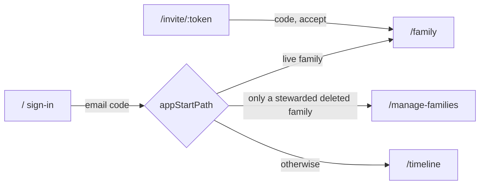
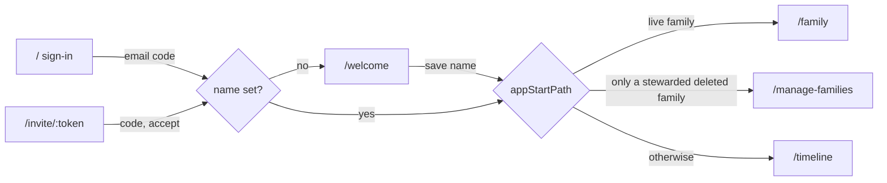

# Phase 8: Accounts — Index

> **For agentic workers:** This is the Phase 8 index. Each slice runs on its own branch off `feature/serverpod` (the integration branch) and lands through one PR into it, after the slices it depends on have merged. 8.1 is written in full below (REQUIRED SUB-SKILL: superpowers:executing-plans or superpowers:subagent-driven-development). Every later slice row is a scope contract: its executor writes the full TDD plan at slice start (superpowers:writing-plans) as `docs/superpowers/plans/2026-11-08-phase8-<n>-<name>.md` and links it in "Status". **Stops:** 8.2 starts only after O1 is answered; 8.3S only after O3, O4 and O5 are answered and the owner's O4 prerequisites are in place; 8.4 merges only after the owner signs off copy and screenshots.

**Goal:** Scope the app's account features and account user flow, as the owner decided on 2026-11-08:
- first-run onboarding: a signed-in user without a display name picks one before using the app;
- sessions and sign-out: sign out of every device;
- more sign-in methods: Sign in with Apple and Google, beside the email code.

**Tech Stack:** Flutter 3.47.7 / Dart 3.13, Serverpod 4.1.1 (`serverpod_auth_core`, `serverpod_auth_idp_server` 4.1.1), mise, just. 8.1 adds no dependencies.

**Inputs:**
- **Owner decisions (2026-11-08), binding.** Listed below; this plan cites them as A1–A5.
- The roadmap's "Product decisions" (D1, D2, D7 and D13 are the account ones).
- `AGENTS.md` (gates, the colours guard, import rules, the copy and token approval rules, "Off limits" for secrets).

| # | Owner decision (2026-11-08) | Where it lands |
|---|---|---|
| A1 | Sign-up stays open (roadmap line 18 unchanged). | — |
| A2 | Any signed-in user without a display name must enter one before using the app. The name is required and there's no skip. This **supersedes D13** for display names; the email local part stays only as the linked-person fallback until the name is saved. | 8.1 |
| A3 | Phase 8 scope: onboarding (8.1), sessions and sign-out (8.2), Sign in with Apple and Google (8.3S, 8.4). | all |
| A4 | D1 (no change-email) and D7 (no account deletion) stay in force. | — |
| A5 | 8.1 copy (the table in §8.1) is approved by the owner's approval of this plan. | 8.1 |

**Baseline at `feature/serverpod` `49c0585`:**
- app `+694 ~12` (measured for this plan with `mise exec -- just test`);
- server `+425`, live `+27`, e2e 9/9 (Phase 6 "As landed"); server measured `+432` at `49c0585`;
- analyze 6 (ceiling 6).

---

## Today (verified 2026-11-08)

- **Login:** passwordless email code only.
  - `apps/server/lib/src/auth/auth_config.dart` `configureAuth` sets up JWT plus `EmailIdpConfigFromPasswords`. The dev code is `111111`.
  - `onAfterAuthUserCreated` inserts `AppUser(authUserId)`.
  - On the client, `lib/data/otp_sign_in.dart` `ServerOtpSignIn.signIn` calls `verifyOtpLoginCode`, then `finishOtpLogin` or `finishOtpRegistration`. Sign-up happens implicitly on the first code.
- **Display name:** sign-up stores none (D13). A linked person takes its name from the email local part (`apps/server/lib/src/accounts/accounts.dart` `linkedPersonName`). `profile.saveName` (`apps/server/lib/src/endpoints/profile_endpoint.dart`) sets the name and renames every linked person; a blank name clears it.
- **Router** (`lib/app/app_router.dart`):
  - Signed out on any route except `/` and `/invite/*` goes to `/`.
  - Signed in on `/` goes to `appStartPath`: `/family` if there's a live family, `/manage-families` if the only family is a soft-deleted one the user stewards, otherwise `/timeline`.
  - `InviteSignInPage` accepts the invite, then calls `context.go(AppRoutes.familyLanding)`.
- **Sign-out:** the avatar menu's Logout (`lib/ui/album/album_header.dart`) calls `AppSession.instance.signOut()`, which is `auth.signOutDevice()`.
  - Sign-out on all devices already exists server-side. The `serverpod_auth_core` module endpoint `status.signOutAllDevices` is registered (`apps/server/lib/src/generated/endpoints.dart`), and the client has `serverClient.auth.signOutAllDevices()`.
  - Refresh-token rows (`serverpod_auth_core_jwt_refresh_token`) only store `method`, `createdAt` and `lastUpdatedAt`, with no device name.
- **Profile cache:** `lib/data/profile_session.dart` `ProfileSession` holds the signed-in user's name, email and avatar. Before 8.1, `ensureLoaded()` loaded once per user through the static `loadOwn` hook (set in `main.dart`), concurrent callers returned before the data arrived, and nothing told you whether a load succeeded.
- **Other sign-in methods:** `serverpod_auth_idp_server` 4.1.1 ships `apple`, `google` and `passkey` providers (`lib/providers/` in the pub cache).

Today's flow:



With 8.1 (`/welcome` after sign-in and after invite accept, only while the loaded profile has no name):



---

## Status

| Slice | Plan | Depends on | Status |
|---|---|---|---|
| 8.1 Welcome: pick your name | this index, §8.1 | — | in review on `feat/p8-1-welcome`: app `+705 ~12` (+11), server `+432` (unchanged), analyze 6, e2e 9/9 |
| 8.2 Sign out everywhere | written at slice start | O1 answered | not started |
| 8.3S Server: Apple and Google identity providers | written at slice start | O3, O4, O5 answered; owner prerequisites (O4) in place | not started |
| 8.4 Client: Apple and Google sign-in buttons | written at slice start | 8.3S; copy and screenshots signed off before merge | not started |
| 8.z Close | this index | all | not started |

```
8.1 ─────────────────┐
8.2 ─────────────────┤
8.3S ─► 8.4 ─────────┴─► 8.z
```

8.1, 8.2 and 8.3S can start at once (8.2 and 8.3S behind their owner questions).

---

## 8.1 Welcome: pick your name

Branch `feat/p8-1-welcome`. TDD: failing test, pass, refactor.

**Copy (approved under A5).** Constants live in `lib/features/auth/welcome_page.dart`.

| Constant | Text | Status |
|---|---|---|
| `welcomeHeading` | `Welcome to Tell Me a Story` | new (A5) |
| `welcomeBody` | `What should your family call you?` | new (A5) |
| `welcomeNameLabel` | `Your name` | new (A5) |
| `welcomeContinueLabel` | `Continue` | new (A5) |
| `welcomeSavingLabel` | `Saving…` | new (A5) |
| `welcomeNameRequired` | `Name is required` | existing text (`add_person_modal.dart`) |
| `welcomeSaveFailed` | `Couldn’t save your profile. Try again.` | existing text (`settings_page.dart`) |
| sign-out link | `useDifferentEmailLabel` from `sign_in_code_form.dart` | existing |

**Steps:**
1. **`ProfileSession` knows whether the profile loaded** (`lib/data/profile_session.dart`). `ensureLoaded()` returns one shared future per user (`_loading`), drops a result that arrives after a user switch, exposes `bool get loaded`, and clears `_loading` on failure so the next call retries. `clear()` resets both, and `bindUser` resets both whenever the bound user changes (including from none): `AlbumHeader.initState` can call `ensureLoaded()` while signed out, and that empty load must not count for the next user (found by the e2e remount between flows). Tests in `test/data/profile_session_test.dart`: concurrent loads share one request; a load that finishes after a user switch is dropped; a failed load is retried on the next call; a load made before sign-in does not count for the signed-in user.
2. **`WelcomePage`** (`lib/features/auth/welcome_page.dart`, auth feature, rank 0). A name field, Continue and "Use a different email". Continue trims the name; blank shows `Name is required` without a network call; otherwise it calls `ProfileGateway.saveName`, applies the name to `ProfileSession` and goes to `startPath()`. A failed save shows `Couldn’t save your profile. Try again.` and re-enables Continue. Album tokens only. Tests in `test/features/auth/welcome_page_test.dart` (four cases).
3. **Route and gate.** `AppRoutes.welcome = '/welcome'`. `needsWelcome()` in `lib/app/app_router.dart` awaits `ProfileSession.ensureLoaded()` and gates only when the profile loaded and its name is blank; a profile that didn't load never gates. In `redirect`, right after the signed-out rule, a signed-in user on any route except `/invite/*` goes to `/welcome` while nameless, and `/welcome` with a name goes to `appStartPath`. Invite accept is never gated; its hand-off to `/family` is then redirected to `/welcome`. Tests in `test/app/app_router_test.dart` (welcome gate group, three cases).
4. **e2e.** Every e2e run signs in fresh emails, so every flow goes through `/welcome`: `_completeWelcome` after `_enterCode` in `_signIn`, C1 and C6. C1 is renamed `C1 email-code sign-in asks for a name and lands on timeline` (and in `integration_test/flows.md`, with `M8 welcome (Phase 8 A2)` in its spec source).

**Acceptance:** `just check` green (app count `+694 ~12` plus the new tests), server gates unchanged, e2e 9/9; manual smoke: a never-used email lands on `/welcome`, a blank name is refused, a saved name lands on the start path with the header initials, `/welcome` with a name redirects away, reload doesn't gate again, and the invite path shows `/welcome` after accept.

Nameless existing accounts (all current test data included) see `/welcome` once; that's intended by A2.

---

## Later slices (scope contracts)

**8.2 Sign out everywhere.** A Settings action, behind a confirm dialog, that calls `serverClient.auth.signOutAllDevices()` through a new `AppSession.signOutAllDevices()`. No server change, because the module endpoint exists. No device list (see O2). After the call the router lands on `/`. Add an e2e flow row only if the owner asks for one.

**8.3S Server: Apple and Google identity providers.** Register `AppleIdpConfigFromPasswords` and `GoogleIdpConfigFromPasswords` (names unverified — confirm against `serverpod_auth_idp_server-4.1.1/lib/providers/{apple,google}.dart`) in `configureAuth`, add the endpoints extending the providers' base endpoints, add the `passwords.yaml` keys, add generated-code and server tests. The existing `onAfterAuthUserCreated` keeps creating `AppUser`. New sign-ups land in the 8.1 welcome gate when the provider gives no name.

**8.4 Client: Apple and Google sign-in buttons.** Apple and Google buttons on `SignInPage` and `InviteSignInPage`, through a gateway in `lib/data/` beside `otp_sign_in.dart`. New dependencies need owner approval.

---

## Owner questions

**O1 (8.2).** Where Sign out everywhere goes and its wording. Recommended: the Settings "Your profile" tab, under the account email: a button "Sign out of all devices" and a confirm dialog "Sign out everywhere? You'll need a new code on every device." Pending approval.

**O2 (8.2).** A device list would show only sign-in method and dates, because the token rows carry no device name. Recommended: don't build it.

**O3 (8.3S).** Account linking. Should Apple or Google sign-in with the same verified email as an existing email-code account become the same account? Recommended: yes. How 4.1.1 supports this is unverified — confirm first.

**O4 (8.3S/8.4).** The owner provides an Apple Developer Services ID and key, and Google OAuth client IDs (web and iOS). Secrets go only into `passwords.yaml` and Secret Manager (AGENTS "Off limits"). Approve the new dependencies (exact packages unverified — confirm first). App Store guideline 4.8 requires Apple sign-in when Google is offered on iPad.

**O5 (8.3S).** Apple's "Hide My Email" relay addresses don't match email-bound invites (D2). Recommended: keep D2; the inviter sends a link-only invite.

---

## Exit criteria for Phase 8

- Nameless signed-in users pick a name on `/welcome` before using the app (A2).
- Sign out everywhere is reachable from the approved place (O1).
- Apple and Google sign-in work beside the email code on web and iPad, with approved copy and dependencies (O3–O5).
- `just check`, `just test-live`, the e2e and CI are green. The app count is at least `+694 ~12` plus the new tests; analyze ≤ 6.

## Status: as landed

(Filled in by 8.z.)
